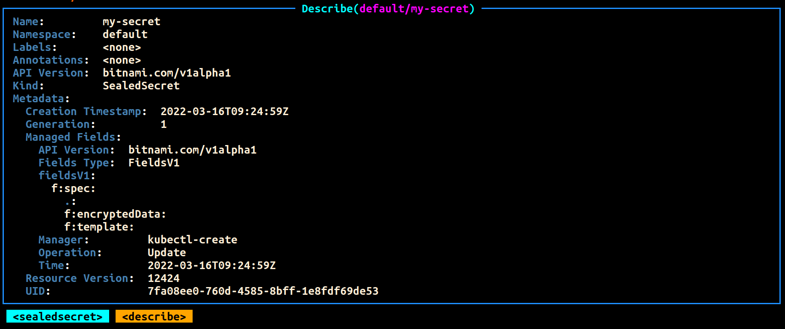
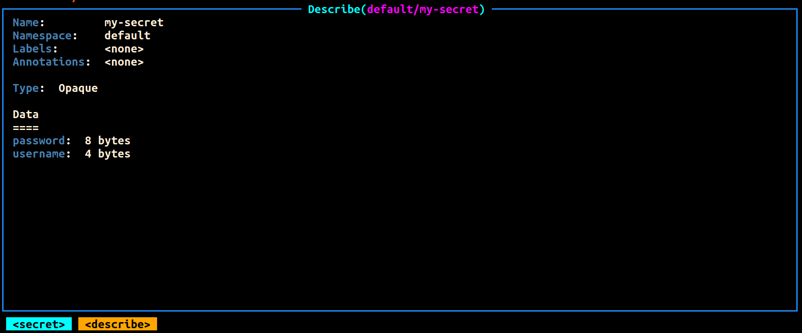
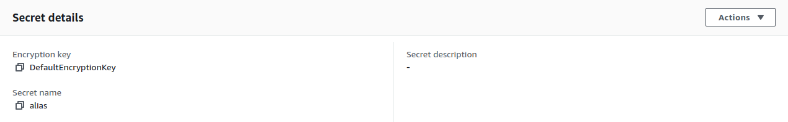
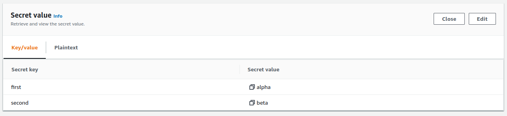
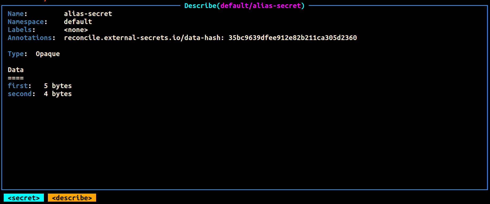
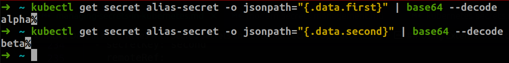
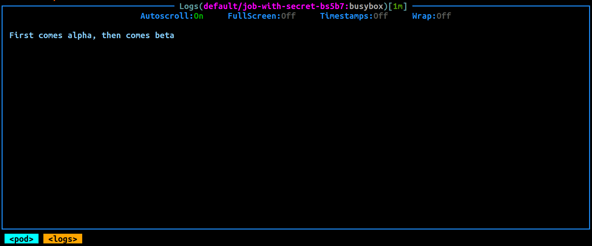

Having multiple environments that can be dynamically configured has become akin to modern software development. This is especially true in an enterprise context where the software release cycles typically consist of separate compute environments like dev, stage and production. These environments are usually distinguished by data that drives the specific behavior of the application.

For example, an application may have three different sets of database credentials for authentication (AuthN) purposes. Each set of credentials would be respective to an instance for a particular environment. This approach essentially allows software developers to interact with a developer-friendly database when carrying out their day-to-day coding. Similarly, QA testers can have an isolated stage database for testing purposes. As you would expect, the production database environment would be the real-world data store for end-users or clients.

To accomplish application configuration in Kubernetes, you can either use [ConfigMaps](https://kubernetes.io/docs/concepts/configuration/configmap/) or [Secrets](https://kubernetes.io/docs/concepts/configuration/secret/). Both serve the same purpose, except Secrets, as the name implies, are used to store very sensitive data in your Kubernetes cluster. Secrets are native Kubernetes resources saved in the cluster data store (i.e., etcd database) and can be made available to your containers at runtime.

However, using Secrets optimally isn't so straightforward. Some inherent risks exist around Secrets. Most of which stem from the fact that, by default, Secrets are stored in a non-encrypted format (base64 encoding) in the etcd datastore. This introduces the challenge of safely storing Secret manifests in repositories privately or publicly. Some security measures that can be taken include: encrypting secrets, using centralized secrets managers, limiting administrative access to the cluster, enabling encryption of data at rest in the cluster datastore and enabling TLS/SSL between the datastore and Pods.

In this post, you'll learn how to use Sealed Secrets for "one-way" encryption of your Kubernetes Secrets and how to securely access and expose sensitive data as Secrets from centralized secret management systems with the External Secrets Operator (ESO).

## Using Sealed Secrets for one-way encryption

One of the key advantages of Infrastructure as Code (IaC) is that it allows teams to store their configuration scripts and manifests in git repositories. However, because of the nature of Kubernetes Secrets, this is a huge risk because the original sensitive credentials and values can easily be derived from the base64 encoding format.

```
``` yaml

apiVersion: v1

kind: Secret

metadata:

  name: my-secret

type: Opaque

data:

  username: dXNlcg==

  password: cGFzc3dvcmQ=

```
```

Therefore, as a secure workaround, you can use Sealed Secrets. As stated above, Sealed Secrets allow for "one-way" encryption of your Kubernetes Secrets and can only be decrypted by the Sealed Secrets controller running in your target cluster. This mechanism is based on public-key encryption, a form of cryptography consisting of a public key and a private key pair. One can be used for encryption, and only the other key can be used to decrypt what was encrypted. The controller will generate the key pair, publish the public key certificate to the logs and expose it over an HTTP API request.

To use Sealed Secrets, you have to deploy the controller to your target cluster and download the kubeseal CLI tool.

- Sealed Secrets Controller - This component extends the Kubernetes API and enables lifecycle operations of Sealed Secrets in your cluster.
- kubeseal CLI Tool - This tool uses the generated public key certificate to encrypt your Secret into a Sealed Secret.

Once generated, the Sealed Secret manifests can be stored in a git repository or shared publicly without any ramifications. When you create these Sealed Secrets in your cluster, the controller will decrypt it and retrieve the original Secret, making it available in your cluster as per norm. Below is a step-by-step guide on how to accomplish this.

To carry out this tutorial, you will need to be connected to a Kubernetes cluster. For a lightweight solution on your local machine, you can use [Rancher Desktop](https://rancherdesktop.io/).

To download kubeseal, you can select the binary for your respective OS (Linux, Windows, or Mac) from the [GitHub releases page](https://github.com/bitnami-labs/sealed-secrets/releases). Below is an example for Linux.

```
``` bash

wget https://github.com/bitnami-labs/sealed-secrets/releases/download/v0.17.3/kubeseal-linux-amd64 -O kubeseal

sudo install -m 755 kubeseal /usr/local/bin/kubeseal

```
```

Installing the Sealed Secrets Controller can either be done via Helm or kubectl. This example will use the latter. This will install Custom Resource Definitions (CRDs), RBAC resources, and the controller.

```
``` bash

wget https://github.com/bitnami-labs/sealed-secrets/releases/download/v0.16.0/controller.yaml

kubectl apply -f controller.yaml

```
```

You can ensure that the relevant Pod is running as expected by executing the following command:

```
``` bash

kubectl get pods -n kube-system | grep sealed-secrets-controller

```
```

Once it is running, you can retrieve the generated public key certificate using kubeseal and store it on your local disk.

```
``` bash

kubeseal --fetch-cert > public-key-cert.pem

```
```

You can then create a Secret and seal it with kubeseal. This example will use the manifest detailed at the start of this section, but you can change the key-value pairs under the data field as you see fit.

```
``` bash

kubeseal --cert=public-key-cert.pem --format=yaml < secret.yaml > sealed-secret.yaml

```
```

The generated output will look something like this:

```
``` yaml

apiVersion: bitnami.com/v1alpha1

kind: SealedSecret

metadata:

  creationTimestamp: null

  name: my-secret

  namespace: default

spec:

  encryptedData:

    password: AgBvA5WMunIZ5rF9...

    username: AgCCo8eSORsCbeJSoRs/...

  template:

    data: null

    metadata:

      creationTimestamp: null

      name: my-secret

      namespace: default

    type: Opaque

```
```

This manifest can be used to create the Sealed Secret in your cluster with kubectl and afterward stored in a git repository without the concern of any individual accessing the original values.

[](images/image1.png)



```
``` bash

kubectl create -f sealed-secret.yaml

```
```

You can then proceed to review the secret and fetch its values.

```
``` bash

kubectl get secret my-secret -o jsonpath="{.data.user}" | base64 --decode

kubectl get secret my-secret -o jsonpath="{.data.password}" | base64 --decode

```
```

## Using External Secrets Operator (ESO) to access Centralized Secrets Managers

Another good practice for managing your Secrets in Kubernetes is to use centralized secrets managers. Secrets managers are hosted third-party platforms used to store sensitive data securely. These platforms typically offer encryption of your data at rest and expose an API for lifecycle management operations such as creating, reading, updating, deleting, or rotating secrets. In addition, they have audit logs for trails and visibility and fine-grained access control for operations of stored secrets. Examples of secrets managers include HashiCorp Vault, AWS Secrets Manager, IBM Secrets Manager, Azure Key Vault, Akeyless, Google Secrets Manager, etc. Such systems can put organizations in a better position when centralizing the management, auditing, and securing secrets. The next question is, "How do you get secrets from your secrets manager to Kubernetes?" The answer to that question is the External Secrets Operator (ESO).

The External Secrets Operator is a Kubernetes operator that enables you to integrate and read values from your external secrets management system and insert them as Secrets in your cluster. The ESO extends the Kubernetes API with the following main API resources:

- SecretStore - This is a namespaced resource that determines how your external Secret will be accessed from an authentication perspective. It contains references to Secrets that have the credentials to access the external API.
- ClusterSecretStore - As the name implies, this is a global or cluster-wide SecretStore that can be referenced from all namespaces to provide a central gateway to your secrets manager.
- ExternalSecret - This resource declares the data you want to fetch from the external secrets manager. It will reference the SecretStore to know how to access sensitive data.

Below is an example of how to access data from AWS Secrets Manager and make it available in your K8s cluster as a Secret. As a prerequisite, you will need to create an AWS account. A free-tier account will suffice for this demonstration.

You can create a secret in AWS Secrets Manager as the first step. If you've got the AWS CLI installed and configured with your AWS profile, you can use the CLI tool to create the relevant Secret.

```
``` bash

aws secretsmanager create-secret --name <name-of-secret> --description <secret-description> --secret-string <secret-value> --region <aws-region>

```
```

Alternatively, you can create the Secret using the AWS Management Console.





As you can see in the images above, my Secret is named "alias" and has the following values:

```
``` json

{

  "first": "alpha",

  "second": "beta"

}

```
```

After you've created the Secret, [create an IAM user](https://docs.aws.amazon.com/IAM/latest/UserGuide/id_users_create.html) with programmatic access and safely store the generated AWS credentials (access key ID and a secret access key). Make sure to limit this user's service and resource permissions in a custom IAM Policy.

```
``` json

{

  "Version": "2012-10-17",

  "Statement": [

    {

      "Effect": "Allow",

      "Action": [

        "secretsmanager:GetResourcePolicy",

        "secretsmanager:GetSecretValue",

        "secretsmanager:DescribeSecret",

        "secretsmanager:ListSecretVersionIds"

      ],

      "Resource": [

        "arn:aws:secretsmanager:<aws-region>:<aws-account-id>:secret:<secret-name>",

      ]

    }

  ]

}

```
```

Once that is done, you can install the ESO with Helm.

```
``` bash

helm repo add external-secrets https://charts.external-secrets.io

helm install external-secrets \

   external-secrets/external-secrets \

    -n external-secrets \

    --create-namespace

```
```

Next, you can create the Secret that the SecretStore resource will reference for authentication. You can optionally seal this Secret using the approach demonstrated in the previous section that deals with encrypting Secrets with kubeseal.

```
``` yaml

apiVersion: v1

kind: Secret

metadata:

  name: awssm-secret

type: Opaque

data:

  accessKeyID: PUtJQTl11NKTE5...

  secretAccessKey: MklVpWFl6f2FxoTGhid3BXRU1lb1...

```
```

If you seal your Secret, you should get output like the code block below.

```
``` yaml

apiVersion: bitnami.com/v1alpha1

kind: SealedSecret

metadata:

  creationTimestamp: null

  name: awssm-secret

  namespace: default

spec:

  encryptedData:

    accessKeyID: Jcl1bC6LImu5u0khVkPcNa==...

    secretAccessKey: AgBVMUQfSOjTdyUoeNu...

  template:

    data: null

    metadata:

      creationTimestamp: null

      name: awssm-secret

      namespace: default

    type: Opaque

```
```

Next, you need to create the SecretStore.

```
``` yaml

apiVersion: external-secrets.io/v1alpha1

kind: SecretStore

metadata:

  name: awssm-secretstore

spec:

  provider:

    aws:

      service: SecretsManager

      region: eu-west-1

      auth:

        secretRef:

          accessKeyIDSecretRef:

            name: awssm-secret

            key: accessKeyID

          secretAccessKeySecretRef:

            name: awssm-secret

            key: secretAccessKey

```
```

The last resource to be created is the ExternalSecret.

```
``` yaml

apiVersion: external-secrets.io/v1alpha1

kind: ExternalSecret

metadata:

  name: awssm-external-secret

spec:

  refreshInterval: 1440m

  secretStoreRef:

    name: awssm-secretstore

    kind: SecretStore

  target:

    name: alias-secret

    creationPolicy: Owner

  data:

  - secretKey: first

    remoteRef:

      key: alias

      property: first

  - secretKey: second

    remoteRef:

      key: alias

      property: second

```
```

You can then chain the creation of these resources in your cluster with the following command:

```
``` bash

kubectl create -f sealed-secret.yaml,secret-store.yaml,external-secret.yaml

```
```

After this execution, you can review the results using any of the approaches below.



```
``` bash

kubectl get secret alias-secret -o jsonpath="{.data.first}" | base64 --decode

kubectl get secret alias-secret -o jsonpath="{.data.second}" | base64 --decode

```
```



You can also create a basic Job to test its access to these external secrets values as environment variables. In a real-world scenario, make sure to apply fine-grained RBAC rules to Service Accounts used by Pods. This will limit the access that Pods have to the external secrets injected into your cluster.

```
``` yaml

apiVersion: batch/v1

kind: Job

metadata:

  name: job-with-secret

spec:

  template:

    spec:

      containers:

        - name: busybox

          image: busybox

          command: ['sh', '-c', 'echo "First comes $ALIAS_SECRET_FIRST, then comes $ALIAS_SECRET_SECOND"']

          env:

            - name: ALIAS_SECRET_FIRST

              valueFrom:

                secretKeyRef:

                  name: alias-secret

                  key: first

            - name: ALIAS_SECRET_SECOND

              valueFrom:

                secretKeyRef:

                  name: alias-secret

                  key: second

      restartPolicy: Never

  backoffLimit: 3

```
```

You can then view the logs when the Job has been completed.



##

## Conclusion

In this post, you learned that using Secrets in Kubernetes introduces risks that can be mitigated with encryption and centralized secrets managers. Furthermore, we covered how Sealed Secrets and the External Secrets Operator can be used as tools for managing your sensitive data. Alternative solutions that you can consider for encryption and management of your Secrets in Kubernetes are Mozilla SOPS and Helm Secrets. If you're interested in a video walk-through of this post, you can watch the video below.

https://youtu.be/FD8zzHPbhoY

### Let's continue the conversation! [Join the SUSE & Rancher Community](https://community.suse.com/), where you can further your Kubernetes knowledge and share your experience.
