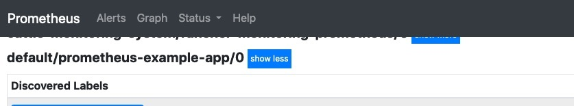
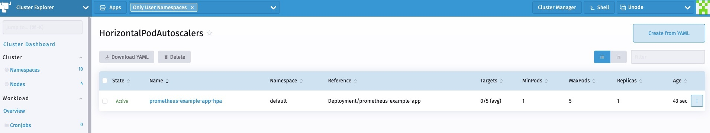

Discover what’s new in Rancher 2.5[Learn More](https://www.rancher.com/products)

We dedicate a lot of space in our blog to the topic of monitoring. That’s because when you’re managing Kubernetes clusters, things can change quickly. It’s important that you have tools to monitor the health and resource metrics of your clusters.

In Rancher 2.5, we introduced a new version of our monitoring based on the [Prometheus Operator](https://github.com/prometheus-operator/prometheus-operator), which provides Kubernetes-native deployment and management of Prometheus and related monitoring components. Prometheus operator lets you monitor the state and processes of your cluster nodes, Kubernetes components and application workloads. It also defines alerts based on metrics collected via Prometheus and creates custom dashboards to make it easy to visualize collected metrics via Grafana. Get more details on the new monitoring components [here](https://rancher.com/docs/rancher/v2.x/en/monitoring-alerting/v2.5/).

The new monitoring also rolls out the [prometheus-adapter](https://github.com/DirectXMan12/k8s-prometheus-adapter), which developers can leverage to scale their workloads based on custom metrics and Horizontal Pod Autoscalar (HPA).

In this blog, we will explore how to leverage Prometheus Operator for scraping custom metrics and leveraging the same for advanced workload management.

## Install Prometheus

Installing Prometheus from Rancher 2.5 is straightforward. Just visit **Cluster Explorer** -> **Apps** and install `rancher-monitoring`.


You need to be aware of these defaults:

- `prometheus-adapter` is enabled as part of the chart installation.
- `ServiceMonitorNamespaceSelector` is left empty, allowing Prometheus to scrape ServiceMonitors in all namespaces.


Once installation is complete, we can access the monitoring components from **Cluster Explorer**.


## Deploy Workload

Now let’s deploy a sample workload that exposes custom metrics from the application layer. The workload exposes a simple application that has been instrumented using the Prometheus client\_golang libraries and serves up some custom metrics at `/metric` endpoint.

It serves two metrics:

- http\_requests\_total
- http\_request\_duration\_seconds

The following manifest deploys the workload, the associated service and ingress to access this workload.

```
apiVersion: apps/v1
kind: Deployment
metadata:
  labels:
    app.kubernetes.io/name: prometheus-example-app
  name: prometheus-example-app
spec:
  replicas: 1
  selector:
    matchLabels:
      app.kubernetes.io/name: prometheus-example-app
  template:
    metadata:
      labels:
        app.kubernetes.io/name: prometheus-example-app
    spec:
      containers:
      - name: prometheus-example-app
        image: gmehta3/demo-app:metrics
        ports:
        - name: web
          containerPort: 8080
---
apiVersion: v1
kind: Service
metadata:
  name: prometheus-example-app
  labels:
    app.kubernetes.io/name: prometheus-example-app
spec:
  selector:
    app.kubernetes.io/name: prometheus-example-app
  ports:
    - protocol: TCP
      port: 8080
      targetPort: 8080
      name: web
---
apiVersion: networking.k8s.io/v1beta1
kind: Ingress
metadata:
    name: prometheus-example-app
spec:
    rules:
    - host: hpa.demo
      http:
        paths:
        - path: /
          backend:
            serviceName: prometheus-example-app
            servicePort: 8080
```

## Deploy ServiceMonitor

The ServiceMonitor is a custom resource definition (CRD) that allows us to declaratively define how a dynamic set of services should be monitored.

You can check out the full spec for ServiceMonitor [here](https://github.com/prometheus-operator/prometheus-operator/blob/master/Documentation/api.md#servicemonitor).

Now let’s deploy ServiceMonitor, which Prometheus uses to scrape the pods that make up the prometheus-example-app Kubernetes service.

```
apiVersion: monitoring.coreos.com/v1
kind: ServiceMonitor
metadata:
  name: prometheus-example-app
spec:
  selector:
    matchLabels:
      app.kubernetes.io/name: prometheus-example-app
  endpoints:
  - port: web
```

As you can see, now users can browse the ServiceMonitor in Rancher Monitoring.


In a short while, the new service monitor and pods associated with the service should be reflected in the Prometheus service discovery.



We can also view the metrics in Prometheus.


## Deploy Grafana Dashboard

Monitoring in Rancher 2.5 allows users to store Grafana dashboards as ConfigMaps in the `cattle-dashboards` namespace.

Users/Cluster admins can now add more dashboards in this namespace to extend Grafana to have custom dashboards.

```
Dashboard ConfigMap Example
```

```
apiVersion: v1
kind: ConfigMap
metadata:
  name: prometheus-example-app-dashboard
  namespace: cattle-dashboards
  labels:
    grafana_dashboard: "1"
data:
  prometheus-example-app.json: |
    {
    "annotations": {
        "list": [
        {
            "builtIn": 1,
            "datasource": "-- Grafana --",
            "enable": true,
            "hide": true,
            "iconColor": "rgba(0, 211, 255, 1)",
            "name": "Annotations & Alerts",
            "type": "dashboard"
        }
        ]
    },
    "editable": true,
    "gnetId": null,
    "graphTooltip": 0,
    "links": [],
    "panels": [
        {
        "aliasColors": {},
        "bars": false,
        "dashLength": 10,
        "dashes": false,
        "datasource": null,
        "fieldConfig": {
            "defaults": {
            "custom": {}
            },
            "overrides": []
        },
        "fill": 1,
        "fillGradient": 0,
        "gridPos": {
            "h": 9,
            "w": 12,
            "x": 0,
            "y": 0
        },
        "hiddenSeries": false,
        "id": 2,
        "legend": {
            "avg": false,
            "current": false,
            "max": false,
            "min": false,
            "show": true,
            "total": false,
            "values": false
        },
        "lines": true,
        "linewidth": 1,
        "nullPointMode": "null",
        "percentage": false,
        "pluginVersion": "7.1.5",
        "pointradius": 2,
        "points": false,
        "renderer": "flot",
        "seriesOverrides": [],
        "spaceLength": 10,
        "stack": false,
        "steppedLine": false,
        "targets": [
            {
            "expr": "rate(http_requests_total{code="200",service="prometheus-example-app"}[5m])",
            "instant": false,
            "interval": "",
            "legendFormat": "",
            "refId": "A"
            }
        ],
        "thresholds": [],
        "timeFrom": null,
        "timeRegions": [],
        "timeShift": null,
        "title": "http_requests_total_200",
        "tooltip": {
            "shared": true,
            "sort": 0,
            "value_type": "individual"
        },
        "type": "graph",
        "xaxis": {
            "buckets": null,
            "mode": "time",
            "name": null,
            "show": true,
            "values": []
        },
        "yaxes": [
            {
            "format": "short",
            "label": null,
            "logBase": 1,
            "max": null,
            "min": null,
            "show": true
            },
            {
            "format": "short",
            "label": null,
            "logBase": 1,
            "max": null,
            "min": null,
            "show": true
            }
        ],
        "yaxis": {
            "align": false,
            "alignLevel": null
        }
        },
        {
        "aliasColors": {},
        "bars": false,
        "dashLength": 10,
        "dashes": false,
        "datasource": null,
        "description": "",
        "fieldConfig": {
            "defaults": {
            "custom": {}
            },
            "overrides": []
        },
        "fill": 1,
        "fillGradient": 0,
        "gridPos": {
            "h": 8,
            "w": 12,
            "x": 0,
            "y": 9
        },
        "hiddenSeries": false,
        "id": 4,
        "legend": {
            "avg": false,
            "current": false,
            "max": false,
            "min": false,
            "show": true,
            "total": false,
            "values": false
        },
        "lines": true,
        "linewidth": 1,
        "nullPointMode": "null",
        "percentage": false,
        "pluginVersion": "7.1.5",
        "pointradius": 2,
        "points": false,
        "renderer": "flot",
        "seriesOverrides": [],
        "spaceLength": 10,
        "stack": false,
        "steppedLine": false,
        "targets": [
            {
            "expr": "rate(http_requests_total{code!="200",service="prometheus-example-app"}[5m])",
            "interval": "",
            "legendFormat": "",
            "refId": "A"
            }
        ],
        "thresholds": [],
        "timeFrom": null,
        "timeRegions": [],
        "timeShift": null,
        "title": "http_requests_total_not_200",
        "tooltip": {
            "shared": true,
            "sort": 0,
            "value_type": "individual"
        },
        "type": "graph",
        "xaxis": {
            "buckets": null,
            "mode": "time",
            "name": null,
            "show": true,
            "values": []
        },
        "yaxes": [
            {
            "format": "short",
            "label": null,
            "logBase": 1,
            "max": null,
            "min": null,
            "show": true
            },
            {
            "format": "short",
            "label": null,
            "logBase": 1,
            "max": null,
            "min": null,
            "show": true
            }
        ],
        "yaxis": {
            "align": false,
            "alignLevel": null
        }
        }
    ],
    "schemaVersion": 26,
    "style": "dark",
    "tags": [],
    "templating": {
        "list": []
    },
    "time": {
        "from": "now-15m",
        "to": "now"
    },
    "timepicker": {
        "refresh_intervals": [
        "5s",
        "10s",
        "30s",
        "1m",
        "5m",
        "15m",
        "30m",
        "1h",
        "2h",
        "1d"
        ]
    },
    "timezone": "",
    "title": "prometheus example app",
    "version": 1
    }
```

Users should now be able to access the “prometheus example app” dashboard in Grafana.


### HPA with Custom Metrics

This section assumes the `prometheus-adapter` was installed as part of the monitoring installation.

Monitoring by default installs the prometheus-adapter.

Users can now create a HPA spec as follows:

```
apiVersion: autoscaling/v2beta2
kind: HorizontalPodAutoscaler
metadata:
  name: prometheus-example-app-hpa
spec:
  scaleTargetRef:
    apiVersion: apps/v1
    kind: Deployment
    name: prometheus-example-app
  minReplicas: 1
  maxReplicas: 5
  metrics:
  - type: Object
    object:
        describedObject:
            kind: Service
            name: prometheus-example-app
        metric:
            name: http_requests
        target:
            averageValue: "5"
            type: AverageValue
```

More details about HPA are available [here](https://kubernetes.io/docs/tasks/run-application/horizontal-pod-autoscale/)

We’ll use the custom http\_requests\_total metric to perform pod autoscaling.



Now we can generate a sample load to see HPA in action. I can use `hey` for the same.

```
hey -c 10 -n 5000 http://hpa.demo
```


## Summary

In this blog, we can explored the flexibility of the new monitoring in Rancher 2.5. Developers and cluster administrators can leverage the stack to monitor their workloads, deploy visualization and leverage the advanced workload management capabilities available within Kubernetes.

Discover what’s new in Rancher 2.5[Learn More](https://www.rancher.com/products)
