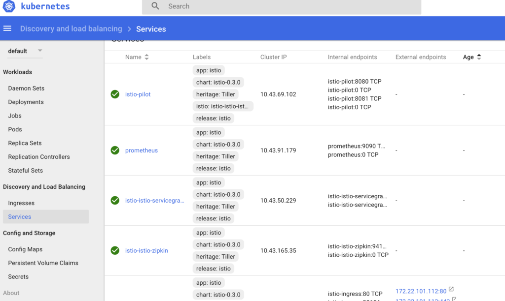
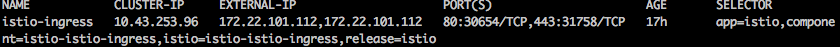
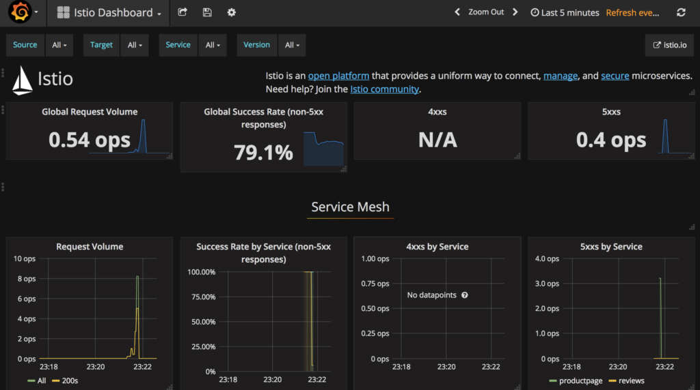

Expert Training in Kubernetes and RancherJoin our free online training sessions to learn more about Kubernetes, containers, and Rancher.[Sign up here](https://rancher.com/training/)

Update: This tutorial on Istio was updated for Rancher 2.0 here.

One of the recent open source initiatives that has caught our interest
at Rancher Labs is [*Istio*](https://istio.io/), the micro-services
development framework. It’s a great technology, combining some of the
latest ideas in distributed services architecture in an easy-to-use
abstraction. Istio does several things for you. Sometimes referred to as
a “service mesh“, it has facilities for API
authentication/authorization, service routing, service discovery,
request monitoring, request rate-limiting, and more. It’s made up of a
few modular components that can be consumed separately or as a whole.
Some of the concepts such as “circuit breakers” are so sensible I
wonder how we ever got by without them.

[Circuit breakers](http://microservices.io/patterns/reliability/circuit-breaker.html)
are a solution to the problem where a service fails and incoming
requests cannot be handled. This causes the dependent services making
those calls to exhaust all their connections/resources, either waiting
for connections to timeout or allocating memory/threads to create new
ones. The circuit breaker protects the dependent services by
“tripping” when there are too many failures in a some interval of
time, and then only after some cool-down period, allowing some
connections to retry (effectively testing the waters to see if the
upstream service is ready to handle normal traffic again).

Istio is
built with [Kubernetes](https://kubernetes.io/) in mind. Kubernetes is a
great foundation as it’s one of the fastest growing platforms for
running container systems, and has extensive community support as well
as a wide variety of tools. Kubernetes is also built for scale, giving
you a foundation that can grow with your application.

## Deploying Istio with Helm

Rancher includes and enterprise Kubernetes distribution makes it easy to
run Istio. First, fire up a Kubernetes environment on Rancher (watch
this
[demo](https://www.youtube.com/watch?v=kbsbZHCNfrg&index=2&list=PLfAoTEAPazb6s78XUwSn9VOV5vZ-M5TSC)
or see our [quickstart
guide](https://rancher.com/docs/rancher/latest/en/quick-start-guide/) for
help). Next, use the helm chart from the Kubernetes Incubator for
deploying Istio to start the framework’s components. You’ll need to
install helm, which you can do by following [this
guide](https://github.com/kubernetes/helm/blob/master/docs/install.md).
Once you have helm installed, you can add the helm chart repo from
Google to your helm client:

```
helm repo add incubator http://storage.googleapis.com/kubernetes-charts-incubator
```

Then you can simply run:

```
helm install -n istio incubator/istio
```

[](https://cdn.rancher.com/wp-content/uploads/2017/08/23130416/istio-microservices.png)
A view in kube dash of the microservices that makeup Istio
This will deploy a few micro-services that provide the functionality of
Istio. Istio gives you a framework for exchanging messages between
services. The advantage of using it over building your own is you don’t
have to implement as much “boiler-plate” code before actually writing
the business logic of your application. For instance, do you need to
implement auth or ACLs between services? It’s quite possible that your
needs are the same as most other developers trying to do the same, and
Istio offers a well-written solution that just works. Its also has a
community of developers whose focus is to make this one thing work
really well, and as you build your application around this framework, it
will continue to benefit from this innovation with minimal effort on
your part.

## Deploying an Istio Application

OK, so lets try this thing out. So far all we have is plumbing. To
actually see it do something you’ll want to deploy an Istio
application. The Istio team have put together a nice sample application
they call ”[BookInfo](https://istio.io/docs/samples/bookinfo.html)” to
demonstrate how it works. To work with Istio applications we’ll need
two things: the Istio command line client, `istioctl`, and the Istio
application templates. The `istioctl` client works in conjunction with
`kubectl` to deploy Istio applications. In this basic example,
`istioctl` serves as a preprocessor for `kubectl`, so we can dynamically
inject information that is particular to our Istio deployment.
Therefore, in many ways, you are working with normal Kubernetes resource
YAML files, just with some hooks where special Istio stuff can be
injected. To make it easier to get started, you can get both `istioctl`
and the needed application templates from this repo:
<https://github.com/wjimenez5271/rancher-istio>. Just clone it on your
local machine. This also assumes you have kubectl installed and
configured. If you need help installing that [see our
docs.](https://rancher.com/docs/rancher/v1.6/en/kubernetes/#kubectl) Now
that you’ve cloned the above repo, “cd” into the directory and run:

```
kubectl apply -f <(istioctl kube-inject -f samples/apps/bookinfo/bookinfo.yaml)
```

This deploys the kubernetes resources using kubectl while injecting some
istio specific values. It will deploy new services to K8 that will serve
the “BookInfo” application, but it will leverage the Istio services
we’ve already deployed. Once the BookInfo services finish deploying we
should be able to view the UI of the web app. We’ll need to get the
address first, we can do that by running

```
kubectl get services istio-ingress -o wide
```

This should show you the IP address of the istio ingress (under the
`EXTERNAL-IP` column). We’ll use this IP address to construct the URL to
access the application. For example, my output with my local Rancher
install looks like: [](images/rancher_blog_example-kubectl-output-getservices.png)
Example output of kubectl get services istio-ingress -o wide
The istio ingress is shared amongst your applications, and routes to the
correct service based on a URI pattern. Our application route is at
`/productpage` so our request URL would be:

```
http://$EXTERNAL_IP/productpage
```

Try loading that in your browser. If everything worked you should see
a page like this: [](https://cdn.rancher.com/wp-content/uploads/2017/08/23130532/bookinfo-istio-app.png)
Sample application “BookInfo“, built on Istio

## Built-in metrics system

Now that we’ve got our application working we can check out the built
in metrics system to see how its behaving. As you can see, Istio has
instrumented our transactions automatically just by using their
framework. Its using the Prometheus metrics collection engine, but they
set it up for you out of the box. We can visualize the metrics using
Grafana. Using the helm chart in this article, accessing the endpoint of
the Grafana pod will require setting up a local kubectl port forward
rule:

```
export POD_NAME=$(kubectl get pods --namespace default -l "component=istio-istio-grafana" -o jsonpath="{.items[0].metadata.name}")

kubectl port-forward $POD_NAME 3000:3000 --namespace default
```

You can then access Grafana at:
<http://127.0.0.1:3000/dashboard/db/istio-dashboard> [](https://cdn.rancher.com/wp-content/uploads/2017/08/23130627/grafana-dash.png)
The Grafana Dashboard with the included Istio template that highlights
useful metrics Have you developed something cool with Istio
on Rancher? If so, we’d love to hear about it. Feel free to drop us a
line on twitter [@Rancher\_Labs](https://twitter.com/rancher_labs), or
on our user slack.

Expert Training in Kubernetes and RancherJoin our free online training sessions to learn more about Kubernetes, containers, and Rancher.[Sign up here](https://rancher.com/training/)
