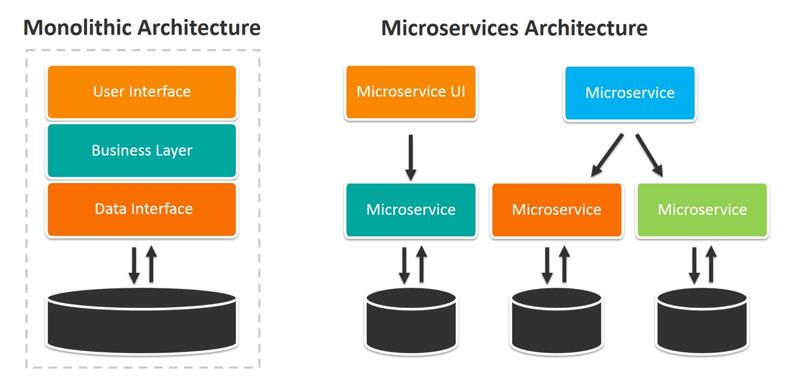
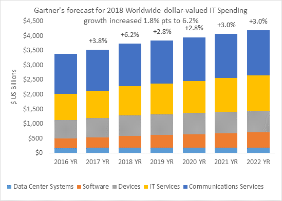

Enterprises are increasingly pressured by competitors and their own customers to get applications working and online quicker while also minimizing development costs. These divergent goals have forced enterprise IT organization to evolve rapidly. After undergoing one forced evolution after another since the 1960s, many are prepared to take the step away from monolithic application architectures to embrace the microservices approach.

#### Figure 1: Architecture differences between traditional monolithic applications and microservices

Image courtesy of [BMC](https://www.bmc.com/blogs/microservices-architecture/)

## Higher Expectations and More Empowered Customers

Customers that are used to having worldwide access to products and services now expect enterprises to quickly respond to whatever other suppliers are doing.

[CIO magazine](https://www.cio.com/article/3223871/customer-relationship-management/satisfying-the-impatient-customer.html), in reporting upon Ovum’s research, pointed out:
> “Customers now have the upper hand in the customer journey. With more ways to shop and less time to do it, they don’t just gather information and complete transactions quickly. They often want to get it done on the go, preferably on a mobile device, without having to engage in drawn-out conversations.”

## IT Under Pressure

This intense worldwide competition also forces enterprises to find new ways to cut costs or find new ways to be more efficient. Developers have seen this all before. This is just the newest iteration of the perennial call to “do more with less” that enterprise IT has faced for more than a decade. Even though IT budgets grow, they’ve learned, the investments are often in new IT services or better communications.

#### Figure 2: Forcasted 2018 worldwide IT spending growth

Source: [Gartner Market Databook, 4Q17](https://www.gartner.com/technology/research/it-spending-forecast/)

As enterprise IT organizations face pressure to respond, they have had to revisit their development processes. The traditional two-year development cycle, previously acceptable, is no longer satisfactory. There is simply no time for that now.

## A Confluence of Trends

Enterprise IT has also been forced to respond to a confluence of trends that are divergent and contradictory.

- **The introduction of inexpensive but high-performance network connectivity** that allows distributed functions to communicate with one another across the network as fast as processes previously could communicate with one another inside of a single system.
- **The introduction of powerful microprocessors** that offer mainframe-class performance in inexpensive and small packages. After standardizing on the X86 microprocessor architecture, enterprises are now being forced to consider other architectures to address their need for higher performance, lower cost, and both lower power consumption and heat production.
- **Internal system memory capacity continues to increase** making it possible to deploy large-scale applications or application components in small systems.
- **External storage use is evolving** away from the use of rotating media to solid state devices to increase capability, reduce latency, decrease overall cost, and deliver enormous capacity.
- **The evolution of open-source software and distributed computing functions** make it possible for the enterprise to inexpensively add a herd of systems when new capabilities are needed rather than facing an expensive and time-consuming forklift upgrade to expand a central host system.
- **Customers demand instant and easy access to applications and data.**

As enterprises address these trends, they soon discover that the approach that they had been relying on — focusing on making the best use of expensive systems and networks — needs to change. The most significant costs are now staffing, power, and cooling. This is in addition to the evolution they made nearly two decades ago when their focus shifted from monolithic mainframe computing to distributed, X86-based midrange systems.

## The Next Steps in a Continuing Saga

Here’s what enterprise IT has done to respond to all of these trends.

They are choosing to move from using the traditional waterfall development approach to various forms of rapid application development. They also are moving away from compiled languages to interpreted or incrementally compiled languages such as Java, Python, or Ruby to improve developer productivity.

[IDC](https://www.idc.com/downloads/IDC_Worldwide_CIO_Agenda_2019_Predictions.pdf/), for example, predicts that:
> “By 2021 65% of CIOs will expand agile/DevOps practices into the wider business to achieve the velocity necessary for innovation, execution, and change.”

Complex applications are increasingly designed as independent functions or “services” that can be hosted in several places on the network to improve both performance and application reliability. This approach means that it is possible to address changing business requirements as well as to add new features in one function without having to change anything else in parallel. [NetworkWorld’s](https://www.networkworld.com/article/3324050/data-center/10-predictions-for-the-data-center-and-the-cloud-in-2019.html) Andy Patrizio pointed out in his predictions for 2019 that he expects “Microservices and serverless computing take off.”

Another important change is that these services are being hosted in geographically distributed enterprise data centers, in the cloud, or both. Furthermore, functions can now reside in a customer’s pocket or in some combination of cloud-based or corporate systems.

## What Does This Mean for You?

Addressing these trends means that enterprise developers and operations staff have to make some serious changes to their traditional approach including the following:

- **Developers must be willing to learn technologies that better fits today’s rapid application development methodology.** An experienced “student” can learn quickly through online schools. For example, [Learnpython.org](https://www.learnpython.org/) offers free courses in Python, while codecademy offers free courses in [Ruby](https://www.codecademy.com/learn/learn-ruby), [Java](https://www.codecademy.com/learn/learn-java/), and other languages.
- **They must also be willing to learn how to decompose application logic** from a monolithic, static design to a collection of independent, but cooperating, microservices. Online courses are available for this too. One example of a course designed to help developers learn to “think in microservices” comes from [IBM](https://www.coursera.org/learn/intro-ibm-microservices). Other courses are available from [Lynda.com](https://www.lynda.com/Node-js-tutorials/Advanced-Node-js-Scaling-Applications/661809-2.html).
- **Developers must adopt new tools for creating and maintaining microservices** that support quick and reliable communication between them. The use of various commercial and open-source messaging and management tools can help in this process. Rancher Labs, for example, offers open-source software for delivering Kurbernetes-as-a-service.
- **Operations professionals need to learn orchestration tools** for containers and Kubernetes to understand how they allow teams to quickly develop and improve applications and services without losing control over data and security. Operations has long been the gatekeepers for enterprise data centers. After all, they may find their positions on the line if applications slow down or fail.
- **Operations staff must allow these functions to be hosted outside of the data centers they directly control.** To make that point, analysts at [Market Research Future](https://www.marketwatch.com/press-release/cloud-microservices-market-size-2018-global-trends-industry-share-growth-drivers-business-opportunities-and-demand-forecast-to-2023-2019-02-13?siteid=bigcharts&dist=bigcharts) recently published a report saying that, “the global cloud microservices market was valued at USD 584.4 million in 2017 and is expected to reach USD 2,146.7 million by the end of the forecast period with a CAGR of 25.0%”.
- **Application management and security issues must now be part of developers’ thinking.** Once again, online courses are available to help individuals to develop expertise in this area. [LinkedIn](https://www.linkedin.com/learning/paths/become-an-it-security-specialist), for example, offers a course in how to become an IT Security Specialist.

It is important for *both* IT *and* operations staff to understand that the world of IT is moving rapidly and everyone must be focused on upgrading their skills and enhancing their expertise.

## How Do Microservices Benefit the Enterprise?

This latest move to distributed computing offers a number of real and measurable benefits to the enterprise. Development time and cost can be sharply reduced after the IT organization incorporates this form of distributed computing. Afterwards, each service can be developed in parallel and refined as needed without requiring an entire application to be stopped or redesigned.

The development organization can focus on developer productivity and still bring new application functions or applications online quickly. The operations organization can focus on defining acceptable rules for application execution and allowing the orchestration and management tools to enforce them.

## What New Challenges Do Enterprises Face?

Like any approach to IT, the adoption of a microservices architecture will include challenges as well as benefits.

[Monitoring](/blog/2018/2018-10-18-monitoring-kubernetes/) and managing many “moving parts” can be more challenging than dealing with a few monolithic applications. The adoption of an enterprise management framework can help address these challenges. Security in this type of distributed computing needs to be top of mind as well. As the number of independent functions grows on the network, each must be analyzed and protected.

## Should All Monolithic Applications Migrate to Microservices?

Some monolithic applications can be difficult to change. This may be due to technological challenges or may be due to regulatory constraints. Some components in use today may have come from defunct suppliers, making changes difficult or impossible.

It can be both time consuming and costly for the organization to go through a complete audit process. Often, organizations continue investing in older applications much longer than is appropriate in the belief that they’re saving money.

It is possible to evaluate what an monolithic application does to learn if some individual functions can be separated and run as smaller, independent services. These can be implemented either as cloud-based services or as container-based microservices.

Rather than waiting and attempting to address older technology as a whole, it may be wise to undertake a series of incremental changes to make enhancing or replacing an established system more acceptable. This is very much like the old proverb, “the best time to plant a tree was 20 years ago. The second best time is now.”

## Is the Change Worth It?

Enterprises that have made the move towards the adoption of microservices-based application architectures have commented that their IT costs are often reduced. They also often point out that once their team mastered this approach, it was far easier and quicker to add new features and functions when market demands changed.

If your enterprise hasn’t adopted this approach, it would be wise to learn more about it. Suppliers like Rancher Labs have helped their clients safely make this journey and they may be able to help your organization.

### Go Deeper with Online Training

Get free online [training](https://rancher.com/training "Kubernetes and Rancher Online Training") on our container management software, Rancher, or continue your education with more advaned topics in the [Kubernetes master classes](https://rancher.com/kubernetes-master-class "Kubernetes Master Class Online Series").
