## Introduction

This guide will show you how to migrate your Rancher Single Node Docker install to a (HA) Kubernetes / K3s Cluster extensively.

Back when Rancher v2.0.0 was released, there were only two options for installation. Either you ran it as a Single-Node Docker container or installed it on an RKE Kubernetes cluster (an HA-cluster being the recommended way by Rancher Labs for production workloads). With the release of Rancher 2.4.0, this has been expanded to include K3s clusters and, as of v2.5.0, any CNCF-certified Kubernetes distribution is supported.

Since I was still new to Kubernetes back then and had no idea how to set up a cluster, I went with a Single Node Docker install. Up until Rancher v2.5.0, you were actually stuck with this choice. There was no way to migrate your Single-Node Docker container to a Kubernetes cluster. However, with the release of v2.5.0, migrating your Rancher installation is now officially supported using the [backup-restore-operator](https://github.com/rancher/backup-restore-operator). In this guide, I will show you all the steps I've taken to do so and explain how you, too, can migrate your Rancher installation from a single node docker install to a single node or even a highly available Kubernetes cluster.

This guide will be written with new Kubernetes/Docker/Linux users in mind, so it will be rather extensive. However, it does include advice that even more experienced users should find helpful in executing this migration. I will also avoid using any cloud services (specifically S3 buckets) that you might not have available. Let's get started!

## Essential conditions

## Right, let's start with the things you'll need to have available for you to execute this migration.

**Time:** 1 hour - 1.5 hours

**Must have:**

- Rancher 2.5.0 and up running as a single node docker install (older versions are not supported for this method, you'll have to update first.)

**Tip:** If you're not running Rancher 2.5.x yet, I highly recommend updating from the latest 2.4.x (2.4.15 as of writing) straight to v2.5.8 or higher, skipping 2.5.0-2.5.7. As of Rancher 2.5.0, rancher installs [Rancher Fleet](https://github.com/rancher/fleet) into downstream clusters, and I've found that the earlier 2.5.x versions had some issues in doing so reliably after updating. However, all my updates from v2.4.x to 2.5.8 (and up) have gone flawlessly.

- Access to the DNS records of your Rancher domain. This is ONLY required IF you're changing the IP/node. Your migrated installation is required to use the same domain as your current installation as Rancher does not support changing this.
- SSH access to the node Rancher is running on either as `root` or a user that can use `sudo` (without password, more on that later).
- Access to the `local` cluster through the UI Access to the `local` cluster through the UI. If you're not running 2.5.x yet, you probably have never seen this before. But as of 2.5.0 Rancher actually. lists the cluster on which it’s installed as `local.` This is the case even for Single-Node Docker installation as Rancher sets up a K3S cluster inside the docker container in order to run. Pretty neat huh?
- [kubectl](https://kubernetes.io/docs/tasks/tools/) (v1.20.x - v1.22.x at the time of writing) on your local machine (the one inside the Rancher Interface won't cut it here as we'll be using it once Rancher is down for the migration) - this is the Kubernetes command-line interface.
- [helm v3.2.x or higher](https://docs.helm.sh/using_helm/#installing-helm) (lower versions cause issues) - package management for Kubernetes.
- A node to install K3S on as a single node cluster (this can be the node on which Rancher is currently installed.

**Optionally:**

- An S3 bucket, preferably with a valid HTTPS certificate (can be Amazon or Minio). If you have a bucket you can use, that will make your life easier. If you have one but without a valid certificate, you can still use it, but it will not be covered in this guide on how to do so. I will however link to resources where you can find out how to do so.

**Note:** Even though [backup-restore-operator](https://github.com/rancher/backup-restore-operator) supports using different StorageClasses other than S3 for its back-ups, the documentation on using them for restores is scarce. Unless you can download the backup manually to use it for the restore later, I wouldn't recommend going down this route. If you do use a different StorageClass, make sure its Reclaim Policy is set to "Retain". This will prevent the PV from being deleted if the PVC from the `rancher-backup` chart gets deleted.

## What we'll be doing

- Make a backup of the current single-node docker install as a last resort in case stuff goes wrong (in a way that we can restore to a single-node docker install if needed).
- Install the Rancher [backup-restore-operator](https://github.com/rancher/backup-restore-operator) (BRO).
- Create a Persistent Volume for BRO to store the backup.
- Extract the back-up from the Rancher container (Because Rancher in a single node docker container runs on what's effectively a K3s cluster inside a Docker container, the notion of HostPath writing to the host is lost. As far as Rancher is concerned, the container is the host. Thus this extra step is required to obtain the backup).
- Create a one-time backup using BRO that will be used for the migration.
- Setting up a new cluster (this is optional if you already have one prepared) to migrate Rancher to. This can be your current host.
- Preparing the new cluster for restoration.
- Restore the BRO back-up, reinstall Rancher into the new cluster and verify everything works. Restoring the backup only restores the data from your Kubernetes data store, but not the actual workloads from the `local` cluster. Hence we have to reinstall Rancher after restoring the backup.
- Clean up backup-restore-operator and the persistent volume we used.
- Extra: Update Rancher to 2.6.3.

## 1. Creating a backup

Before we do anything else, let's make a backup of our current single-node docker install. That way, in case anything goes wrong, we'll have something to return to. Rancher has an excellent guide on how to do this:

<https://rancher.com/docs/rancher/v2.x/en/backups/v2.5/docker-installs/docker-backups/>

**Note:** This backup will only serve as a last resort to restore your current single-node docker install if something goes wrong. This backup can not be used to migrate your SND install to a Kubernetes cluster.

**Important:** Copy the backup from your node to your local machine or secure it elsewhere. That way if something goes horribly wrong with the node, you won't be locked out of your backup.

If you don't know how to do so, you can use `rsync`. If you've only used the older `scp` one before, the command is exactly the same, except you have to remove the `-P`. If you've used neither, just know that they're both tools capable of transferring files over SSH. No need to set up anything on your server in order to use them. The syntax for `rsync` is as follows:

`rsync [OPTIONS] user@serverIP_or_name:SourceDirectory_or_filePath Target`

Example (filled in):

`rsync -P vashiru@192.168.1.221:/home/vashiru/rancher-backup-2021-05-28.tar.gz .`

This will copy the backup from the home directory of my server to the current directory my terminal is pointed at.

## 2. Creating a Persistent Volume for BRO

For this guide, I'll assume you don't have access to an S3-compatible object store that BRO can use to store and retrieve backups. If you do have access, you can skip this step if you prefer and move on to installing a backup-restore-operator.

If you don't have S3-compatible storage, we'll have to first create a Persistent Volume for BRO to store the backups.

1. Go to your **cluster overview** and click on the `local` cluster. Our `local` is the cluster that Rancher uses under the hood and it itself is installed in.

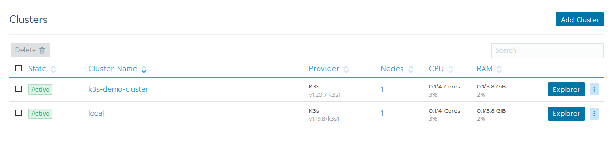

2. You should see your dashboard, in the top bar navigate to **Storage** → **Persistent Volumes**

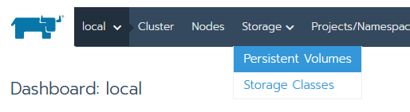

3. Click on **add v****olume,** and give it the name `rancher-backup.`For the **vo****lume plugin** select `HostPath`, and the default capacity of `10 GB` is fine (it'll be a couple of MB only). For the p**ath on the node**select `/rancher-backup`, and you must select the option  `A directory, or create if does not exist`.

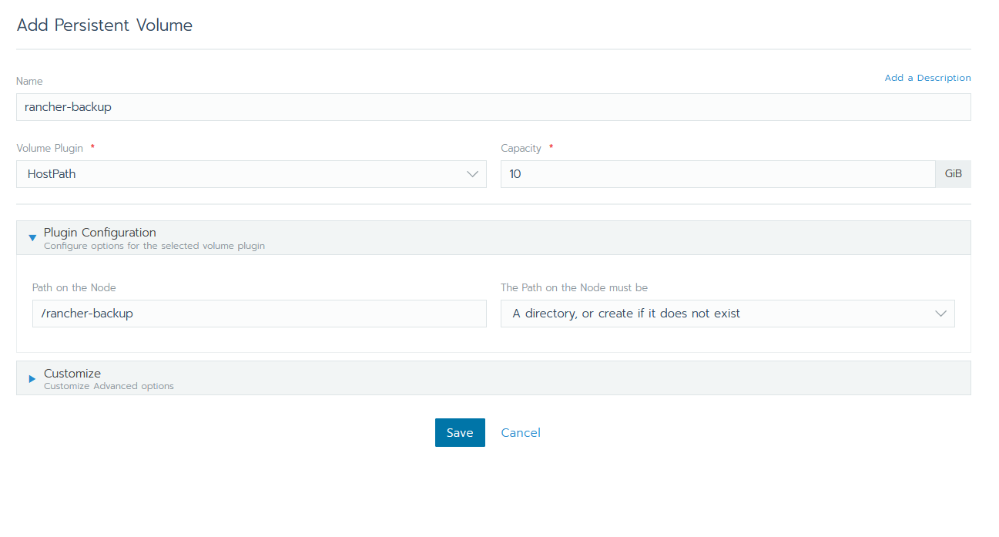

**Important:** Because Rancher as a single-node docker container runs a K3S single-node cluster inside the Docker container, the p**ath on the node** means something different here than you’d expect from the name. The node in this context is not your host system, but rather the container in which Rancher itself is running This means that right now, anything BRO would write to it, will be lost once the container gets removed. Because of this, we'll have to copy the backup out of the docker container later on in order to use it for the migration.

(Yes, alternatively you could bind-mount a folder on the host to the directory in this container. That way it'll write directly to the hard disk of your node; feel free to do so).

## 3. Installing backup-restore-operator

Installing the backup-restore operator is very straightforward. It comes as an app that you install into your local cluster through the Market Place in Cluster explorer.

1. Go to your (global) **cluster overview** and click on **explorer** behind the `local` cluster.

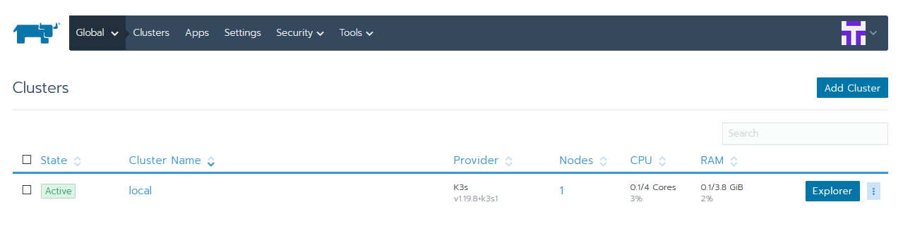

2. Open the menu on the top left and select **apps & marketplace.**

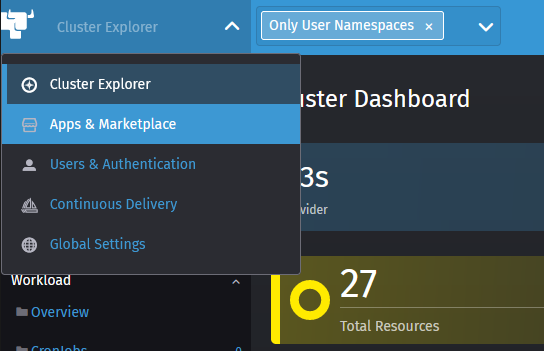

3. Locate the **Rancher backups chart** and open it.

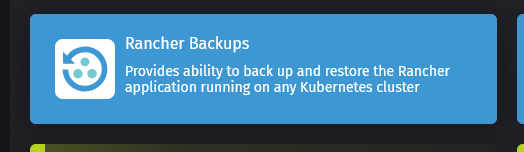

4. You'll be greeted with the following screen (though a slightly newer version, that’ll still work with this version of Rancher). On the left side, select **chart options.**

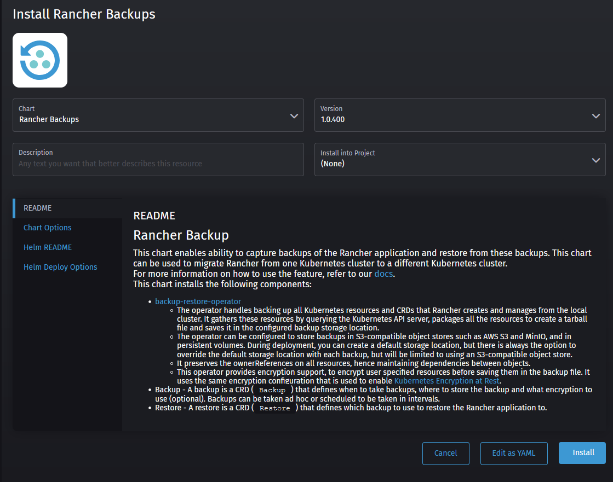

5. If you want to use your S3 compatible storage, this is where you would enter your credentials for it as well as any CA certificates in case it's self-signed. If you're using Minio, the default bucket region is `us-east-1`. More information about using an S3 bucket can be found in the [Racher docs](https://rancher.com/docs/rancher/v2.x/en/backups/v2.5/configuration/backup-config/#s3).

If not, select the "**use an existing persistent volume"** option and select our previously created `rancher-backup` PV as follows:

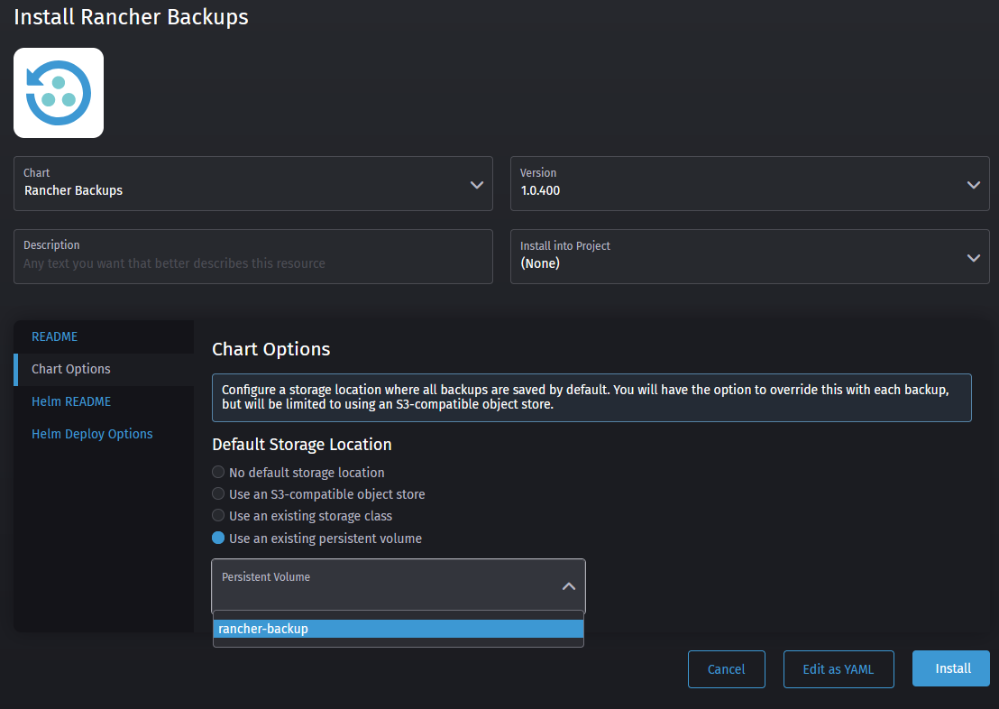

6. Click install and wait for the installation to finish. It'll install two things: first the rancher-backup-crds and secondly rancher-backups. CRDs are [custom resource definitions](https://kubernetes.io/docs/concepts/extend-kubernetes/api-extension/custom-resources/), which are extensions to the Kubernetes API. Rancher backup uses these to create the backups and then restore them.

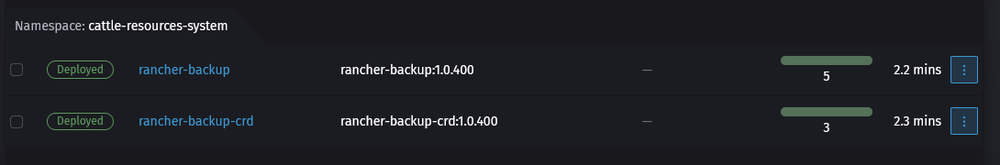

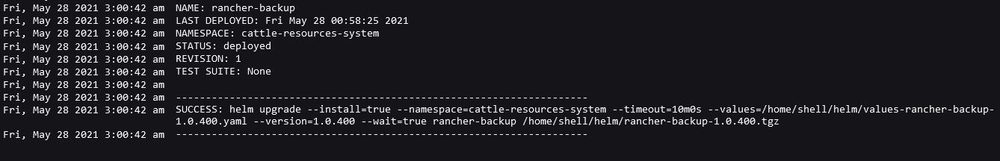

## 4. Creating a one-time backup using BRO

After we've installed BRO, it's time to create our backup. This is the backup we'll be using to actually migrate the cluster in the following steps.

1. Navigate to the **cluster explorer** of your `local` cluster like we did before and open the menu on the top left. You'll notice it has a new option called Rancher backups - that's the one we want. If you don't see it, try refreshing the page.

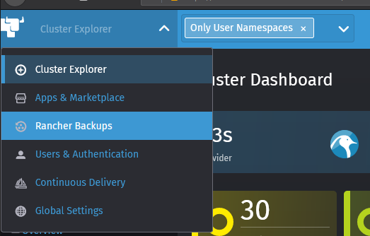

2. You'll see that there are currently no backups present, so let's go ahead and make one using the create button.

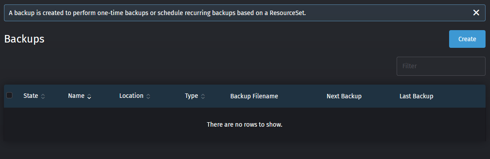

3. Let's give our backup a name, called `rancher-migrate`, and enter a description if you like. Set the **schedule** to `One-Time Backup` and set **encryption** to `Store the contents of the backup unencrypted` (we'll make it easy on us for ourselves here). You can leave the **storage location** set to `Use the default storage location configured during installation`. If you're using an S3 bucket, there is no need to enter your credentials again here. After you've done all that, go ahead and click on create to generate the backup job.

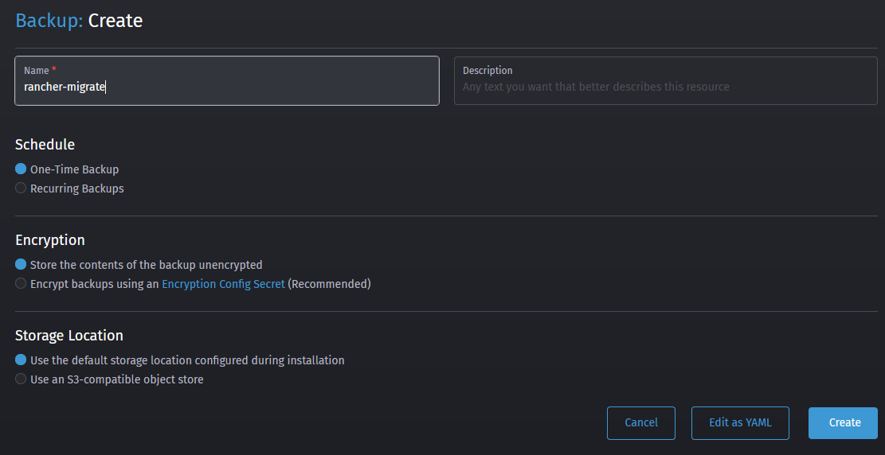

4. After you hit create, you should be returning to the backup overview. Your Rancher migrate backup job should be visible and after a few moments the state should change to **completed** and a filename should show up.

**Important:** Copy the filename to a safe location, you'll need it later.

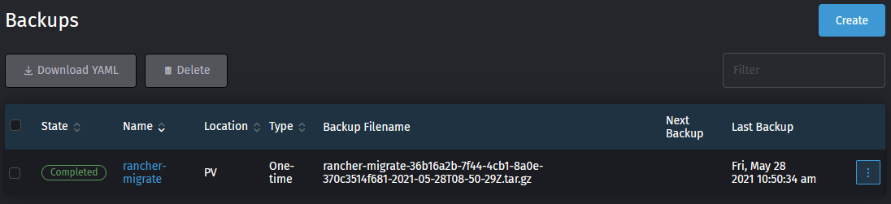

**Note:** Despite the backup-restore-operator looking very straightforward, the rest of the procedure is actually a bit difficult. You can't just go ahead, install a new cluster, add Rancher on it along with BRO, and trigger a restore from the UI on the new cluster. This will cause issues and have your restoration turn out unsuccessful. I am talking from experience here.

## 5. Extracting the BRO backup from the container for migration

If you've used the persistent volume method from this guide to perform your backup, you'll have to perform this step. If you've used an S3 bucket, you can skip this entirely. If you used a different StorageClass, go download your backup from there.

As mentioned earlier, Rancher uses a K3S cluster inside its docker container in order to run, causing the HostPath PV not to write to the host, but to the storage inside the container. This means we'll have to extract the backup from the container, in order to use it for our migration.

Luckily docker has made it very easy to do so.

1. SSH into your host.
2. Find your container or container-id using the command `sudo docker ps` for me that would be `228d9abea4f4` or `distracted_ride`.

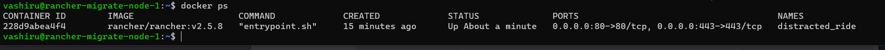

3. Use the following command to copy the backup from inside the container to a directory on your host:

`sudo docker cp <container-name>:<path_from_pv>/filename_of_backup.tar.gz .`.

In my case that would be:

`sudo docker cp distracted_ride:/rancher-backup/rancher-migrate-ceee0baa-0c4a-4b25-b15e-e554aa28f705-2021-06-01T21-04-31Z.tar.gz .`

4. You can check you've successfully extracted it using `ls -lh`.

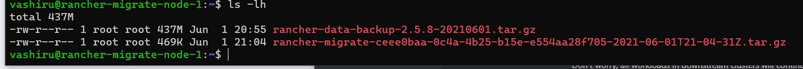

5. Just like before, let's copy this file over to our local machine using rsync, just to be safe. This step is also required if you'll be using a new cluster rather than your current host for your new Rancher installation. Do so by exiting your current host and retrieving the file with rsync.

`rsync -P vashiru@192.168.1.221:/home/vashiru/rancher-migrate-36b16a2b-7f44-4cb1-8a0e-370c3514f681-2021-05-28T08-50-29Z.tar.gz .`

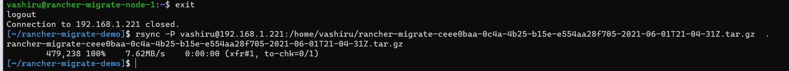

Take note of this filename, as you'll need it later to perform the restore.

## 6. Shutting down the current Rancher docker container

Now that you've created a backup of the current rancher installation and secured it to your local machine for the migration, we can shut down the current Rancher installation. Don't worry, all workloads in downstream clusters will continue to run as normal.

1. SSH into your host.
2. Find your container or container-id using the command `sudo docker ps` for me, that would be `228d9abea4f4` or `distracted_ride`.


3. Shutdown the current Rancher container using `sudo docker stop <container name>`, so for me that would be `sudo docker stop distracted_ride`. If you want you can validate that it's been shut down by running `sudo docker ps -a`. This will list all containers, including stopped ones, and you'll see their status has been changed to exit.

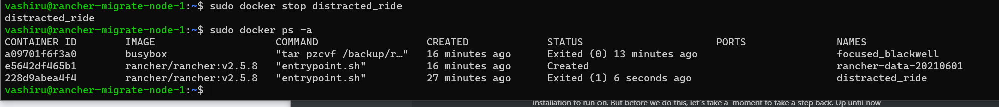

With the backup out of the way, we're about halfway there. From here on it's just a matter of setting up a Kubernetes cluster, preparing it for the restore, restoring the backup, and bringing Rancher back online. This might sound daunting at first, but I'll walk you through it.

## 7. Picking an appropriate new Kubernetes cluster

In order to perform this migration, we're going to need to create a cluster for our Rancher installation to run on. But before we do this, let's take a  moment to take a step back. Up until now you've been running Rancher as a single-node docker container. Whether this came to be due to budgetary reasons, hardware constraints, or just a short-term solution gone permanent, this is a good moment to reconsider if a single node is still sufficient for your use case.

If Rancher being available for you and perhaps other people is vital to your day-to-day operation, I would recommend setting up a highly available cluster (as does Rancher labs for production workloads). However, if Rancher having 100% uptime isn’t a concern for you (in my experience a single-node K3s cluster is very robust on its own) a single-node cluster might be plenty for you.

The last thing to consider is the future of your use case. A single-node cluster might just work for you now, but you may want to turn that into a highly available cluster down the line. If you feel like that's the case for you, you might want to look more closely at the various options available below. If the future is uncertain at this point, don’t worry, you can always migrate your cluster again using this guide.

I've listed a couple of options for Kubernetes clusters based on K3s and RKE, along with links to the documentation on how to set them up. Both K3s and RKE are fully CNCF-certified Kubernetes distributions, meaning they're fully compatible with other [Kubernetes] distributions and can utilize all the features. The main difference is how you set up your cluster and that K3S has had some in-tree storage drivers and cloud provider drivers stripped out of it.

**Single node cluster options**

- K3S cluster using the embedded SQLite database - Lightweight - can NOT be scaled to HA later; for the sake of simplicity, this will be the focus of this guide.
- [K3S cluster using the embedded etcd datastore](https://rancher.com/docs/k3s/latest/en/installation/ha-embedded/) - Resource heavy: requires a fast SSD and lots of memory due to etcd - can be scaled to a HA cluster later. If you still want this option, follow along with the installation below; you'll only have to change 1 parameter.
- [K3S cluster using an external MySQL/Postgresql/etcd datastore](https://rancher.com/docs/k3s/latest/en/installation/ha/) - Lightweight using MySQL/Postgresql, resource-heavy with etcd, but can all be scaled to a HA cluster later.
- [RKE cluster using embedded etcd datastore](https://rancher.com/docs/rke/latest/en/installation/) - requires a very fast SSD and lots of memory due to etcd, can be scaled to a HA cluster later.

**Highly available cluster options:**

- 3, 5, 7, etc. node [K3s cluster using the embedded etcd datastore](https://rancher.com/docs/k3s/latest/en/installation/ha-embedded/) - Resource-heavy: requires a fast SSD and lots of memory due to etcd. [Etcd requires quorum, so only supports an uneven number of nodes.](https://etcd.io/docs/v3.3/faq/#why-an-odd-number-of-cluster-members)
- 2-3 node [K3s cluster using an external MySQL/Postgresql/etcd datastore](https://rancher.com/docs/k3s/latest/en/installation/ha/) - Lightweight using MySQL/Postgresql, resource-heavy with etcd. Because the datastore is external, Rancher itself would already run HA on 2 nodes instead of 3. (Note that it's only truly fully HA if your database is also HA).
- 3, 5, 7 etc. nodes [RKE cluster using embedded etcd datastore](https://rancher.com/docs/rke/latest/en/installation/) - requires a very fast SSD and lots of memory due to etcd, can be scaled to a HA cluster later

If you decide one of the K3s options is best suited for your use case, you can follow along with the next step 'setting up a K3S cluster for Rancher'. Apart from setting up any Mysql/Postgres/etcd external databases, I'll cover which flags to change to use them.

## 8. Setting up a K3s cluster for Rancher

You've chosen to have your new Rancher installation run on a Kubernetes cluster based on K3s - an excellent choice! There are a couple of ways to install K3s:

- [Install script from Rancher Labs](https://rancher.com/docs/k3s/latest/en/installation/install-options/) - Manual SSH into the hosts for installation.
- [k3sup](https://github.com/alexellis/k3sup) - Installs K3s over SSH.
- [k3d](https://github.com/rancher/k3d) - Multi-node K3s cluster in Docker containers.

It's important to note that K3s out-of-the-box does not use Docker. Instead, it used the containerd container runtime. Containerd is actually fully compatible with Docker, as containerd is what Docker already uses under the hood, hidden by the fancy Docker CLI. If you prefer to keep running your containers inside Docker, that's possible with all 3 options, not just k3d.

For this guide, we'll be using k3sup to install K3s. It's my preferred way of doing so as it will automatically download the kubeconfig file to our local machine to access the cluster. Saving us a few steps.

**Important:** If you're installing Rancher on a K3s cluster running on **raspbian buster,** you'll have to follow [these steps](https://rancher.com/docs/k3s/latest/en/advanced/#enabling-legacy-iptables-on-raspbian-buster) to switch to legacy IP tables. If your cluster is Alpine Linux based, please follow [these extra steps](https://rancher.com/docs/k3s/latest/en/advanced/#additional-preparation-for-alpine-linux-setup).

1. Prepare the node(s). If you’re not using the `root` account to log in over SSH and `sudo` for the account requires any form of authentication (usually a password), disable this using this [guide](https://phpraxis.wordpress.com/2016/09/27/enable-sudo-without-password-in-ubuntudebian/). You can undo this afterward - it’s just required for k3sup to work.
2. First, download and install [k3sup](https://github.com/alexellis/k3sup#download-k3sup-tldr) for your platform of choice
3. Secondly, we will be able to install a single-node K3s cluster with just one command. This command will install K3s as a single-node Kubernetes cluster using `containerd` and the embedded `sqlite` data store. It will also store the credentials of the cluster in the current directory as `rancher-cluster.yaml` with the context name `rancher`.  If you'd rather use `docker`, prepare for HA,  or just want to use an external database in general, check the tweaks below the command.

`k3sup install --ip=<ip-of-first-node> --user=<username> --k3s-channel=v1.20 --local-path=rancher-cluster.yaml --context rancher`

**Important:** Kubernetes v1.20.x is the latest supported version of Kubernetes by Rancher v2.5.0. This is why it’s important to tell the installation to use this version rather than the latest v1.22.5 of K3s.

**Tweaks**

- **Q: I want to use Docker instead of containerd**

  Add `-k3s-extra-args='--docker'` behind the command.  I would recommend using containerd though as the [k3s-uninstall.sh](http://k3s-uninstall.sh/) script works better with it, but if you want to use docker you can. Just note that if you ever decide to uninstall k3s, you'll have to manually stop and remove the workloads in docker.
- **Q: I want to use an external Mysql/Postgresql/etcd database as a data store**

  Add `--datastore="sql-etcd-connection-string"` to the command. [Check the k3s documentation for the format of the string.](https://rancher.com/docs/k3s/latest/en/installation/ha/)
- **Q: I want to use the embedded etcd database for the HA setup**

  Add `--cluster` to the command to replace the embedded `SQLite` with `etcd` and start K3s in clustering mode.

3. After K3sup finishes installing our cluster, we want to check everything went correctly. Because we stored our `kubeconfig` in the current directory, we can't just run `kubectl get nodes` because it will look for our config in `~/.kube/config`. So in order to fix that for this terminal session, run the following command: `export KUBECONFIG=${PWD}/rancher-cluster.yaml`.
4. Now verify your cluster has been installed correctly using `kubectl get nodes`. You should get an output like this:

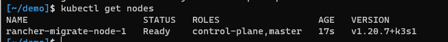

If it says "not ready", wait a few moments and run `kubectl get nodes` again.

Congratulations,  you've just installed a single-node Kubernetes cluster! ?

**Important:** If you plan on going with a HA setup, proceed with the rest of the first, then add the other nodes afterward.

## 9. Preparing the cluster for restore

Before we can proceed to restore the BRO backup (`rancher-migrate....tar.gz`), we need to prepare our cluster. Preparing the cluster will be done through the following steps:

1. Installing [cert-manager](https://cert-manager.io/docs/) (required by Rancher).
2. Creating a HostPath Persistent Volume and placing our backup in.
3. Installing backup-restore-operator.

For these steps, we're going to need [kubectl](https://kubernetes.io/docs/tasks/tools/) and [helm v3.2.x or higher](https://docs.helm.sh/using_helm/#installing-helm). If you hadn't installed helm until now, please do so.

**Important:** Do NOT install Rancher itself at this point. If you install Rancher before performing the restore, it will fail. You'll end up with duplicate resources inside the datastore that will cause all kinds of issues.

## **9.1 Installing cert-manager**

1. Make sure you use the same terminal session as you did before. By validating you still see the same nodes as before `kubectl get nodes`. If not, run the `export KUBECONFIG` command from earlier to load the right config.
2. Before we can install cert-manager, we need to tell helm where to find it. In order to do so, we'll add the jetstack (cert-manager) helm chart repositories to helm and let it download its definitions. We can do that with the following 2 commands:`helm repo add jetstack https://charts.jetstack.io``helm repo update`.

After you should see helm reload all charts from all the repositories you've added.

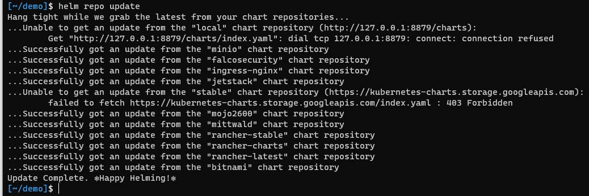

4. `cert-manager` requires a few CRDs to be installed before installing `cert-manager`itself. Technically there's a way to do it by setting a flag on the helm install as well, but the last time I did that, it didn't work. So we'll use kubectl for it:

`kubectl apply -f https://github.com/jetstack/cert-manager/releases/download/v1.6.1/cert-manager.crds.yaml`

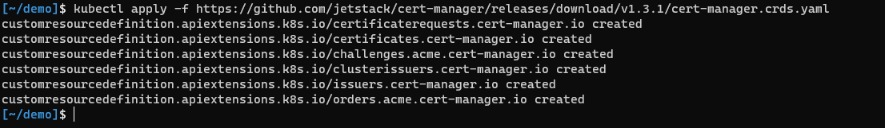

*Ignore the slight version discrepancy in the picture, the screenshots are slightly older, and the guide has been updated to use the latest version.*

5. Then we install cert-manager itself using helm.

`helm install cert-manager jetstack/cert-manager --namespace cert-manager --create-namespace --version v1.6.1`

Tip: If you add the `--create-namespace` flag when installing a helm-chart, it will create it for you as the name suggests. This saves you from having to create it manually with kubectl first.

6. Wait for a few minutes and then check that `cert-manager` has been installed correctly using `kubectl get pods -n cert-manager`. All pods should have a ready 1/1 state. If not, wait a couple of minutes and check again. If they're still not starting, check the logs using `kubectl logs <podname> -n cert-manager` to figure out what's wrong.

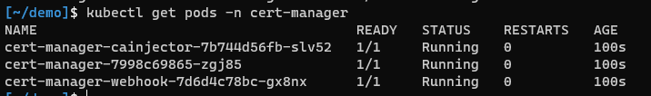

And that's the first part done; the cert-manager is now successfully installed.

## **9.2 Creating the persistent volume for our restore**

Before we can install the `backup-restore-operator` we have to create a Persistent Volume containing our backup first. This is because the backup-restore-operator can **only restore from a persistent volume if it's set as the default location upon installation.** Otherwise, it only supports S3 buckets. This is currently not very clearly stated in the documentation on the Rancher website.

If you actually used an S3 bucket for your backup and will be using that for the restore, you can skip these steps and move on with 9.3 Installing backup-restore-operator. If you used a different storage class, either grab your backup from there and use the PV method below or skip to 9.3 Installing the backup-restore-operator and tweak the installation of BRO yourself. For everyone else following this guide, just keep reading.

7. First, we must create our persistent volume to place our backup. This has to be in the same namespace as where BRO is installed, so we'll have to create both up front. Below you can find the `yaml` file to do so.

**Note:** For the `hostPath` I used `/home/vashiru/rancher-backup` - this is the actual folder in which you'll have to place your backup on the node. When we tell BRO to use this PV, it will mount that folder to `/var/lib/backups` inside the container. Due to this, you'll want it to be a separate folder on your node. As such, tweak it to your needs. The path doesn't have to exist on the node yet, we'll create it in the next few steps.

For now, just tweak the `path` under `hostPath` to your needs and save the file as `rancher-backup-ns-pv.yaml`.

```
---
apiVersion: v1
kind: Namespace
metadata:
  name: cattle-resources-system
---
apiVersion: v1
kind: PersistentVolume
metadata:
  name: rancher-backup
  namespace: cattle-resources-system
spec:
  storageClassName: manual
  capacity:
    storage: 10Gi
  accessModes:
  - ReadWriteOnce
  hostPath:
    path: /home/vashiru/rancher-backup
```

8. Now apply this file to your cluster using `kubectl apply -f rancher-backup-ns-pv.yaml`.
9. You can validate it's been deployed using `kubectl get pv`.

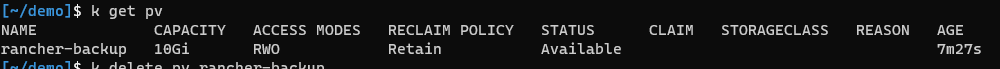

10. SSH into your node.
11. Create the directory using `mkdir -p /home/vashiru/rancher-backup`. In case you didn't know, the `-p` flag will automatically create the entire path you specify, including subdirectories.
12. If you are re-using the node you previously used to run the single node docker-container on, just copy the `rancher-migrate-<hash>-<timestamp>.tar.gz` file into the `/home/vashiru/rancher-backup`. Otherwise, use `rsync` to upload your backup to the new node.

**Example:**

`rsync rancher-migrate-<hash>-<timestamp>.tar.gz 192.168.1.221:/home/vashiru/rancher-backup/`

**Important:** Make sure you used the backup starting with `rancher-migrate-<hash>...` here. Do NOT use `rancher-data-backup`, as that's only for restoring single-node docker installations.

13. Once the backup is placed in the right directory, exit from SSH again.

## **9.3. Installing backup-restore-operator**

13. Add the `rancher-charts` helm chart repository to helm and update the definitions using:

`helm repo add rancher-charts https://charts.rancher.io`

`helm repo update`

14. Install the CRDs for the backup-restore-operator using helm:

`helm install rancher-backup-crd rancher-charts/rancher-backup-crd -n cattle-resources-system --create-namespace`

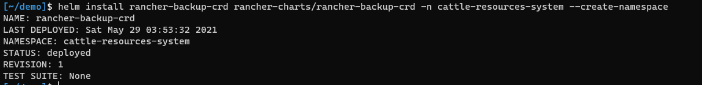

15. Next, we'll have to install the backup restore operator. If you've been following along with the guide for the persistent volume, use option A. If you're using S3, use option B.

**A. Persistent volume method:**

`helm install rancher-backup rancher-charts/rancher-backup -n cattle-resources-system --set persistence.enabled=true --set persistence.storageClass=manual --set persistence.volumeName="" --set persistence.size=10Gi`

This will change a few things in the helm chart values so that the backup-restore-operator will create a persistent volume claim that will bind our persistent volume.

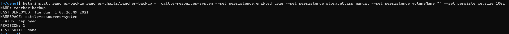

**B. S3 bucket for restore:**

`helm install rancher-backup rancher-charts/rancher-backup -n cattle-resources-system`

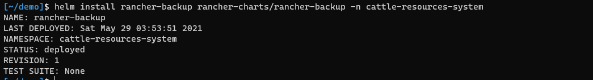

16. Validate that the PVC has been able to claim the persistent volume using `kubectl get pv`. You should see the following:

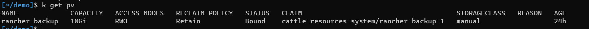

The **status** should be updated to `Bound` and the **claim** should be bound to `cattle-resources-system/rancher-backup-1`. If this is not the case, go back to 9.2 and check your steps. If needed, uninstall the helm chart and delete the PV. Deleting the PV will not delete your data inside because this is a hostPath PV.

## 10. Restoring the BRO-back-up

There are only a couple of steps left! First will be the restoration itself. The backup-restore-operator automatically monitors the `local` cluster for any objects that are being created of the `Restore` kind that uses the **apiVersion** `resources.cattle.io/v1`. When it detects such an object is created, it immediately triggers a restore.

So how do we create this `Restore` object? After all, it's not like we have the Rancher GUI to manage them. Well once again, we'll use a `yaml` file to create this and trigger the restore.

1. Depending on whether you'll be restoring from a PV or an S3 bucket. Pick one of the options below depending on how you want to trigger the restore and follow the steps there. If you follow this guide and use the persistent volume, go for option A. If you want to restore from an S3 bucket, pick option B.

**A. Restore from the persistent volume**

Replace the filename with the one that's applicable to you and save it as `restore.yaml`.

```
apiVersion: resources.cattle.io/v1
kind: Restore
metadata:
  name: rancher-migrate
spec:
  backupFilename: rancher-migrate-ceee0baa-0c4a-4b25-b15e-e554aa28f705-2021-06-01T21-04-31Z.tar.gz
```

**B. Restore using an S3 bucket**

The S3 restore requires a secret to be present for the S3 credentials, so the sample below contains both the secret, as well as the restore object in it. Replace all `<>` brackets with the values applicable to you (removing the `<>` of course) and save it as `restore.yaml`.

**Note:** The secret is specified as `stringData`, which means you can enter your accessKey and secretKey as plaintext. Normally you'd use `data` instead of `stringData`, in which case they'd have to be base64 encoded.

Friendly reminder: the default region for buckets created by Minio is `us-east-1`.

```
---
apiVersion: v1
kind: Secret
metadata:
  name: s3-creds
  namespace: cattle-resources-system
type: Opaque
stringData:
  accessKey: <your-access-key>
  secretKey: <your-secret-key>
---
apiVersion: resources.cattle.io/v1
kind: Restore
metadata:
  name: rancher-migrate
spec:
  backupFilename: rancher-migrate-ceee0baa-0c4a-4b25-b15e-e554aa28f705-2021-06-01T21-04-31Z.tar.gz
  prune: false
  storageLocation:
    s3:
      credentialSecretName: s3-creds
      credentialSecretNamespace: cattle-resources-system
      bucketName: <your-bucket-name>
      folder: <folder-on-bucket>
      region: <bucket-s3-region>
      endpoint: <hostname-to-bucket-so-without-http>
```

2. Apply your YAML file to the cluster using `kubectl apply -f restore.yaml`.
3. Use `kubectl get pods -n cattle-resources-system` to find out the name of your rancher-backup pod

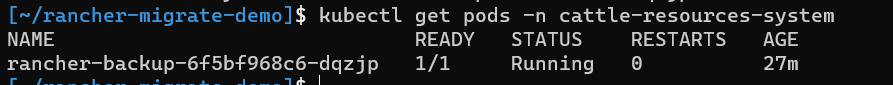

4. Use `kubectl logs <pod-name> -n cattle-resources-system -f` to monitor the logs of the container for errors. You'll see it picks up the restore and starts to process it:

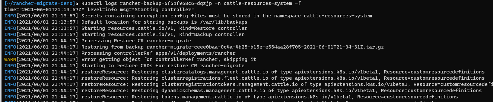

5. After a few minutes, it will finish with the message `Done Restoring`. You might see a `WARN[2021/06/01 21:46:33] Error getting object for controllerRef rancher, skipping it`, just before the end - you can ignore this.

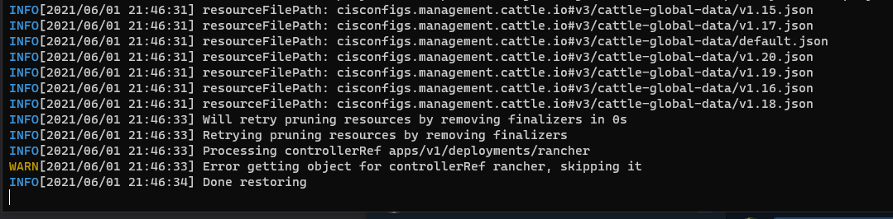

Great! Our datastore has been restored time to open our browser and. ... Nope, not yet. Two more steps to go. The datastore has been restored, but this doesn't restore our deployment of Rancher itself. We'll still have to install Rancher manually. Once installed, it will automatically detect the data already present in the datastore and use that instead of triggering a first setup procedure. Also, there's currently a bug that causes the `local-path-provisioner` to fail, so we'll have to fix that.

## 11. Fixing local-path-provisioner

There's currently an issue that after you restore Rancher, the `local-path-provisioner` will start to fail. Luckily this can easily be adjusted. This might be fixed by the time you use this guide, so we'll validate if this is the case first.

1. Let your cluster settle for a bit.
2. Use `kubectl get pods -n kube-system` to check on our `local-path-provisioner` pod. Your output will look something like this:

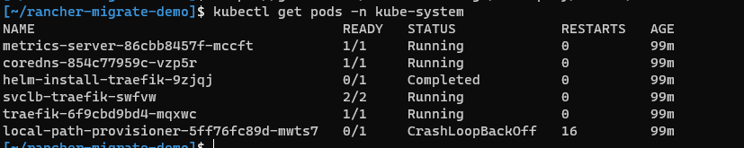

3. Check the logs of that pod using `kubectl logs <pod-name> -n kube-system`. If it returns the error below, you've been affected by [kubernetes-sigs/kubespray #7321](https://github.com/kubernetes-sigs/kubespray/issues/7321) :

`time="2021-06-01T22:51:44Z" level=fatal msg="Error starting daemon: invalid empty flag helper-pod-file and it also does not exist at ConfigMap kube-system/local-path-config with err: configmaps \"local-path-config\" is forbidden: User \"system:serviceaccount:kube-system:local-path-provisioner-service-account\" cannot get resource \"configmaps\" in API group \"\" in the namespace \"kube-system\": RBAC: [clusterrole.rbac.authorization.k8s.io](http://clusterrole.rbac.authorization.k8s.io/) \"local-path-provisioner-role\" not found"`

4. If you're affected, save the following `yaml` (credits to ledroide) to your disk ask `role-local-path.yaml`:

```
---
apiVersion: rbac.authorization.k8s.io/v1
kind: Role
metadata:
  name: local-path-provisioner-workaround
  namespace: kube-system
rules:
- apiGroups:
    - ''
  resources:
    - configmaps
  verbs:
    - get
    - list
    - watch
---
apiVersion: rbac.authorization.k8s.io/v1
kind: RoleBinding
metadata:
  name: local-path-provisioner-workaround
  namespace: kube-system
roleRef:
  apiGroup: rbac.authorization.k8s.io
  kind: Role
  name: local-path-provisioner-workaround
subjects:
- kind: ServiceAccount
  name: local-path-provisioner-service-account
```

5. Apply it to your cluster using `kubectl apply -f role-local-path.yaml`.
6. Restart the deployment using `kubectl rollout restart deployment/local-path-provisioner -n kube-system`.

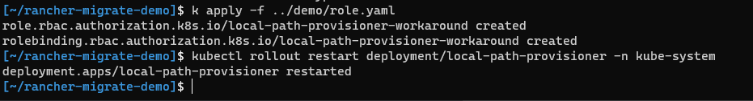

7. Run `kubectl get pods -n kube-system` to validate that the issue has been resolved.

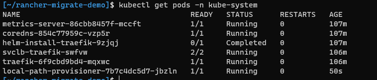

## 12. Installing Rancher on your new cluster

Almost done. This is our last step before having our beloved Rancher installation up and running, ready to manage our clusters again. We'll do some housekeeping after, but this is the last step before your cluster will be back online.

1. If you are using a new node for your cluster (ergo you switched IP addresses) update your DNS records now and have them point to your new node. If you're repurposing your old node, you can skip this.
2. Add the `rancher-stable` helm repo to the helm. This is different than the general rancher helm chart you installed earlier. You can add the `rancher-stable` repo using:

`helm repo add rancher-stable https://releases.rancher.com/server-charts/stable`

`helm repo update`

3. So before we install Rancher, we have one more decision to make. How is the HTTPS certificate going to be handled? Will you let Rancher self-generate its TLS certificate, using let's encrypt for a valid certificate, or are you bringing your own? Pick your option down below and follow the required steps:

**IMPORTANT:** your hostname MUST be the same as it was on the single node docker installation. This is what your downstream clusters will be looking for to (re)connect with Rancher.

**A. Rancher generated (self-signed) certificate**

Replace the hostname (including the brackets) to the one of your rancher cluster (without protocol etc.) and run the following command:

`helm install rancher rancher-stable/rancher --version=2.5.8 --namespace cattle-system --create-namespace --set hostname=<replace-with-your-hostname> --set replicas=1 --set ingress.tls.source=rancher`

**Note:** We're setting replicas to 1 because we only have 1 node in our cluster right now. If you’re switching to a HA cluster later on, you can update the replica count later to reflect the number of nodes.

**B. Use let's encrypt (cert-manager) to generate valid certificates (easiest)**

Replace the hostname and e-mail (including the brackets) with the ones applicable to your rancher cluster and run the following command:

`helm install rancher rancher-stable/rancher --version=2.5.8 --namespace cattle-system --create-namespace --set hostname=<replace-with-your-hostname>  --set replicas=1 --set ingress.tls.source=letsEncrypt --set letsEncrypt.email=<replace-with-your-email>`

**C. Rancher generated (self-signed) certificate**

Replace the hostname (including the brackets) with one of your clusters and run the command below. If you're using a private CA, append `--set privateCA=true` to the command. After running it, follow "[Adding TLS Certificates](https://rancher.com/docs/rancher/v2.x/en/installation/resources/encryption/tls-secrets/)" to upload them to Rancher.

`helm install rancher rancher-stable/rancher --version=2.5.8 --namespace cattle-system --create-namespace --set hostname=<replace-with-your-hostname> --set replicas=1 --set ingress.tls.source-secret`

**Note:** We're setting replicas to one because we only have 1 node in our cluster right now. If you’re switching to a HA cluster later on, you can update the replica count later to reflect the number of nodes.

**Install finished**

Once you’ve run the helm command, whichever option you’ve picked, once finished should look something like this:

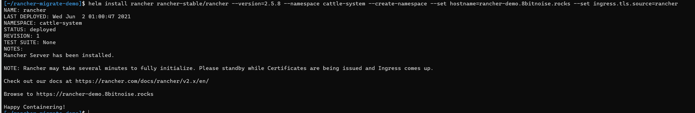

4. Whilst Rancher is deploying, take note of all the `--set` options you used in the previous step. You'll be needing those in the future when you upgrade your Rancher installation. (If you ever need to retrieve them you can use `helm get values rancher -n cattle-system > rancher-values.yaml` and it’ll export it to rancher-values.yaml).
5. Check up on the status of installation using: `kubectl -n cattle-system rollout status deploy/rancher`. After a couple of minutes (depending on your host could be 15-20 minutes) it should start informing you that the replicas are becoming available. If you see `error: deployment "rancher" exceeded its progress deadline`, you can check the status again using `kubectl -n cattle-system get deploy rancher`.

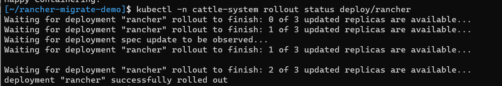

6. Once it's finished, go into your browser and navigate to your Rancher URL. You should see the Rancher GUI appear. In the case of Firefox, you might get an SSL error first if you used self-signed certificates and they changed; just refresh, and it'll go through. If you're prompted with login, the credentials are the same as they were before. Once signed in you should see your clusters.

**NOTE:** It's perfectly normal if you see some of your clusters switch a couple of times between active and unavailable at this point. After a few minutes, they should settle down, and all show up as available.

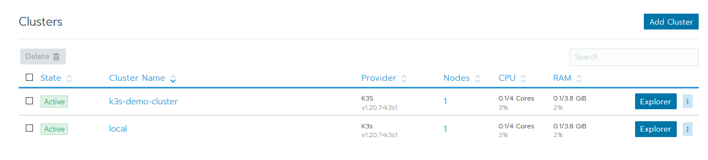

7. After migrating a cluster like this, I've noticed that the `rancher-webhook` pod might get into an infinite restart loop simply logging "unauthorized". The solution for this is deleting the actual pod. Doing so will trigger a clean restart after it will work. You can easily remove this pod with the following command:

`kubectl get pods -n cattle-system | grep 'rancher-webhook' | awk '{print $1}' | xargs kubectl delete pod -n cattle-system`

And with that out of the way, congratulations! You've just successfully migrated your Rancher single-node docker install to a single node K3S cluster.

## 12. Cleaning up

During this guide, you've created a PV and installed the backup-restore-operator into your cluster in a way that you're probably not going to want to keep using it. In order to remove those, we can run a few simple commands:

1. `helm uninstall rancher-backup -n cattle-resources-system`
2. `helm uninstall rancher-backup-crd -n cattle-resources-system`
3. `kubectl delete pv rancher-backup`

## 13. Extra: Update Rancher to 2.6.3

So we’ve migrated Rancher to our shiny new Kubernetes cluster, but you can’t help but notice that the versions we’ve migrated to are slightly outdated. Well, you’d be correct. This guide has actually been written a little while ago and I hadn’t gotten around to publishing it yet. Fortunately, this gives me the opportunity to teach you how to update and maintain your Rancher and K3s installation. So without further ado, let’s get updating.

**What we’ll be doing**

- Re-install Backup Restore Operator to take a back-up; this time it will correctly function with hostPath.
- Take a backup.
- Update Rancher using Helm along with the values we used to install it.
- Update K3s.

**Important:** If you manage any downstream clusters that run on K3s (clusters you control from inside Rancher): There’s an issue updating the Kubernetes version of those in Rancher 2.6.0-2.6.2 when upgrading Rancher from 2.5.x. It will fail because it cannot find the service account it’s looking for. This should be fixed in Rancher 2.6.3 (which was released 4 weeks ago), but if you happen to run into this issue as I did, the solution can be found in [this ticket](https://github.com/rancher/rancher/issues/35797).

**Steps:**

1. Re-install Rancher backup restore operator and take a back-up as we did in steps two through four.
2. SSH into your Rancher host machine and confirm the backup is present on the host in the directory that you specified, in this guide `/rancher-backup`.
3. When upgrading a deployment via helm, you always have to (re-)specify the values you passed for installation. Because upgrading could be adjusting the config or changing the version. The easiest way to do this is to retrieve the old values and save them to a YAML file using `helm get values rancher -n cattle-system > rancher-values.yaml`.**Note:** Helm uses the context from your kubeconfig file. If you’re updating later down the line, ensure you’ve loaded the right context. If you’ve closed your terminal since the earlier procedure, check out section eight, step three for a refresher. (And perhaps consider merging your kubeconfig. Also, I can recommend the plugins [kubectx and kubens](https://github.com/ahmetb/kubectx) for switching between contexts and namespaces.)
4. In order to update the Rancher deployment, we first have to make sure our helm repos are actually up to date. We can update these using `helm repo update`.
5. Once you’ve done that you can upgrade your Rancher deployment using `helm upgrade rancher rancher-stable/rancher -n cattle-system -f rancher-values.yaml --version 2.6.3` this will upgrade your Rancher deployment to Rancher v2.6.3 using the values you provided during the original installation. If you want to test your command before running it you can add `--dry-run` to make sure it’s all valid.

## Steps to take next

There are a couple of things I would suggest you do next:

**Take the K3s class if you're new to K3s**

If you just want to keep using your Rancher installation as a single node cluster, you can proceed in doing so. If this is your first time dealing with K3s and want to learn more about it (including backup and restore) I can recommend the free ["Up and Running: K3s" class](https://community.suse.com/courses/6599524/feed) in the SUSE & Rancher community.

**Set up a cronjob to restart K3s every 14 days to keep its certificates fresh**

K3s uses certificates internally that have a validity of 365 days. K3s renews those certificates on the restart when they're within 90 days of expiration. The easiest way to realize renewing these is to create a cronjob to restart K3s. Don't worry, your Rancher workload will actually keep running while you do this. The K3s control plane can restart independently from its workloads.

In order to create a cronjob to restart K3s every 14 days (this is in order to ensure multiple attempts before the 90 days are over in case of failure), use the following clusters:

1. SSH into your cluster.
2. Open crontab using `sudo crontab -e`, if it asks for an editor and don't know what to do, pick `nano`.
3. At the bottom of the file, add the following line:

`0 3 */14 * * sudo service k3s restart`

4. For `nano`: Hit `Ctrl+X`, hit `y` followed by enter to save the changes.
5. Your K3s will now restart every 14 days at 3 am.

**Add your other nodes and make your setup fully HA**

If you've followed this guide with the intention of migrating to a HA setup, now is the time to start adding your nodes to the cluster. Depending on your option, pick one of the following links for the next steps:

- K3s: [Create a multi-master (HA) setup using an external SQL database](https://github.com/alexellis/k3sup#create-a-multi-master-ha-setup-with-external-sql)
- K3s: [Create a multi-master (HA) setup using the embedded etcd](https://github.com/alexellis/k3sup#create-a-multi-master-ha-setup-with-embedded-etcd)
- RKE: Add your 2nd node, run `rke up`, repeat for the third.

Once you've done that, you have a multi-master setup, but your Kube-config is still pointing at only one node at a time. Also, your downstream clusters are currently getting round-robin DNS, which will fail if one of the nodes actually goes down. Depending on where you’ve chosen to host the Rancher installation there are a few solutions for this:

- Create a cloud-based TCP load balancer that redirects traffic to the individual nodes and detects when they're down.
- Install [kube-vip](https://kube-vip.io/) as a service type load-balancer and have that target your nodes using a floating IP.
- Install [metalLB](https://metallb.universe.tf/), create a service type load-balancer and use that to distribute the workloads.

## Summary

You've just migrated your Rancher single-node docker installation into a Kubernetes cluster! In doing so, you've brought upon your cluster the benefits of Kubernetes excellent lifecycle management, as well as the other benefits that come with Kubernetes. You've also future-proofed your Rancher installation since the docker installation will eventually be deprecated.

I hope you found this guide helpful in successfully migrating your Rancher installation to a Kubernetes cluster. This is the first time I've ever written a guide on anything Rancher / Kubernetes / K3s related so feedback is welcome.

I've also published this guide on my blog if you want to link to it somewhere public: <https://vashiru.tech/migrating-rancher-single-node-docker-to-a-ha-kubernetes-cluster/>.

#
