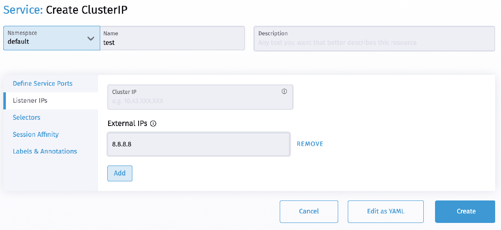
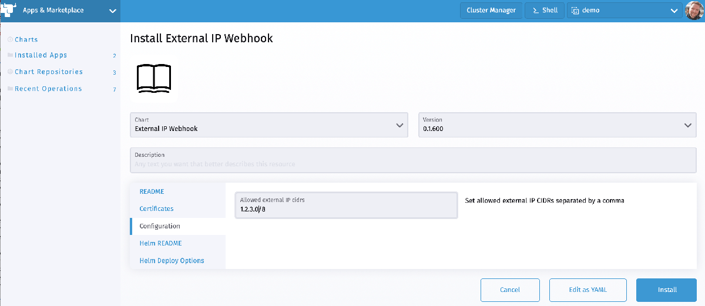
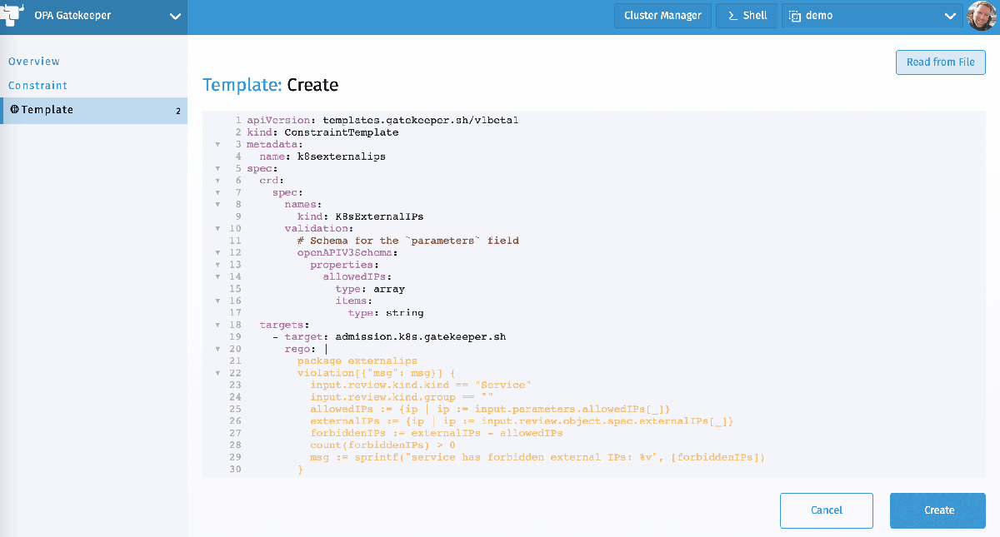
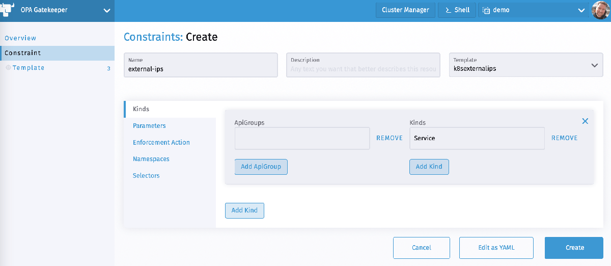
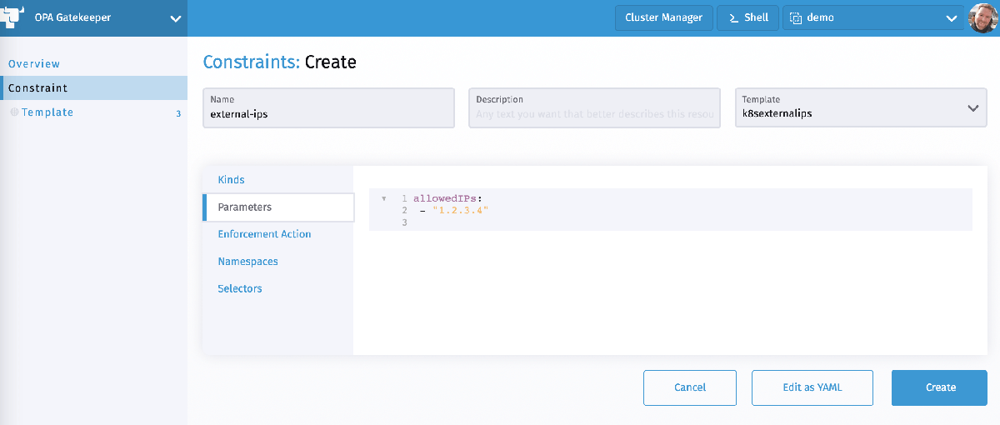
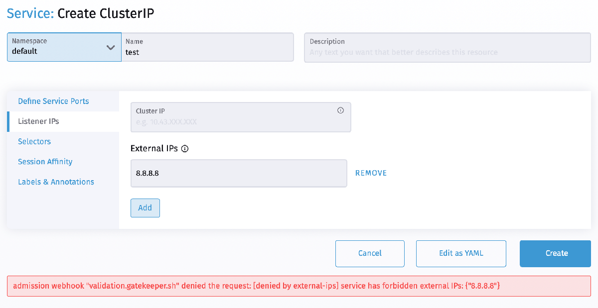

Discover what’s new in Rancher 2.5[Learn More](https://www.rancher.com/products)

Earlier this month the Kubernetes project [discovered](https://groups.google.com/g/kubernetes-announce/c/GPpZzVtGwiI) a security issue affecting multitenant clusters: If a potential attacker can already create or edit services and pods, then they may be able to intercept traffic from other pods (or nodes) in the cluster.

An attacker that is able to create a ClusterIP service and set the `spec.externalIPs` field can intercept traffic to that IP. In the following image, a malicious party would be able to intercept traffic intended for Google’s public DNS server address ‘8.8.8.8’ with a workload targeted by the ‘test’ service.



Similarly an attacker that is able to patch the status (which is considered a privileged operation and should not typically be granted to users) of a LoadBalancer service can set the `status.loadBalancer.ingress.ip` to similar effect.

This issue is a design flaw that cannot be mitigated without user-facing changes.

## Am I Vulnerable?

This issue affects all Kubernetes versions. Multitenant clusters that grant tenants the ability to create and update services and pods are most vulnerable.

## How Do I Mitigate This Vulnerability?

Per the Kubernetes announcement, there is no patch for this issue. Currently, it can only be mitigated by restricting access to the vulnerable features. Because an in-tree fix requires a breaking change, considerations for a longer-term fix or built-in mitigation are underway.

As an immediate fix, Rancher recommends two potential solutions to mitigate this vulnerability:

#### With an admission webhook

A validating admission webhook can be registered into a Kubernetes cluster and validate whether the configured external IP of a service should be allowed. Rancher makes this easy with the “External IP Webhook” Helm chart available through the App Marketplace.

During the installation, you can provide the IP cidrs that should be allowed.



Note that the webhook needs a TLS certificate to ensure secure communication between the Kubernetes API server and the webhook. The Helm chart can either use [cert-manager](https://cert-manager.io) to create one automatically or you can provide your own certificate through a Secret in the Certificates section of the installation form.

#### With an OPA Gatekeeper Constraint

Instead of deploying a dedicated admission webhook, you can use Rancher’s OPA Gatekeeper integration to allow only specific external IPs in Services.

If you haven’t already done so, install the OPA Gatekeeper Helm Chart from the Apps Marketplace. Once it is installed, you can add a new ConstraintTemplate in the OPA Gatekeeper section of the Cluster Explorer



This is the full ConstraintTemplate ([source](https://github.com/open-policy-agent/gatekeeper-library/blob/master/library/general/externalip/template.yaml)):

```
apiVersion: templates.gatekeeper.sh/v1beta1
kind: ConstraintTemplate
metadata:
  name: k8sexternalips
  annotations:
    description: "Restricts Services from containing externalIPs except those in a provided allowlist."
spec:
  crd:
    spec:
      names:
        kind: K8sExternalIPs
      validation:
        # Schema for the `parameters` field
        openAPIV3Schema:
          properties:
            allowedIPs:
              type: array
              items:
                type: string
  targets:
    - target: admission.k8s.gatekeeper.sh
      rego: |
        package k8sexternalips
        violation[{"msg": msg}] {
          input.review.kind.kind == "Service"
          input.review.kind.group == ""
          allowedIPs := {ip | ip := input.parameters.allowedIPs[_]}
          externalIPs := {ip | ip := input.review.object.spec.externalIPs[_]}
          forbiddenIPs := externalIPs - allowedIPs
          count(forbiddenIPs) > 0
          msg := sprintf("service has forbidden external IPs: %v", [forbiddenIPs])
        }
```

Now you can use this template in a new Constraint.

Create a new Constraint with the template `k8sexternalips`. Under Kinds, add an empty ApiGroup and the Kind `Service`.



Under Parameters, you can provide a list of `allowedIPs` that can be set as an external IP on a Service:



### Testing the Mitigation

Once you have the Gatekeeper constraint or the admission hook in place, test it out by adding a new Service with an external IP. This should fail if the IP is not in the list of allowed IPs.



Note that these solutions only remediate setting the external IP spec on a service.

There is another attack vector that is executed by setting LoadBalancer IPs, but since we don’t recommended users to be given permission to patch those, no remediation avenue exists other than replicating the above solutions to handle that case.

Admins should also be auditing existing services that have been patched, in addition to any existing external IPs.

Discover what’s new in Rancher 2.5[Learn More](https://www.rancher.com/products)
