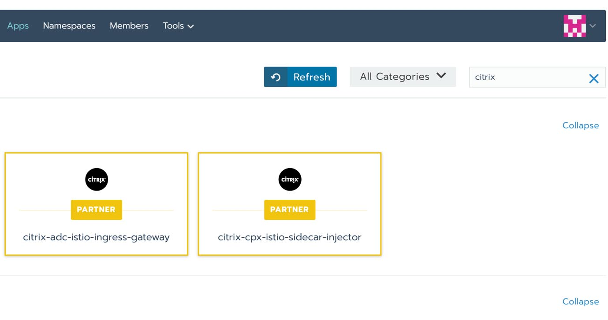

Read our free white paper: How to Build a Kubernetes Strategy [Download Now](https://more.suse.com/fy21-global-web-landing-page-how-to-build-enterprise-kubernetes-strategy) Many organizations use Kubernetes to quickly ship new features and improve the reliability of their services. Rancher enables teams to reduce the operational overhead of managing their cloud-native workloads — but getting continuous visibility into these environments can be challenging.

In this post, we’ll explore how you can quickly start monitoring orchestrated workloads with Rancher’s built-in support for Prometheus and Grafana. Then we’ll show you how integrating Datadog with Rancher can help you get even deeper visibility into these ephemeral environments with rich visualizations, algorithmic alerting, and other features.

## The Challenges of Kubernetes Monitoring

Kubernetes clusters are inherently complex and dynamic. Containers spin up and down at a blistering rate: in a [survey](https://www.datadoghq.com/container-report/#5) of more than 1.5 billion containers across thousands of organizations, Datadog found that orchestrated containers churned twice as fast (one day) as unorchestrated containers (two days).

In such fast-paced environments, monitoring your applications and infrastructure is more important than ever. Rancher includes baked-in support for open source monitoring tools like Prometheus and Grafana, allowing you to track basic health and resource metrics from your Kubernetes clusters.

Prometheus gathers metrics from Kubernetes clusters at preset intervals. While Prometheus has no visualization options, you can use Grafana’s built-in dashboards to display an overview of health and resource metrics, such as the CPU usage of your pods.

However, some open source solutions aren’t designed to keep tabs on large, dynamic Kubernetes clusters. Further, Prometheus requires users to learn [PromQL, a specialized query language](https://prometheus.io/docs/prometheus/latest/querying/basics/), to analyze and aggregate their data.

While Prometheus and Grafana can provide some level of insight into your clusters, they don’t allow you to see the full picture. For example, you’ll need to connect to one of [Rancher’s supported logging solutions](https://rancher.com/docs/rancher/v2.x/en/cluster-admin/tools/logging/) to access logs from your environment. And to troubleshoot code-level issues, you’ll also need to deploy an [application performance monitoring](https://www.suse.com/c/observability-application-performance-monitoring-guide-what-apm-is-its-challenges-and-its-benefits/) solution.

Ultimately, to fully visualize your orchestrated clusters, you need to monitor all of these sources of data — metrics, traces and logs — in one platform. By delivering detailed, actionable data to teams across your organization, a comprehensive monitoring solution can help reduce mean time to detection and resolution (MTTD and MTTR).

## The Datadog Agent: Auto-Discover and Autoscale Services

To get ongoing visibility into every layer of your Rancher stack, you need a monitoring solution specifically designed to track cloud-native environments in real time. The Datadog Agent is lightweight, open source software that gathers metrics, traces and logs from your containers and hosts, and forwards them to your account for visualization, analysis and alerting.

Because Kubernetes deployments are in a constant state of flux, it’s impossible to manually track which workloads are running on which nodes, or where your containers are running. To that end, the Datadog Agent uses [Autodiscovery](https://docs.datadoghq.com/agent/autodiscovery/) to detect when containers spin up or down, and automatically starts collecting data from your containers and the services they’re running, like etcd and Consul.

Kubernetes’ built-in autoscaling functionality can help improve the reliability of your services by automatically scaling workloads based on demand (such as a spike in CPU usage). Autoscaling also helps manage costs by rightsizing your infrastructure.

Datadog extends this feature by enabling you to autoscale Kubernetes workloads based on any metric you’re already monitoring in Datadog — including custom metrics. This can be extremely useful for scaling your cluster in response to fluctuations in demand, particularly during business-critical periods like Black Friday. Let’s say that your organization is a retailer with a bustling online presence. When sales are taking off, your Kubernetes workloads can autoscale based on a custom metric that serves as an indicator of activity, such as the number of checkouts, to ensure a seamless shopping experience. For more details about autoscaling Kubernetes workloads with Datadog, check out our [blog post](https://www.datadoghq.com/blog/autoscale-kubernetes-datadog/).

## Kubernetes-Specific Monitoring Features

Regardless of whether your environment is multi-cloud, multi-cluster or both, Datadog’s highly specialized features can help you monitor your containerized workloads in real time. [Datadog automatically enriches your monitoring data](https://www.datadoghq.com/blog/monitoring-kubernetes-with-datadog/#monitoring-kubernetes-with-tags) with tags imported from Kubernetes, Docker, cloud services and other technologies. Tags provide continuous visibility into any layer of your environment, even as individual containers start, stop or move across hosts. For example, you can search for all containers that share a common tag (e.g., the name of the service they’re running) and then use another tag (e.g., availability zone) to break down their resource usage across different regions.

Datadog collects more than 120 Kubernetes metrics that help you track everything from Control Plane health to pod-level CPU limits. All of this monitoring data can be accessed directly in the app — no query language needed.

Datadog provides several features to help you explore and visualize data from your container infrastructure. The [Container Map](https://www.datadoghq.com/blog/container-map/) provides a bird’s-eye view of your Kubernetes environment, and allows you to filter and group containers by any combination of tags, like docker\_image, host and kube\_deployment.

You can also color-code containers based on the real-time value of any resource metric, such as System CPU or RSS Memory. This allows you to quickly spot resource contention issues at a glance — for instance, if a node is consuming more CPU than others.

The Live Container view displays process-level system metrics — graphed at two-second granularity — from every container in your infrastructure. Because metrics like CPU utilization can be extremely volatile, this high level of granularity ensures that important spikes don’t get lost in the noise.

Both the Container Map and the Live Container view allow you to filter and sort containers using any combination of tags, such as image name or cloud provider. For more detail, you can also click to inspect the processes running on any individual container — and view all the metrics, logs and traces collected from that container, with a few clicks. This can help you debug issues and determine if you need to adjust your provisioning of resources.

With Datadog Network Performance Monitoring (NPM), you can track the real-time flow of network traffic across your Kubernetes deployments and quickly debug issues. By nature, Docker containers are constrained only by the amount of CPU and memory available. As a result, a single container can saturate the network and bring the entire system down.

Datadog can help you easily isolate the containers that are consuming the most network throughput and identify possible root causes by navigating to correlated logs or request traces from that service.

## Datadog + Rancher Go Together

Datadog works in tandem with Rancher, so you can use Rancher to manage diverse, orchestrated environments and deploy Datadog to monitor, troubleshoot and automatically scale them in real time.

Additionally, Watchdog, Datadog’s algorithmic monitoring engine, uncovers and alerts team members to performance anomalies (such as latency spikes or high error rates). This allows teams to get ahead of potential issues (such as an abnormally high rate of container restarts) before they escalate.

We’ve shown you how Datadog can help you get comprehensive visibility into your Rancher environment. With Datadog, engineers can use APM to identify bottlenecks in individual requests and pinpoint code-level issues, collect and analyze logs from every container across your infrastructure and more. By unifying metrics, logs and traces in one platform, Datadog removes the need to switch contexts or tools. Thus, your teams can speed up their troubleshooting workflows and leverage the full potential of Rancher as it manages vast, dynamic container fleets.

With Rancher’s [Datadog Helm chart](https://rancher.com/blog/2018/2018-07-16-how-to-deploy-datadog/), your teams can start monitoring their Kubernetes environments in minutes — with minimal onboarding. If you’re not currently a Datadog customer, sign up today for a [free 14-day trial](https://www.datadoghq.com/free-datadog-trial/).Read our free white paper: How to Build a Kubernetes Strategy [Download Now](https://more.suse.com/fy21-global-web-landing-page-how-to-build-enterprise-kubernetes-strategy)
