Discover what’s new in Rancher 2.5 [Learn More](/products/rancher/2.5) Kubernetes is increasingly becoming a uniform standard for computing – in Edge, in core and in the cloud. At NTS, we recognize this trend and have been systematically building up competencies for this core technology since 2018. As a technically-oriented business, we regularly validate different Kubernetes platforms and we share the view of many analysts (e.g. [Forrester](https://rancher.com/blog/2018/2018-10-22-forrester-rancher-leader-enterprise-container-management/) or [Gartner](https://www.gartner.com/reviews/market/cloud-management-platforms/vendor/rancher/product/rancher) and [Gartner Hype Cycle](https://rancher.com/press/2019-08-27-gartner-cycles-press-release/) Reports) that Rancher Labs ranks among the leading players in this sector. In fact, five of our employees are [Rancher certified](https://www.linkedin.com/posts/sebastian-mangelkramer-42118a139_kubernetes-rancheracademy-container-activity-6702206011454889984-nuMK) through [Rancher Academy](https://academy.rancher.com/), to maintain a close and sustainable partnership – with the best possible customer support entirely based on the premise “Relax, we care.”

## Application Performance Monitoring with AppDynamics

Kubernetes is the ideal platform to create platforms and to operate a modern infrastructure. But often, Kubernetes alone is not sufficient. Understanding the application and its requirements is necessary above all – and that’s where our partnership with Rancher comes in.

The conversion to a container-based landscape carries a risk that can be minimized with comprehensive monitoring, which *includes not only the infrastructure*, such as vCenter, server, storage or Load Balancer, *but also the business process*.

To serve this sector, we have developed competencies in the area of Application Performance Monitoring (APM) and partnered with AppDynamics. Once again, we agree with analysts such as [Gartner](https://www.appdynamics.com/blog/news/gartner-magic-quadrant-2020/) that AppDynamics is a leader in this space. We’ve achieved AppDynamics Pioneer partner status in a short amount of time thanks to our certified engineers.

## Why Monitor Kubernetes with AppDynamics?

In distributed environments, it’s easy to lose track of things using containers (they do even need to be microservices). Maintaining an overview is not a simple task, but it is absolutely necessary.

We’re seeing a huge proliferation of containers. Previously there were a few “large rocks” – the virtual machines (VMs). These large rocks are the monoliths from conventional applications. In containerized environments, fundamental topics change as well. In a monolith, “process calls” within an application happen in the same VM, within the same application. With containers, they happen via networks and APIs or Service Meshes.

An optimally instrumented APM is absolutely necessary for the operation of critical applications, which are a direct contributor to the added value of a company and to the business process.

To address this need, NTS created an integration between AppDynamics and Rancher Labs. Our goal for the integration was to maintain an overview as well and to minimize the potential risk for the user/customer. In this blog post, we’ll describe the integration and show you how it works.

## Integration Description

AppDynamics supports “full stack” monitoring from the application to the infrastructure. Rancher provides a modern platform for Kubernetes “everywhere” (edge, core, cloud). We have designed a tool to simplify monitoring of Kubernetes clusters and created a Rancher chart that is based on a [Helm](https://helm.sh/) (a package manager for Kubernetes) that is available to all Rancher users in the App Catalog.

Now we’ll show how simple it is to monitor Rancher Kubernetes clusters with AppDynamics.

### Prerequisites

- Rancher management server (Rancher)
- Kubernetes cluster with version > = 1.13
  - On premises (e.g. based on VMware vSphere)
  - or in the public cloud (e.g. based on Microsoft Azure AKS)
- AppDynamics controller/account ([free trial available](https://www.appdynamics.com/free-trial/))

## Deploying AppDynamics Cluster Agents

The [AppDynamics cluster agent](https://docs.appdynamics.com/display/PRO45/Deploy+the+Cluster+Agent+on+Kubernetes) for Kubernetes is a Docker image that is maintained by AppDynamics. The deployment of the cluster agents is largely simplified and automated by our Rancher chart. Therefore, virtually any number of Kubernetes clusters can be prepared for monitoring with AppDynamics at the touch of a button. This is an essential advantage in case of distributed applications.

We conducted our deployment in an NTS Rancher test environment. To begin, we log into the Rancher Web interface:

Next, we choose **Apps** in in the top navigation bar:

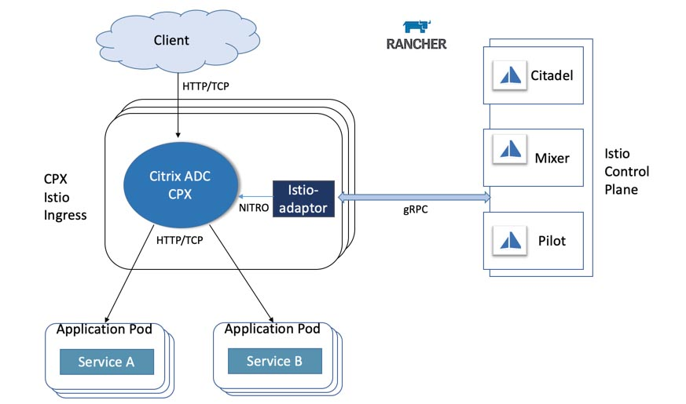

Then we click **Launch**:

Now, Rancher shows us the available applications. We choose **appdynamics-cluster-agent**:

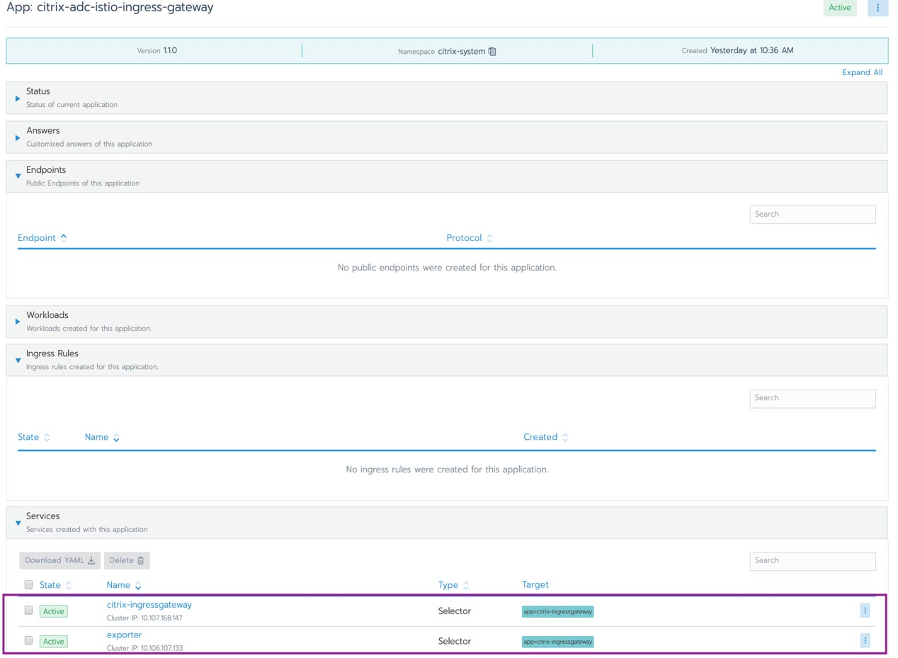

Next, we deploy the AppDynamics cluster agent:

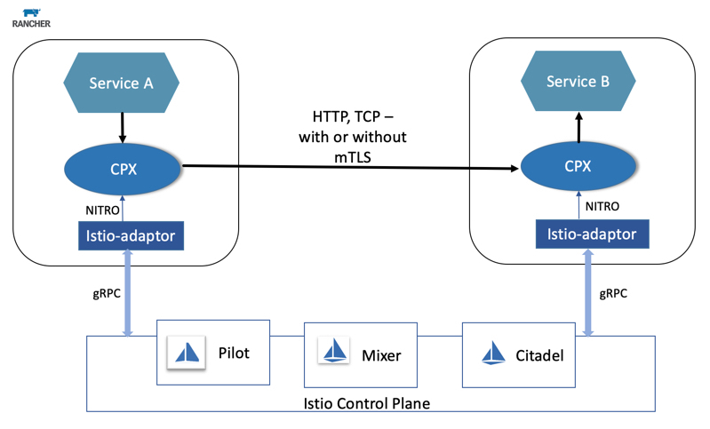

Next, choose the target Kubernetes cluster – in our case, it’s “netapp-trident.”

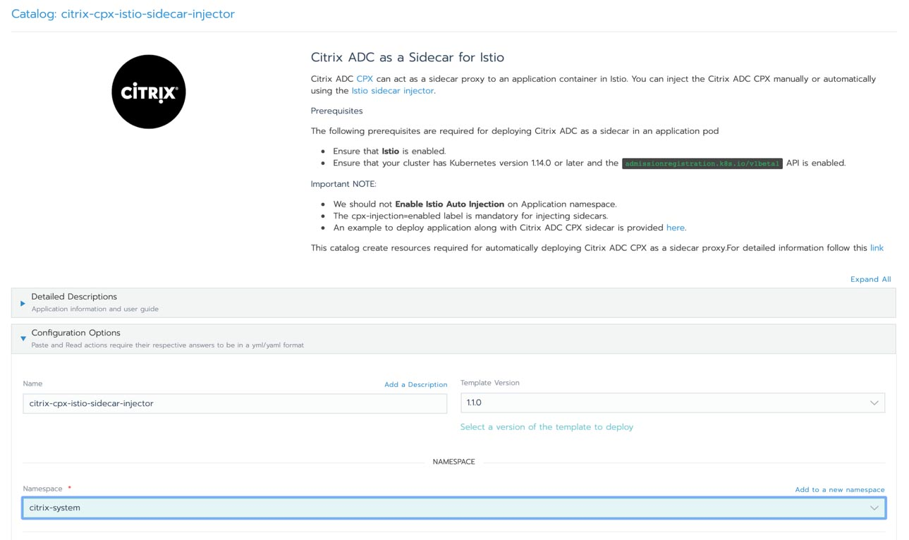

Then specify the details of the AppDynamics controller:

You can also set agent parameters via the Rancher chart.

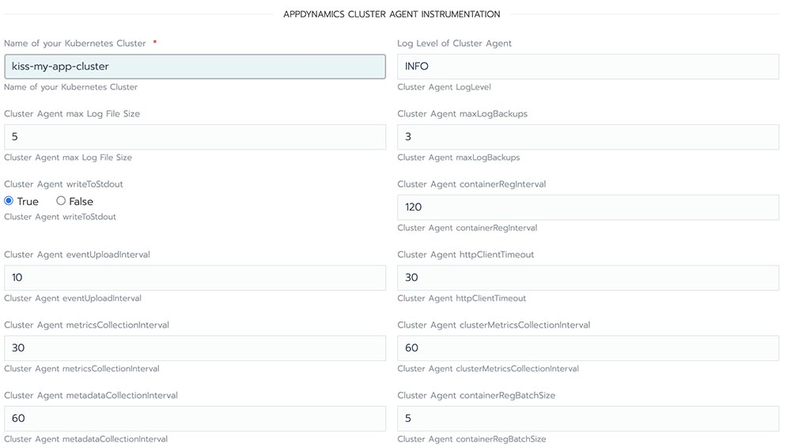

Finally, click **Launch**

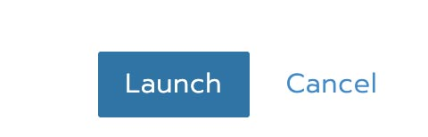

and Rancher will install the AppDynamics cluster agent in the target clusters:

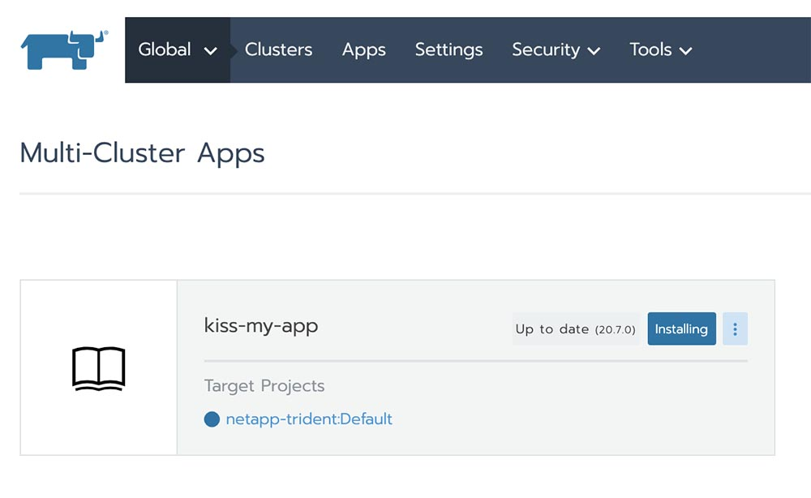

After a few minutes, we’ll see a successful deployment:

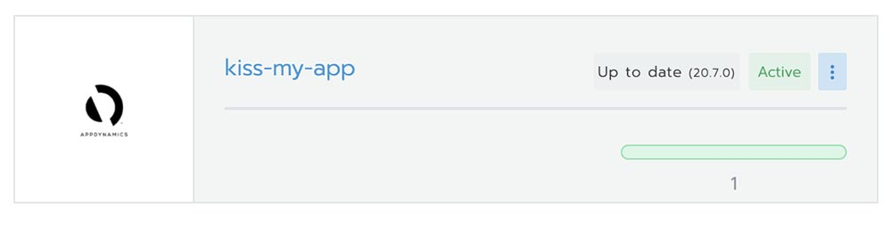

### Instrumentation of the AppDynamics Cluster Agent

After a few minutes, the deployed cluster agent shows up in the AppDynamics controller. To find it, select **Admin** → **AppDynamics Agents** → **Cluster Agents**:

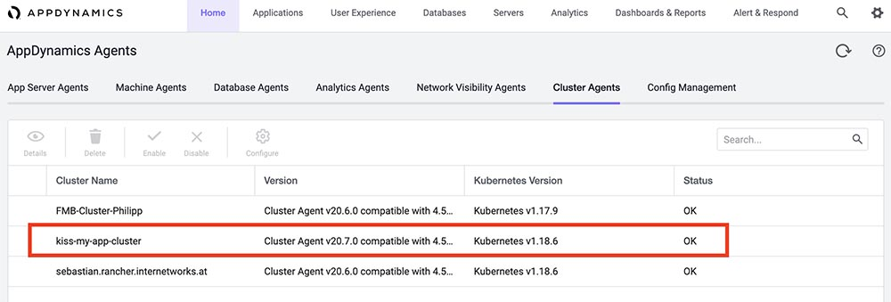

Now we “instrument” this agent (“to instrument” is the term for monitoring elements in AppD).

Choose your cluster and click **Configure**:

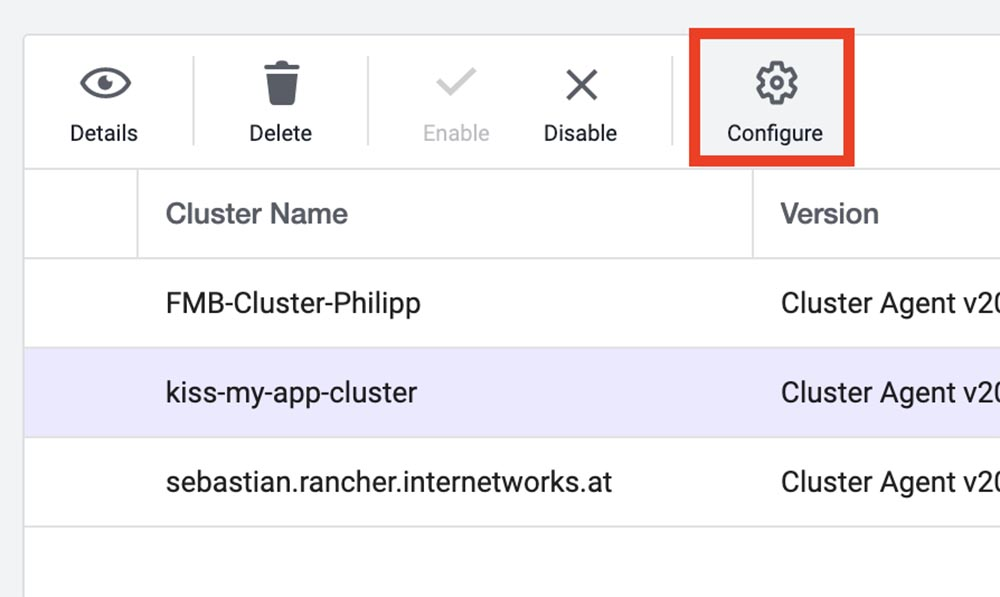

Next, select the namespaces to monitor:

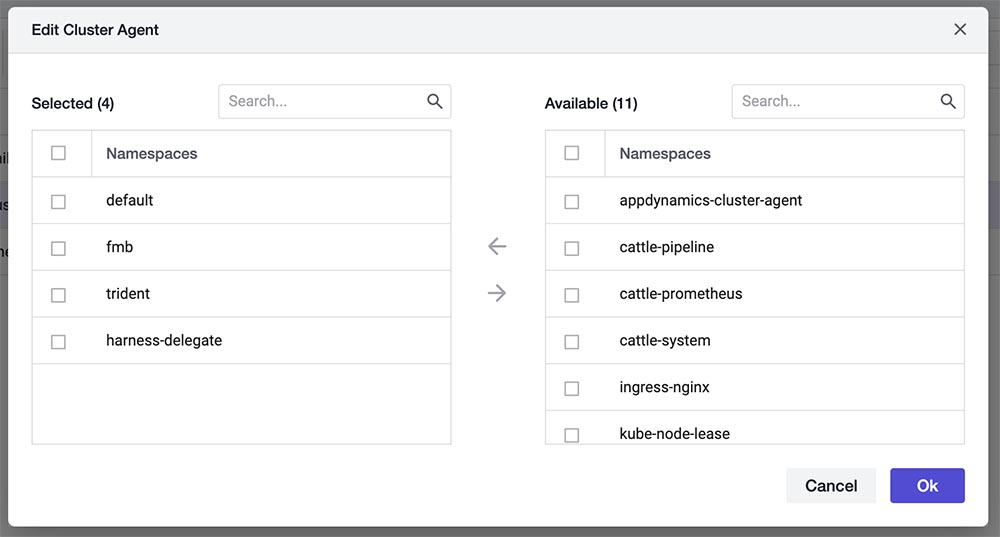

And click **Ok**.

Now we’ve successfully instrumented the cluster agent.

After a few minutes (monitoring cycles), the cluster can be monitored in AppDynamics under **Servers** → **Cluster**:

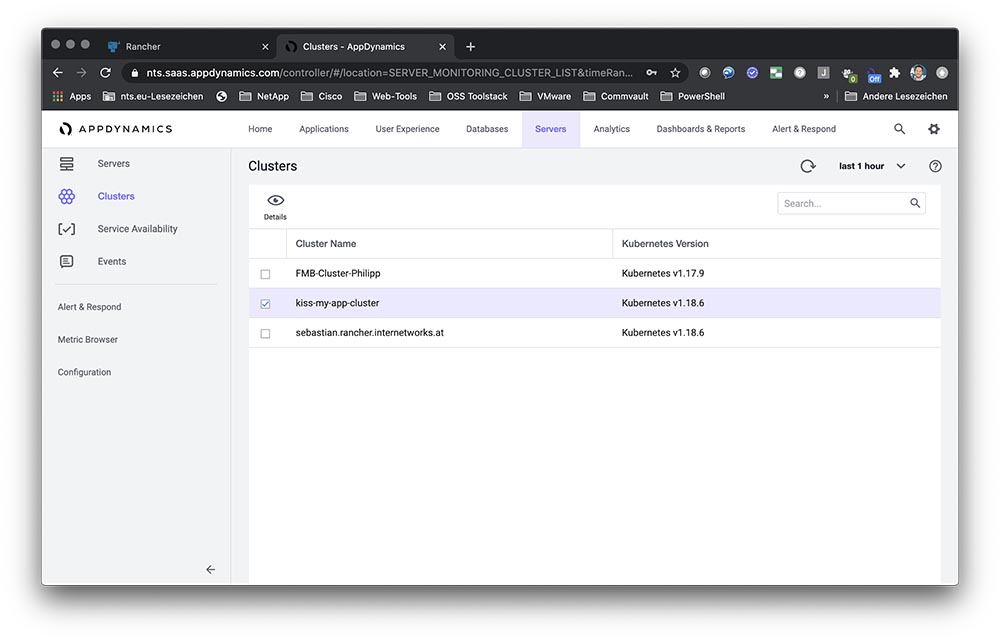

## Kubernetes Monitoring with AppDynamics

The following screen shots show the monitoring features of AppDynamics.

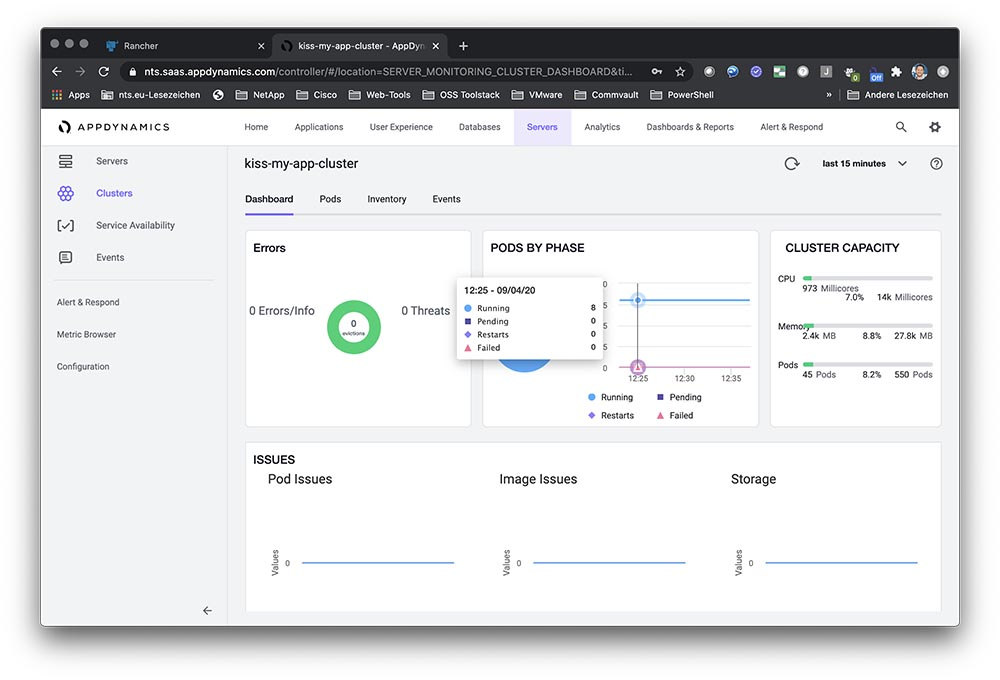

Dashboard

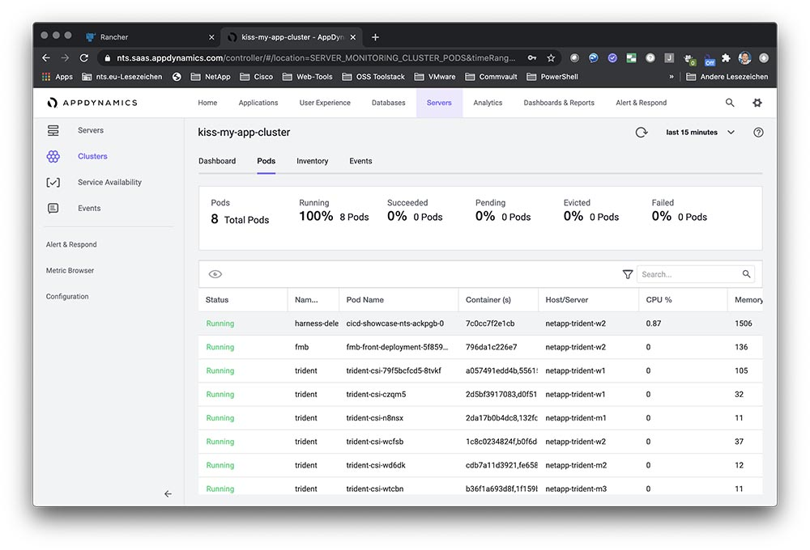

Pods

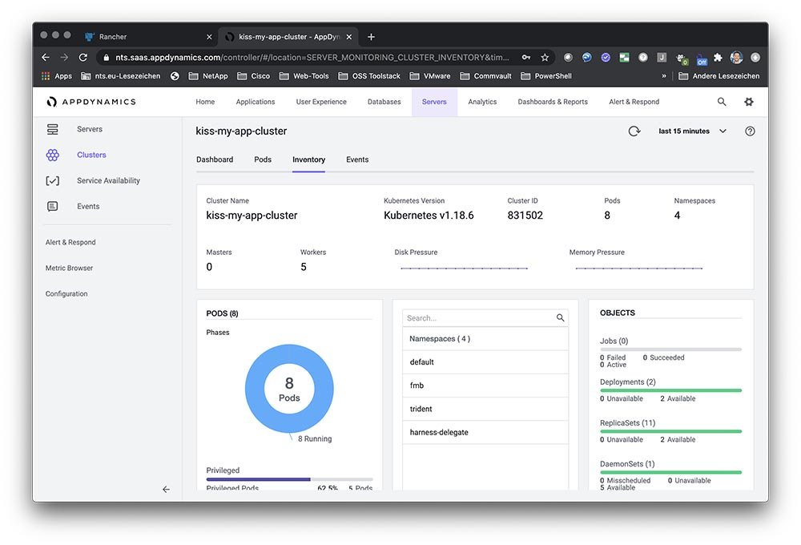

Inventory

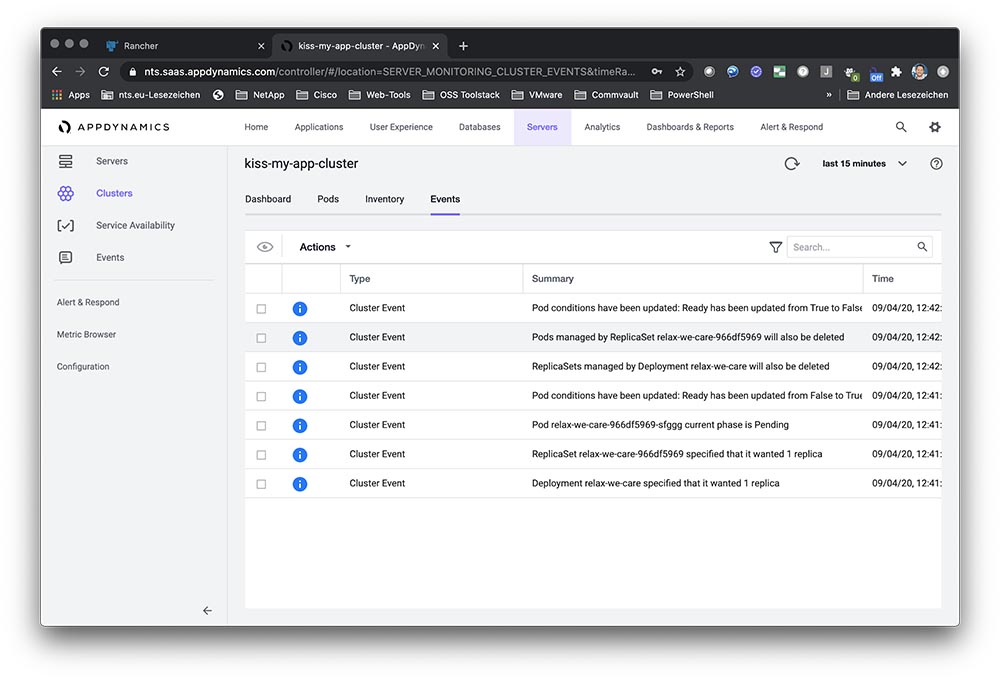

Events

## Conclusion

In this blog post, we’ve described the integration that NTS developed between Rancher and AppDynamics. Both partners have deployed this integration and plans are for it to continue. We’ve shown you how the integration works and described how AppDynamics, which is ideally suited for monitoring Kubernetes clusters, works so well with Rancher, which is great for managing your Kubernetes deployments. NTS offers expertise and know-how in the areas of Kubernetes and monitoring and we’re excited about the potential of these platforms working together to make Kubernetes easier to monitor and manage.Discover what’s new in Rancher 2.5 [Learn More](/products/rancher/2.5)
