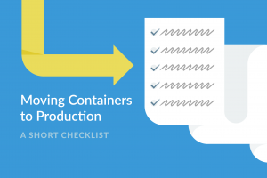
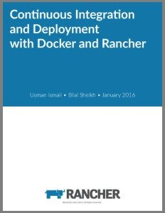

If

you’re anything like me, you’ve been watching the increasing growth of

container-based solutions with considerable interest, and you’ve

probably been experimenting with a couple of ideas. At some point in the

future, perhaps you’d like to take those experiments and actually put

them out there for people to use. Why wait? It’s a new year, and there

is no time like the present to take some action on that goal.

Experimenting is great, and you learn a great deal, but often in the

midst of trying out new things, hacking different technologies together

and making it all work, things get introduced into our code which

probably shouldn’t be put into a production environment. Sometimes,

having a checklist to follow when we’re excited and nervous about

deploying new applications out into the wild can help ensure that we

don’t do things we shouldn’t. Consider this article as the start of a

checklist to ready your Docker applications for prime time.

### Item 1: Check Your Sources

 Free

eBook: Continuous Integration and Deployment with Docker and

Rancher Years ago, I worked on a software project with a

fairly large team. We started running into a problem—Once a week, at 2

PM on a Tuesday afternoon, our build would start failing. At first we

blamed the last guy to check his code in, but then it mysteriously

started working before he could identify and check-in a fix. And then

the next week it happened again. It took a little research, but we

traced the source of the failure to a dependency in the project which

had been set to always pull the latest snapshot release from the vendor,

and it turned out that the vendor had a habit of releasing a new, albeit

buggy version of their library around 2 PM on Tuesday afternoons. Using

the latest and greatest versions of a library or a base image can be fun

in an experiment, but it’s risky when you’re relying on it in a

production environment. Scan through your Docker configuration files,

and check for two things.

**First**, ensure that you have your source images tied to a stable

version of the image. Any occurrence of ***:latest*** in your Docker

configuration files should fail the smell test.

**Second**, if you are using Dockerhub as your image repository, use the

official image wherever possible. Among the reasons for doing this:

“These repositories have clear documentation, promote best practices,

and are designed for the most common use case.” ([[Official Repositories on Docker Hub]](https://docs.docker.com/docker-hub/official_repos/)[)

]

### Item 2: Keep your Secrets...Secret

As Gandalf asked, “Is it secret? Is it safe?” Our applications have a

need for secret information. Most applications have a need for a

combination of database credentials, API tokens, SSH keys and other

necessary information which is not appropriate, or advisable for a

public audience. Secret storage is one of the biggest weaknesses of

container technology. Some solutions which have been implemented, but

are not recommended are:

**Baking the secrets into the image.** Anyone with access to the

registry can potentially access the secrets, and if you have to update

them, this can be a rather tedious process.

**Using volume mounts.** Unfortunately, this keeps all of your secrets

in a single and static location, and usually requires them to be stored

in plain text.

**Using environment variables.** These are easily accessible by all

processes using the image, and are usually easily viewed with Docker

inspect.

**Encrypted solutions.** Secrets are stored in an encrypted state, with

decryption keys on the host machines. While your passwords and other key

data elements aren’t stored in plain text, they are fairly easy to

locate, and the decryption methods identified.

The best solution at this point is to use a secrets store, such as

[Vault](http://www.vaultproject.io)by HashiCorp or

[Keywhiz](http://square.github.io/keywhiz) from Square. Implementation

is typically API-based and very reliable. Once implemented, a secret

store provides a virtual filesystem to an application, which it can use

to access secured information. Each store provides documentation on how

to set up, test and deploy a secret store for your application.

### Item 3: Secure the Perimeter

A compelling reason for the adoption of a container-based solution is

the ability to share resources on a host machine. What we gain in ease

of access to the host machine’s resources, however, we lose in the

ability to separate the processes from a single container from those of

another. Great care needs to be taken to ensure that the user under

which a containers application is started has the minimum required

privileges on the underlying system. In addition, it is important that

we establish a secure platform on which to launch our containers. We

must ensure that the environment is protected wherever possible from the

threat of external influences. Admittedly this has less to do with the

containers themselves, and more with the environment into which they are

deployed, but it is important nonetheless.

### Item 4: Make Sure to Keep an Eye on Things

The final item on this initial checklist for production-readying your

application is to come up with a monitoring solution. Along with secret

management, monitoring is an area related to container-based

applications which is still actively evolving. When you’re experimenting

with an application, you typically don’t run it under much significant

load, or in a multiple-user environment. Additionally, for some reason,

our users insist on finding new and innovative ways to leverage the

solutions we provide, which is both a blessing and a curse. This article

“[[Comparing monitoring options for Docker deployments]](https://rancher.com/comparing-monitoring-options-for-docker-deployments/)“

provides information and comparison between a number of monitoring

options, as does a more recent online meetup on the topic.

The landscape for Docker monitoring solutions is still under continued

development.

### Go Forth and Containerize in an Informed Manner

The container revolution is without a doubt one of the most exciting and

disruptive developments in the world of software development in recent

years. Docker is the tool which all the cool kids are using, and let’s

be honest, we all want to be part of that group. When you’re ready to

take your project from an experimental phase into production, make sure

you’re proceeding in an informed manner. The technology is rapidly

evolving, and offers many advantages over traditional technologies, but

be sure that you do your due diligence and confirm that you’re using the

right tool for the right job. *Mike Mackrory is a Global citizen who has settled down in the Pacific Northwest - for now. By day he works as a Senior Engineer on a Quality Engineering team and by night he writes, consults on several web based projects and runs a marginally successful eBay sticker business. When he’s not tapping on the keys, he can be found hiking, fishing and exploring both the urban and the rural landscape with his kids.*
