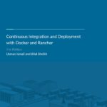

You have a complex monolithic system that is critical to your business.
You’ve read articles and would love to move it to a more modern platform
using microservices and containers, but you have no idea where to start.
If that sounds like your situation, then this is the article for you.
Below, I identify best practices and the areas to focus on as you evolve
your monolithic application into a microservices-oriented application.

### Overview

We all know that net new, greenfield development is ideal, starting with
a container-based approach using cloud services. Unfortunately, that is
not the day-to-day reality inside most development teams. Most
development teams support multiple existing applications that have been
around for a few years and need to be refactored to take advantage of
modern toolsets and platforms. This is often referred to as brownfield
development. Not all application technology will fit into containers
easily. It can always be made to fit, but one has to question if it is
worth it. For example, you could lift and shift an entire large-scale
application into containers or onto a cloud platform, but you will
realize none of the benefits around flexibility or cost containment.

### Document All Components Currently in Use

 Our
newly-updated eBook walks you through incorporating containers into your
CI/CD pipeline. [Download the
eBook](https://info.rancher.com/cicd-with-docker-ebook)
Taking an assessment of the current state of the application and its
underpinning stack may not sound like a revolutionary idea, but when
done holistically, including all the network and infrastructure
components, there will often be easy wins that are identified as part of
this stage. Small, incremental steps are the best way to make your
stakeholders and support teams more comfortable with containers without
going straight for the core of the application. Examples of
infrastructure components that are container-friendly are web servers
(ex: Apache HTTPD), reverse proxy and load balancers (ex: haproxy),
caching components (ex: memcached), and even queue managers (ex: IBM
MQ). Say you want to go to the extreme: if the application is written in
Java, could a more lightweight Java EE container be used that supports
running inside Docker without having to break apart the application
right away? WebLogic, JBoss (Wildfly), and WebSphere Liberty are great
examples of Docker-friendly Java EE containers.

### Identify Existing Application Components

Now that the “easy” wins at the infrastructure layer are running in
containers, it is time to start looking inside the application to find
the logical breakdown of components. For example, can the user interface
be segmented out as a separate, deployable application? Can part of the
UI be tied to specific backend components and deployed separately, like
the billing screens with billing business logic? There are two important
notes when it comes to grouping application components to be deployed as
separate artifacts:

1. Inside monolithic applications, there are always shared libraries
   that will end up being deployed multiple times in a newer
   microservices model. The benefit of multiple deployments is that
   each microservice can follow its own update schedule. Just because a
   common library has a new feature doesn’t mean that everyone needs it
   and has to upgrade immediately.
2. Unless there is a very obvious way to break the database apart (like
   multiple schemas) or it’s currently across multiple databases, just
   leave it be. Monolithic applications tend to cross-reference tables
   and build custom views that typically “belong” to one or more other
   components because the raw tables are readily available, and
   deadlines win far more than anyone would like to admit.

### Upcoming Business Enhancements

Once you have gone through and made some progress, and perhaps
identified application components that could be split off into separate
deployable artifacts, it’s time to start making business enhancements
your number one avenue to initiate the redesign of the application into
smaller container-based applications which will eventually become your
microservices. If you’ve identified billing as the first area you want
to split off from the main application, then go through the requested
enhancements and bug fixes related to those application components. Once
you have enough for a release, start working on it, and include the
separation as part of the release. As you progress through the different
silos in the application, your team will become more proficient at
breaking down the components and making them in their own containers.

### Conclusion

When a monolithic application is decomposed and deployed as a series of
smaller applications using containers, it is a whole new world of
efficiency. Scaling each component independently based on actual load
(instead of simply building for peak load), and updating a single
component (without retesting and redeploying EVERYTHING) will
drastically reduce the time spent in QA and getting approvals within
change management. Smaller applications that serve distinct functions
running on top of containers are the (much more efficient) way of the
future. *Vince Power is a Solution Architect who has a focus on cloud
adoption and technology implementations using open source-based
technologies. He has extensive experience with core computing and
networking (IaaS), identity and access management (IAM), application
platforms (PaaS), and continuous delivery.*
