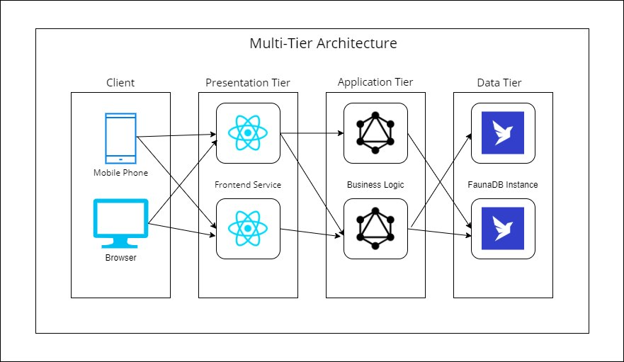
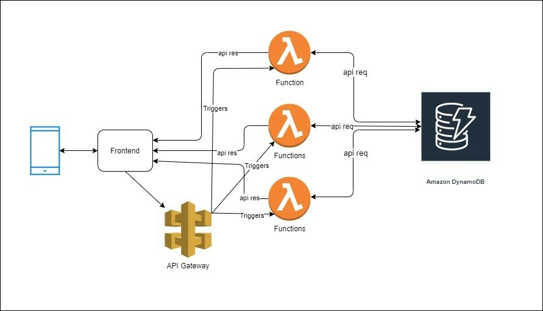

You’ve undoubtedly come across some terms like three-tier application, serverless framework and multi-tier architecture in your knowledge-seeking journey. There’s a lot to keep up with regarding application design. In this post, we’ll briefly compare serverless and multi-tier architectures and look at the benefits of serverless over traditional multi-tier architectures and vice versa.

Before diving into our comparison, let’s look at the unique components of each architecture.

## What is Serverless?

The best way to define serverless is to look at where we’ve come from in the last five to ten years --  multi-tier architecture. Historically, when designing software, we plan that software to be run on a particular runtime architecture. Serverless is an approach to software design for client-server applications. It refers to software that runs on a single computer or a group of computers hosting an application that connects to a remote system such as a browser or mobile phone. Business logic is executed on the server systems to respond to that client, whether it's a phone, browser, etc.
For example, let’s look at your bank’s website. When you connect to their website, you connect to a software application running on a server somewhere. Odds are it's running on a mini server, and it's in a complex environment that's performing the functions of the bank's website. But for all intents and purposes, it’s a single application. You gain value from that application because you can conduct your online banking transactions. There is logic built into that application that performs various financial transactions; whatever you need is fulfilled by the software running on their servers.
Serverless offers a way to build applications without considering the runtime environment. You don't need to worry about how the servers are placed into various subnets or what infrastructure software runs on which server. It's irrelevant. But that hasn't always been the case, and that's where we get multi-tier architecture.

## What is Multi-Tier?

Let’s say you work at a bank and you need to write a software application for an online banking service. You don't want to think about how the bank will store the data for the various baking transactions. The odds are that it exists in a database somewhere like FaunaDB (a serverless database service). You’re not recreating the bank's enterprise reporting software. You’re simply looking to leverage that existing data. Traditionally,  we design software as a multi-tier architecture. That is a runtime architecture for client-server applications composed of tiers. So there can be several different tiers depending on how you approach a particular problem, but generally speaking, the most common tiers are presentation, application and data. Let’s explore those.

- **Presentation Tier**: This is the actual UI of the application. It uses something like RedwoodJS, React or HTML+CSS to provide the visual layout of the Data. Part of the application handles displaying that information in some shape or form.
- **Application Tier**: This tier passes information to the presentation tier. It processes how we manipulate the data to services. For example, if we need to show a list of banking transactions by date, the application tier handles the date sort and other business logic our application requires.
- **Data Tier**: This tier handles getting and storing the data that we are manipulating within our application.

*Multi-Tier Application Architecture*
I’ve outlined the basics of multi-tier,  a common approach for software development. Understanding where we come from makes it easier to understand the benefits of serverless. Historically, if we were writing software, we’d have to think about database servers, application servers and front-end servers and how they handle different tiers of our application. We’d also have to think about the network paths between those servers and how many servers we need to perform the necessary functions. For example, your application tier may need a substantial number of servers to have the computing power to do the business logic processing. Data tiers also historically have extensive resource needs.
Meanwhile, your front end might not need many servers. These are all considerations in a multi-tier software design approach. With serverless, this is not necessarily the case. Let’s find out why.

## Serverless Fundamentals

Before we jump into architecture, let’s familiarize ourselves with several serverless components.

### Backend-as-a-service(BAAS)

With the evolution of the public cloud and mobile applications, we’ve seen a different application development approach. Today mobile app developers don't want to maintain a data center to service their clients. Instead, they’ve designed mobile applications to take advantage of the cloud. Cloud vendors quickly provided a solution to this in the form of a backend as a service. Backend as a service is a cloud service model where server-side logic and state are hosted by cloud providers and used by client applications running via a web or mobile interface. Essentially, this is a series of APIs hosted in the cloud. Let’s say I'm working on a web application and need an authentication mechanism. I can use AUTH0’s cloud-hosted APIs. I don't need to manage authentication on my servers; AUTH0 handles it for me. At the end of the day, all APIs hosted on the cloud craft a URL, make a rest request to get some data and execute it.BAAS lays the foundation for serverless.

### Functions as a service (FaaS)

Functions are just some code that performs a super-specific task, whether it be collecting a user id or formatting some data for output. In the Faas cloud service model, business logic is represented by event triggers, WhileBaaS using APIs from cloud providers, with FaaS, you provide your code, which is executed in the cloud by event-triggered containers that are dynamically allocated and ephemeral. Since our code is event triggered, we don't have to start the application and wait for a request. The application only exists when it's triggered; something has to make it spin up. The best part is you have to define what that trigger is. Containers provide the runtime environment for your code. In the true nature of serverless, there aren't servers; services handling your request only get created when a request comes in that it needs to handle. Faas is also dynamic, so you don't have to worry about scaling when you get a traffic spike. Cloud providers handle scaling the application up and down. The last thing to keep in mind is that the containers running our code are ephemeral, meaning they will not stick around. When the job is done, so are they.

## Serverless Architecture:

Serverless is a runtime architecture where cloud service providers manage the resources and dynamically allocate infrastructure on demand for a given business logic unit. The key to a serverless application is the application runs on a seemingly ethereal phantom infrastructure that exists yet doesn't. Serverless uses servers, but the beautiful part is you don't have to manage or maintain them. You don't have to configure or set up a VPC, set up complex routing rules, or install regular patches to the system to get high-performance and robust applications. The cloud providers take care of all these details, leaving you to focus on developing your application.

*Basic Serverless Architecture*
Developing an application with serverless takes a lot of overhead. You pay every time your code is triggered and for the time it runs to the cloud provider.
When creating a serverless application, take appropriate measures to protect it from unwanted high traffic, such as a DDOS (Distributed Denial Of Service) attack that could spin up a lot of copies of your code and increase your bill.
Your application can be a mixture of both BaaS and FaaS hosted on your cloud provider's infrastructure.
Ultimately, with serverless, you only have to focus on developing and shipping the code. Development is easier, making client-server applications simpler because the cloud service provider does the heavy lifting.

Now that we better understand **Multi-Tier and Serverless architectures****let's compare them.**

## Multi-Tier vs. Serverless

There are several critical areas to consider when comparing serverless architecture with multi-tier architecture.

- Skill Set
- Costs
- Use Case

Each has varying degrees of impact depending on your goals.
**Skill Set:**

Serverless:
You need only a development background to be successful with serverless. Your cloud provider will take care of the infrastructure complexity.

Multi-Tier:
To succeed in a multi-tier approach, you need an operational level of support expertise: You’ll configure servers, install operating systems and software, manage firewalls and develop all these things alongside the software. Depending on what you’re trying to achieve, having this skill set could be advantageous.

**Costs:**

**Serverless**:
When it comes to cost, there are arguments for both architectures.  Startup costs with serverless are really low because you only pay for every execution of your code.

**Multi-Tier**:
The opposite is true with multi-tier architecture. You’ll have upfront costs for servers and getting them set up in your data center or cloud. However, you’ll save money if you expect a steady traffic volume and you can leverage that cloud configuration. Because you will do the cloud configuration yourself, the cost may vary depending on your use case.

**Use Cases:**
Let’s look at how we expect to use the software.

**Serverless**: Serverless is fantastic for sporadic traffic or seasonal traffic. Perhaps you are looking at a retail website with large monthly sales (with huge traffic). With a traditional data center, your infrastructure is available even when you don’t need it, and that’s a significant spike in overall cost. With serverless, you don't have to worry about the infrastructure. It will automatically scale.

**Multi-Tier**: Let's say you have a consistent traffic pattern. You know exactly what you need. In this case, you might be able to save some money by sticking to the traditional approach of software architecture.

## Conclusion

In closing, traditional DevOps culture is converging. We’ve moved from servers to virtual machines to containers. Now we are looking at literally just a few lines of code in a function that we have been shrinking away from maintaining a full-on infrastructure with our software. We have to isolate business logic from the infrastructure with serverless. And that is convenient for development's sake because you don't have to worry about taking care of the infrastructure as you develop your software.
