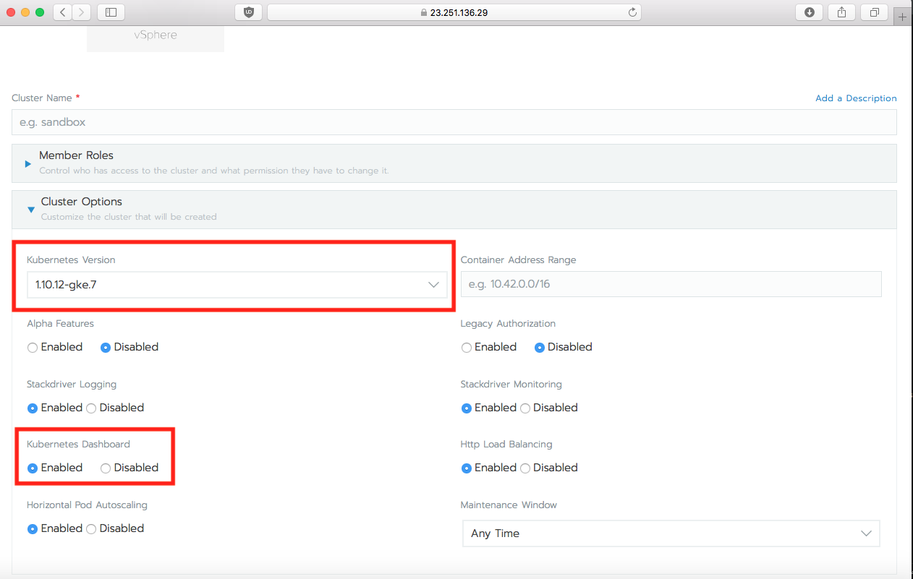
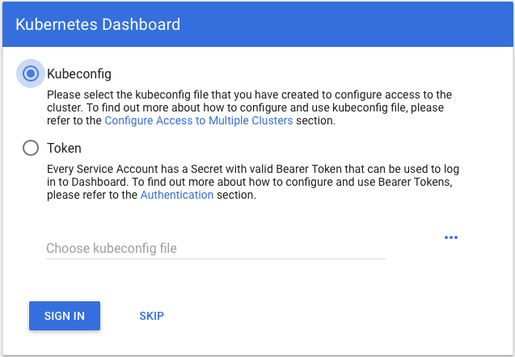
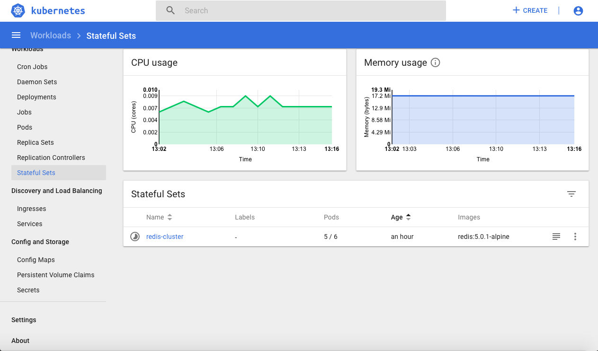
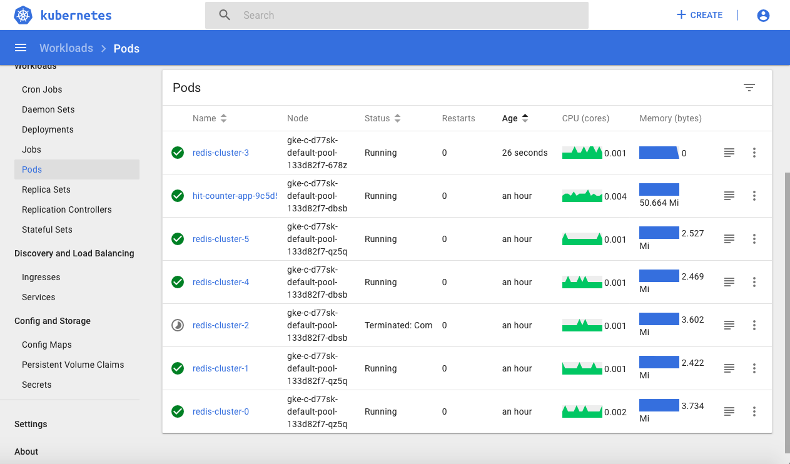
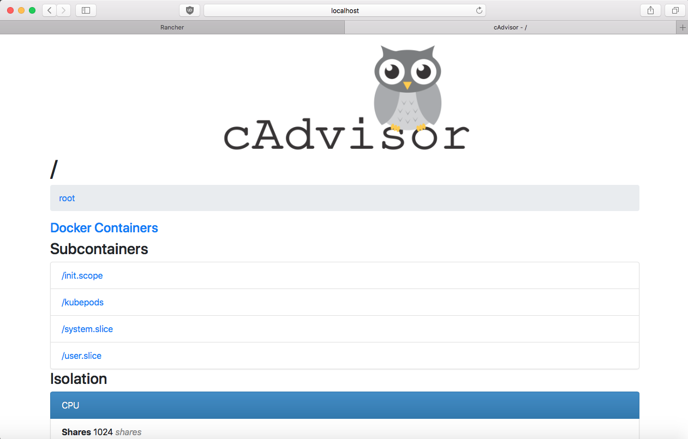
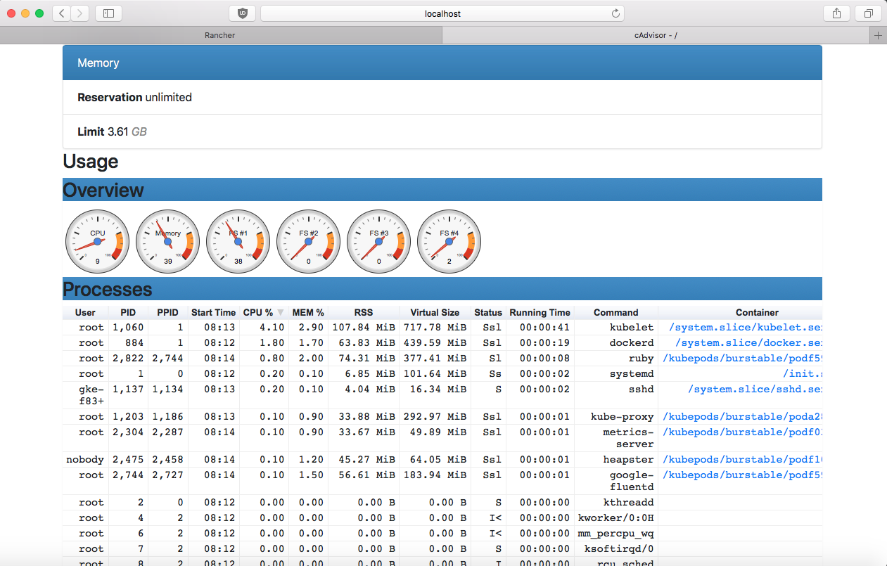
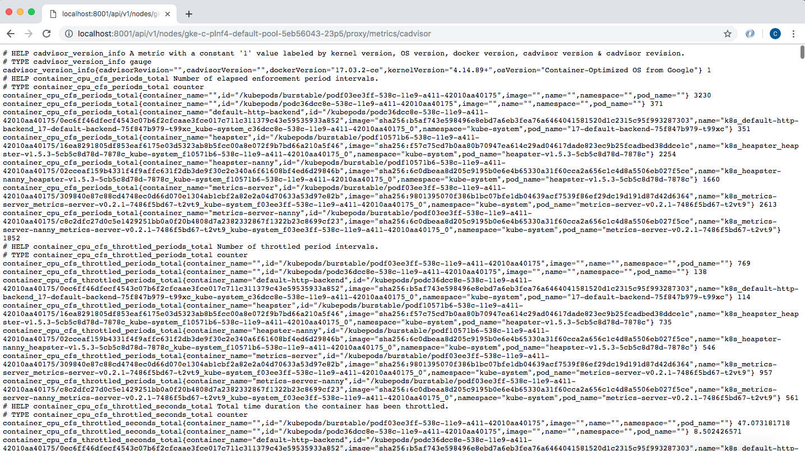
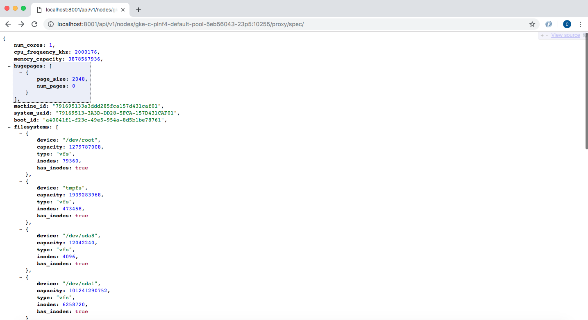
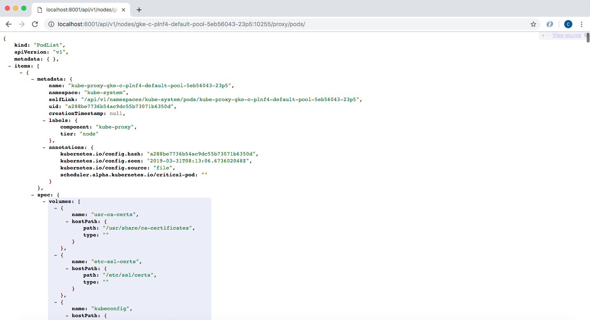

## Introduction

Kubernetes is an open-source orchestration platform for working with containers. At its core, it gives us the means to do deployments, easy ways to scale, and monitoring. In this article, we will talk about the built-in monitoring capabilities of Kubernetes and include some demos for better understanding.

You may benefit from reading our Introduction to [Kubernetes Monitoring](/blog/introduction-to-kubernetes-monitoring/) which offers a more general primer on challenges and solutions for monitoring Kubernetes.

## Brief Overview of Kubernetes Architecture

At the **infrastructure** level, a Kubernetes cluster is a set of physical or virtual machines, each acting in a specific role. The machines acting in the role of master function as the brain of the operations and are charged with orchestrating the management of all containers that run on all of the nodes.

- Master components manage the life cycle of a pod:
  - **apiserver:** main component exposing APIs for all the other master components
  - **scheduler:** uses information in the pod spec to decide on which node to run a pod
  - **controller-manager:** responsible for node management (detecting if a node fails), pod replication, and endpoint creation
  - **etcd:** key/value store used for storing all internal cluster data
- Node components are worker machines in Kubernetes, managed by the master. Each node contains the necessary components to run pods:
  - **kubelet:** handles all communication between the master and the node on which it is running. It interfaces with the container runtime to deploy and monitor containers
  - **kube-proxy:** is in charge with maintaining network rules for the node. It also handles communication between pods, nodes, and the outside world.
  - **container runtime:** runs containers on the node.

From a **logical** perspective, a Kubernetes deployment is comprised of various components, each serving a specific purpose within the cluster:

- **Pods:** are the basic unit of deployment within Kubernetes. A pod consists of one or more containers that share the same network namespace and IP address.
- **Services:** act like a load balancer. They provide an IP address in front of a pool (set of pods) and also a policy that controls access to them.
- **ReplicaSets:** are controlled by deployments and ensure that the desired number of pods for that deployment are running.
- **Namespaces:** define a logical segregation for different kind of resources like pods and/or services.
- **Metadata:** marks containers based on their deployment characteristics.

## Monitoring Kubernetes

Monitoring an application is absolutely required if we want to anticipate problems and have visibility of potential bottlenecks in a dev or production deployment.

To help monitor the cluster and the many moving parts that form a deployment, Kubernetes ships with some built-in monitoring capabilities:

- **Kubernetes dashboard:** gives an overview of the resources running on your cluster. It also gives a very basic means of deploying and interacting with those resources.
- **cAdvisor:** is an open source agent that monitors resource usage and analyzes the performance of containers.
- **Liveness and Readiness Probes:** actively monitor the health of a container.
- **Horizontal Pod Autoscaler:** increases the number of pods if needed based on information gathered by analyzing different metrics.

In this article, we will be covering the first two built-in tools. A follow up article focusing on the remaining tools can be found [here](/blog/native-kubernetes-monitoring-part-2-scaling-and-life-cycle-management/).

There are many Kubernetes metrics to monitor. As we’ve described the architecture in two separate ways (infrastructure and logical), we can do the same with monitoring and separate this into two main components: monitoring the cluster itself and monitoring the workloads running on it.

### Cluster Monitoring

All clusters should monitor the underlying server components since problems at the server level will show up in the workloads. Some metrics to look for while monitoring node resources are CPU, disk, and network bandwidth. Having an overview of these metrics will let you know if it’s time to scale the cluster up or down (this is especially useful when using cloud providers where running cost is important).

### Workload Monitoring

Metrics related to deployments and their pods should be taken into consideration here. Checking the number of pods a deployment has at a moment compared to its desired state can be relevant. Also, we can look for health checks, container metrics, and finally application metrics.

## Prerequisites for the Demo

In the following sections, we will take each of the listed built-in monitoring features one-by-one to see how they can help us. The prerequisites needed for this exercise include:

- **a Google Cloud Platform account:** the free tier is more than enough. Most other cloud should also work the same.
- **a host where Rancher will be running:** This can be a personal PC/Mac or a VM in a public cloud.
- **[Google Cloud SDK](https://cloud.google.com/sdk/install):** should be installed along [kubectl](https://kubernetes.io/docs/tasks/tools/install-kubectl/) on the host running Rancher. Make sure that `gcloud` has access to your Google Cloud account by authenticating with your credentials (`gcloud init` and `gcloud auth login`).

### Starting a Rancher Instance

To begin, start your Rancher instance. There is a very intuitive [getting started guide for Rancher](https://rancher.com/quick-start/) that you can follow for this purpose.

### Using Rancher to Deploy a GKE cluster

Use Rancher to set up and configure a Kubernetes cluster by following the how-to [guide](https://rancher.com/docs/rancher/v2.x/en/cluster-provisioning/hosted-kubernetes-clusters/gke/).
> **Note**  
> Note: please make sure `Kubernetes Dashboard` is enabled and Kubernetes version is `v.1.10`.



#### Fig. 3: Create kubernetes cluster with the help of Rancher

As mentioned previously, in this guide we will be covering the first two built-in tools: the Kubernetes dashboard and cAdvisor. A follow up article that discusses probes and horizontal pod autoscalers can be found [here](/blog/native-kubernetes-monitoring-part-2-scaling-and-life-cycle-management/).

## Kubernetes Dashboard

The Kubernetes dashboard is a web-based Kubernetes user interface that we can use to troubleshoot applications and manage cluster resources.

[Rancher](https://github.com/rancher/rancher), as seen above, helps us install the dashboard by just checking a radio button. Let’s take a look now at how the dashboard can help us by listing some of its uses:

- Provides an overview of cluster resources (overall and per individual node), shows us all of the namespaces, lists all of the storage classes defined
- Shows all applications running on the cluster
- Provides information about the state of Kubernetes resources in your cluster and on any errors that may have occurred

To access the dashboard, we need to proxy the request between our machine and Kubernetes API server. Start a proxy server with `kubectl` by typing the following:

```
kubectl proxy &
```

The proxy server will start in the background, providing output that looks similar to this:

```
[1] 3190
$ Starting to serve on 127.0.0.1:8001
```

Now, to view the dashboard, navigate to the following address in the browser:
> http://localhost:8001/api/v1/namespaces/kube-system/services/https:kubernetes-dashboard:/proxy/

We will then be prompted with the login page to enter the credentials:


#### Fig. 4: Dashboard login

Let’s take a look on how to create a user with admin permission using the Service Account mechanism. We will use two YAML files.

One will create the Service Account:

```
cat ServiceAccount.yaml
```

```
apiVersion: v1
kind: ServiceAccount
metadata:
  name: admin-user
  namespace: kube-system
```

The other will create the `ClusterRoleBinding` for our user:

```
cat ClusterRoleBinding.yaml
```

```
apiVersion: rbac.authorization.k8s.io/v1
kind: ClusterRoleBinding
metadata:
  name: admin-user
roleRef:
  apiGroup: rbac.authorization.k8s.io
  kind: ClusterRole
  name: cluster-admin
subjects:
- kind: ServiceAccount
  name: admin-user
  namespace: kube-system
```

Apply the two YAML files to create the objects they define:

```
kubectl apply -f ServiceAccount.yaml
kubectl apply -f ClusterRoleBinding.yaml
```

```
serviceaccount "admin-user" created
clusterrolebinding.rbac.authorization.k8s.io "admin-user" created
```

Once our user is created and the correct permissions have been set, we will need to find out the token in order to login:

```
kubectl -n kube-system describe secret $(kubectl -n kube-system get secret | grep admin-user | awk '{print $1}')
```

```
Name:         admin-user-token-lnnsn
Namespace:    kube-system
Labels:       <none>
Annotations:  kubernetes.io/service-account.name=admin-user
              kubernetes.io/service-account.uid=e34a9438-4e12-11e9-a57b-42010aa4009e

Type:  kubernetes.io/service-account-token

Data
====
ca.crt:     1119 bytes
namespace:  11 bytes
token:      COPY_THIS_STRING
```

Select “Token” at the Kubernetes dashboard credentials prompt and enter the value you retrieved above in the token field to authenticate.

The Kubernetes Dashboard consists of few main views:

- **Admin view:** lists nodes, namespaces, and persistent volumes along with other details. We can get an aggregated view for our nodes (CPU and memory usage metrics) and an individual details view for each node showing its metrics, specification, status, allocated resources, events, and pods.
- **Workload view:** shows all applications running in a selected namespace. It summarizes important information about workloads, like the number of pods ready in a StatefulSet or Deployment or the current memory usage for a pod.
- **Discover and Load Balancing view:** shows Kubernetes resources that expose services to the external world and enable discovery within the cluster.
- **Config and storage view:** shows persistent volume claim resources used by applications. Config view is used to shows all of the Kubernetes resources used for live configuration of applications running in the cluster.

Without any workloads running, the dashboard’s views will be mainly empty since there will be nothing deployed on top of Kubernetes. If you want to explore all of the views the dashboard has to offer, the best option is to deploy apps that use different workload types (stateful set, deployments, replica sets, etc.). You can check out [this article on deploying a Redis cluster](/blog/deploying-redis-cluster-on-top-of-kubernetes/) for an example that deploys a Redis cluster (a stateful set with volume claims and configMaps) and a testing app (a Kubernetes deployment) so the dashboard tabs will have some relevant info.

After provisioning some workloads, we can take down one node and then check the different tabs to see some updates:

```
kubectl delete pod redis-cluster-2
kubectl get pods
```

```
pod "redis-cluster-2" deleted
NAME                              READY     STATUS        RESTARTS   AGE
hit-counter-app-9c5d54b99-xv5hj   1/1       Running       0          1h
redis-cluster-0                   1/1       Running       0          1h
redis-cluster-1                   1/1       Running       0          1h
redis-cluster-2                   0/1       Terminating   0          1h
redis-cluster-3                   1/1       Running       0          44s
redis-cluster-4                   1/1       Running       0          1h
redis-cluster-5                   1/1       Running       0          1h
```



#### Fig. 5: Dashboard view on Stateful Sets



#### Fig. 6: Dashboard view on Pods

## cAdvisor

cAdvisor is an open-source agent integrated into the `kubelet` binary that monitors resource usage and analyzes the performance of containers. It collects statistics about the CPU, memory, file, and network usage for all containers running on a given node (it does not operate at the pod level). In addition to core metrics, it also monitors events as well. Metrics can be accessed directly, using commands like `kubectl top` or used by the scheduler to perform orchestration (for example with autoscaling).

Note that cAdvisor doesn’t store metrics for long-term use, so if you want that functionality, you’ll need to look for a dedicated [Kubernetes monitoring tool](https://www.suse.com/c/observability-kubernetes-monitoring-tools-what-they-are-metrics-to-track-and-how-to-choose-one/).

cAdvisor’s UI has been marked deprecated as of Kubernetes version 1.10 and the interface is scheduled to be completely removed in version 1.12. Rancher gives you the option to choose what version of Kubernetes to use for your clusters. When setting up the infrastructure for this demo, we configured the cluster to use version 1.10, so we should still have access to the cAdvisor UI.

To access the cAdvisor UI, we need to proxy between our machine and Kubernetes API server. Start a local instance of the proxy server by typing:

```
kubectl proxy &
```

```
[1] 3190
$ Starting to serve on 127.0.0.1:8001
```

Next, find the name of your nodes:

```
kubectl get nodes
```

You can view the UI in you browser by navigating to the following address, replacing the node name with the identifier you found on the command line:
> http://localhost:8001/api/v1/nodes/gke-c-plnf4-default-pool-5eb56043-23p5:4194/proxy/containers/



#### Fig. 7: Initial cAdvisor UI



#### Fig. 8: cAdvisor UI Overview and Processes

To confirm that `kubelet` is listening on port 4194, you can log into the node to get more information:

```
gcloud compute ssh admin@gke-c-plnf4-default-pool-5eb56043-23p5 --zone europe-west4-c
```

```
Welcome to Kubernetes v1.10.12-gke.7!

You can find documentation for Kubernetes at:
  http://docs.kubernetes.io/

The source for this release can be found at:
  /home/kubernetes/kubernetes-src.tar.gz
Or you can download it at:
  https://storage.googleapis.com/kubernetes-release-gke/release/v1.10.12-gke.7/kubernetes-src.tar.gz

It is based on the Kubernetes source at:
  https://github.com/kubernetes/kubernetes/tree/v1.10.12-gke.7

For Kubernetes copyright and licensing information, see:
  /home/kubernetes/LICENSES
```

We can confirm that in our version of Kubernetes, the `kubelet` process is serving the cAdvisor web UI over that port:

```
sudo su -
netstat -anp | grep LISTEN | grep 4194
```

```
tcp6       0      0 :::4194                 :::*                    LISTEN      1060/kubelet
```

If you run Kubernetes version 1.12 or later, the UI has been removed, so `kubelet` does not listening on port 4194 anymore. You can confirm this with the commands above. However, the metrics are still there since cAdvisor is part of the `kubelet` binary.

The `kubelet` binary exposes all of its runtime metrics and all of the cAdvisor metrics at the `/metrics` endpoint using the Prometheus exposition [format](https://github.com/prometheus/docs/blob/master/content/docs/instrumenting/exposition_formats.md):
> http://localhost:8001/api/v1/nodes/gke-c-plnf4-default-pool-5eb56043-23p5/proxy/metrics/cadvisor



#### Fig. 9: cAdvisor metrics endpoint

Among the output, metrics you can look for include:

- CPU:
  - `container_cpu_user_seconds_total`: Cumulative “user” CPU time consumed in seconds
  - `container_cpu_system_seconds_total`: Cumulative “system” CPU time consumed in seconds
  - `container_cpu_usage_seconds_total`: Cumulative CPU time consumed in seconds (sum of the above)
- Memory:
  - `container_memory_cache`: Number of bytes of page cache memory
  - `container_memory_swap`: Container swap usage in bytes
  - `container_memory_usage_bytes`: Current memory usage in bytes, including all memory regardless of when it was accessed
  - `container_memory_max_usage_bytes`: Maximum memory usage in byte
- Disk:
  - `container_fs_io_time_seconds_total`: Count of seconds spent doing I/Os
  - `container_fs_io_time_weighted_seconds_total`: Cumulative weighted I/O time in seconds
  - `container_fs_writes_bytes_total`: Cumulative count of bytes written
  - `container_fs_reads_bytes_total`: Cumulative count of bytes read
- Network:
  - `container_network_receive_bytes_total`: Cumulative count of bytes received
  - `container_network_receive_errors_total`: Cumulative count of errors encountered while receiving
  - `container_network_transmit_bytes_total`: Cumulative count of bytes transmitted
  - `container_network_transmit_errors_total`: Cumulative count of errors encountered while transmitting

Some additional useful metrics can be found here:

- `/healthz`: Endpoint for determining whether cAdvisor is healthy
- `/healthz/ping`: To check connectivity to etcd
- `/spec`: Endpoint returns the cAdvisor `MachineInfo()`

For example, to see the cAdvisor `MachineInfo()`, we could visit:
> http://localhost:8001/api/v1/nodes/gke-c-plnf4-default-pool-5eb56043-23p5:10255/proxy/spec/



#### Fig. 10: cAdvisor spec endpoint

The `pods` endpoint provides the same output as `kubectl get pods -o json` for the pods running on the node:
> http://localhost:8001/api/v1/nodes/gke-c-plnf4-default-pool-5eb56043-23p5:10255/proxy/pods/



#### Fig. 10: cAdvisor pods endpoint

Similarly, logs can also be retrieved by visiting:
> http://localhost:8001/logs/kube-apiserver.log

## Conclusion

Monitoring is vital in order to understand what is happening with our applications. Kubernetes helps us with a number of built-in tools and provides some great insights for both, infrastructure layer (nodes) and logical one (pods).

This article concentrated on the tools that focus on providing monitoring and metrics for users. Continue on to the [second part of this series](/blog/native-kubernetes-monitoring-part-2-scaling-and-life-cycle-management/) to learn about the included monitoring tools focused on workload scaling and life cycle management.

## Kubernetes Monitoring in Rancher

In Rancher, you can easily monitor and graph everything in your cluster, from nodes to pods to applications. The advanced monitoring tooling, powered by Prometheus, gives you real-time data about the performance of every aspect of your cluster. [Watch our online meetup](https://info.rancher.com/meetup-introducing-rancher-2.2) to see these advanced monitoring features demoed and discussed.
