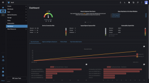
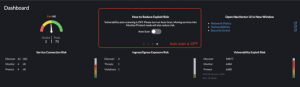

We have officially released the first version of the NeuVector UI Extension for Rancher! This release is an exciting first step for integrating NeuVector security monitoring and enforcement into the Rancher Manager UI. 

The security vision for SUSE and its [enterprise container management](https://www.suse.com/solutions/enterprise-container-management/) (ECM) products has always been to enable easy deployment, monitoring and management of a secure cloud native stack. The full-lifecycle container security solution [NeuVector](https://www.suse.com/products/neuvector/) offers a comprehensive set of security observability and controls, and by integrating this with Rancher, users can protect the sensitive data flows and business-critical applications managed by Rancher.

Rancher users can deploy NeuVector through Rancher and monitor the key security metrics of each cluster through the NeuVector UI extension. This extension includes a cluster security score, ingress/egress connection risks and vulnerability risks for nodes and pods.

 

 

Thanks to the single sign-on (SSO) integration with Rancher, users can then open the full NeuVector console (through the convenient links in the upper right above) without logging in again. Through the NeuVector console, users can do a deeper analysis of security events and vulnerabilities, configure admission control policies and manage the zero trust run-time security protections NeuVector provides.

The NeuVector UI Extension also supports user interaction to investigate security details from the dashboard. In particular, it displays a dynamic Security Risk Score for the entire cluster and its workloads and offers a guided wizard for ‘How to Improve Your Score.’ As shown below, one action turns on automated scanning of nodes and pods for vulnerabilities and compliance violations.

 

###

## **Rancher Extensions Architecture provides a decoupling of releases**

[Extensions](https://ranchermanager.docs.rancher.com/integrations-in-rancher/rancher-extensions) allow users, developers, partners and customers to extend and enhance the Rancher UI. In addition, users can make changes and create enhancements to their UI functionality independent of Rancher releases. Extensions will enable users to build on top of Rancher to tailor it to their respective environments better. In this case, the NeuVector extension can be continuously enhanced and updated independent of Rancher releases.

## **Rancher Prime and NeuVector Prime**

The new UI extension for NeuVector is available as part of the [Rancher Prime](https://www.rancher.com/products/rancher-platform) and NeuVector Prime commercial offerings. Commercial subscribers can install the extension directly from the Rancher Prime registry, and it comes pre-installed with Rancher Prime.

## **What's next: The Rancher-NeuVector Integration roadmap**

This is an exciting first phase for UI integration, with many more phases planned over the following months. For example, the ability to view scan results for pods and nodes directly in the Rancher cluster resources views and manually trigger scanning is planned for the next phase. We are also working on more granular SSO/RBAC integration between Rancher users/groups and NeuVector roles, as well as integrating admission controls from [Kubewarden](https://www.kubewarden.io/) and NeuVector.

## **Want to learn more?**

For more information, see the NeuVector [documentation](https://open-docs.neuvector.com/deploying/rancher) and [release notes](https://open-docs.neuvector.com/releasenotes/5x). The NeuVector UI Extension requires NeuVector version 5.3.0+ and Rancher version 2.7.0+.
