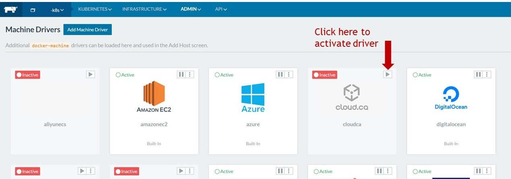

One of the great
benefits of the [Rancher](https://rancher.com/rancher) container
management platform is that it runs on any infrastructure. While it’s
possible to add any Linux machine as a host using our custom setup
option, using one of the machine drivers in Rancher makes it especially
easy to add and manage your infrastructure.

Today, we’re pleased to
have a new machine driver available in Rancher, from our friends at
**[cloud.ca](https://cloud.ca/)**. cloud.ca is a regional cloud IaaS for
Canadian or foreign businesses requiring that all or some of their data
remain in Canada, for reasons of compliance, performance, privacy or
cost. The platform works as a standalone IaaS and can be combined with
hybrid or multi-cloud services, allowing a mix of private cloud and
other public cloud infrastructures such as Amazon Web Services. Having
the cloud.ca driver available within Rancher makes it that much easier
for our collective users to focus on building and running their
applications, while minding data compliance requirements. To access the
cloud.ca machine driver, navigate to the “Add Hosts” screen within
Rancher, select “Manage available machine drivers“. Click the arrow to
activate the driver; it’ll be easily available for subsequent
deployments.  Click the > arrow to activate the
cloud.ca machine driver You can learn more about using the
driver and Rancher together on the\*\* [cloud.ca
blog](https://blog.cloud.ca/orchestrating-containers-on-cloud.ca-with-rancher)\*\*.
If you’re headed to [Devops Days
Toronto](https://www.devopsdays.org/events/2017-toronto/welcome/) (May
25-26) as well, we encourage you to visit the cloud.ca booth, where you
can see a demo in person! And as always, we’re happy to hear from
members of our community on how they’re using Rancher. Reach out to us
any time on our [forums](https://forums.rancher.com), or on Twitter
[@Rancher\_Labs](http://twitter.com/rancher_labs)!
