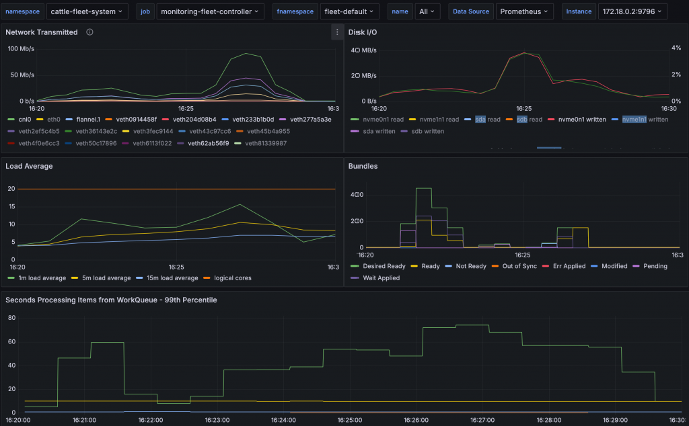

Rancher Continuous Delivery ([known as Fleet](https://fleet.rancher.io/)) can be used in a workflow to deploy applications to many clusters.

With its GitOps support, it enables downstream clusters to pull updates from a Git repository.

We know of users that monitor several hundred Git repositories and deploy to a thousand clusters.

 

To make this scale possible, several intermediate steps are necessary.

First, the application is converted into separate bundles, which are then targeted at clusters.

An agent is running on each cluster, which will pull the application bundles from the management cluster and deploy them.

Our long-term goal is to provide clear best practices for optimizing [Fleet](https://fleet.rancher.io/) performance. However, use cases differ and so do performance criteria. Users of edge computing might want to deploy a few apps to many clusters. Others need updates rolled out as quickly as possible, while some manage low bandwidth edge clusters, like oil rigs, planes, or factories.

So it is often unclear what we mean when we talk about performance. Is it polling hundreds of Git repositories? Will switching to web hooks solve all the problems? Or will distribution to clusters be slowed down by too many update events? Will agents choke on helm charts that are just too big to download and monitor for changes?

In a typical GitOps system, some configuration options are obvious. One of them is the polling interval of a Git repository: polling many repos frequently will cost bandwidth and might incur rate limits. Another is the controller’s worker count, which controls how many requests for different resources can be handled in parallel. Or the etcd database size limit, which influences how many resources can exist in the cluster and how often they can change. Each change creates a copy, which is only garbage-collected every 5 minutes when the database compresses.


Fleet Grafana dashboard during the benchmark.

It is tough to know if tuning changes are actually helping, and measuring performance can be complex. There are just too many dimensions, images need to be downloaded, CPU, network bandwidth and disk IO are shared with other hosts, etc..

For that reason we created the Fleet benchmark suite. It is a set of standardized tests, which can be repeated. For each test several metrics are collected and the overall running time is reported. Tests address individual lifecycle phases to provide meaningful results:

- creating bundles
- targeting bundles at clusters
- deploying bundle to clusters

Now we can try and measure different scenarios, to answer questions like:

- Do many failed deployments reduce the speed of new deployments?
- Is a new version slower or faster than the previous one?
- Does adding more CPU resources change something?
- Is etcd tuning effective?
- How does the number of clusters influence scaling?
- Which CD pipeline optimizations help?

### Running the Suite

Download the binary from the [Fleet release page](https://github.com/rancher/fleet/releases/tag/v0.13.0-alpha.2) and run it: `./fleet-benchmark run`.

The suite will target all labeled clusters in a single namespace. Afterwards it will print a report and save the results to a file. If you have more than one report in its database folder, it compares the report to previous results and scores them.

```
% ./fleet-benchmark run
•••••
Experiment                        | Duration | Mean            |
                                  |          | Duration        |
=======================================================================
1-bundledeployment-10-resources   | 11.46s   | 12.17s          | better
-----------------------------------------------------------------------
1-gitrepo-50-bundle               | 8.77s    | 7.00s           | worse
-----------------------------------------------------------------------
50-bundle                         | 7.35s    | 6.22s           | worse
-----------------------------------------------------------------------
50-bundledeployment-500-resources | 229.35s  | 99.22s          | worse
-----------------------------------------------------------------------
50-gitrepo-50-bundle              | 55.92s   | 34.02s          | worse
```

> Note: The benchmarks creates and deletes resources; by labeling the clusters with the special [fleet.cattle.io/benchmark=true](http://fleet.cattle.io/benchmark=true) one can make sure only a subset of the clusters is used. These clusters must be in the namespace pointed to by the FLEET\_BENCH\_NAMESPACE environment variable. The fleet controllers in the management cluster are always part of the benchmark. Running the benchmark against a production environment should not result in damage, but is not advised.

The suite is still in its early stages. The tests need to be complex enough to show varying results between setups, but small enough to run on limited systems without crashing.

 

For example, when Rancher Desktop only has 5GB of RAM, a full Rancher installation uses too many resources for the suite to complete successfully. The suite might not terminate, as the out-of-memory killer restarts the API server, pods get evicted and restart. This is not unexpected, the [installation requirements for Rancher Manager on k3s](https://ranchermanager.docs.rancher.com/getting-started/installation-and-upgrade/installation-requirements#k3s-kubernetes) specify at least 16GB RAM.

Increasing the RAM to 8GB, half the requirement of Rancher lets the suite finish in under 8 minutes on my Laptop.

### Help us make Rancher CD better

You can help, by putting the Fleet benchmark suite to the test in your own environment and see how it performs. Once you've gathered your results, contribute to our collective understanding of Fleet performance by filling out the report form. Your insights will help us identify areas for improvement and establish best practices for various use cases.

 

**Help us make Rancher CD better** Feel free to share your results in our [feedback form](https://forms.gle/Gd25i8CRfKxppfiB6).

We will keep improving the benchmark suite, so we can better judge the performance effect of code changes and validate installation requirements.
