[Kubernetes](https://kubernetes.io/) is an open source container orchestration system that enables applications to run on a cluster of hosts. It’s a critical part of cloud native architecture because it can work on public or private clouds and on-premises environments. With an orchestration layer on top of traditional infrastructure, Kubernetes allows the automated deployment, scaling, and management of containerized applications.

Applications deployed on Kubernetes run on containers and pods. A container represents a packaged runtime environment for an application, with all dependencies included. A pod encapsulates one or more containers with all the services required by the applications running in those containers. A service provides container networking, load balancing, scaling, scheduling, and security.

Kubernetes ensures the application's availability by bringing up new instances of pods in various cluster nodes when existing pods and containers go down or crash. This scheduling is also used for load balancing. While this provides seamless scaling and high availability, the pods must be stateless to achieve this. However, it’s unrealistic for all applications to run statelessly, so you need a persistent storage mechanism.

You could implement persistent storage using external services, such as [Amazon Simple Storage Service (Amazon S3)](https://aws.amazon.com/s3/). However, this means you need an account with a third-party provider, such as [Amazon Web Services (AWS)](https://aws.amazon.com/). Third-party storage solutions lack the flexibility that an open storage model built on Kubernetes can provide. They also come with issues related to vendor lock-in and additional costs.

A more flexible solution would be to use [Longhorn](https://longhorn.io/), a reliable cloud native storage system installed on Kubernetes that can run anywhere. In this article, you’ll learn about Longhorn and see how you can use it for Kubernetes persistent storage.

## **Understanding Longhorn**

Longhorn is a cloud native distributed block storage for Kubernetes. Developed and open sourced by [Rancher](https://rancher.com/), and now part of SUSE, Longhorn is currently an incubating project from the [Cloud Native Computing Foundation (CNCF)](https://www.cncf.io/). It integrates with the Kubernetes persistent volume API and provides a way to use persistent storage without relying on a storage provider.

Longhorn’s architecture is microservices-based, comprising two layers — the Longhorn Manager and the Longhorn Engine. The Longhorn Manager is responsible for creating Longhorn Engines by integrating with the Kubernetes APIs. The Longhorn Engine acts as a storage controller and is required to manage only one volume. The cluster holds the storage controller and replica within itself.

To understand how Longhorn integrates with Kubernetes, you need to understand how Kubernetes handles storage. Although pods can directly reference storage, it’s not advised because local disk files in a container are short-lived and deleted when the container goes down. Instead, Kubernetes handles storage requirements through volumes that can be temporary or persistent.

Kubernetes facilitates persistent volumes through its [StorageClass](https://kubernetes.io/docs/concepts/storage/storage-classes/) objects. It supports cloud storage services, such as [Amazon Elastic Block Store (Amazon EBS)](https://kubernetes.io/docs/concepts/storage/storage-classes/#aws-ebs) or [Azure Disk Storage](https://azure.microsoft.com/en-us/services/storage/disks/), and open source alternatives, such as [GlusterFS](https://www.gluster.org/). Kubernetes also exposes the [Container Storage Interface (CSI)](https://kubernetes.io/blog/2019/01/15/container-storage-interface-ga/) to allow third-party providers to implement storage plug-ins.

Kubernetes abstracts storage requests from users through [PersistentVolumeClaims (PVC)](https://kubernetes.io/docs/concepts/storage/persistent-volumes/). Under the hood, it manages Longhorn as a CSI plug-in, which integrates with the PersistentVolume (PV) and PVC. Longhorn lets you specify the volume size and the number of replicas to maintain. Resources running on Kubernetes can use PVC claims to use existing PVs or dynamically create PVs.

## **Perfect persistent storage for Kubernetes**

Longhorn is a perfect solution to Kubernetes persistent storage when you want the following:

- A distributed storage system that runs well with your cloud native application (without relying on external providers).
- A storage solution that is tightly coupled with Kubernetes.
- Storage that is highly available and durable.
- A storage system without specialized hardware and not external to the cluster.
- A storage system that is easy to install and manage.

Consider the following features that Longhorn offers:

### **High availability**

Longhorn’s lightweight, microservice-based architecture makes it highly available. As a result, Longhorn’s storage engine needs to manage only one volume. This architecture simplifies the storage controller design so that only the volume served by that engine is affected in a crash. Longhorn Engine is also lightweight enough to support thousands of volumes.

It keeps multiple replicas of each volume in the same Kubernetes cluster in different nodes. It automatically rebuilds replicas if the number drops below a predefined limit.

Since each volume and replica have a controller, upgrading a volume’s controller won’t affect its availability. It can execute long-running jobs to upgrade all the live controllers without disrupting the system.

### **Durability**

Longhorn comes with incremental snapshot and backup features. Engineers can schedule automatic snapshots and backup jobs through the UI or ‘kubectl’ commands. It’s possible to execute these jobs even when a volume is detached. It’s also possible to configure the system to prevent existing data from being overwritten by new data by using the concept of snapshots.

### **Ease of use**

Longhorn comes with an intuitive dashboard. It provides information about the volumes’ status, available storage space, and node status. The UI also enables engineers to configure nodes, create backup jobs, or change other operational settings. This is not to say that these configurations are only possible through the UI. The standard way of doing it through ‘kubectl’ commands is also possible.

### **Ease of deployment**

Deploying Longhorn is easy. If you use the Rancher marketplace, you can do it with a single click. Even from the command line, it’s just a matter of running a few commands. This simplicity is possible because Longhorn is a CSI plug-in.

### **Built-in disaster recovery**

A storage service’s usefulness largely depends on its self-healing and disaster recovery (DR) capabilities. Engineers can create a DR volume in another Kubernetes cluster for each Longhorn volume and failover when problems arise. When setting up these DR volumes, it’s also possible to explicitly define recovery time and point objectives.

### **Security**

Longhorn can encrypt data at rest and in transit. It uses the Linux kernel’s [dm-crypt](https://www.kernel.org/doc/html/latest/admin-guide/device-mapper/dm-crypt.html) subsystem methods to encrypt volumes. [Kubernetes Secrets](https://kubernetes.io/docs/concepts/configuration/secret/) stores the saved encryption keys. Once a volume is encrypted, all volume backups are also encrypted by default.

### **Other benefits**

Unlike cloud service storage or external storage arrays, Longhorn is portable between clusters. Also, since it is open sourced, the cost of the product is minimal and the only cost incurred has to do with infrastructure.

## **Getting started with Longhorn**

Before installing Longhorn, ensure you meet the following prerequisites:

- The cluster must be running Kubernetes v1.18 or above.
- All cluster nodes must have `open-iscsi` installed and configured (`open-iscsi` enables mass storage over IP networks and is required to create PVs).
- All cluster nodes must have an NFS v4 client installed.
- The host filesystem must be ext4.
- The system must have the necessary Linux libraries available (`curl`, `findmnt`, `grep`, `awk`, `blkid` and `lsblk`).
- The [mount propagation](https://kubernetes.io/docs/concepts/storage/volumes/#mount-propagation) should be enabled in Kubernetes (this is a Kubernetes setting that allows containers to share volumes).

### **Install Longhorn**

The easiest way to set up Longhorn is through the [Rancher Apps & Marketplace](https://ranchermanager.docs.rancher.com/how-to-guides/new-user-guides/helm-charts-in-rancher) via the command line with the `kubectl` utility or by using Helm.

Rancher is a container management platform for Kubernetes. It helps you deliver Kubernetes as a service by managing multiple Kubernetes clusters from a single point. It also allows you to monitor the health of Kubernetes clusters from its UI. Rancher applies a unified role-based access control (RBAC) model across all the clusters and helps deploy applications through its marketplace.

If you don’t already have Rancher installed for your Kubernetes cluster, you can [follow these instructions to install and configure it](https://ranchermanager.docs.rancher.com/getting-started/installation-and-upgrade).

To install Longhorn using Rancher, find the cluster where you plan to install Longhorn:

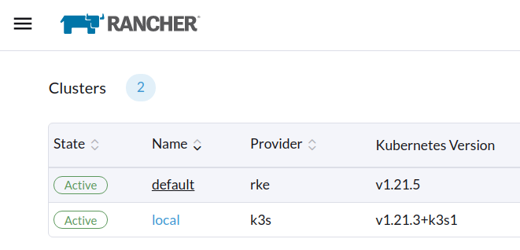

Navigate to the **Apps & Marketplace** page and find Longhorn by searching for it:

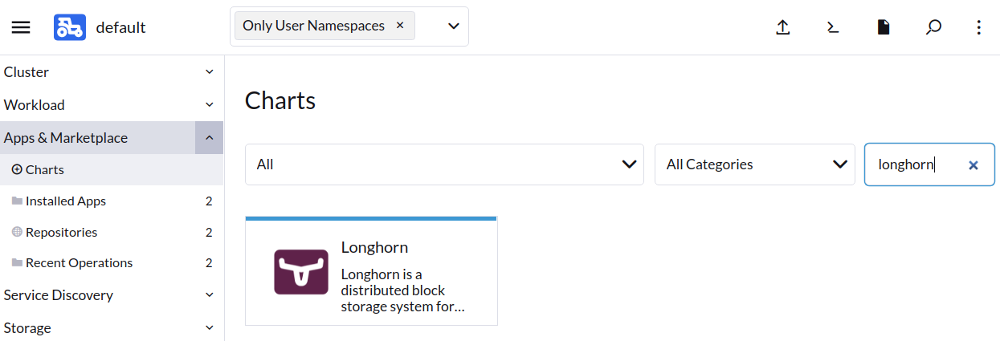

Click **Install** and move to the next screen:

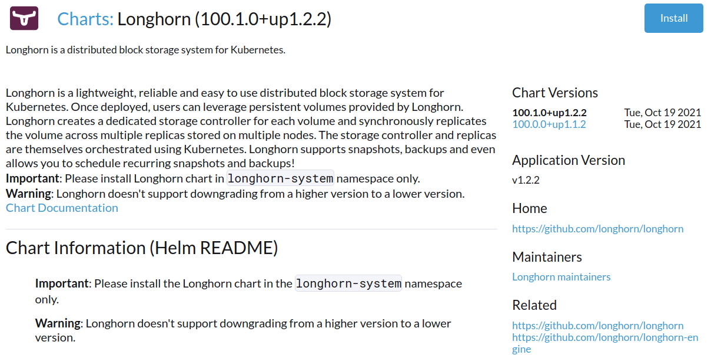

Now, select the project you want to install Longhorn to. If you don’t intend to install it on a specific project, you can leave the drop-down list empty and click **N****ext**:

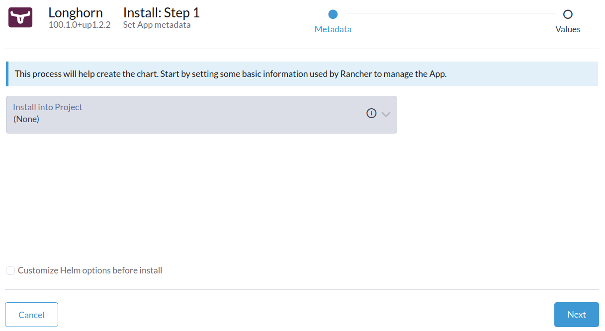

### **Access the UI**

If all prerequisites are met, your installation should be complete. The next step is to look at the Longhorn UI and familiarize it. For this, you can click on the Longhorn app icon:

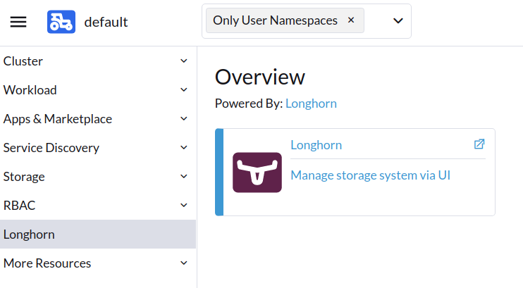

You can now view the UI and play around with the options:

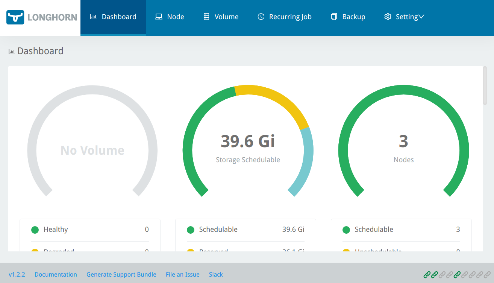

### **Create volumes**

Longhorn UI provides a quick way to create volumes. Click on the **Volume** tab to list the existing volumes and create a new one:

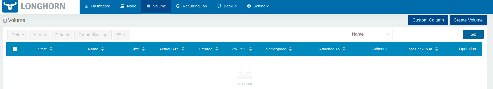

Click the **Create Volume** button in the upper right-hand corner to create a volume. Provide a name and set the number of replicas. You can leave the rest of the options to their default values:

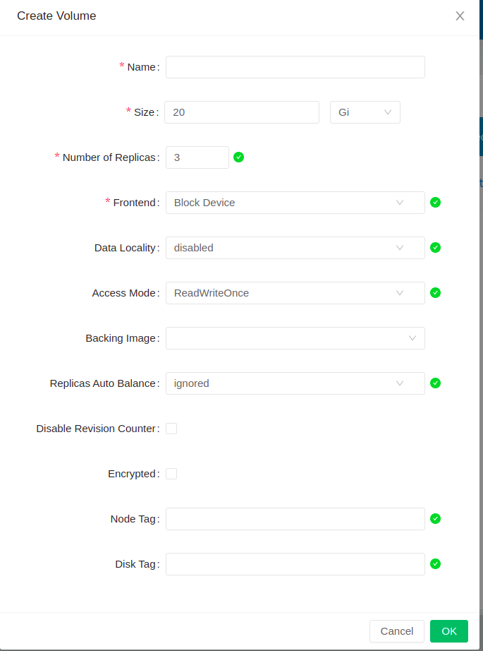

Select **OK** to go back to the volume list. You should now see the volume you created. Next, you need to attach it to a host. Click on the drop-down arrow that appears on the right side of the listed volume:

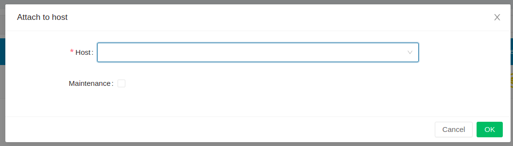

If a valid Kubernetes host exists, it will be listed in the drop-down:

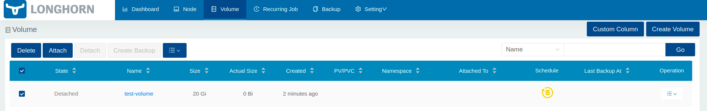

Once attached, the volume should be listed as **Healthy**:

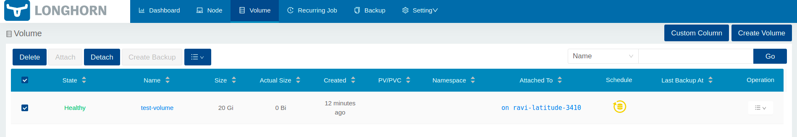

You can change any volume parameters from the drop-down list. You can also update the replica count, upgrade the engine, detach the volume and even delete it.

## **Conclusion**

This article taught you about Longhorn, a distributed Cloud Native Storage for Kubernetes clusters and [Rancher Prime](https://www.rancher.com/products/rancher-platform). Longhorn can help stateful applications save data in a continuous, highly available, and scalable storage. It also comes with an easy-to-use UI. You also learned how to easily install Longhorn with the Rancher app and marketplace.

In combination with Rancher, SUSE provides open source solutions for managing Kubernetes clusters, including [Longhorn](https://www.suse.com/products/longhorn/). Rancher allows you to manage multiple clusters and deploy applications, like Longhorn, with a single click and monitor them.

To learn more about Longhorn, you can check out the [official docs](https://longhorn.io/docs).
