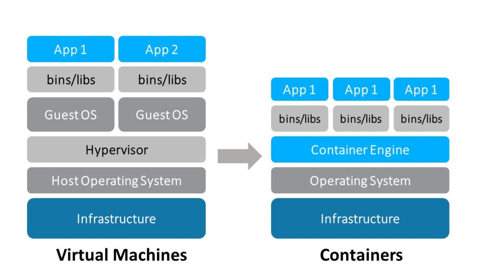

This article is essentially a guide to getting started with Docker for
people who, like me, have a strong IT background but feel a little
behind the curve when it comes to containers. We live in an age where
new and wondrous technologies are being introduced into the market
regularly. If you’re an IT professional, part of your job is to identify
which technologies are going to make it into the toolbox for the average
developer, and which will be relegated to the annals of history. Docker
is one of those technologies that sounded interesting when it first
debuted in 2013, but was easy to ignore because at the time it was not
clear whether Docker would ever graduate beyond something that
developers liked to play with in their spare time. Personally, I didn’t
pay close attention to Docker containers in Docker’s early days. They
got lost amid all the other noise in the IT world. That’s why, in 2016,
as Docker continued to rise in prominence, I realized that I’d missed
the container boat. Docker was becoming a must-know technology, and I
was behind the curve. If you’re reading this, you may well be in a
similar position. But there’s good news: [](https://attendee.gotowebinar.com/rt/2905734731496917249)
Register now for free online training on deploying containers with
Rancher **Container technology, and Docker specifically, are
not hard to pick up and learn if you already have a background in IT.**
Sure, containers can be a little scary when you’re first getting
started, just like any new technology. But rest assured that it’s not
too late to get on the container train, even if you weren’t writing
Docker files back in 2013. I’ll explain what Docker is and how container
technology works, then go through the first steps in setting Docker up
on your workstation and getting a container running that you can
interact with. Finally, I’ll direct you to some of the resources I used
to familiarize myself with Docker, so you can continue your journey.

### What is Docker and How Does it Work?

Docker is technology that allows you to create and deploy an application
together with a filesystem and everything needed to run it. The Docker
container, as it is called, can be installed on any machine, as long as
the Docker engine has been installed, and can be expected to always run
in the same manner. A physical machine with the Docker Engine installed
can host multiple Docker containers, each sharing the resources of the
host machine. You may already be familiar with machine virtualization,
either as a result of running local virtual machines using VMware on
your workstations, or interacting with cloud services like Amazon Web
Services or Microsoft Azure. Container technology is similar in some
ways, and different in others. Let’s start by comparing the two by
looking at the diagram below which shows the basic structure of a
machine hosting Docker containers, and another hosting virtual machines.
In both cases the host machine has its infrastructure and host operating
system. Virtual machines then require a hypervisor which is software or
firmware that allows virtual machines to be hosted. The virtual machines
themselves each contain their own operating system and the application,
together with its required binaries, libraries and any other
dependencies. Similarly, the machine hosting the Docker containers has
its own infrastructure and operating system. Instead of the hypervisor,
it has the Docker Engine installed, and this is what interacts with the
containers. Each container holds its application and the required
binaries, libraries and other dependencies. It is important to note that
they don’t require their own guest operating system. This allows the
containers to be significantly smaller in size, and able to be
distributed, deployed and started in a fraction of the time taken by
virtual machines.
[](https://cdn.rancher.com/wp-content/uploads/2017/02/16175231/VMs-and-Containers.jpg)
Other key differences are that virtual machines have specifically
allocated access to the system resources, while Docker containers share
host system resources through the Docker engine.

### Installing Docker and Discovering Docker Hub

I can’t think of a better way to learn about new technology than to
install it, and get your hands dirty. Let’s install the Docker Engine on
your workstation and a simple Docker container. Before we can deploy a
container, we’ll need the Docker Engine. This is the platform that will
host the container and allow it to interact with the underlying
operating system. You’ll want to pick the appropriate download from the
[Docker products](https://www.docker.com/products/overview) page, and
install it on your workstation. Downloads are available for OS X,
Windows, Linux, and a host of other operating systems. Once we have the
Docker platform installed, we’re now ready to get a container running.
Before we do that though, let’s familiarize ourselves with [Docker
Hub](http://hub.docker.com). Docker Hub is a central repository for
Docker Container images. Let’s pretend that you’re working on a Windows
machine, and you’d like to deploy an app on SUSE Linux. If you go to
Docker Hub, and search for OpenSuse, you’ll be shown a list of
repositories. At the time of writing there were 212 repositories listed.
You’ll want to look for the “official” repository. The official
repositories are maintained by a team of engineers sponsored by Docker.
Official repositories have clear documentation and promote best
practices. Now search for [BusyBox](https://hub.docker.com/_/busybox/).
Busybox is a tiny Unix distribution, which provides all of the
functionality we’ll need for this example. If you go to the official
repository, you’ll be able to read some good documentation on the image.
Let’s get a BusyBox container running on your workstation.

### Getting Your First Container Running

Assuming you’ve installed the Docker Engine, open a new command prompt
on your workstation. If you’re on a Windows machine, I’d recommend using
the Docker Quick Start link which was included as part of your
installation. This will launch an interactive shell that will make it
easier to work with Docker. You don’t need this on IOS or other
Linux-based system. Enter the following command:

```
$ docker run -it --rm busybox
```

This will search the local machine for the latest BusyBox image, and
then download it from DockerHub if it isn’t found. The process should
take only a couple of seconds, and you should have something similar to
the the text shown below on your screen:

```
$ docker run -it --rm busybox
Unable to find image `busybox:latest` locally
latest: Pulling from library/busybox
4b0b=bc1c4050b: Pull complete
Digest: sha256”817q12c32a39bbe394944ba49de563e08f1d3c5266eb89723256bc4448680e
Status: Downloaded newer image for busybox:latest
/ #
```

We started a new Docker container, using the BusyBox image. We used the
-it parameters to specify that we want an interactive, pseudo TTY
session, and the --rm flag indicates that we want to delete the
container once we exit it. If you execute a command like ‘ls’ you’ll see
that you have access to a new Linux filesystem. Play around a little,
and when you’re done, enter `exit` to exit the container, and remove
it from the system. Congratulations! You’ve now created, interacted
with, and shut down your own Docker container.

### Creating Your Own Docker Image

Being able to start up and close down a container is fun, but it doesn’t
have much practical use. Let’s start a new container, install something
on it, and then save it as a container for someone else to use. We’ll
start with a Debian container, install Git on it, and then save it for
later use. This time, we’ll start the container without the --rm flag,
and we’ll specify a version to use as well. Type the following into your
command prompt:

```
$ docker run -it debian:jessie
```

You should now have a Debian container running—specifically the jessie
tag/release from Docker Hub. Type the `git` command when you have the
container running. You should observe something similar to the
following:

```
root@4a4882a7ed59:/# git
bash: git: command not found
```

So it appears this container doesn’t have Git installed. Let’s rectify
that situation by installing Git:

```
root@4a4882a7ed59:# apt-get update && apt-get install -y git
```

This may take a little longer to run, but it will update the apt-get
utility, and then install Git. When it finishes up, type `git` again.
Voila! At this point, we have a container started, and we’ve installed
Git. We started the container without the --rm parameter, so when we
exit it, it won’t destroy the container. Let’s exit now. Type `exit`.
Now we want to get the ID of the container we just ran. To find this, we
type the following command:

```
$ docker ps -a
```

You should now see a list of recent containers. My results looked
similar to what’s below:

```
CONTAINER ID       IMAGE            COMMAND       CREATED        STATUS                          PORTS       NAMES
4a4882a7ed59       debian:jessie    “/bin/bash”   9 minutes ago  Exited (1) About a minute ago               hungry_fermet
```

It can be a little hard to read, especially if the results get wrapped
in your command window. What we’re looking for is the container ID,
which in my case was 4a4882a7ed59. Yours will be different, but similar
in format. Run the following command, replacing my container ID with
yours. Test:example are arbitrary names as well—*Test* will be the
name of your saved image, and *example* will be the version or tag of
that image.

```
$ docker commit 4a4882a7ed59 test:example
```

You should see a sha256 response once the container is saved. Now, run
the following to list all the images available on your local machine:

```
$ docker images
```

Docker will list the images on your machine. You should be able to find
a repository called test with a tag of example. Let’s see if it worked.
Start up your container using the following command, assuming you saved
your image with the same name and tag as I did.

```
$ docker run -it test:example
```

Once you have it running, try and execute the git command. It should
return with a list of possible options for Git. You did it! You created
a custom image of Debian with Git installed. You’re practically a Docker
Master at this point.

### Following the Container Ecosystem

Using containers effectively also requires a familiarity with the trends
that are defining the container ecosystem. In 2013, when Docker debuted,
the ecosystem consisted of, well, Docker. But it has changed in big ways
since then. Orchestrators, which automate the provisioning of
infrastructure for containers, have evolved and become an essential part
of large-scale container deployment. Storage options have become more
sophisticated, simplifying the task of moving data between containers
and external, persistent storage systems. Monitoring solutions for
containers have been extended from basic tools like the Docker stats
command to include commercial monitoring and APM tools designed for
containers. And Docker now even runs on Windows as well as Linux (albeit
with some important caveats, like limited networking support at this
time). Discussing all of the container ecosystem trends in detail is
beyond the scope of this article. But in order to make the most of
containers, you should follow the news in the container ecosystem to
gain a sense of what is coming next as containers and the solutions that
support them become more and more sophisticated.

### Continuing to Learn About Containers

Obviously this just scratches the surface of what containers offers, but
this should give you a good start, and afford you enough of a base of
understanding to create, modify and deploy your own containers locally.
If you would like to know more about Docker, the Web is full of useful
tutorials and additional information:

- [Rancher Monthly Online
  Training](https://attendee.gotowebinar.com/rt/2905734731496917249)
- [How to Install and Use
  Docker](https://www.digitalocean.com/community/tutorials/how-to-install-and-use-docker-getting-started)
  from DigitalOcean
- [The Complete Docker Course for DevOps and
  Developers](https://www.udemy.com/docker-tutorial-for-devops-run-docker-containers/)
  on Udemy

*Mike Mackrory is a Global citizen who has settled down in the Pacific
Northwest - for now. By day he works as a Senior Engineer on a Quality
Engineering team and by night he writes, consults on several web based
projects and runs a marginally successful eBay sticker business. When
he’s not tapping on the keys, he can be found hiking, fishing and
exploring both the urban and the rural landscape with his kids.*
