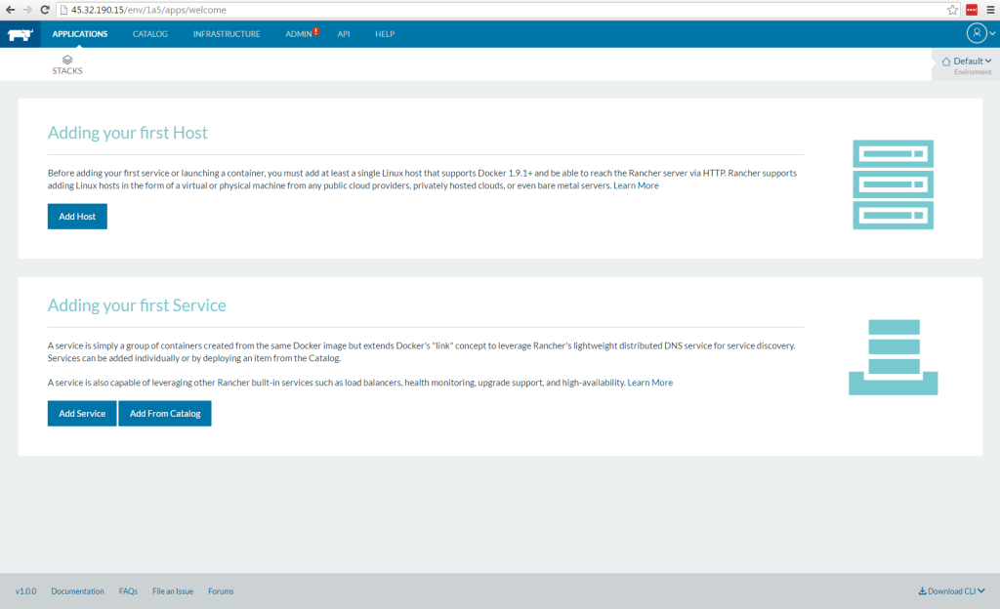
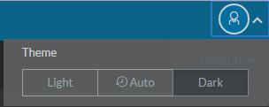
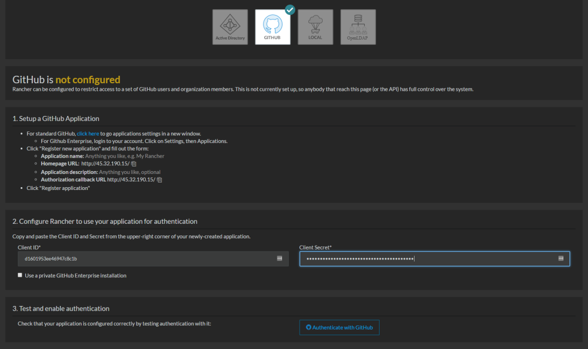
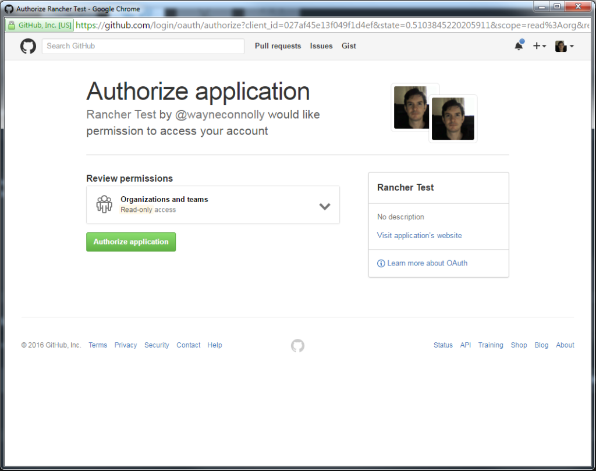
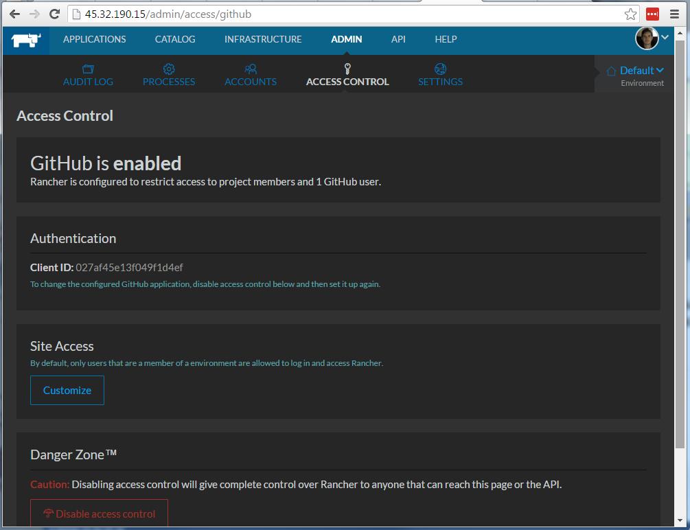

We have been using Rancher at the Piel.io (site is not up yet but by the
time I finish these blog posts for Rancher it will be...stay tuned...)
for several months now as we build our first Micro Service to release
publicly in the coming months. During that time, many things have
changed as Rancher moved towards the 1.0 release so it seems appropriate
that in this series of guest blog posts I will be stepping you through
how we at Piel.io have used Rancher 1.0 to facilitate our micro-service
product delivery. Nothing will be new to a seasoned Rancher pro, but
hopefully, I can help out people/teams who are just starting out. This
post, Part 1, will cover setting up your own Rancher Server. Part 2 will
be building, configuring and integrating your own Docker registry into
Rancher. Part 3 will discuss creation and usage of stacks to finally
provide you with a usable platform to describe, deploy and manage your
product offering. So let’s get started. First, get yourself a fresh
cloud vm. I purchased a $5 Ubuntu 14.04 LTS VM from vultr.com but any
will obviously do. Pre-requisites: Install Docker:

```
curl -fsSL https://get.docker.com/ | sh
```

After this completes you should be able to start using Docker but
let’s just verify that it exists.

```
docker -v
Docker version 1.10.3, build 20f81dd
```

Yay. We are ready to get going. Now let’s get the latest copy of
rancher, we could specify no tag to pull because the most recent tag
maps to v1.0.0 but to future proof those who want the 1.0.0 Rancher we
will include the tag. All tags can be found here:
<https://hub.docker.com/r/rancher/server/tags/>.

```
docker pull rancher/server:v1.0.0
```

```
v1.0.0: Pulling from rancher/server

8387d9ff0016: Already exists

3b52deaaf0ed: Already exists

4bd501fad6de: Already exists

a3ed95caeb02: Already exists

1dd2ffa08394: Already exists

6574a9c2d75b: Already exists

fedb745f2358: Already exists

951a2617430a: Already exists

04f380ccb3c6: Already exists

6367f33eed6c: Already exists

Digest: sha256:7634423082be8a3c7a7aafa71f3b344f212ce1b75ee3f4263362fbc87812bf6b

Status: Downloaded newer image for rancher/server:v1.0.0
```

Success! Next, I would like to keep the data persistent upon the disk.
In Docker, we do this via volumes. So go ahead and create a new folder
to house this data.

```
mkdir -p /data/rancher-server
```

We should be ready to run the Rancher image that we just pulled (note
that we could also have the Rancher image automatically pulled via the
docker run command, but I split it up for clarity).

```
sudo docker run -d -v /data/rancher-server:/var/lib/mysql --restart=always -p 80:8080 rancher/server:v1.0.0

f83e74a6b8f5c20d74acad519004635a74662954634966606e9046a7be29233b
```

Seems successful but let’s check with Docker.

```
docker ps

CONTAINER ID        IMAGE                   COMMAND                  CREATED             STATUS              PORTS                            NAMES

f83e74a6b8f5        rancher/server:v1.0.0   "/usr/bin/s6-svscan /"   35 seconds ago      Up 34 seconds       3306/tcp, 0.0.0.0:80->8080/tcp   distracted_elion

Ok, it's running, but Docker auto-named the container. So I will kill the container and run the command again with the addition of "--name rancher-server."

sudo docker run -d -v /data/rancher-server:/var/lib/mysql --restart=always -p 80:8080 --name rancher-server rancher/server:v1.0.0

1fa9cc4013e8e17f1ac175b011955308089819e8c10d423e3b06ed09c536e864

docker ps

CONTAINER ID        IMAGE                   COMMAND                  CREATED             STATUS              PORTS                            NAMES

1fa9cc4013e8        rancher/server:v1.0.0   "/usr/bin/s6-svscan /"   3 seconds ago       Up 2 seconds        3306/tcp, 0.0.0.0:80->8080/tcp   rancher-server
```

Now to visit the website.
**[](https://cdn.rancher.com/wp-content/uploads/2016/04/18072009/1.rancher.png)**
Brilliant, So we now have Rancher Server up and running on port 80 with
a persistent file storage which is helpful when you upgrade or migrate
the Rancher Server as it saves all the setup/configuration from being
repeated I will also switch the theme from light to dark as I think it
looks a lot better than the default light theme. But, it’s up to you of
course.
**[](images/rancher_blog_2.rancher.png)**
Anyone can obviously hit this URL and start configuring Rancher so it is
time to add some security. I choose Github authentication as all of our
team members use Github, so it makes sense. Navigate to ADMIN >
ACCESS CONTROL This page is self-explanatory and outlines the steps
you need to complete to authorize Rancher via Github so I won’t rehash
these steps.
**[](https://cdn.rancher.com/wp-content/uploads/2016/04/18072106/3.rancher.png)**
Fill out your client and secret and click the Authorize button. A Github
authorize screen will pop up and request authorization confirmation,
**[](https://cdn.rancher.com/wp-content/uploads/2016/04/18072120/4.rancher.png)**
If all goes well, then we will have successfully secured the Rancher
application.
**[](images/rancher_blog_5.rancher.png)**
So let’s recap what has happened here: We have pulled the 1.0.0 Rancher
Server Docker image and have run it on the standard web port 80. It has
a persistent storage on the host disk in case we wish to upgrade in the
future and finally we have secured the container via Github
authorization. In the next blog post, I will create a Docker Registry
and show how we can utilize it inside of Rancher.
