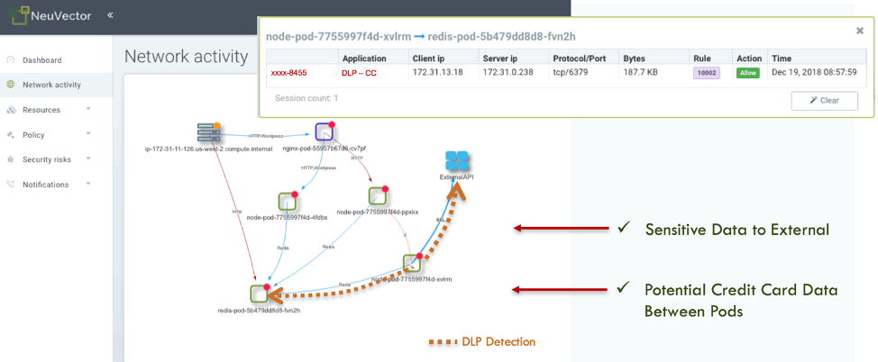

Containers are becoming the new computing standard for many businesses. New technology does not protect you from traditional security concerns. If your containers handle any sensitive data, including personally identifiable information (PII), credit cards or accounts, you’ll need to take a ‘defense in depth’ approach to container security. The CI/CD pipeline is vulnerable at every stage, from build to ship to runtime.

In this article, we’ll look at best practices for protecting sensitive data and enforcing compliance, from vulnerability management to network segmentation. We’ll also discuss how NeuVector simplifies security, privacy and compliance throughout the container lifecycle for organizations using Rancher’s kubernetes management platform.

## Shift-Left Security

The DevOps movement is all about shifting left, and security is no different. The more security we can build in earlier in the process, the better for developers and the security team. The concept of security policy as code puts more control into developers hands while ensuring compliance with security mandates. Best practices include:

### Comprehensive vulnerability management

Vulnerability detection and management throughout the CI/CD pipeline is essential. In order to prevent vulnerabilities from being introduced into registries, organizations should create policy-based build success/failure criteria. As a further safeguard, they should monitor and auto-scan all major registries such as AWS Elastic Container Registry, Docker, Azure Container Registry (ACR) and jFrog Artifactory. And finally, they should automatically scan running containers and host OSes for vulnerabilities to prevent exploits and other attacks on critical business data. With an auto-scanning infrastructure in place, containers can be auto-quarantined based on a vulnerability criteria.

Recommendation:

- Scan the Rancher OS (or other OS)
- Integrate and automate scanning with Jenkins plug-in or other build-phase scanning extensions, plus registry scanning
- Employ admission control to prevent deployment of vulnerable images
- Scan running containers and hosts for vulnerabilities, preventing ‘back-door’ vulnerable images
- Protect running containers from vulnerability exploits with ‘virtual patching’ or other security controls to prevent unauthorized network or container behavior.

### Adherence to the Center for Internet Security Benchmarks for Kubernetes and Docker

The CIS benchmarks provide strong security auditing for container, orchestrator and host configurations to ensure that proper security controls are not overlooked or disabled. These checks should be run before containers are put into production, and continuously run after deployment, as updates and restarts can often change such critical configurations. Patching, updating and restarting hosts can also inadvertently open security holes that were previously locked down.

Recommendation:

- Use [CIS Scan in Rancher 2.4](https://rancher.com/products/rancher/2.4) to run CIS benchmarks for Rancher managed Kubernetes clusters and the containers running on them.
- Augment CIS benchmarks with any customized auditing or compliance checks on hosts or containers which are required by your organization.

### Privacy

Privacy is a critical component of many compliance standards. However, container environments raise PCI Data Security Standard (DSS) – and likely GDPR and HIPAA – compliance challenges in the areas of monitoring, establishing security controls and limiting the scope of the Cardholder Data Environment (CDE) with network segmentation. Due to the ephemeral nature of containers – spinning up and down quickly and dynamically, and often only existing for several minutes – monitoring and security solutions must be active in real-time and able to automatically respond to rapidly transforming attacks.

Because most container traffic is internal communication between containers, traditional firewalls and security systems designed to vet external traffic are blind to nefarious threats that may escalate within the container environment. And the use of containers can increase the CDE, requiring critical protections to the size of the entire microservices environment unless limited by a container firewall able to fully visualize and tightly control its scope.

Recommendation:

- Inspect network connections from containers within and exiting the Rancher cluster for unencrypted credit card or Personally Identifiable Information (PII) data using network DLP
- Provide the required network segmentation for in-scope (CDE) traffic for application containers deployed by and run on Rancher

### Compliance (PCI, GDPR, HIPAA and More)

Containers and microservices are inherently supportive of PCI DSS compliance across several fronts. In an ideal microservices architecture, each service and container delivers a single function, which is congruent with the PCI DSS requirement to implement only a single primary function with each server. In the same way, containers provide narrow functionality by design, meeting the PCI DSS mandate to enable only necessary protocols and services.

One might think that physically separate container environments that are in-scope would resolve issues, but this can severely restrict modern automated DevOps CI/CD pipelines and result in slower release cycles and underused resources. However, cloud-native container firewalls are emerging which provide the required network segmentation without the sacrifice of the business benefits of containers.

Recommendation:

- Deploy a cloud-native firewall to automate network segmentation required by compliance standards such as PCI.
- Maintain forensic data, logs and notifications for security events and other changes.

## How NeuVector Enhances Rancher Security

NeuVector extends Rancher’s capabilities to support and enforce PCI-DSS, GDPR and HIPAA compliance requirements by auditing, monitoring and securing production deployments built on Rancher including:

- Providing a comprehensive vulnerability management platform integrated with Rancher admission controls and run-time visibility.
- Enforcing network segmentation based on layer 7 application protocols, so that no unauthorized connections are allowed in or out of containers.
- Enforcing that encrypted SSL connections are used for transmitting sensitive data between containers and for ingress/egress connections.
- Monitoring all unencrypted connections for sensitive data and either alerting or blocking when detected.

The NeuVector [container security platform](https://neuvector.com/run-time-container-security/) is an end-to-end solution for securing the entire container pipeline from build to ship to run-time. The industry’s first container firewall provides the critical function to perform automated network segmentation and container DLP by inspecting all container connections for sensitive data such as credit cards, PII and financial data. The screen shot below shows an example of unencrypted credit card data being transmitted between pods, as well as to an external destination.

A container firewall solution provides network segmentation, network monitoring and encryption verification – meeting regulatory compliance requirements. PCI-DSS requires network segmentation as well as encryption for in-scope CDE environments. The NeuVector container firewall provides the required network segmentation of CDE workloads, while at the same time monitoring for unencrypted cardholder data which would violate the compliance requirements. The violations can be the first indications of a data breach, a misconfiguration of an application container or an innocent mistake made by a customer support person pasting in credit card data into a case.

## Next Steps for Securing Your Container Infrastructure

For organizations transitioning to container infrastructure, it is important to recognize that security is important throughout the lifecycle of the container. Compliance and privacy regulations require protection of customer’s information wherever it resides on the organization’s network.

In this article, we looked at some of the ways that you can protect sensitive data and enforce compliance in your container infrastructure. To learn more, join us for our free [Master Class: How to Automate Privacy Protections, PCI Compliance and Vulnerability Management for Kubernetes](https://info.rancher.com/kubernetes-master-class-may5-2020) on May 5.
