# Introduction

[](https://media1-production-mightynetworks.imgix.net/asset/23804952/couch_DB.png?ixlib=rails-4.2.0&fm=jpg&q=75&auto=format)

[CouchDB](https://couchdb.apache.org/) is an open source NoSQL database that stores highly available data accessed through HTTP requests to its REST API server. Among many notable features of CouchDB, here are some you might consider for your needs:

- Through its cluster design, CouchDB can be scaled up or down to suit your requirements, as you can configure nodes within the cluster while performing data replication between them.
- Being a document-oriented database, Couchdb provides flexible data models for structuring your stored data.
- CouchDB makes it easier to work with data by providing a REST-like interface for making operations without the need for drivers or extra configurations.

In this article, we'll use Rancher to provision a [Kubernetes](https://kubernetes.io/) cluster on the [Google Kubernetes Engine](https://cloud.google.com/kubernetes-engine) (GKE) with two statefulsets workloads running a distributed CouchDB database. Further operations on the cluster will be done using the new Rancher [Cluster Explorer](https://rancher.com/blog/2020/rancher-2-5-partner-perspective-from-sva).

## Prerequisites:

Although they are briefly explained in this guide, you should be familiar with the following;

- Key concepts and terminologies of Kubernetes and CouchDB.
- Tradeoffs of using a distributed containerized database. The introductory parts of [this article](https://community.suse.com/posts/%28https%3A//rancher.com/blog/2018/2018-06-20-create-production-quality-database/%29) discuss the Advantage of using Kubernetes for Distributed Databases

## Setup:

Here are the resources you would need to follow along with this article: -

- [RancherD](https://rancher.com/blog/2020/rancherd-simplifies-rancher-deployment) to launch the Rancher Kubernetes Cluster- A CouchDB installation
- An active billing plan on the [Google Cloud Platform](https://console.cloud.google.com/) account. You can sign up for a new account [here](https://console.cloud.google.com/) to receive free trial credits for this project.
- [Google Kubernetes Engine](https://cloud.google.com/kubernetes-engine)
- [Google Compute Persistent Disks](https://cloud.google.com/persistent-disk)

### Step 1 -- Set Up Rancher on A VM Instance using RancherD

If this is your first time using Rancher, you can get Rancher installed in the quickest time possible using [RancherD](https://rancher.com/blog/2020/rancherd-simplifies-rancher-deployment), a single binary that you can launch to bring up a Kubernetes cluster bundled with the deployment of Rancher itself.

For this use case, you would install [RancherD](https://rancher.com/blog/2020/rancherd-simplifies-rancher-deployment) on a [Debian-based](https://www.debian.org/) virtual machine instance on the [Google Compute Engine](https://cloud.google.com/compute) using the command below;

```
curl -sfL https://get.rancher.io | sh -
```

Next, start the Rancher management server after installing Rancher using RancherD in the script above on your Virtual machine.

Open your web browser and navigate to port *8080* on your web browser to access the Rancher management server and go through the one-time installation.

### Step 2 -- Connecting Rancher To Your GCP Project

Rancher simplifies the provisioning and management of a cluster on several cloud providers supporting Kubernetes, including GKE. The Rancher Management server can connect to Kubernetes clusters within your project using the enabled GKE API through a service account with the necessary roles. After creating a service account, Google Cloud supplies a JSON service account key to Rancher for authentication and Rancher uses it to connect to the service account.

The following steps outline the commands needed to create a Service Account and obtain a Service Account Key using the terminal on your local with [gcloud](https://cloud.google.com/sdk/gcloud) installed or the Cloud Shell on the Cloud Console;

Run the command below to create a new Service account:

```
gcloud iam service-accounts create couchdb-rancher --description="For CloudDB GKE deployment" --display-name="couchdb-rancher"
```

Update the Service Account with the [IAM](https://cloud.google.com/iam) roles needed by Rancher, replacing **PROJECT\_ID** with your actual project **ID**:

```
gcloud projects add-iam-policy-binding PROJECT_ID --member="serviceAccount:couchdb-rancher@PROJECT_ID.iam.gserviceaccount.com" --role="roles/compute.viewer" --role="roles/viewer" --role="roles/container.admin" --role="roles/iam.serviceAccountUser" --condition=None
```

Lastly, create a Service Account Key in JSON format and download it into your project directory on GCP:

```
gcloud iam service-accounts keys create ~/key.json --iam-account couchdb-rancher@project-id.iam.gserviceaccount.com
```

At this point, we have a Service Account that we can access through the Service Account Key. To use the key, type ***cat key.json*** and copy the file contents printed out to the console.

Paste the file content into the Service Account input field in the Rancher cluster creation page, then configure your cluster nodes.

### Step 3 -- Provision a Two-Node Kubernetes Cluster

From your Rancher dashboard, click the **Create Cluster** button to create a new cluster with **Google Kubernetes Engine** selected as a hosted Kubernetes provider.

After adding a name and a cluster label to the input fields, copy the content of the generated service account key into the Service account field.

[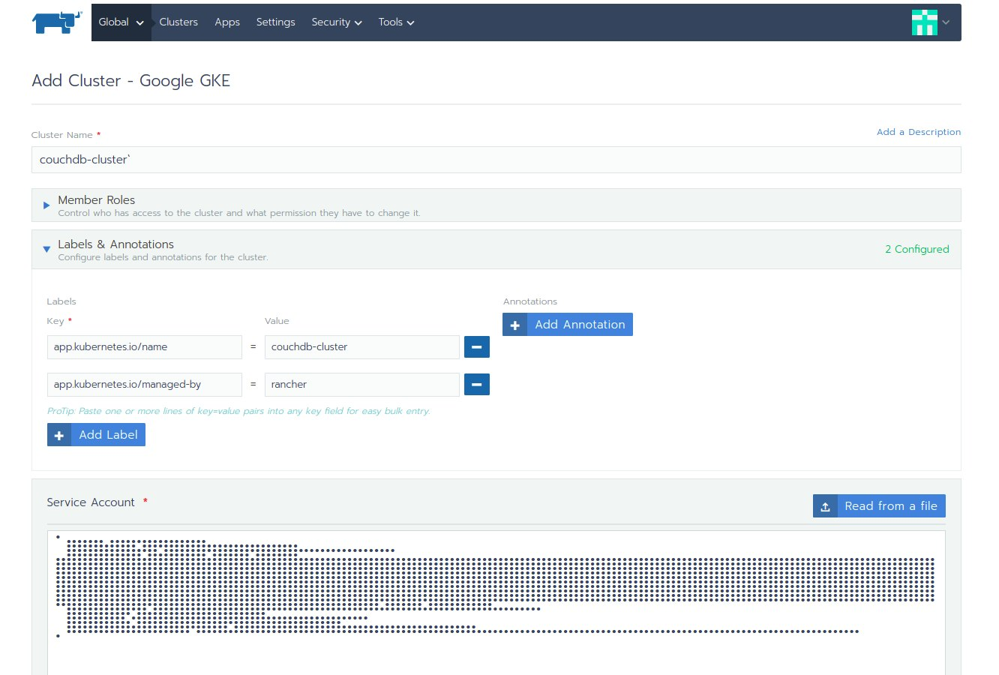](https://media1-production-mightynetworks.imgix.net/asset/23109831/1.png?ixlib=rails-4.2.0&fm=jpg&q=75&auto=format)

Click **Configure Nodes** to authenticate with Google Cloud. Then configure your cluster nodes.

For Node Options, modify the Node Count to 2 and Root Disk Size to 50 GB, leaving the other values as default.

The configuration file in YAML format used to create the nodes can be found here:

[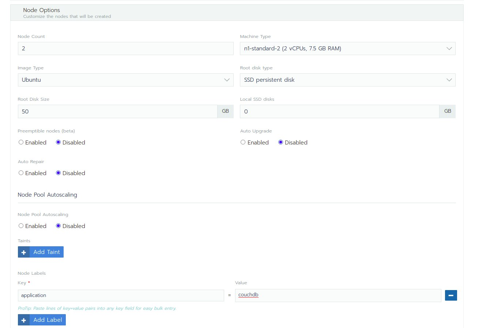](https://media1-production-mightynetworks.imgix.net/asset/23109889/2.png?ixlib=rails-4.2.0&fm=jpg&q=75&auto=format)

Using the configuration above, we can configure a 2-node cluster with a 50 GB root disk size Ubuntu image.

[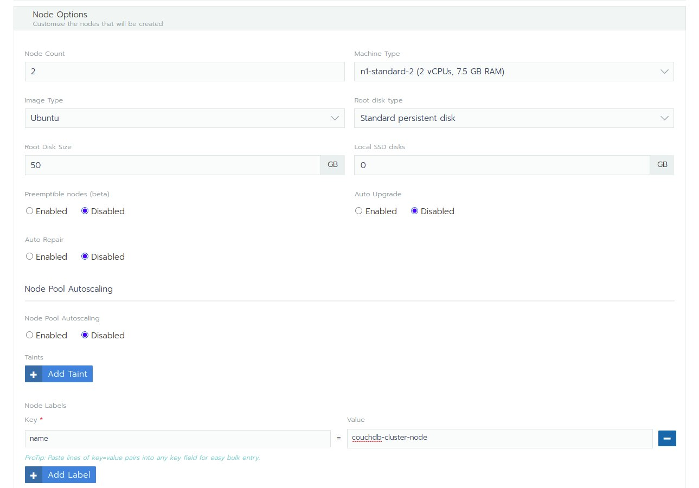](https://media1-production-mightynetworks.imgix.net/asset/23110006/3.png?ixlib=rails-4.2.0&fm=jpg&q=75&auto=format)

Click the **Create** button to begin provisioning the cluster (this takes a few minutes.)

With the opened cluster in an **active** state, we can switch from the Cluster Manager in Rancher to the new Cluster Explorer to view and work further with this cluster.

[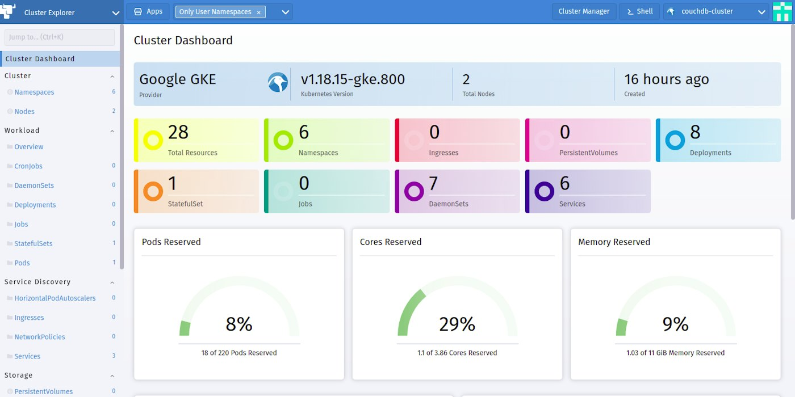](https://media1-production-mightynetworks.imgix.net/asset/23110132/4.png?ixlib=rails-4.2.0&fm=jpg&q=75&auto=format)

The new Cluster Explorer dashboard gives us full analytics of the Kubernetes cluster without needing to fetch resource details using the *kubectl ge*t command. Useful, right?

### Step 4 -- Create a Statefulset Workload

Next, we would create a [Statefulset](https://kubernetes.io/docs/concepts/workloads/controllers/statefulset/#:~:text=StatefulSet%20is%20the%20workload%20API,on%20an%20identical%20container%20spec) workload type on the pods.

Statefulsets provide a unique identifier of the pods and also an ordering when destroyed or created. Two key things are needed for persistent storage within pods.

From the left navigation menu, navigate to the StatefulSets page to create a [StatefulSet](https://kubernetes.io/docs/concepts/workloads/controllers/statefulset/#:~:text=StatefulSet%20is%20the%20workload%20API,on%20an%20identical%20container%20spec) with the configurations in the image below; The configuration file in YAML format used to create this StatefulSet looks like this:

[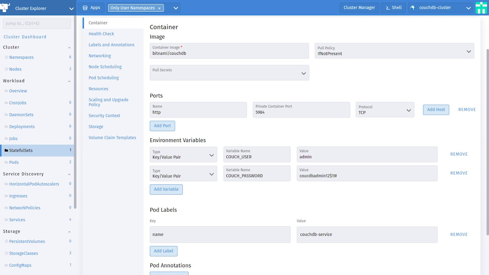](https://media1-production-mightynetworks.imgix.net/asset/23110363/5.png?ixlib=rails-4.2.0&fm=jpg&q=75&auto=format)

**Attention**: As you can see in the above image, we are not using the official  [CouchDB Image](https://hub.docker.com/_/couchdb) on [DockerHub](https://hub.docker.com/), but [one managed](https://bitnami.com/stack/couchdb) by Bitnami.

**Note**: CouchDB 3+ no longer supports the [Admin party](https://guide.couchdb.org/draft/security.html), so we need a user and a password for an admin. Add a ***COUCHDB\_USER***and  ***COUCHDB\_PASSWORD*** in the environment variables field above.

Once in an **active** state, we use *kubectl logs* to view logs from one of the stateful set replicas to see if the CouchDB instance is running and if any errors occurred during installation.

Using the Cluster Explorer shell, run the command below to view the logs from the first stateful set replica.

```
kubectl logs -f pod/couchdb-statefulset-0
```

[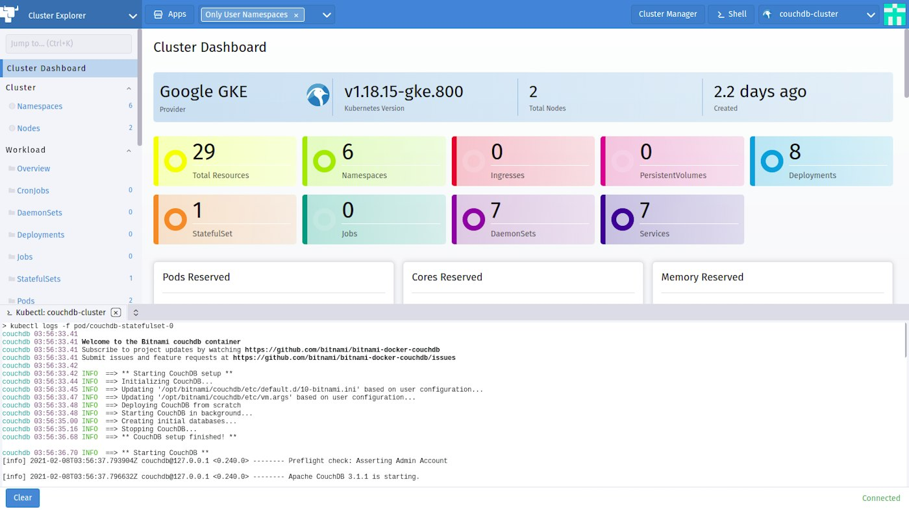](https://media1-production-mightynetworks.imgix.net/asset/23110571/6.png?ixlib=rails-4.2.0&fm=jpg&q=75&auto=format)

The shell in the image above shows the installer running to set up CouchDB after the replica was created.

Now we have a Couch Database created across two replicas. However, we need to persist the data to prevent data loss when one of the pods is restarted.

### Step 5 -- Dynamically Provision A New Storage

**Note:** With [Dynamic Provisioning](https://kubernetes.io/docs/concepts/storage/dynamic-provisioning/), we don’t need to pre-provision storage before creating the workloads. This can be done on-demand and automatically attached using its StorageClass when requested.

To persist data from the pods, we create a GCE Persistent Disk for storing data in blocks, as follows:

1. **Create a Storage Class configuration**;

Similar to storage classes in the C programming language, storage classes in Kubernetes are used to describe the classes of storage offered. <!-- I'm not sure this helps to understand. Maybe an example of different storage classes would be better? -->

From the Storage section in the top-bar navigation menu, click the **Storage Classes** to add a new Storage Class similar to the one in the image below;

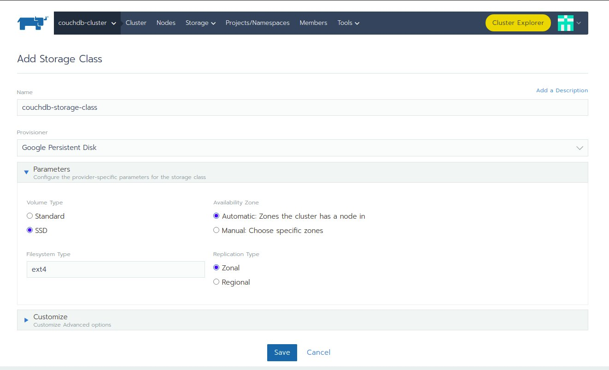

2. **Create a Persistent Volume Claim (PVC);**

Let’s create a new PVC that uses the previously created Storage Class from Cluster Explorer. The configuration file in YAML format used to create this Persistent Volume Claim can be found [here](https://github.com/vickywane/rancher-couchdb-cluster/blob/main/pvc-config.yaml):

[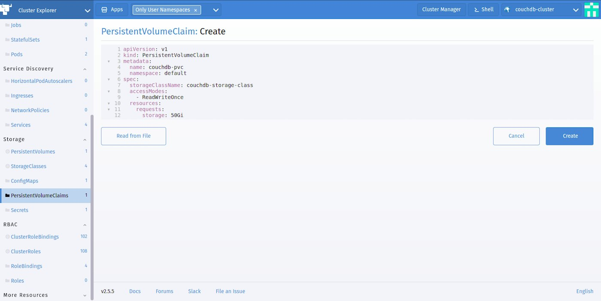](https://media1-production-mightynetworks.imgix.net/asset/23111376/8.png?ixlib=rails-4.2.0&fm=jpg&q=75&auto=format)

Clicking the **C****reate** button would save this PVC and immediately create a Persistent Volume using the Storage Class referenced in it and bind it.

You would see the newly created PVC and its status on the PVC list. From your terminal, you can get all PVCs using the Kubectl command below;

```
kubectl get pvc
```

You can also get more details about the persistent volume claim using the command below;

```
 kubectl describe coucdb-pvc
```

[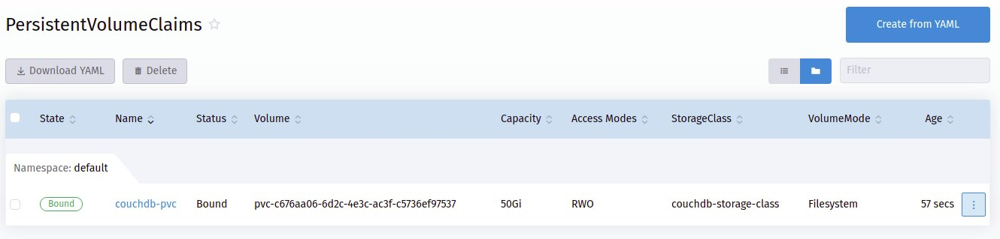](https://media1-production-mightynetworks.imgix.net/asset/23111560/9.png?ixlib=rails-4.2.0&fm=jpg&q=75&auto=format)

**Attention:** We can see by the random values used that the volume name was auto-generated.

From the **Persistent Volumes** page, we can see the generated volume created. From your terminal, you can get all PVs using the Kubectl command below;

```
kubectl get pv
```

You can also get more details about the persistent volume using the *describe* command within Kubetcl;

```
kubectl describe PV_NAME
```

[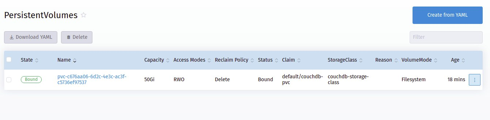](https://media1-production-mightynetworks.imgix.net/asset/23111637/10.png?ixlib=rails-4.2.0&fm=jpg&q=75&auto=format)

**Attention:** The bound PV above has a Reclaim Policy set to delete, meaning it is automatically deleted when the PVC is deleted.

If we check the Disk section within the GCE, we can see the two disks created for the two replicas.

[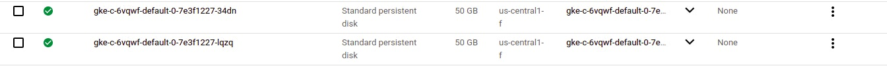](https://media1-production-mightynetworks.imgix.net/asset/23111659/11.png?ixlib=rails-4.2.0&fm=jpg&q=75&auto=format)

At this stage, our pods are persisting data to the persistent disk on the GCE so that we can worry less about a sudden restart.

### Step 6 -- Expose The StatefulSet Service

From the side menu, navigate to the **Services** page and select the **LoadBalancer** service type. Add the following configurations into the fields in the respective sections:

- **Selectors**: statefulset.kubernetes.io/pod-name : couchdb-statefulset-0

[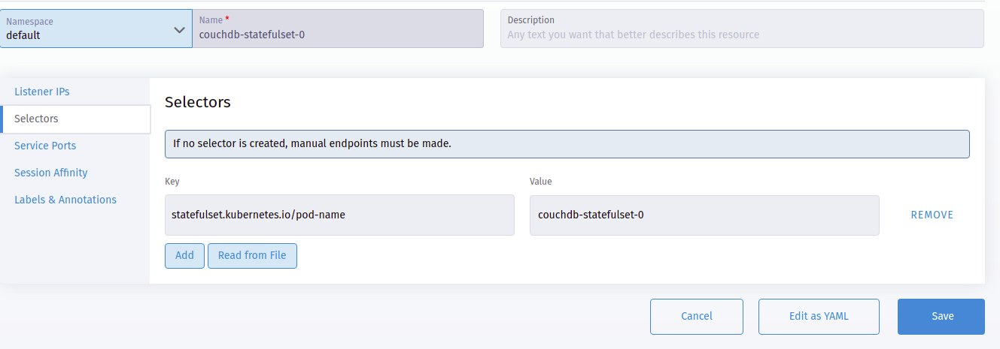](https://media1-production-mightynetworks.imgix.net/asset/23111727/12.png?ixlib=rails-4.2.0&fm=jpg&q=75&auto=format)

- **Service Ports**: Leaving the **Protocol** and Node Port as their defaults, set the listening port to *5984* and target port to *5984*.

[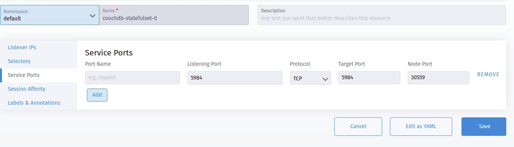](https://media1-production-mightynetworks.imgix.net/asset/23111757/13.png?ixlib=rails-4.2.0&fm=jpg&q=75&auto=format)

Leave the rest options as their defaults and create the service.

From the services list, click on the target to access the service endpoint.

### Step 7 -- Access CouchDB Data Using Fauxton

We can access and work with Couch DB visually using the Fauxton web app. The Apache docs on [Fauxton](https://couchdb.apache.org/fauxton-visual-guide/index.html) describe it as "a web-based interface built into CouchDB. It provides a basic interface to most of the functionality, including the ability to perform CRUD operations on documents."

To access [Fauxton](https://couchdb.apache.org/fauxton-visual-guide/index.html), we can expose one of the pods using a [LoadBalancer](https://kubernetes.io/docs/concepts/services-networking/service/#loadbalancer) service type to access the pod directly through its IP Address.

To access the Fauxton web application, append ***/\_utils*** to the endpoint address. Then input the username and password defined in the cluster environment variables. <!-- Where do we find the endpoint address? -->

[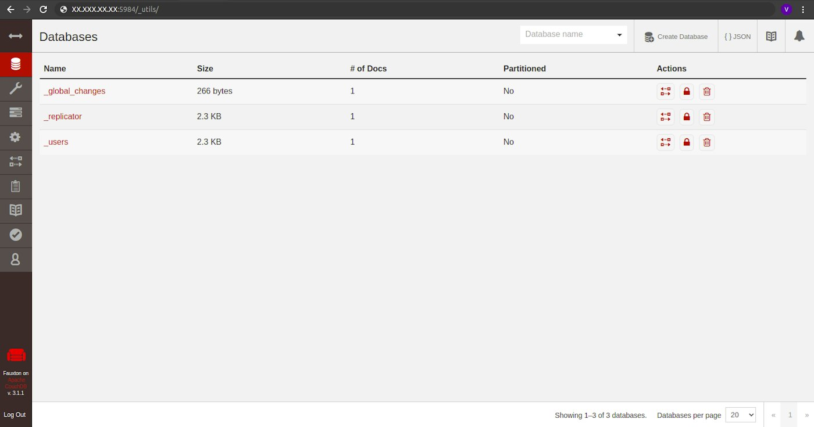](https://media1-production-mightynetworks.imgix.net/asset/23111796/14.png?ixlib=rails-4.2.0&fm=jpg&q=75&auto=format)

**Attention:** The databases in the image above were created by default during the installation process using the CouchDB Installer.

Now the Couch Database is fully operational, and we can make HTTP requests to your CouchDB server interface to query data.

## Summary

While we provisioned a distributed containerized Couch database on GKE, the main focus of the article was showing how we could provision and manage the resources using the Rancher and the new Cluster Explorer with ease.

That said, Rancher provides many features which help to simplify your Kubernetes operations. If you are forwarding to using Rancher, you can get started by using the [RancherD](https://rancher.com/blog/2020/rancherd-simplifies-rancher-deployment) installation script as it is the easiest way to get Rancher up and running on your machine.

Note that the cluster built within this article is not production-ready as it is missing several important configurations, including the [liveness and readiness probes](https://kubernetes.io/docs/tasks/configure-pod-container/configure-liveness-readiness-startup-probes/) for Health checks. However, this post should show you how to set up a production-ready cluster using Rancher.
