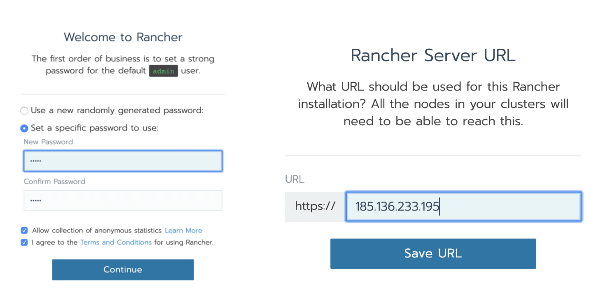
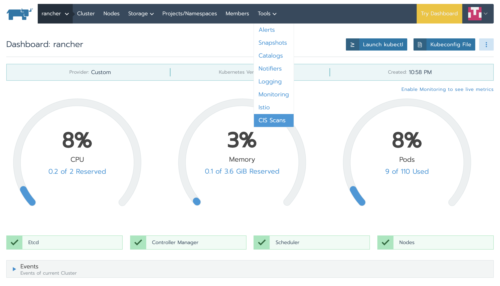
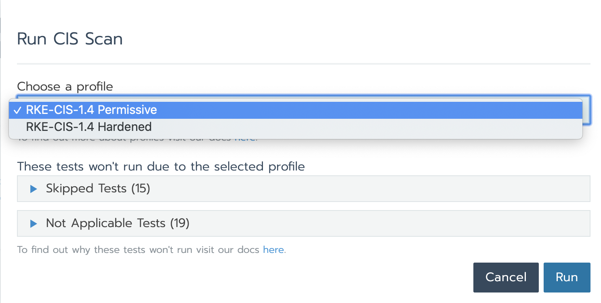

*Editor’s note: Rancher Labs’ William Jimenez provides an introduction to CIS Scan. Then Saiyam Pathak takes over with a hands-on demo.*

Cluster security is critical to any successful Kubernetes strategy. Recent research by AimPoint revealed that 44 percent of respondents had delayed application production due to security concerns around Kubernetes containers.

Yet securing Kubernetes is a complex machine with many moving parts, integrations and knobs and levers. This can make the already challenging job of a security expert even more difficult.

Rancher Labs is constantly looking for ways to improve the efficiency of our users, so we’re excited to launch the CIS Scan feature in Rancher 2.4. This new integrated feature for Rancher managed clusters allows you to run ad-hoc security scans of your RKE clusters against more than 100 CIS benchmarks published by the [Center for Internet Security](https://www.cisecurity.org/) as well as scheduled scans. With CIS Scan, you can create custom test configurations and generate reports that illustrate pass/fail information. From there, you can take corrective action to ensure your clusters meet all security requirements.

The CIS Benchmark is considered the de facto definition of a secure Kubernetes cluster. It provides an industry approved rubric by which to measure a Kubernetes cluster’s security posture. It couples domain knowledge of the info-sec community with a deep understanding of the API, interactions and overall control pathways in Kubernetes. When an engineer is trying to understand all the places they need to secure their cluster, the benchmark outlines dozens of possible attack vectors and how to mitigate against them.

## Why Do IT Ops Need CIS Scan?

Evaluating a cluster by hand against a CIS benchmark can be a time-intensive and failure-prone process. The reality of today’s cloud environments is that our systems are constantly changing, so we need to re-evaluate often. That’s where `kube-bench` comes in. This is an open source tool created by Aqua Security to automate the process of evaluating a cluster against the CIS Benchmark.

Rancher 2.4 uses `kube-bench` under the hood, but with several valuable additions. With CIS Scan in Rancher 2.4, you can orchestrate a scan of your cluster with a single action. Rancher handles fetching the `kube-bench` tool and wiring it up to your cluster. Then Rancher summarizes the results from all the nodes into an easy-to-read report that shows areas where the cluster passed or failed. In addition, Rancher lets you schedule a period scan at the cluster level. And this setting can be enabled at the cluster template level, allowing an admin to configure the template for scheduled scans by default so that scans run for every new cluster created by any user in the Rancher setup. Finally, Rancher provides customizable alerts and notifications for CIS Scans to notify security admins of configuration drift or if a cluster fails the scan.

Now I’ll hand things off to Saiyam to show us how it works.

## Hands-on with CIS Clusters in Rancher 2.4

Let’s spin up a Rancher RKE cluster.

Prerequisites: CentOS VM (2 core min) with Docker Installed.

**Step 1**: Run Rancher server

```
[root@rancher-rke ~]# sudo docker run -d --restart=unless-stopped -p 80:80 -p 443:443 rancher/rancher:v2.4.0-rc3
Unable to find image 'rancher/rancher:v2.4.0-rc3' locally
Trying to pull repository docker.io/rancher/rancher ...
v2.4.0-rc3: Pulling from docker.io/rancher/rancher
423ae2b273f4: Pull complete
de83a2304fa1: Pull complete
f9a83bce3af0: Pull complete
b6b53be908de: Pull complete
b365c90117f7: Pull complete
c939267bea55: Pull complete
7669306d1ae0: Pull complete
25e0f5e123a3: Pull complete
d6664495480f: Pull complete
99f55ceed479: Pull complete
edd7d0bc05aa: Pull complete
77e4b172baa4: Pull complete
48f474afa2cd: Pull complete
2270fe22f735: Pull complete
44c4786f7637: Pull complete
45e3db8be413: Pull complete
6be735114771: Pull complete
dfa5473bfef3: Pull complete
Digest: sha256:496bd1d204744099d70f191e86d6a35a5827f86501322b55f11c686206010b51
Status: Downloaded newer image for docker.io/rancher/rancher:v2.4.0-rc3
a145d93e8fa66a6a08b4f0e936dafc4b9717a93c59013e78118a4c5af8209a53
```

```
[root@rancher-rke ~]# docker ps

CONTAINER ID        IMAGE                        COMMAND             CREATED              STATUS              PORTS                                      NAMES
a145d93e8fa6        rancher/rancher:v2.4.0-rc3   "entrypoint.sh"     About a minute ago   Up About a minute   0.0.0.0:80->80/tcp, 0.0.0.0:443->443/tcp   distracted_albattani
```

**Step 2:** Go to Rancher URL and install **RKE** `http://{hostIP}`

Set the Password and URL


Set up Rancher password and URL as the host IP

Add a new Cluster and choose `From existing nodes (Custom)`


Choose default options and select etcd, control plane and worker, as we are going to install everything on a single VM.


**Copy the above command and run on the VM instance**

```
[root@rancher-rke ~]# **sudo docker run -d --privileged --restart=unless-stopped --net=host -v /etc/kubernetes:/etc/kubernetes -v /var/run:/var/run rancher/rancher-agent:v2.4.0-rc3 --server https://185.136.233.195 --token** hwpf4kpjf49gk9wq5xvw7gdjxtj257j8wmnn5rj6lb98csz2zmkcgq --ca-checksum 3f9640ab12533287fd5e0ad1663cccf354a4ce2a76243cd6735abcfb085bdbf2 --etcd --controlplane --worker
Unable to find image 'rancher/rancher-agent:v2.4.0-rc3' locally
Trying to pull repository docker.io/rancher/rancher-agent ...
v2.4.0-rc3: Pulling from docker.io/rancher/rancher-agent
423ae2b273f4: Already exists
de83a2304fa1: Already exists
f9a83bce3af0: Already exists
b6b53be908de: Already exists
931af2228ddf: Pull complete
94b51e50d654: Pull complete
7e7961efe32b: Pull complete
85725dc92c8d: Pull complete
5a82c6e509a6: Pull complete
3b675e73aee3: Pull complete
Digest: sha256:89017bd846a8cc597186f41eb17cfe1520aa0f7e6d86b48d8c32a5490c588f1e
Status: Downloaded newer image for docker.io/rancher/rancher-agent:v2.4.0-rc3
5aaa9fab48db4557c84b7ce0c61816384075570ed3e593446795bf8443610b64
```

In the Rancher UI, the cluster gets imported and we can see the status of the cluster as active:


Now click on the cluster and from the Tools menu, select CIS Scans.





Currently the CIS Scan is only for RKE clusters and there are two scan profiles: Permissive and Hardened.

**Permissive:** Skips a set of tests because they are too obstructive for a user who is just getting started with Kubernetes.

**Hardened:** No tests are skipped. This is for advanced users and security professionals.

In each of these profile types, some of the tests are marked **Not Applicable** because they do not apply to RKE clusters.

Now let’s choose the “Permissive” profile and run the scan. The result is a pass overall for the standard RKE cluster.


In order to see more details about all the tests performed, click on the test and the whole list of tests failed/skipped/passed appears.


Let’s do the same test with the “Hardened” profile and we’ll see the tests that were skipped the last time would fail.


As you can see, in accordance with the CIS benchmarking, the results that are a **Fail** provide a description as well as a remediation step. This is really useful as you not only know what things are falling apart within your cluster per the CIS benchmark, but you also get to repair the cluster with a suitable recommendation.

## Next Steps for Hardering Your Cluster Security

What’s even better than being able to click to run a CIS Scan is to have it happen on an automated schedule. This can be configured in Rancher as well. A regularly occurring scan gives you the peace of mind that if something does become uncompliant in your cluster, you will catch it sooner.

Now what happens when something isn’t compliant in your cluster? The solution is simple: check out the [Rancher Hardening Guide](https://rancher.com/docs/rancher/v2.x/en/security/#rancher-hardening-guide). This guide provides Rancher-specific steps to follow to bring your cluster in compliance with each of the CIS checks. Rancher’s world-class support team is well versed in addressing these issues from years of experience. As they say, this isn’t our first rodeo ;)

See CIS Scan in action. [Register for our free Master Class](https://info.rancher.com/secure-production-kubernetes-clusters-with-cis-benchmark-scanning-tool-in-rancher-2-4): How to Harden Your Kubernetes Clusters with the CIS Benchmark Scanning Tool in Rancher on April 29 with Rancher’s Senior Product Manager Bill Maxwell.
