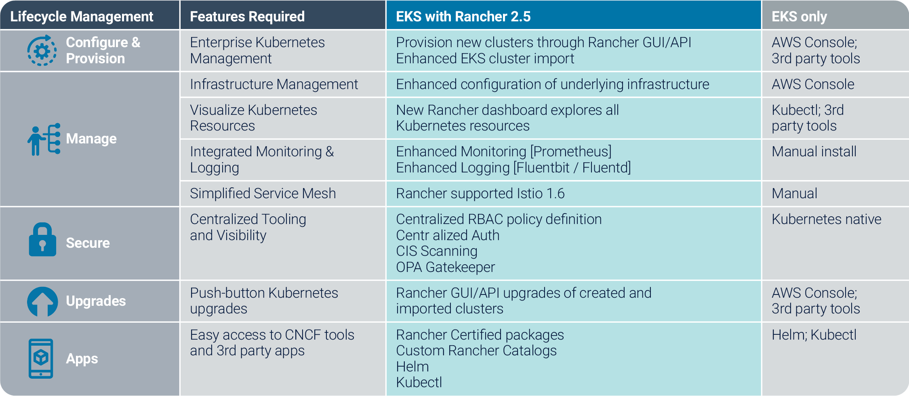
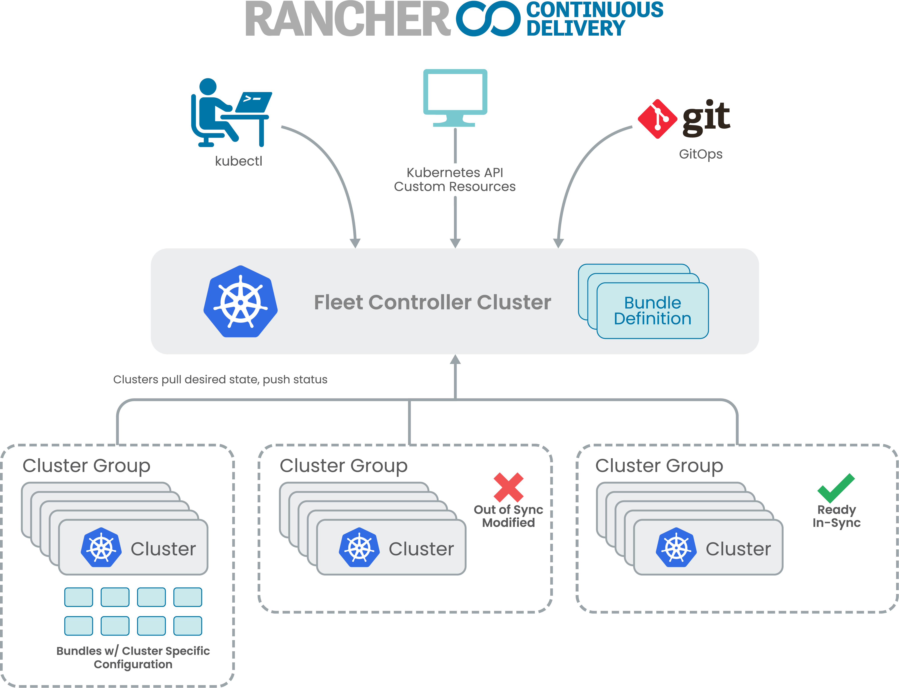

Discover what’s new in Rancher 2.5 [Learn More](/products/rancher/2.5) Despite the lockdown restrictions of the last six months, I'm delighted to announce that we've released Rancher 2.5 on schedule today. This latest release represents another major milestone of Rancher's "Computing Everywhere" strategy by delivering management capabilities that match the extraordinary popularity of Amazon EKS and our lightweight Kubernetes distribution, [K3s](https://landscape.cncf.io/selected=k3s).

When we released Rancher 2.4 in March 2020, we announced a series of significant under-the-hood changes that would pave the way for Rancher to support apps deployed across up to one million clusters. With Rancher 2.5, the inclusion of GitOps-based continuous delivery makes good on this promise. But more than that, Rancher now brings its industry-leading multi-cluster management capabilities to single cluster deployments everywhere.

## Rancher Now Installable on Any Cluster

With the 2.5 release, you can now install Rancher on any certified Kubernetes cluster. This is a significant development. Since its first release in May 2016, Rancher has pioneered multi-cluster management, but its differentiated positioning has had limited appeal for traditional single-cluster use cases.

Some users wondered, "Since I've only got just one Kubernetes cluster, why do I need a multi-cluster management tool like Rancher?"

Rancher 2.5 makes it easy for single cluster deployments to enjoy the same benefits as multi-cluster deployments:

- Simplified cluster operations
- Enterprise-grade security and policy enforcement
- Easy access to our cloud-native eco-system via our app catalog

Rancher's single binary format and simplified installation workflow make it a shoo-in for every cluster, wherever it's located.

For those with a multi-cluster or multi-cloud use cases, Rancher continues to deliver unparalleled levels of operational consistency and observability for all certified Kubernetes clusters without the lock-in associated with [competing platforms](https://more.suse.com/fy21-global-web-landing-page-forrester-new-wave-enterprise-container-platform).

## Full Lifecycle Management of Amazon EKS Clusters

Amazon Elastic Kubernetes Service (EKS) is the market-leading Kubernetes management service, with more [than 30 percent market share](https://www.stackrox.com/kubernetes-adoption-and-security-trends-and-market-share-for-containers/) (though Google GKE and Microsoft AKS are also growing in popularity). EKS also happens to be the most popular hosted Kubernetes distribution among our customers.

In response to this demand, we're offering full lifecycle management (LCM) of Amazon EKS clusters in Rancher 2.5. Of all the new capabilities in Rancher 2.5, full LCM of Amazon EKS clusters will be immediately popular with our enterprise customers. This new feature enhances Rancher's market-leading support for popular cloud-hosted Kubernetes distributions by adding full import, provision, upgrade, configure, observe, secure and auto-scale features all from a single pane of glass.

Out-of-the-box, Amazon EKS includes a limited set of cluster lifecycle management features. The AWS Console is undoubtedly excellent, and, with the right knowledge, you can meet most LCM requirements with manual configuration or by leveraging third-party tools (often at additional cost). By contrast, by using Rancher 2.5 as a control plane for your EKS estate, you'll have immediate access to the LCM capabilities already available to users of our popular on-prem distribution, RKE. The following chart outlines what Rancher 2.5 brings to EKS.

## New FIPS-Enabled Kubernetes Distribution

To meet the requirements of Rancher's growing number of US federal customers, our engineering team built a highly secure, FIPS-enabled Kubernetes distribution called RKE Government. (FIPs stands for Federal Information Processing Standards).

Certified by the CNCF, this new distribution combines the data center scalability of [RKE](https://rancher.com/products/rke/) with the flexibility of K3s to deliver secure workloads across any infrastructure – cloud connected, on-premise or even airgap.

RKE Government adds several security enhancements to Rancher's catalog, including Security-Enhanced Linux (SELinux) via containerd (an industry first), and the first fully FOSS FIPS-140-2 validated encryption module.

## GitOps at Scale for Edge Clusters

Since its release in February 2019, users and customers have used K3s (a CNCF-certified lightweight Kubernetes distribution) to deploy standalone Kubernetes clusters by the thousands to unattended, resource-constrained, remote locations at the edge, inside IoT appliances or in dev/test environments.

With the ever-increasing demand for scale, our engineering team has developed a new architecture for multi-cluster management. By leveraging GitOps continuous deployment, we believe that Rancher 2.5 represents the next evolution of cluster management.

Following the model of how Kubernetes deploys pods, Rancher 2.5 allows users to define "bundles" that target clusters based on selectors.

We refer to the units as bundles and not applications because not only can Rancher 2.5 manage application deployments, but more importantly, it can handle any Kubernetes resource.

Rancher 2.5 provides a built-in mechanism to customize bundles per target cluster. Once bundles are deployed across clusters, Rancher 2.5 actively monitors that those resources are both ready, consistent and secure.*Rancher CEO Sheng Liang talks about new capabilities in Rancher 2.5*

## Looking Ahead

As we draw closer to the acquisition of Rancher Labs by SUSE, we're excited to take our reputation of Kubernetes innovation and combining it with the significant engineering and go-to-market capabilities of one of the open source community's best-known brands. And as competitive platforms begin to adopt, in some cases very reluctantly, the inevitability of a heterogenous, multi-cluster future, I'm looking forward to how we will further strengthen our platform and developer services up the stack. One's thing's for sure – Rancher and SUSE will definitely be "Stronger. Together."

[Learn more about Rancher 2.5's new features and capabilities.](https://rancher.com/products/rancher/2.5)Discover what’s new in Rancher 2.5 [Learn More](/products/rancher/2.5)
