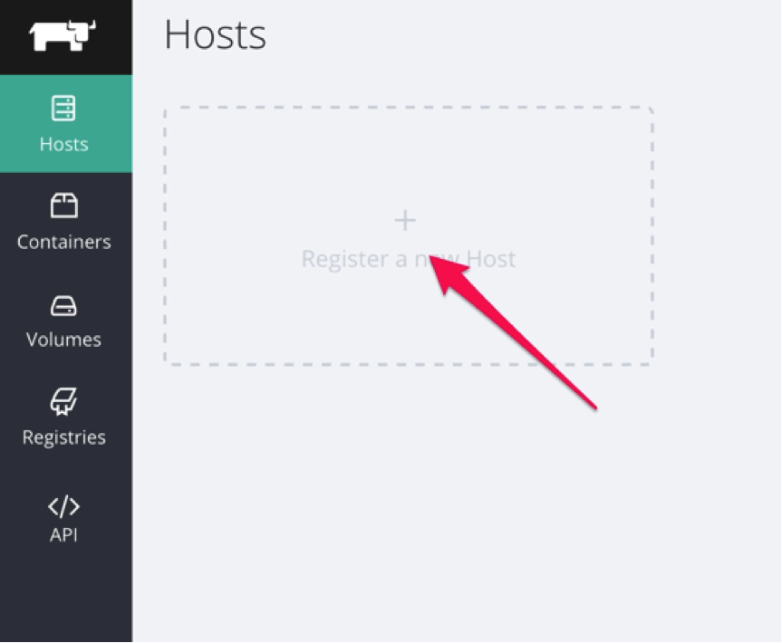
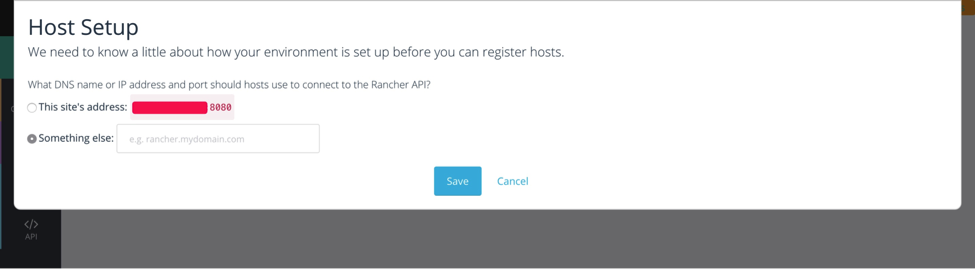
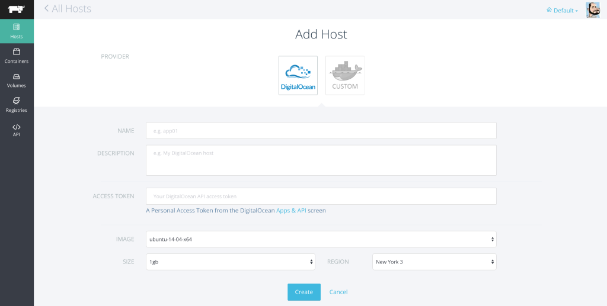
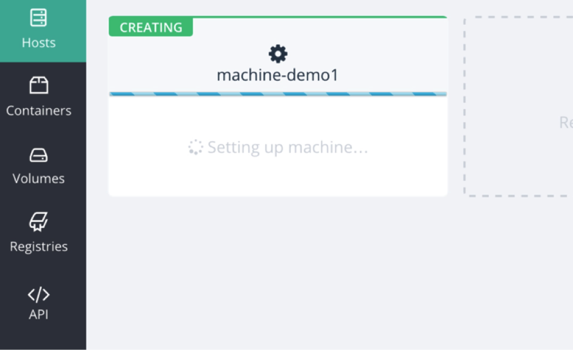

This
week we released Rancher 0.12, which adds support for provisioning hosts
using Docker Machine. We’re really excited to get this feature out,
because it makes launching Rancher-enabled Docker hosts easier than
ever. If you’re not familiar with Docker Machine, it is a project that
allows cloud providers to develop standard “drivers” for provisioning
cloud infrastructure on the fly. You can learn more about it on the
Docker
[website](http://blog.docker.com/2015/02/announcing-docker-machine-beta/).
The first cloud we’re supporting with Docker Machine is Digital Ocean.
For our initial release, we chose Digital Ocean, because it is an
excellent implementation of the machine driver. As always, the Digital
Ocean team has focused on simplicity and user experience, and were
fantastic to work with during our testing. Docker machine drivers are
already available for many public cloud providers, as well as vCenter,
CloudStack, OpenStack and other private cloud platforms. We will be
adding support for additional drivers over the next few weeks, and
documenting how you can use any driver you like. Please feel free to
[let us know](https://github.com/rancher/rancher/issues) if there
are drivers you would like us to prioritize. Now, let me walk you
through using Docker Machine with Rancher. To get started, click on the
“Regsiter a New Host” link in the Hosts tab within Rancher.

If this is the first time you’ve added a host, you’ll be presented
with a Host Setup dialog that asks you to confirm the DNS host name or
IP address that hosts should use to connect to the Rancher API. Confirm
this setting and click Save.

Once that is completed, you’ll be taken to the Add Host page,
where you’ll see a new tab for provisioning Digital Ocean hosts.

To provision a Digital Ocean machine, fill out the relevant
information about the host you want to provision, inlcuding the OS
image, size and Digital Ocean region. You’ll need to have a Digital
Ocean access token, which you can get by [creating an
account](https://cloud.digitalocean.com/registrations/new) on their
site. Once you hit create, you’ll be returned to the hosts page where
you will see your new host being created.

Creating the host will take a few minutes, as the VM needs to be
provisioned, configured with Docker, and bootstrapped as a Rancher host.
But once it’s done, the UI will automatically update to show the new
host. At this point, you have a fully enabled Docker host. You can click
the Add Container link to start adding containers. We hope you find this
feature useful and welcome your feedback. As always, you can submit any
feature requests or other issues to the [Rancher GitHub
repo](https://github.com/rancher/rancher). In the next few weeks,
we’ll be adding the ability to export the Docker machine configuration
so that you can deploy containers outside of Rancher, more verbose
status updates during machine creation, and (of course) more Machine
drivers. If you’d like to talk with one of our engineers and learn more
about Rancher, please feel free to request a demo, and we’ll walk you
through Rancher and answer all of your questions.
