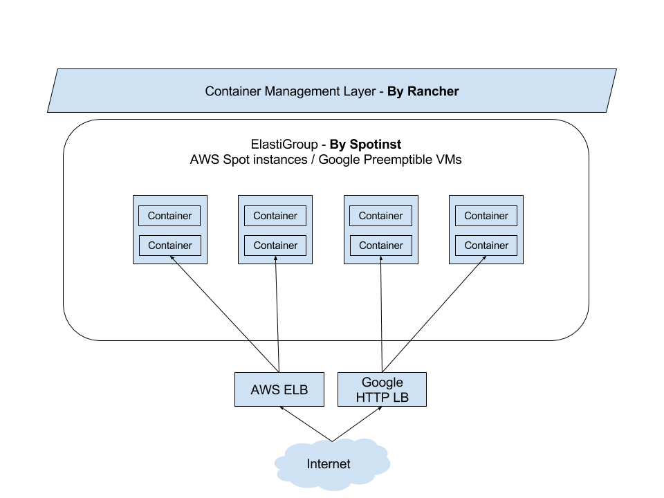
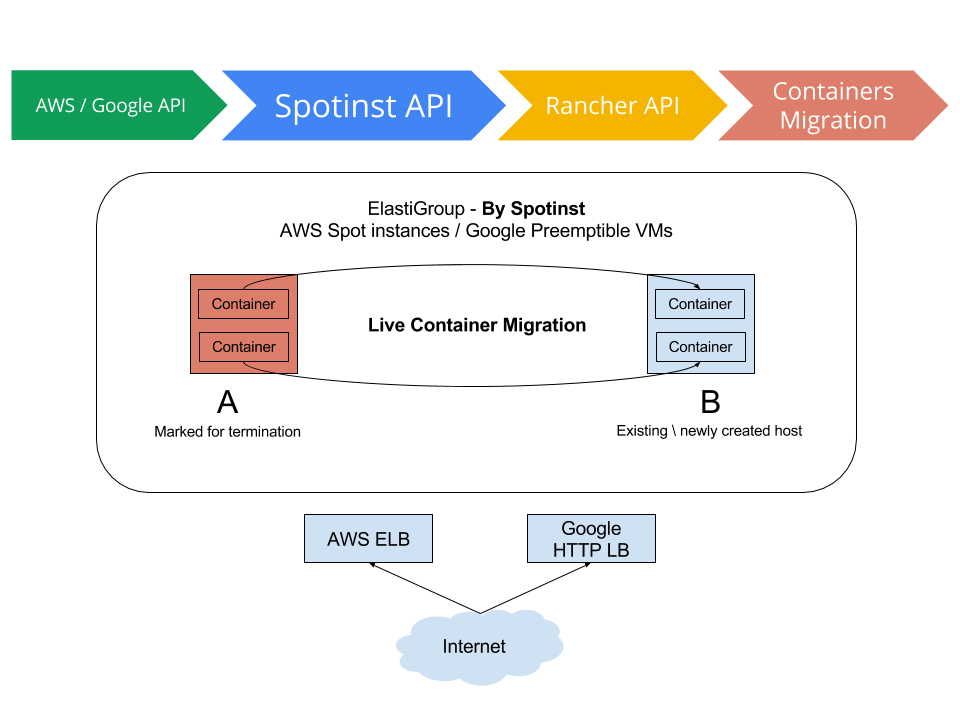
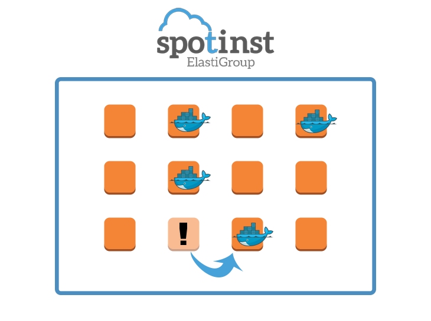

](https://cdn.rancher.com/wp-content/uploads/2015/11/16025649/spotinstlogo.png)
We
are very excited to announce a new partnership
with [Spotinst](https://www.spotinst.com) today to deliver intelligent
management and migration of container workloads running on spot
instances. With this new solution, we have developed a simple, intuitive
way for using spot instances to run **any**
container workload reliably and for a fraction of the cost of
traditional applications. Since the dawn
of data centers we’ve seen continuous improvements in utilization and
cost efficiency. But like [Jevons’
Paradox]](https://en.wikipedia.org/wiki/Jevons\_paradox),
**the more efficient we become in consuming
a resource, the more of that resource we consume**. So we always are
seeking the newest, fastest and uber-optimized of everything.

### How it works:

Spotinst is a SaaS platform that enables reliable, highly available use
of AWS Spot Instances and Google Preemptible VMs with typical savings of
70-90%.

We’ve worked with the team at Spotinst to integrate with the Rancher API directly. The integration
utlizes Docker “checkpoint and resume” (CRIU project). Based on metrics
and business rules provided by Spotinst, Rancher can freeze any
container and resume it on any other instance, automating the process a
typical DevOps team might implement to manage container
deployment.
](images/rancher\_blog\_rancher-spotinst-1.png)
For example, if Spotinst identifies that the spot instance a
container is running on, is about to terminate (with a 4 - 7 minute
heads-up), Spotinst will instruct Rancher to pause that container and
relocate it to another relevant instance.
](images/rancher\_blog\_rancher-spotinst-2.png)

**Unprecedented Availability for Online Gaming** While pizza servers,
blade racks and eventually virtualization technology paved the way for
modern data centers, today’s cloud computing customer expects
increasingly higher performance and higher availability in everything
from online gaming to genome sequencing. An
awesome example of how Docker is utilizing live migration to deliver
high availability can be seen in this
[presentation](https://www.youtube.com/watch?v=mL9AFkJJAq0&feature=youtu.be&t=1653) from
DockerCon earlier this yeaar.

The presenters show how they containerized Quake, had it running on a
DigitalOcean server in Singapore, and then live migrated it to Amsterdam
with the player experiencing practically zero interruption to his game.
Using “checkpoint and resume”, they
**didn’t** just stop the container, but
took an entire running process with all its memory, file descriptors,
etc. and effortlessly moved it and resumed it halfway around the
world.

## How it works?

](images/rancher\_blog\_rancher-spotinst-4.png)

We’re really excited about the potential of live migrating containers,
and this partnership with Spotinst. By moving workloads to spot
instances, organizations can dramatically reduce the cost of cloud
resources.

To try out the new service, you can sign up for a [Spotinst account](http://spotinst.com/signup) and directly connect it to your
running Rancher deployment, via your API keys.

To learn more, please [request a demonstration](https://more.suse.com/fy21-global-sales-call-request-schedule-a-rancher-demo) from one of our engineers.
