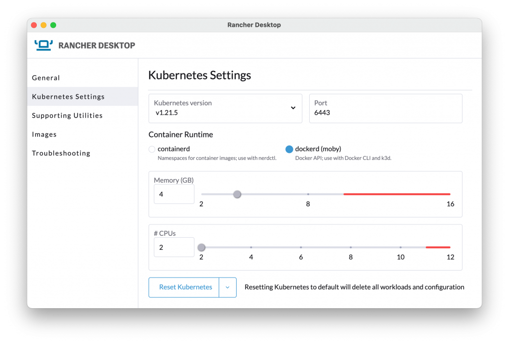

We are happy to announce the 1.0.0 release of [Rancher Desktop](https://rancherdesktop.io/). This release has been months in the making since development on Rancher Desktop began. After starting small and learning what users needed, we were able to adjust its path and develop the features needed for a 1.0.0 stable community release. 

But wait – what is Rancher Desktop again? It’s an open source app for desktop Kubernetes and container management on Mac, Windows and Linux. 

## Why Did SUSE Build Rancher Desktop?

At SUSE, we want to make the experience of working with Kubernetes on your desktop easier and simpler. Those who develop applications or package them up to run in Kubernetes need an easy-to-use local environment. 

When Rancher Desktop started, the existing open source tools that enabled you to run Kubernetes on your desktop were command line tools. Many of these tools relied on other external tools. We knew there were many across the community who wanted a simple and straightforward experience of a desktop application. 

We also knew that there are a wide number of Kubernetes versions in production use. We wanted the ability for the local environment to be the same version of Kubernetes as production. With all the nuances in Kubernetes versions and changes in APIs between versions, testing and using the same version locally as in production can be valuable. 

## What Rancher Desktop Includes

Rancher Desktop provides Kubernetes, using the k3s distribution, at the version of your choice. This enables you to setup a local Kubernetes environment at the same version you are using elsewhere, such as in your production environment. 

It’s possible to test how your workloads handle a Kubernetes upgrade with Rancher Desktop. When you change the version of Kubernetes that Rancher Desktop is using to a newer version it will upgrade Kubernetes and keep your workloads. 

Under the hood, Rancher Desktop is using either containerd or dockerd as a container engine. You can choose which to use. This is directly available to Rancher Desktop users when they use either nerdctl or the Docker CLI. These CLIs will let you build, push, and pull container images and run containers. The images you build with these tools are directly available to run in Kubernetes without the need to push or pull them from a registry. When you choose the dockerd runtime you have a Docker socket available for your other tools to use. This makes it possible to use tools like k3d that communicate directly with the Docker socket. 

## What Comes Next

There are three things you will find in Rancher Desktop development going forward.

-First, there will be a stable release process around features and bug fixes. That includes regular patch releases to fix bugs on a predictable schedule.

- Second, the team is actively working on small features and bigger issues that will be included in feature releases. A simple example of this is improved support for networking when connected to a VPN.

- The third thing is the development of some new major features. The details of those will be coming in future announcements. 

## How You Can Use Rancher Desktop

The easiest way to get started is to head over to [rancherdesktop.io](https://rancherdesktop.io/) to download the app. You can find more details, such as operating system supporting and system requirements, over in the [Rancher Desktop documentation](https://docs.rancherdesktop.io/).

### Join me for the [Global Online Meetup: Rancher Desktop](https://more.suse.com/Global-Meetup-Rancher-Desktop.html) on Feb. 16 at 10am PT. Bring your questions and get psyched for an awesome demo!
