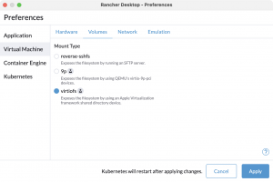
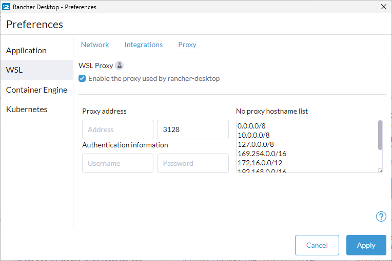

We are delighted to announce the release of a new version of Rancher Desktop. This release includes significant enhancements to features such as Deployment Profiles, mount types support, networking proxy configuration, and other important bug fixes. 

## Feature Improvements

### `rdctl create-profile` command

To complement the [Deployment Profiles](https://docs.rancherdesktop.io/1.10/getting-started/deployment) feature that we introduced in the Rancher Desktop 1.8.0 release, we have added the `rdctl create-profile` command in this release. The `rdctl create-profile` command makes it incredibly easy to create deployment profiles for both Windows (.reg) and macOS (.plist) by offering a range of options and flags. It is important to note that for Linux users, the `rdctl create-profile` command is not needed because deployment profiles for Linux are already provided in JSON format. On macOS and Windows, you can use the command to create deployment profiles bypassing the settings information (JSON) in a file or via command line arguments. Or you can simply export your current Rancher Desktop settings as a deployment profile using the flag `--from-settings`. The command also provides additional flags to control whether you want to create a locked or a default profile. Please refer to the [documentation](https://docs.rancherdesktop.io/1.10/references/rdctl-command-reference#rdctl-create-profile) for detailed syntax and examples. 

### `virtiofs` mount type for Linux

We have extended the support for the `virtiofs` mount type to the Rancher Desktop Linux version. You can set `virtiofs` as the mount type in the Preferences dialog, as shown in the image below. 

### Windows Proxy Update

To further help Windows users use Rancher Desktop in distinct corporate environments, we have added a Preferences option that lets you specify a no-proxy list, which provides a way to exclude traffic destined to the specified addresses from using the WSL proxy. You can configure the no-proxy list in the Preferences dialog, as shown in the image below. 

In addition to the mentioned feature improvements, this release also contains various bug fixes as described in the [release notes](https://github.com/rancher-sandbox/rancher-desktop/releases/tag/v1.10.0). Try out the latest features and fixes in the 1.10.0 release, and let us know your feedback.  

## Next steps

There are several next steps you can take: 

- Learn more about the changes in the 1.10.0 release from the [**release notes**](https://github.com/rancher-sandbox/rancher-desktop/releases/tag/v1.10.0).
- Star [**Rancher Desktop on GitHub**](https://github.com/rancher-sandbox/rancher-desktop) to show that you like it. This lets us know that you want to see development continue.
- Provide feedback in the [**issue queue**](https://github.com/rancher-sandbox/rancher-desktop/issues).
