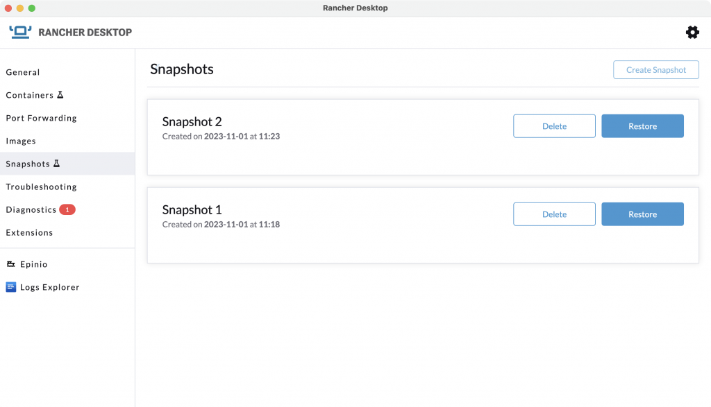
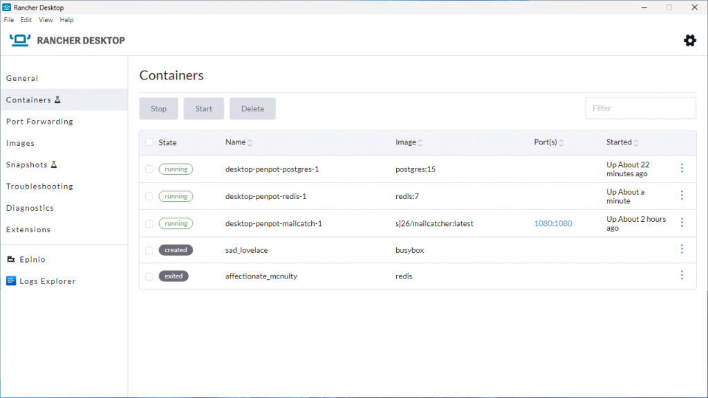

We are delighted to announce the release of Rancher Desktop 1.11.0! This update comes with new features, Snapshots and the Container Dashboard, along with other important bug fixes.  

## Snapshots (Experimental)

The snapshots feature allows you to save a snapshot of the current configuration of your virtual machine (VM) and all the associated settings. The saved snapshots persist across app restarts and upgrades as well as the Factory Reset, so you can restore a saved snapshot at any time to go back to a desired VM state. Snapshots can be a powerful and time-saving feature for various scenarios. For example, imagine you need to test database migration over and over. Starting with a specific database setup, loading seed data etc., can be time-consuming. This is where the Snapshots feature comes to your rescue. Take a snapshot with the required database configuration and all the seed data. Then, when you need to test again, simply restore to the saved snapshot. No more tedious setup or data loading. 

Another example where the Snapshots feature can be handy is when you have a set of your favorite helm apps, docker extensions etc., that you install and configure every time after you perform a factory reset. Again, you can save a snapshot with all your favorite apps installed and configured. After the Factory Reset, you restore your snapshot, and voila, all your extensions and apps get back up and running.   

Trying the Snapshots feature is super easy. You can use the GUI or the command line interface (e.g., `rdctl snapshot create`, `rdctl snapshot restore`) to manage snapshots. Please give it a try and let us know how it helps you. 

## Container Dashboard (Experimental)

Rancher Desktop provides the CLI utilities docker and nerdctl to help you work with containers. To make container management more convenient and accessible, we have built the Container Dashboard, a dedicated page within the application for managing containers. On the dashboard, you can view, start, stop and delete containers and perform bulk actions with just mouse clicks. 

In addition to the new features, this release also contains various stability improvements and bug fixes, as described in the [release notes](https://github.com/rancher-sandbox/rancher-desktop/releases/tag/v1.10.0). Try out the latest features and fixes in the 1.11.0 release, and let us know your feedback.  

## Next steps

There are several next steps you can take: 

- Learn more about the changes in the 1.10.0 release from the [**release notes**](https://github.com/rancher-sandbox/rancher-desktop/releases/tag/v1.11.0).
- Star [**Rancher Desktop on GitHub**](https://github.com/rancher-sandbox/rancher-desktop) to show that you like it. This lets us know that you want to see development continue.
- Provide feedback in the [**issue queue**](https://github.com/rancher-sandbox/rancher-desktop/issues).
