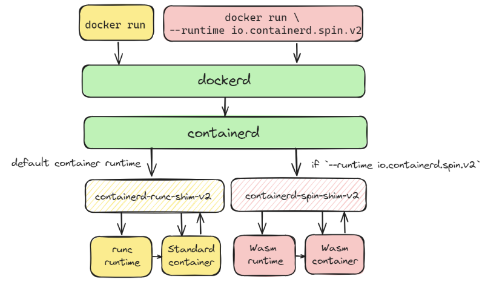
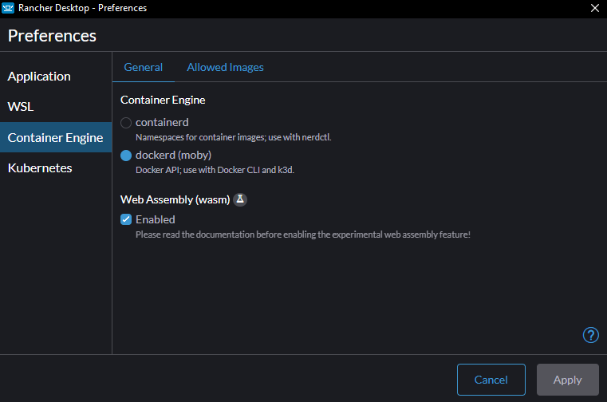

We are delighted to announce the release of Rancher Desktop 1.13.0! This update comes with the basic support for running WebAssembly (Wasm) containers and deploying them to Kubernetes, along with other improvements and fixes.

## **Wasm support (Experimental)**

 

Wasm is an operating system and architecture-neutral binary instruction format. You can compile code written in many languages, such as C, C++, Rust, Go, and others, into Wasm modules that you can run on any OS or architecture. The newly introduced Wasm feature in Rancher Desktop provides the required setup to let you package and run Wasm modules as containers and deploy them to Kubernetes using the exact same toolchain (e.g., `docker`, `kubectl`) you are likely familiar with. 

How does it work under the hood? In this release, Rancher Desktop comes bundled with a new containerd shim called `containerd-spin-shim-v2`. When the `docker run` command is run with the flag `--runtime io.containerd.spin.v2` to run a Wasm container, the container engine (`containerd`) under the hood hands over the responsibility of running this container to the containerd-spin-shim instead of the default containerd-runc-shim. The containerd-spin-shim then runs the container using the Wasm runtime instead of the default runc.

 

 

It is easy to try running a Wasm container with Rancher Desktop. First, you need to enable Wasm under the `Preferences > Container Engine` settings, which prepares your environment to run Wasm containers.

Then, you can run a sample Wasm container using the docker run command. 

`docker run \ --detach \ --name spin-demo \ --runtime io.containerd.spin.v2 \ --platform wasi/wasm \ --publish 8080:80 \ ghcr.io/deislabs/containerd-wasm-shims/examples/spin-rust-hello:v0.11.1 \ /`

To confirm that the Wasm container is working as expected, run the command below to access the API provided by the sample app.

`$ curl http://localhost:8080/hello Hello world from Spin!`

For a more detailed tutorial covering Kubernetes deployment, advanced configuration to add other Wasm shims etc, please refer to the [docs](https://docs.rancherdesktop.io/tutorials/working-with-webassembly). 

To see Wasm on Rancher Desktop in action, watch this [quick video tutorial](https://www.youtube.com/watch?v=3yfLKmcr3Fc) created by Divya Mohan. 

To learn about other improvements & fixes in the release, please refer to the [release notes](https://github.com/rancher-sandbox/rancher-desktop/releases/tag/v1.13.0).

## Next steps

There are several next steps you can take: 

- Learn more about the changes in the 1.13.0 release from the [**release notes**](https://github.com/rancher-sandbox/rancher-desktop/releases/tag/v1.13.0).
- Star [**Rancher Desktop on GitHub**](https://github.com/rancher-sandbox/rancher-desktop) to show that you like it. This lets us know that you want to see development continue.
- Join the Slack channel [#rancher-desktop](https://rancher-users.slack.com/archives/C0200L1N1MM) to engage with the community.
- Provide feedback in the [**issue queue**](https://github.com/rancher-sandbox/rancher-desktop/issues).
