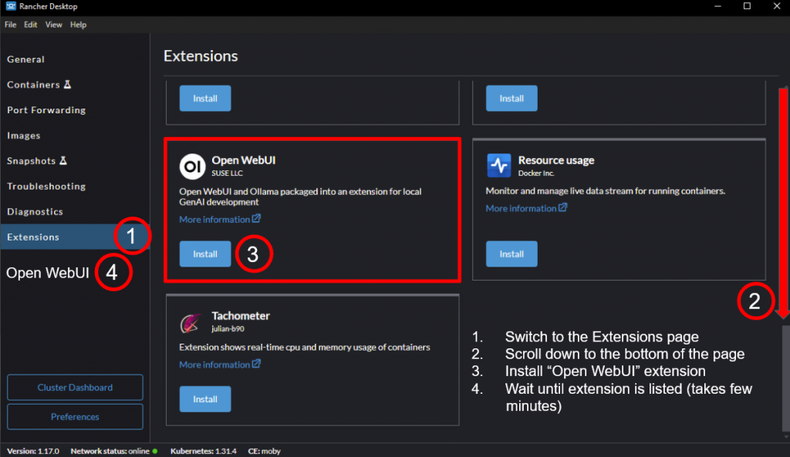
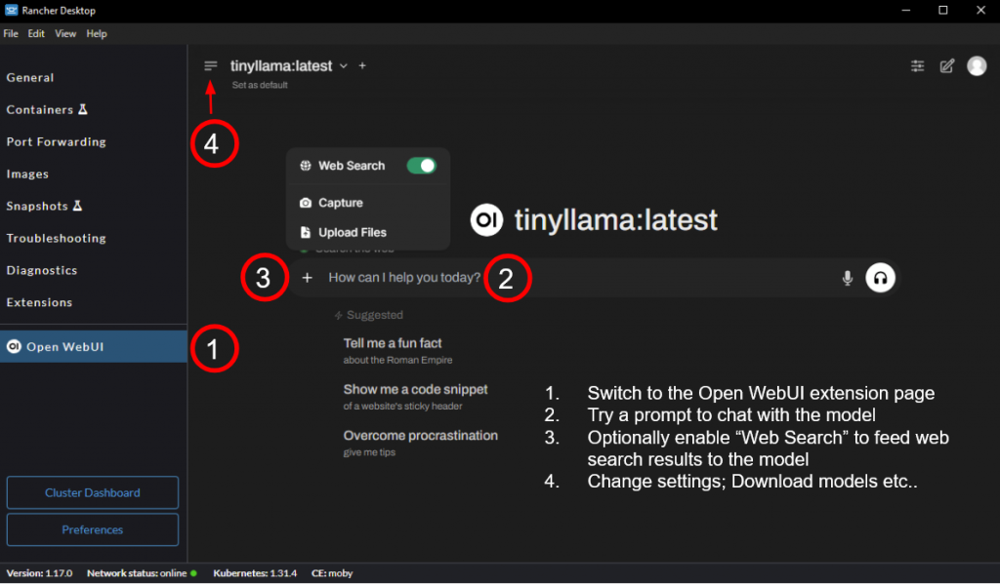

We are delighted to announce the release of Rancher Desktop 1.17.0! This release comes with the newly added Open WebUI extension for local GenAI development, along with other improvements and fixes.

## Open WebUI extension for local GenAI development

Generative AI (GenAI) and Large Language Models (LLMs) have undoubtedly taken the world by storm in the last couple of years. The technology has come a long way ever since the first version of ChatGPT was released just around 2 years ago. Thanks to the rapid advancements and the open-source success, the barrier to entry has never been lower, empowering experienced and non-experienced users alike in joining and contributing to the ecosystem. Among the many tools emerging in the GenAI ecosystem, the combination of **Ollama**, **Open WebUI**, and lightweight **small language models (SLMs)** looks promising. This trio provides an easy way to work with open source LLMs from anywhere including on development machines. Despite not having great inference times, the ability to work with LLMs on development machines is useful, especially in the following situations:

- Jumpstart development of GenAI applications without complex server setups and costs, especially in the prototyping stage
- Work with confidential data/code that you or your organizations don’t want to leave your development machine

In the current release,  we introduced the Open WebUI extension in Rancher Desktop, to help you get started with Ollama and Open WebUI without having to worry about individually downloading and configuring those components for local usage.

The **Rancher Desktop Open WebUI extension** provides an easy-to-install setup, comprising the components listed below:

- [Ollama](https://ollama.com/) to pull, run, and fine-tune open-source LLMs. The extension will download and install Ollama, if not already present, on the host machine to have access to the GPU.
- [Open WebUI](https://openwebui.com/) to chat with the LLMs, use custom knowledge, web search, etc., via a feature rich Graphical User Interface (GUI).
- A lightweight LLM called [tinyllama](https://ollama.com/library/tinyllama) to enable you to kickstart your LLM exploration from the get go
- [SearXNG](https://github.com/searxng/searxng) for web search, to enhance retrieval augmented generation (RAG) results

Getting started with the Open WebUI extension is super easy.

- Install the latest [Rancher Desktop 1.17](https://github.com/rancher-sandbox/rancher-desktop/releases/tag/v1.17.0) on your machine.
- Go to the Extensions catalog and click on **Install**.
- That's all!

Once the installation is complete, you have a ready to use GenAI setup to start your LLM journey. You can pull more models or use Open AI compatible APIs, fine tune and chat with the models, build system prompts, ingest custom knowledge and/or leverage web search to get the chatbot work for your specific needs and more.

We can’t wait for you to try it out! Explore the [documentation](https://docs.rancherdesktop.io/tutorials/working-with-llms) for detailed guidance, and don’t forget to share your feedback with us! Good luck on your journey into the world of LLMs right from your laptop!

To learn about other improvements & fixes in the release, please refer to the [release notes](https://github.com/rancher-sandbox/rancher-desktop/releases/tag/v1.17.0).

## Next steps

There are several next steps you can take: 

- Learn more about the changes in the 1.17.0 release from the [**release notes**](https://github.com/rancher-sandbox/rancher-desktop/releases/tag/v1.17.0).
- Star [**Rancher Desktop on GitHub**](https://github.com/rancher-sandbox/rancher-desktop) to show that you like it. This lets us know that you want to see development continue.
- Join the Slack channel [#rancher-desktop](https://rancher-users.slack.com/archives/C0200L1N1MM) to engage with the community.
- Provide feedback in the [**issue queue**](https://github.com/rancher-sandbox/rancher-desktop/issues).
