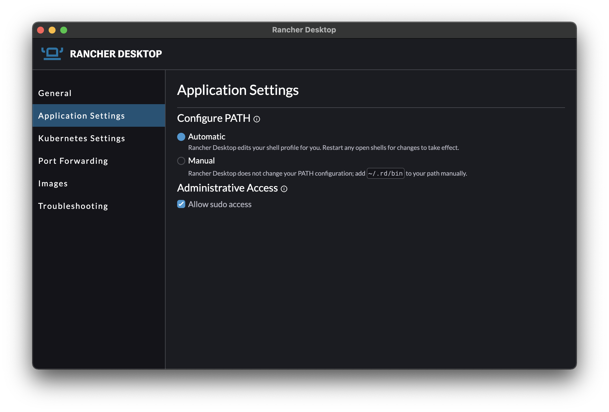

The release of [Rancher Desktop](https://rancherdesktop.io/) 1.3.0 brings in some notable changes that are most visible on Mac and Linux while continuing to expand on experimental features.

## Supporting utility handling

On Windows, the supporting utilities (e.g., Helm, the Docker CLI, etc) have always been transparently added to the path in a manner that allowed you to use your own version of those same utilities if you want to. No management effort from users was needed. On Mac and Linux you had to manually manage each application. Managing Mac has become more complicated with the latest macOS release because there was a lack of a */usr/local/bin* directory by default. This is where Rancher Desktop attempted to make the applications available.

To simplify the process, Rancher Desktop provides a new way to manage the supporting utilities that is available through a new *Application Settings* screen.

The supporting utilities are now symlinked into a directory at *~/.rd/bin* which can either be added to your path by Rancher Desktop or you can manually add it to your path.

If you install Rancher Desktop for the first time or are upgrading to a release that has this new system, you will be prompted for which way you want to manage these utilities. Since this is a setting you can change your mind at any time.

## Use Rancher Desktop without admin access

On the *Application Settings* screen you will notice another new option to allow sudo access. That's because Rancher Desktop can now run on Mac and Linux without requiring administrative (i.e. sudo) access.

Rancher Desktop has required administrative access to make some features work, such as putting a Docker API socket in the default location. With version 1.3.0, you can now use Rancher Desktop without admin access. Some features will work differently. For example, the Docker API socket will be in a non-default location. Rancher Desktop will configure the Docker CLI with a context for this location. There are some other limitations, as well.

When you start up Rancher Desktop for the first time or after an upgrade from a version that required administrative access, you will be prompted if you want to allow the use of administrative access. This setting can be changed at any time.

## Experimental features

The experimental features have continued to expand. These include:

- The *rdctl* CLI, that allows you to control Rancher Desktop from the command line, has expanded to let you start Rancher Desktop and to allow you to run commands or open a shell in the VM. Running commands in the virtual machine may alter the environment so that it does not work properly or in a way that stops Rancher Desktop from managing it.
- On Windows there is an alternative DNS resolve that you can enable. This DNS resolver should support DNS lookups over VPN connections. Details on enabling it are in the [release notes](https://github.com/rancher-sandbox/rancher-desktop/releases/tag/v1.3.0).
- File sharing between the host and virtual machine has used sshfs on Mac. 9p is now an option being tested. Details on enabling it are in the [release notes](https://github.com/rancher-sandbox/rancher-desktop/releases/tag/v1.3.0).

Experimental features are experiments that may change. If you try them we would appreciate your feedback. This will help us complete the features and make sure they work for you.

## Next Steps

There are several next steps you can take:

- Star [Rancher Desktop on GitHub](https://github.com/rancher-sandbox/rancher-desktop) to show that you like it. This lets us know that you want to see development continue.
- [Install the v1.3.0 release](https://rancherdesktop.io/).
- Provide feedback in the [issue queue](https://github.com/rancher-sandbox/rancher-desktop/issues).
