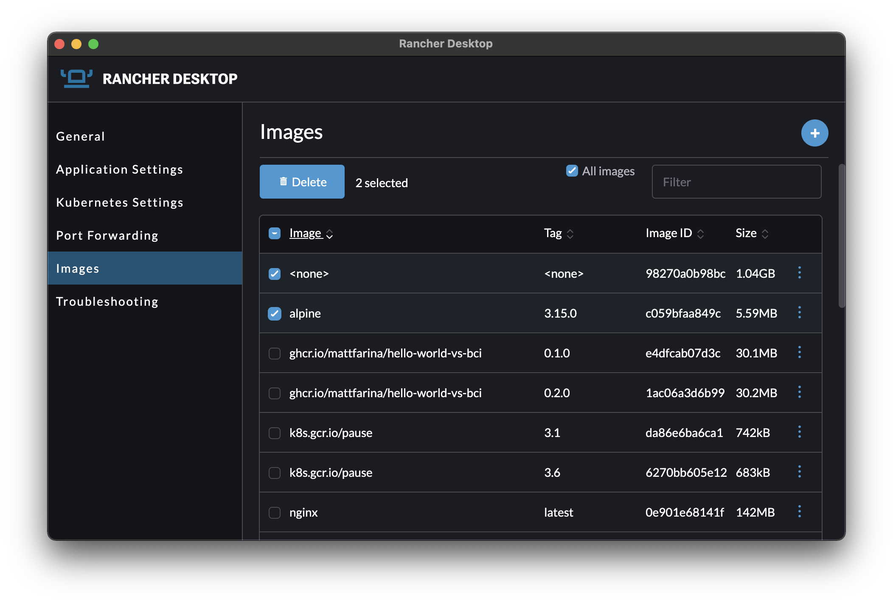

In addition to the usual updates to supporting utilities, Rancher Desktop 1.4 adds a couple of new useful features we think you'll like.

## Credential helpers

If you're using the Docker CLI or nerdctl and you log into a container registry, those credentials need to be stored somewhere. Rancher Desktop 1.4 includes credential helpers. With credential helpers, the credentials you use for authenticating to registries are stored using system native stores. Specifically, on Windows *wincred* is used, on macOS *osxkeychain* is used, and on Linux *pass* is used. The *erc-login* helper is included but not configured automatically.

## Image bulk deletion

Rancher Desktop includes the ability to work with container images. You can push them, you can pull them, you can scan them for vulnerabilities, and you can now bulk delete them. With the release of 1.4, bulk deletion is an option. This is useful for a variety of use cases such as easily cleaning out old image versions, deleting test builds, and more.

## Next Steps

There are several next steps you can take:

- Learn more about the changes in the 1.4 release from the [release notes](https://github.com/rancher-sandbox/rancher-desktop/releases/tag/v1.4.1).
- Star [Rancher Desktop on GitHub](https://github.com/rancher-sandbox/rancher-desktop) to show that you like it. This lets us know that you want to see development continue.
- [Install the v1.4.1 release](https://rancherdesktop.io/).
- Provide feedback in the [issue queue](https://github.com/rancher-sandbox/rancher-desktop/issues).
