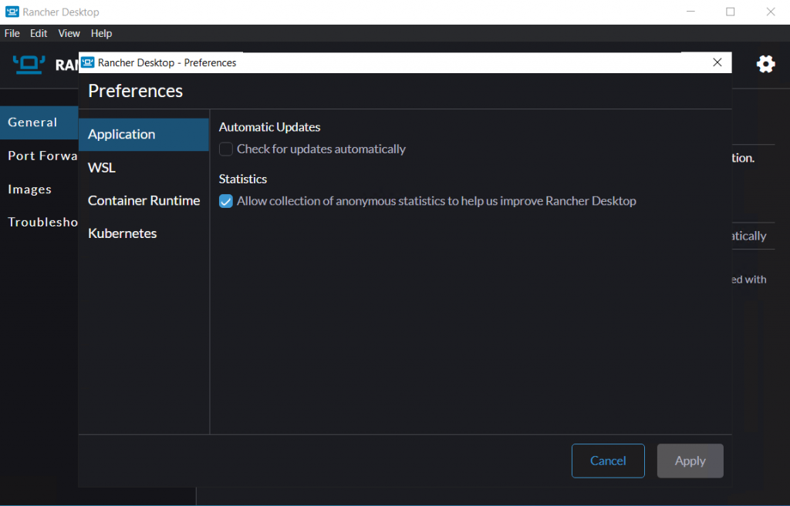

A new version of Rancher Desktop with a redesigned user-friendly Preferences dialog and several other improvements has just been released!

**Redesigned Preferences GUI in Ranch Desktop 1.5.0**

One of the design philosophies of Rancher Desktop is to provide simple-to-use graphical user interface (GUI) features that enable users to configure and control various application components (VM, Container Runtime, Kubernetes, etc.) to meet specific needs. To continue further on this philosophy, we are in the process of adding several easy-to-use configuration features; read more about it [here](https://github.com/rancher-sandbox/rancher-desktop/discussions/1924).

As a first step, we redesigned the GUI to move all the existing configuration options into an easily invokable Preferences dialog, allowing us to extend it with more features in the upcoming releases easily. You can invoke the Preferences dialog by clicking on the Preferences menu icon on the top right corner of the app, by selecting the Preferences item from the system tray menu or  by using the Preferences keyboard shortcut. 

**Offline Operation**

Rancher Desktop has been updated to work better in an offline environment. The improvements introduced in the 1.5.0 release allow users to cache required components, such as Kubernetes, for offline usage. This mode can also be used to set up air-gapped operations. The  instructions for air-gapped setup are available [here](https://docs.rancherdesktop.io/how-to-guides/running-air-gapped#preparing-an-air-gapped-system). 

**Other Key Features in Rancher Desktop 1.5.0**

- The optional experimental host-resolver feature introduced in an earlier version to help resolve hostnames over VPN connections is no longer experimental now and is enabled by default.
- The "Port Forwarding" feature allows the user to pick a specific port instead of choosing one randomly.
- Additional debug messages are written to the logs to help troubleshoot problems.

## **Best Next Steps for Rancher Desktop**

There are several next steps you can take:

- Learn more about the changes in the 1.5.0 release from the [release notes](https://github.com/rancher-sandbox/rancher-desktop/releases/tag/v1.5.0).
- Star [Rancher Desktop on GitHub](https://github.com/rancher-sandbox/rancher-desktop) to show that you like it, which lets us know that you want to see development continue!
- [Install the v1.5.0 release](https://docs.rancherdesktop.io/getting-started/installation).
- Provide feedback in the [issue queue](https://github.com/rancher-sandbox/rancher-desktop/issues).
