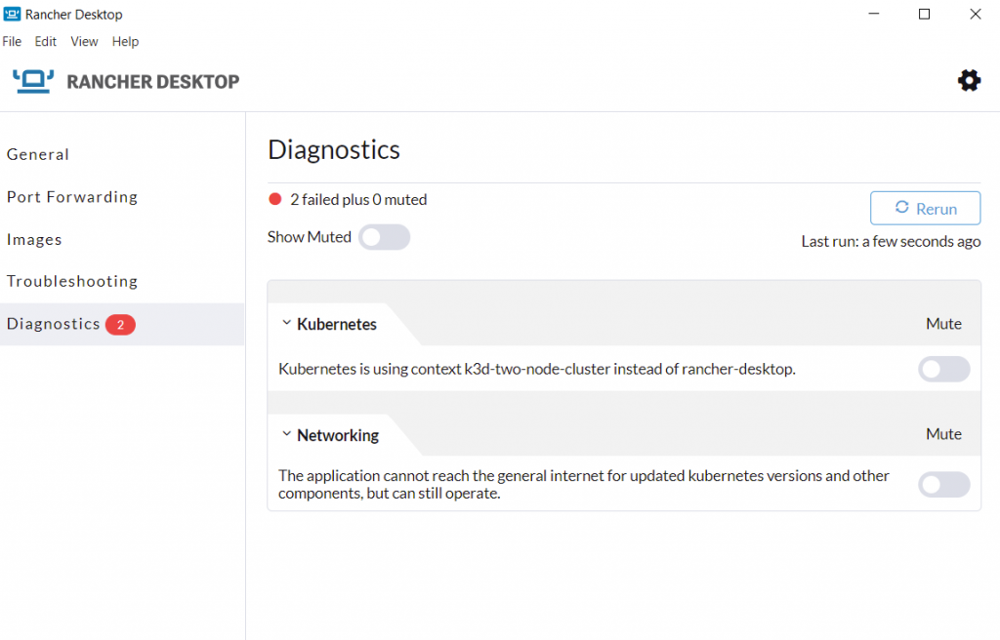

A new version of Rancher Desktop with a troubleshooting diagnostics feature and several other improvements has just been released!

## **Troubleshooting Diagnostics in Rancher Desktop 1.6.0**

Rancher Desktop has come a long way since the General Availability 1.0.0 release at the beginning of this year. Over the months, we have seen the user base growing rapidly, with users running Rancher Desktop in distinct environments, sometimes leading to some users running into issues setting up or using the application. The Rancher Desktop core team at SUSE and the community members have been doing a fantastic job in helping users on our support channels ([GitHub](https://github.com/rancher-sandbox/rancher-desktop/issues), [Slack](https://slack.rancher.io/)) when users face problems. To continue further on the journey of enabling users to run Rancher Desktop in any environment in a seamless fashion, we have introduced a new troubleshooting diagnostics feature. The **Diagnostics** feature runs several checks in the background to detect common problems, such as missing minimum requirements, misconfigurations, etc., in your environment to help you self-troubleshoot and fix Rancher Desktop application issues. In the current release, we only have a handful of diagnostics related to `PATH` settings and the online state of the host machine. We will continue to add more checks in the upcoming versions of Rancher Desktop. 

The diagnostics checks are run whenever the application launches. If there are any problems identified, then the count of failed checks is shown in a red badge next to the *Diagnostics* menu text in the left navigation bar, indicating that something needs your attention. The *Diagnostics* tab displays any failed diagnostics tests, highlighting areas that need attention and guiding you to resolve problems.

## Other Key features in Rancher Desktop 1.6.0

- The port mapping in WSL is extended to all interfaces (INADDR\_ANY) on the host machine, which allows access to applications/services running inside containers via all interfaces in addition to the already supported 127.0.0.1.
- Provision to switch from the *vde\_vmnet* daemon to the experimental *socket\_vmnet* daemon, which increases the maximum throughput through the external interface significantly.
- Rancher Desktop docs are now available in the Chinese language.
- Additional debug messages are written to the logs to help troubleshoot problems.

## Next Steps

There are several next steps you can take:

- Learn more about the changes in the 1.6.0 release from the [release notes](https://github.com/rancher-sandbox/rancher-desktop/releases/tag/v1.6.0).
- Star [Rancher Desktop on GitHub](https://github.com/rancher-sandbox/rancher-desktop) to show that you like it. This lets us know that you want to see development continue.
- [Install the v1.6.0 release](https://docs.rancherdesktop.io/getting-started/installation).
- Provide feedback in the [issue queue](https://github.com/rancher-sandbox/rancher-desktop/issues).
