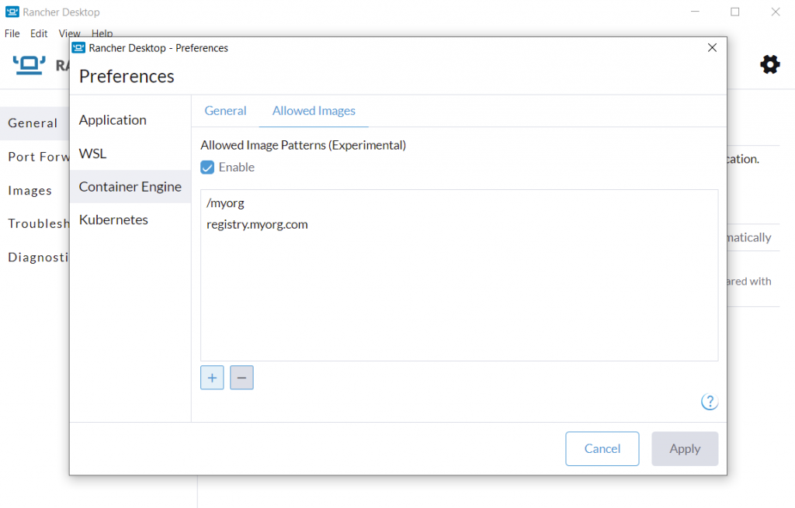

A new version of Rancher Desktop with the experimental Allowed Images feature and several other improvements has just been released!

## **Allowed Images feature (experimental)**

Rancher Desktop provides the required setup and tools on your desktop, enabling you to efficiently build, run and share containers. However, there are situations where you need to have tighter control over what you can and cannot do in your desktop environment. For example, your security-conscious organization might want you to use container images only from specific trusted sources. 

The experimental Allowed Images feature lets you control which registry artifacts you can access on your desktop. You can easily configure image name patterns in the container engine preferences settings, allowing you to pull images only from the specified registries and/or repositories. Whenever you try to pull (or push) an image via the CLI commands such as `docker pull/push`, `nerdctl pull/push`, `docker run`, or via a Kubernetes deployment, etc., Rancher Desktop checks whether the image name matches any of the patterns in the Allowed Images list and allows access only if there is at least one match. For example, you can add the allowed image name pattern `myorg` , which means you can pull images only from your organization namespace **myorg** in the default DockerHub registry. Similarly, you can add the pattern `registry.myorg.com`, which means you can only pull images from your organization’s private registry, **registry.myorg.com**. You can specify multiple Allowed Images name patterns using the format `registry/organization/image:tag`.

Please refer to the [docs](https://docs.rancherdesktop.io/1.7/ui/preferences/container-engine#allowed-images) and [release notes](https://github.com/rancher-sandbox/rancher-desktop/releases/tag/v1.7.0) to learn more about using the **Allowed Images** feature in the current release. We will continue to extend the **Allowed Images** feature in the upcoming releases to enable more controlled ways of configuring and managing the allowed images list, for example, a way to enable an IT Admin to roll out and manage the configuration on remote developer workstations. 

## Other key features in Rancher Desktop 1.7.0

- Windows MSI installer to enable remote deployments and centralized management of Rancher Desktop installations.
- On macOS, any unused disk space in the data volume (e.g. from deleted images) will be returned to the host when the application is closed.
- `rdctl --factory-reset` command to completely reset the application environment to a clean slate state from the CLI or within scripts to facilitate automation use cases.  It is possible to run `rdctl --factory-reset` even when Rancher Desktop isn't running, so it can be used to clean up a broken installation that won't even start.
- Improved bundled utilities (`helm`, `trivy`, `kubectl`, etc.) version management to keep the respective versions up to date in Rancher Desktop.
- Help buttons that link to docs pages specific to the context for the Preferences dialog screens.

## Next steps

There are several next steps you can take:

- Learn more about the changes in the 1.7.0 release from the [release notes](https://github.com/rancher-sandbox/rancher-desktop/releases/tag/v1.7.0).
- Star [Rancher Desktop on GitHub](https://github.com/rancher-sandbox/rancher-desktop) to show that you like it. This lets us know that you want to see development continue.
- [Install the v1.7.0 release](https://docs.rancherdesktop.io/getting-started/installation).
- Provide feedback in the [issue queue](https://github.com/rancher-sandbox/rancher-desktop/issues).
