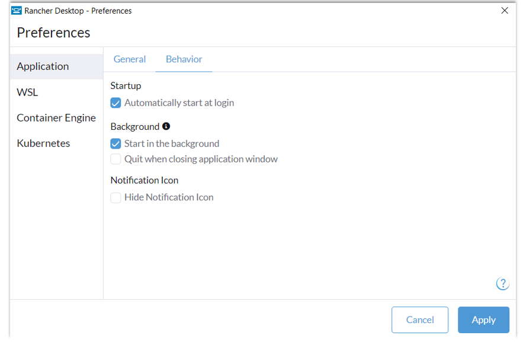
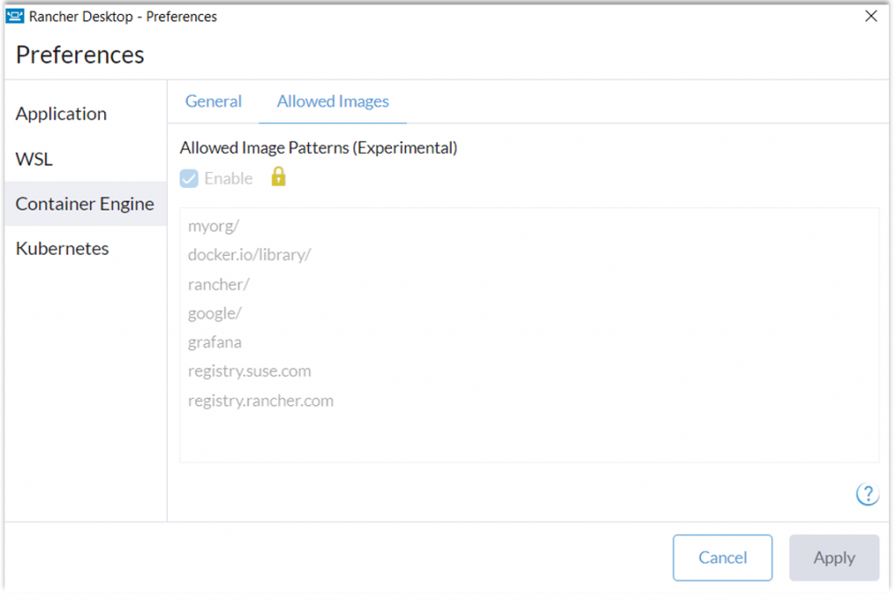

We are pleased to announce that a new Rancher Desktop version with additional configuration options, deployment profiles, a gvisor-based networking stack on Windows and several other improvements has just been released!

## Application behavior configuration

First up, we added preference options that make it easy to configure the application behavior. For example, you can configure Rancher Desktop to start when you log in to your machine automatically, customize whether to show/hide the application GUI on startup, etc. We believe these features will enhance your overall experience of using Rancher Desktop. Try them out via the [GUI](https://docs.rancherdesktop.io/ui/preferences/application#behavior) or `rdctl` CLI and let us know what you think. For example, you can use the `rdctl` command below to start Rancher Desktop in the background and with `dockerd(moby)` as the selected container engine. 

`rdctl start --application.start-in-background=true --container-engine.name moby`

## Deployment profiles (experimental)

Are you an IT Administrator looking for ways to have a consistent Rancher Desktop setup across multiple user machines by enforcing predefined settings and configurations? Are you that user who frequently wants to start over with a factory reset in the rapid experimentation process but wishes there was a way to avoid the initial configuration? We understand you. The experimental deployment profiles feature introduced in the release is just for you.

The deployment profiles feature lets you leverage standard OS mechanisms such as Windows registry and macOS plists to store and load Rancher Desktop preference settings efficiently. For example, you can use a default deployment profile to set your preferred container runtime as default so that you don’t have to manually configure this setting during the first launch or after a factory reset. Similarly, you can use a locked deployment profile to enforce policies around container image access in your organization. 

The picture above shows the allowed images list coming from a locked deployment profile which will enable users to access only a specific set of images, which in this case are:

- Images in an organization namespace `myorg` on DockerHub
- Docker official images ( `docker.io/library/`)
- Images from publishers you trust on DockerHub (ex: `rancher/`, `google/`, `grafana/`)
- Images from registries you trust (ex: `registry.suse.com`, `registry.rancher.com`)

## New gvisor-based networking stack (experimental)

If you are a Windows user who has been unable to use certain networking-dependent features of Rancher Desktop due to an incompatible VPN setup at your organization, then we have some good news for you. We have introduced an experimental gvisor-based networking stack on Windows that should provide better compatibility with diverse VPN configurations. The initial phase of the implementation for Windows has been rolled out in this release. We are committed to extending it to other platforms and making it more robust in future releases. You can enable the new stack using the command `rdctl set --experimental.virtual-machine.networking-tunnel=true` and learn more about the implementation, limitations, etc., [here](https://github.com/rancher-sandbox/rancher-desktop/issues/3810). Also, please provide feedback if you encounter problems beyond the documented limitations. 

## Other key features in Rancher Desktop 1.8

- Support for Apple Virtualization framework on macOS (experimental). Try it with the command `rdctl set --virtual-machine.type vz`
- The alternate filesystem protocol 9p can now be selected on macOS via the rdctl command `rdctl set--experimental.virtual-machine.mount.type 9p`
- Additional mount points (`/Volumes` and `/var/folders`) are available on macOS
- socket\_vmnet has been updated on macOS (experimental). Select it with the command `rdctl set --experimental.virtual-machine.socket-fmnet=true`

## Next steps

There are several next steps you can take: 

- Learn more about the changes in the 1.8.0 release from the [**release notes**](https://github.com/rancher-sandbox/rancher-desktop/releases/tag/v1.8.0).
- Star [**Rancher Desktop on GitHub**](https://github.com/rancher-sandbox/rancher-desktop) to show that you like it. This lets us know that you want to see development continue.
- [**Install the v1.8 release**](https://docs.rancherdesktop.io/getting-started/installation).
- Provide feedback in the [**issue queue**](https://github.com/rancher-sandbox/rancher-desktop/issues).
