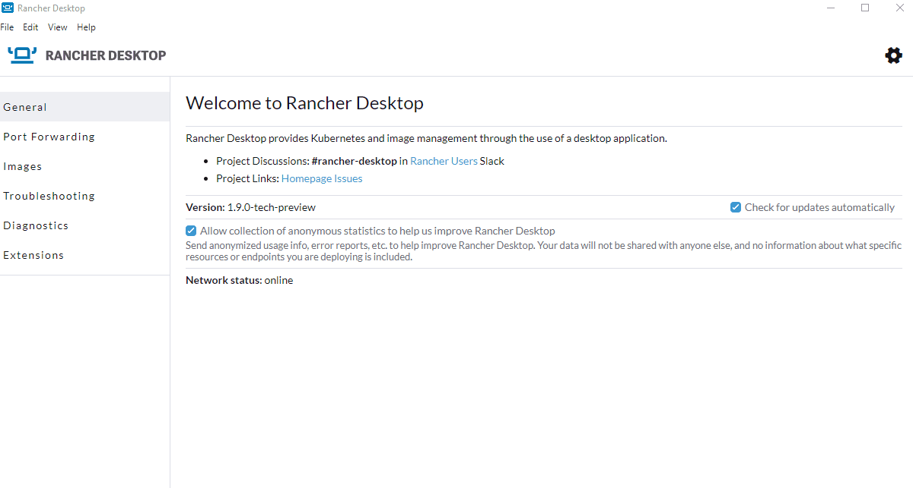

We are pleased to announce that a tech preview version of Rancher Desktop with support for Docker Extensions has just been released!   

## Extensions

If you are a software developer or an operator dealing with containers, you know how crucial it is to have a versatile toolkit to support your diverse and ever-changing needs. Software extensions provide a great way to extend the capabilities of your core tool so you do not have to deal with multiple tools for different needs.  

The newly introduced Extensions feature enables you to install and use [Docker Extensions](https://www.docker.com/products/extensions/) within Rancher Desktop. In the tech preview release, we started with a catalog of three extensions you can install and try. We will continue to expand the catalog with more extensions in the upcoming Rancher Desktop releases. Trying out the current extensions is super easy. You can install and manage the extensions via the GUI or the command line utility `rdctl` (ex: `rdctl extension install docker/logs-explorer:0.2.2`). Try it out today, and let us know what you think! Refer to the [release notes](https://github.com/rancher-sandbox/rancher-desktop/releases/tag/v1.9.0-tech-preview) for installation instructions for your OS.

## Next steps

There are several next steps you can take: 

- Learn more about the changes in the 1.9.0-tech-preview release from the [**release notes**](https://github.com/rancher-sandbox/rancher-desktop/releases/tag/v1.9.0-tech-preview).
- Star [**Rancher Desktop on GitHub**](https://github.com/rancher-sandbox/rancher-desktop) to show that you like it. This lets us know that you want to see development continue.
- Provide feedback in the [**issue queue**](https://github.com/rancher-sandbox/rancher-desktop/issues).
