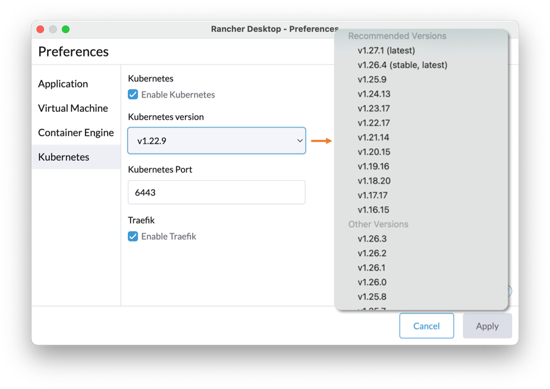
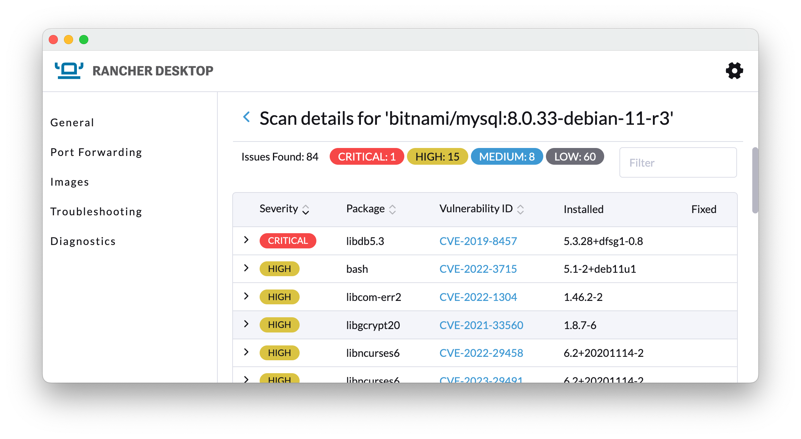
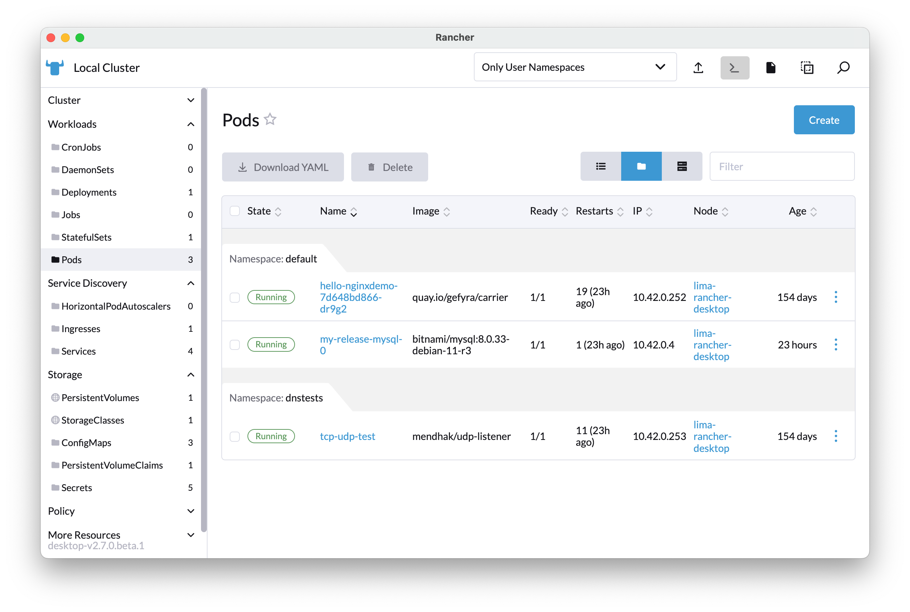
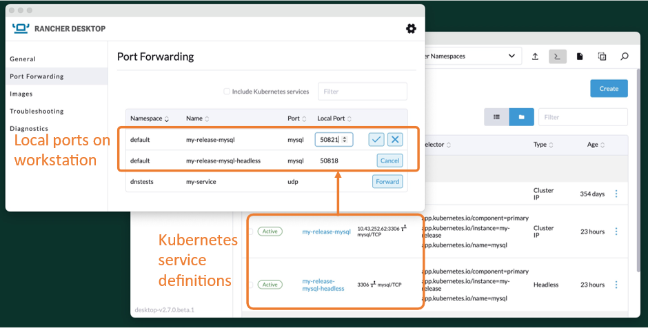

## **The crucial role of Kubernetes in modern software development**

Kubernetes has created a major impact on modern software development because it is a powerful open source container orchestration platform that enables organizations to deploy and manage complex containerized applications at scale.

In this blog, we will cover how **Rancher Desktop can help developers run and manage Kubernetes locally.**

## **Kubernetes simplified: Made for developers, by developers**

As a developer, our main objective is to create software that adapts to changes as rapidly and efficiently as possible to guarantee that it can meet the ever-growing demand or trend in the real world. What Kubernetes offers is the best platform for hosting applications that are containerized, making them effortlessly portable across various platforms and easily scalable to optimize software performance.

This can speed up the development and deployment process by closing the gap in the development, staging and production environments. As a result, our application becomes more stable, robust and viable for production use, which in turn helps us make use of our time and resources effectively. Having said all this, now you wonder, “How do you kick-start your Kubernetes experience?" This is where [Rancher Desktop](https://rancherdesktop.io/) comes into play. Rancher Desktop, created by developers for developers, will help transform your mindset about Kubernetes.

## **Prominent features for developers**

Rancher Desktop is a tool to help developers build cloud native apps. Thanks to its graphic user interface ([GUI](https://docs.rancherdesktop.io/ui/general)) and [powerful cli (rdctl)](https://docs.rancherdesktop.io/references/rdctl-command-reference/), you can easily **run Kubernetes on your local machine and switch between tasks in the fastest and most convenient way** possible. No more waiting for IT to provision the Kubernetes environments you need or must deal with public cloud accounts because you have it all at your fingertips in your own laptop or workstation.

One of the key features of Rancher Desktop is that it gives you the freedom to **install and choose the Kubernetes version you want** or map out the versions that are currently being used to test out the response of your application across version changes.

For example, Rancher Desktop 1.8 allows you to jump with just one click to any Kubernetes version between 1.16 and 1.27, so you can easily move back and forth for testing or troubleshooting.

Easily switch between Kubernetes versions for testing and troubleshooting.

## **Packaged with the core container toolchain**

Rancher Desktop is built around the coolest and lightest Kubernetes distribution (k3s), which makes it blazing fast to spin up your very own development environment.

Both dockerd and containerd are supported, and they come with support for their respective docker and nerdctl command line tools. With Rancher Desktop, developers can switch between the two by selecting their preferred container engine. This makes Rancher Desktop so convenient and practical.

For Kubernetes management and application installation, you can also use the CLI, as both kubectl and Helm are also installed alongside Rancher Desktop.

Not only can developers easily **add, build and manage images with the provided toolchain, but Rancher Desktop also** has an integrated s**ecurity scanner for containers to detect vulnerabilities and configuration issues as early as possible in the development process**.

Rancher desktop fully supports container image security scanning.

## **Dashboard for workload and cluster management**

It also comes with a dashboard where you can visualize and keep track of all the resources in your local Kubernetes cluster as you can in the enterprise version of Rancher Prime. Rancher Desktop´s UI helps developers take control and **manage workloads´** resources such as memory, capacity and so on.

Full-featured dashboard to manage Kubernetes objects and workloads.

## **Configurations diagnostic and troubleshooting**

Rancher Desktop is equipped with a folder containing all Rancher Desktop **log files**, **troubleshooting and diagnostics** features to help identify issues and possible solutions to common problems encountered, such as configuration problems or system requirement issues. Developers can also manage their **port forwarding** to be able to access their laptops to services and ingresses created in the local Kubernetes cluster.

Port forwarding for easy access to your Kubernetes services and ingresses.

## **Rancher Desktop: 100% compatible & 100% open source**

What is great about Rancher Desktop is its **versatility to adapt to any OS, IDE, container runtime, and Kubernetes version,** but the list doesn’t end there. [As of Rancher Desktop version 1.9](/blog/rancher-desktop-1-9-tech-preview-with-support-for-docker-extensions/), it will start supporting [Docker extensions](https://www.docker.com/products/extensions/) so you can adapt and extend your development environment to your needs with just a few clicks, reusing an extensive catalog of extensions. To top it all, [Rancher Desktop is 100% open source and completely free of charge!](https://github.com/rancher-sandbox/rancher-desktop/discussions/3969) Watch our video on YouTube and explore [what´s new and latest in Rancher Desktop](https://www.youtube.com/watch?v=nviBj5GdItU).

# **Summary**

**Rancher Desktop is the ideal tool** for advancing your career as a developer, providing a seamless transition into **working with Kubernetes** and microservices applications.

You won't be alone on this journey; a supportive community awaits you in our Rancher Users Slack group. Simply join the [#rancher-desktop](https://rancher-users.slack.com/archives/C0200L1N1MM) channel or browse the archive of previously answered questions at <https://slack-archive.rancher.com/c/rancher-desktop>.

For those seeking in-depth knowledge about Kubernetes, [SUSE](http://www.suse.com/) offers the [Rancher Academy](https://www.rancher.academy/), an educational platform featuring, among others, free courses and training on [containers](https://www.rancher.academy/courses/container-basics), [Kubernetes](https://www.rancher.academy/courses/kubernetes-basics), and [Rancher](https://www.rancher.academy/courses/rancher-basics), designed to accelerate your learning experience. Likewise, if you would like to understand the value of container orchestration better, you can read more about it in our [Demystifying Container Orchestration: A Beginner´s Guide](/blog/demystifying-container-orchestration-a-beginners-guide/) post.
