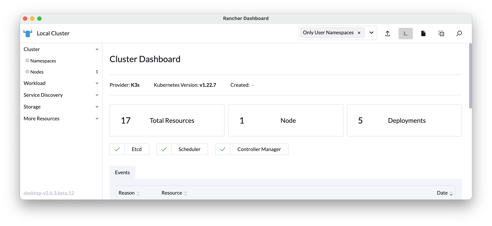
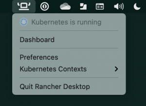

With the [1.2.0 release](https://github.com/rancher-sandbox/rancher-desktop/releases/tag/v1.2.0) of [Rancher Desktop](https://rancherdesktop.io/), there are two new features available as a Feature Preview.

## Rancher Dashboard

[Rancher](https://rancher.com/), the multi-cluster Kubernetes manager, includes a dashboard that enables you to see and interact with resources in a Kubernetes cluster. Rancher Desktop now includes this dashboard. The dashboard will enable you to view and interact with resources in your *local* cluster provided by Rancher Desktop.

The above image shows the home screen for the dashboard. As you navigate it you'll discover the resources in the cluster, be able to see their details, and you can edit their configuration.

Accessing the dashboard is simple. There is a new menu item for it alongside the menu item for preferences. This second image shows where you can access this menu under macOS. It is also available in the menu on Windows and Linux.

## rdctl

There are times when you may want to access Rancher Desktop from the command line. This could be for scripting, troubleshooting, remote management and more. rdctl is a new command line tool, included in Rancher Desktop, that enables command line access. Long-term all functionality available in the UI will be available from the command line. In this feature preview release, the following commands are available:

- `rdctl list-settings`

- `rdctl set --container-runtime dockerd --kubernetes-version 1.21.2`

- `rdctl shutdown`

## Next Steps

There are several next steps you can take:

- Star [Rancher Desktop on GitHub](https://github.com/rancher-sandbox/rancher-desktop) to show that you like it. This lets us know that you want to see development continue.

- [Install the v1.2.0 release](https://rancherdesktop.io).

- Provide feedback in the [issue queue](https://github.com/rancher-sandbox/rancher-desktop/issues).

- Already a Rancher Desktop user? [Take a short survey](https://forms.office.com/r/ySpYbgm4TL).
