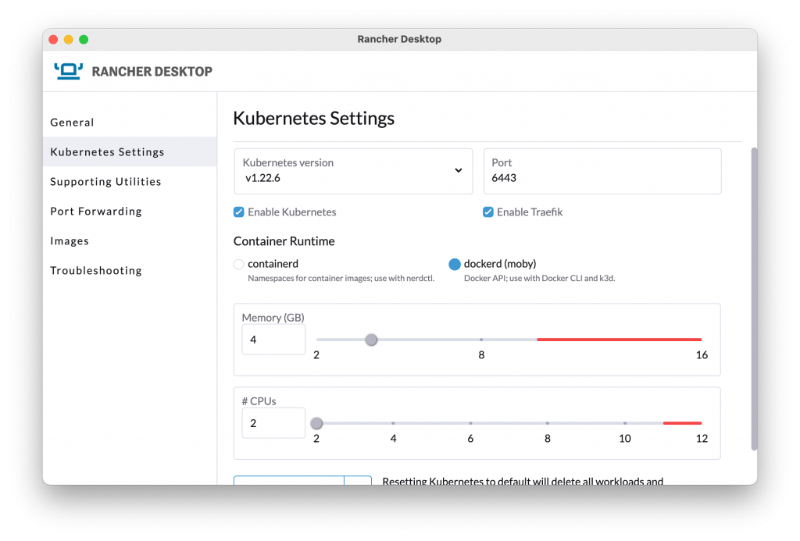

With the 1.1.0 release of Rancher Desktop, there are some changes that give you more control over your environment.

## Disabling Kubernetes

Since Rancher Desktop started providing the ability to use nerdctl or docker to build and run containers, there have been requests to make it possible to disable Kubernetes. Some Rancher Desktop adopters didn’t need Kubernetes, or they wanted to use k3d to run Kubernetes configurations other than those included in Rancher Desktop. With the 1.1.0 release, this is now possible.

In the settings you configure when Rancher Desktop is run the first time and in the Kubernetes Settings you can change at any time, you can disable or enable Kubernetes. Without Kubernetes, the primary features are going to be around the container runtime.

## Disabling Traefik

Another popular request has been to provide the ability to disable Traefik, the cloud native application proxy. By default, K3s - the Kubernetes distribution used by Rancher Desktop – sets up Traefik as an ingress controller using ports 80 and 443. If you want to use those for something else, it’s now possible. You can disable Traefik in the Kubernetes Settings.

## Other Changes

This release contains several other changes including:

- Push button port forwarding is available on Mac and Linux. With this you can easily expose your internal services to work with locally.

- Docker Compose is now included, out of the box.

- Improved development container support with Visual Studio Code.

## Next Steps

There are several next steps:

- Star [Rancher Desktop on GitHub](https://github.com/rancher-sandbox/rancher-desktop) to show that you like it. This lets us know that you want to see development continue.

- [Install the v1.1.0 release](https://rancherdesktop.io).

- Provide feedback in the [issue queue](https://github.com/rancher-sandbox/rancher-desktop/issues).
