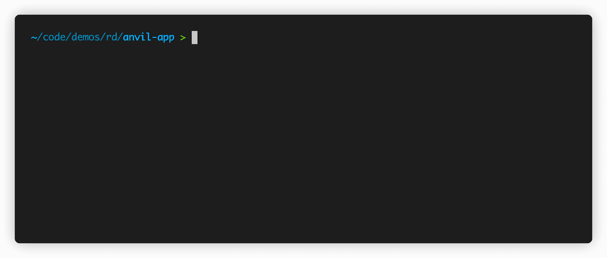
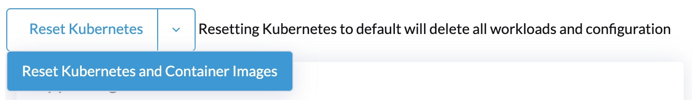

The v0.5 release comes with many new changes. The most prominent of those is the addition of [nerdctl](https://github.com/containerd/nerdctl), a "Docker-compatible CLI". This is the first of our changes to Rancher Desktop to provide more container features.



## **Docker Compatible CLI**

Since the beginning, Rancher Desktop has provided container management features. Before the release of v0.5, those features had been focused on image building, pushing, and pulling. People wanted more, and v0.5 starts to deliver on our plan for more.

Rancher Desktop now provides[nerdctl](https://github.com/containerd/nerdctl), a sub-project of the CNCF containerd project. This CLI provides many of the same features the Docker CLI does with the same command line switches and flags.

***This is only the beginning of Rancher Desktops' expanded container features.***We understand there is a desire to use different container runtimes and CLIs. In future releases, we plan to expand beyond nerdctl and containerd to support other environments, including the *Docker CLI* and *Moby* (the open source engine behind the Docker runtime).

### **Namespaces and nerdctl**

Nerdctl uses namespaces, just like Kubernetes; they are just a separate set of namespaces. If you run nerdctl ps, it will show the containers running in the default namespace. To see what's running in Kubernetes, you need to use the *--namespace* flag and set it to *k8s.io*. Kubernetes namespaces are separate from those used by nerdctl and containerd.

If you want to build a container image and make it available to Kubernetes, you need to set the namespace.

We do not recommend you make changes to Kubernetes containers using nerdctl. If you do and break your environment, you may need to reset Kubernetes.

## **Ports On localhost**

When you run a container, you often want to expose a port. For example, imagine you started a container with the command:

```
nerdctl run -d -p 8000:80 nginx
```

Now you want to access that container in a browser. Well, now you can! If you open a browser up to [http://localhost:8000](http://localhost:8000/) you can access that running container.

*Note, on Mac, the ports are available on 0.0.0.0, which makes them available on all interfaces, including your IP.*

## **Built-In Updates**

When future releases of Rancher Desktop come out, you won't need to go to the Rancher Desktop downloads to get it. The app will now let you know when there's an update and install it for you. If you want to opt out of the updates, there is an option for that.

## **More Reset Options**



Rancher Desktop now allows resetting Kubernetes separately from the container images. This makes it easy to reset Kubernetes to a default environment while keeping any pulled or built container images.

This happens through the use of a drop-down button in the Kubernetes settings.

## **Next Steps**

There are several next steps:

- Star [Rancher Desktop on GitHub](https://github.com/rancher-sandbox/rancher-desktop) to show that you like it. This is how we know you like it and want to see development continue.
- Install the [v0.5.0 release](https://github.com/rancher-sandbox/rancher-desktop/releases/tag/v0.5.0).
- Provide feedback in the [issue queue](https://github.com/rancher-sandbox/rancher-desktop/issues).
