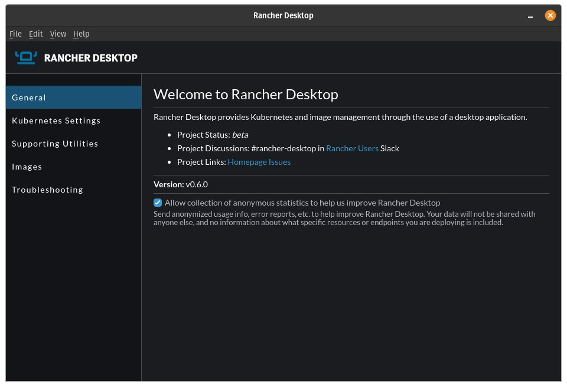

The [v0.6.0 release of Rancher Desktop](https://github.com/rancher-sandbox/rancher-desktop/releases/tag/v0.6.0) brings something completely new. It provides a technical preview of Rancher Desktop on Linux.

Rancher Desktop on Linux runs similarly to Mac. In a virtual machine, containerd and Kubernetes have their own environment. Running in a virtual machine was a design decision we made to separate the container and Kubernetes environment from the rest of the Linux desktop environment. This enables Rancher Desktop users on Linux to control how many system resources to use for containers and makes it easy and safe to reset the environment.

You can [download an rpm, deb, or archive file from the release on GitHub](https://github.com/rancher-sandbox/rancher-desktop/releases/tag/v0.6.0). In future releases, we will have appropriate repositories to connect to and pull updates from.

## Other Updates

Linux isn't the only update in this release. There are some other small but notable changes for everyone. These include:

- The container images listing now shows all the images of the containerd namespaces. Containerd has namespaces in a similar but separate way to Kubernetes.
- On Mac and Linux, the user's home directory is writable, which helps with volumes. Windows was already writable.
- The status messages during startup and shutdown now have more detail. For example, they will tell you when the Kubernetes API is up.

## Next Steps

There are several next steps:

- Star [Rancher Desktop on GitHub](https://github.com/rancher-sandbox/rancher-desktop) to show that you like it. This is how we know you like it and want to see development continue.
- Install the [v0.6.0 release](https://github.com/rancher-sandbox/rancher-desktop/releases/tag/v0.6.0).
- Provide feedback in the [issue queue](https://github.com/rancher-sandbox/rancher-desktop/issues).
