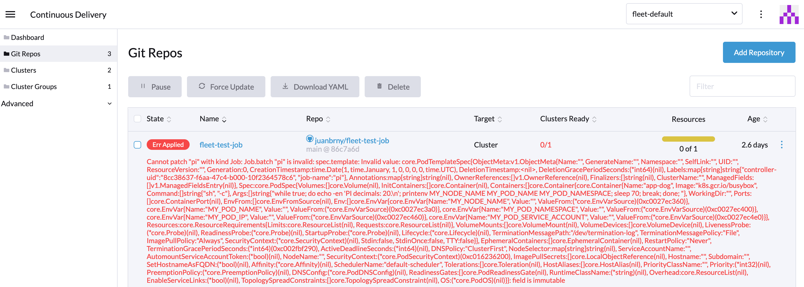
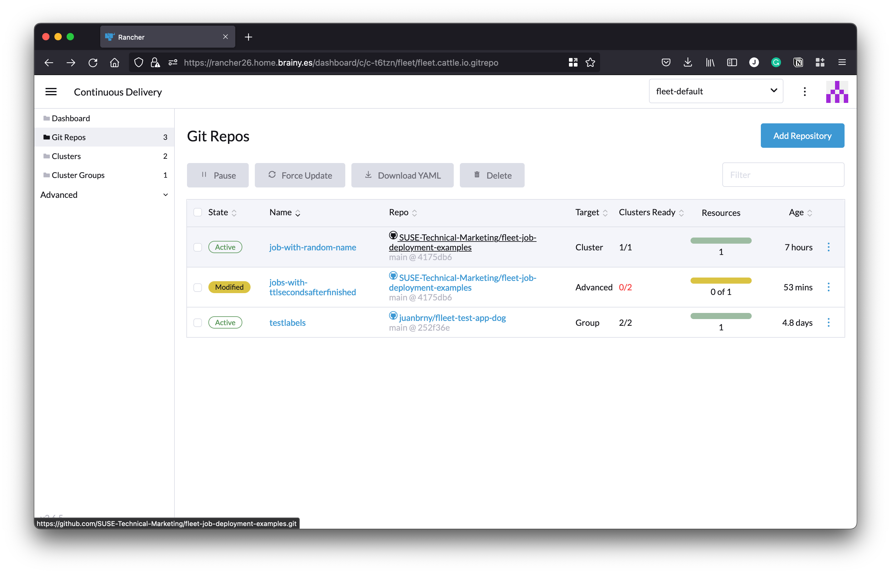
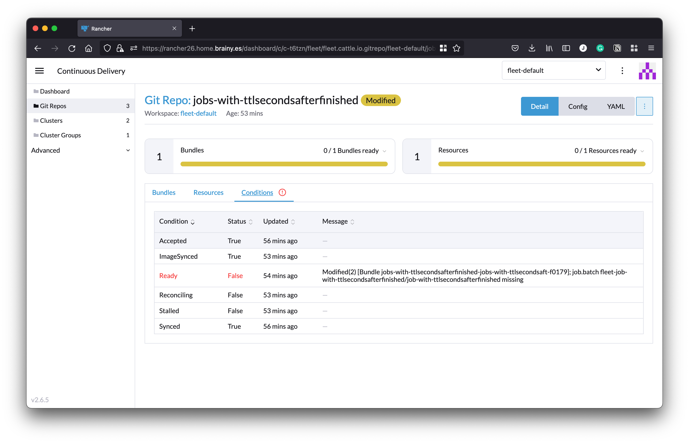

# **Introduction**

Continuous Delivery (CD) frameworks for Kubernetes, like the one created by Rancher with [Fleet](https://fleet.rancher.io/), are quite robust and easy to implement. Still, there are some rough edges you should pay attention to. Jobs deployment is one of those scenarios where things may not be straightforward, so you may need to stop and think about the best way to process them.

We’ll explain here the challenges you may face and will give some tips about how to overcome them.

While this blog is based on Fleet’s CD implementation, most of what’s discussed here also applies to other tools like ArgoCD or Flux.

## **The problem**

Let’s start with a small recap about how Kubernetes objects work.

There are some elements in Kubernetes objects that are immutable. That means that changes to the immutable fields are not allowed once one of those objects is created.

A Kubernetes Job is a good example as the template field, where the actual code of the Job is defined, is immutable. Once created, the code can't be changed. If we make any changes, we’ll get an error during the deployment.

This is how the error looks when we try to update the Job:

```
The Job "update-job" is invalid: spec.template: Invalid value: 
core.PodTemplateSpec{ObjectMeta:v1.ObjectMeta{Name:"", GenerateName:"", Namespace:"", SelfLink:"", 
UID:"", ResourceVersion:"", 
.... 
: field is immutable
```

And this is how the error is shown on Fleet’s UI:



When we do deployments manually and update code within Jobs, we can delete the previous Job manually and relaunch our deployment. However, when using Continuous Delivery (CD), things should work without manual intervention. It’s critical to find a way for the CD process to run without errors and update Jobs in a way that doesn’t need manual intervention.

Thus we have reached the point where we have a new version of a Job code that needs to be deployed, and the old Job should not stop us from doing that in an automated way.

## **Things to consider before configuring your CD process**

Our first recommendation, even if not directly related to the Fleet or Jobs update problem, is always to try using Helm to distribute applications.

Helm installation packages (called Charts) are easy to build. You can quickly build a Chart by putting together all your Kubernetes deployment files in a folder called templates plus some metadata (name, version, etc.) defined in a file called Chart.yaml.

Using Helm to distribute applications with CD tools like Fleet and ArgoCD offers some additional features that can be useful when dealing with Job updates.

Second, In terms of how Jobs are implemented and their internal logic behaves, they must be designed to be [idempotent](https://en.wikipedia.org/wiki/Idempotence). Jobs are meant to be run just once, and if our CD process manages to update and recreate them on each run, we need to be sure that relaunching them doesn’t break anything.

Idempotency is an absolute must while designing Kubernetes [CronJobs](https://kubernetes.io/docs/concepts/workloads/controllers/cron-jobs/), but all those best practices should also be applied here to avoid undesired side effects.

# **Solutions**

## **Solution 1: Let Jobs self-destroy after execution**

The process is well described in Kubernetes documentation:

[“A way to clean up finished Jobs automatically is to use a TTL mechanism provided by a TTL controller for finished resources, by specifying the](https://kubernetes.io/docs/concepts/workloads/controllers/ttlafterfinished/) [spec.ttlSecondsAfterFinished](https://kubernetes.io/docs/concepts/workloads/controllers/ttlafterfinished/) [field of the Job”](https://kubernetes.io/docs/concepts/workloads/controllers/ttlafterfinished/)

Example:

```
apiVersion: batch/v1
kind: TestJob
metadata:
  name: job-with-ttlsecondsafterfinished
spec:
  ttlSecondsAfterFinished: 5
  template:
    spec:
...
```

When we add ttlSecondsAfterFinished to the spec, the TTL controller will delete the Job once it finishes. If the field is not present or the value is empty, the Job won’t be deleted, following the traditional behavior. A value of 0 will fire the deletion just after it finishes its execution. An integer value greater than 0 will define how many seconds will pass after the execution before the Job is deleted. This new feature has been stable since Kubernetes 1.23.

While this seems a pretty elegant way to clean finished jobs (future runs won’t complain about the update of immutable resources), it creates some problems for the CD tools.

The entire CD concepts rely on the fact that our external repos holding our application definition are the source of truth. That means that CD tools are constantly monitoring our deployment and notifying us about changes.

As a result, Fleet detects a change when the Job is deleted, so the deployment is marked as “Modified”:



If we look at the details, we can see how Fleet detected that the Job is missing:



The change can also be seen in the corresponding Fleet Bundle status:

```
...
status:
  conditions:
  - lastUpdateTime: "2022-10-02T19:39:09Z"
    message: Modified(2) [Cluster fleet-default/c-ntztj]; job.batch fleet-job-with-ttlsecondsafterfinished/job-with-ttlsecondsafterfinished
      missing
    status: "False"
    type: Ready
  - lastUpdateTime: "2022-10-02T19:39:10Z"
    status: "True"
    type: Processed
  display:
    readyClusters: 0/2
    state: Modified
  maxNew: 50
  maxUnavailable: 2
  maxUnavailablePartitions: 0
  observedGeneration: 1
...
```

This solution is really easy to implement, with the only drawback of having repositories marked as Modified, which may be confusing over time.

## **Solution 2: Use a different Job name on each deployment**

Here is when Helm comes to our help.

Using Helm’s processing, we can easily generate a random name for the Job each time Fleet performs an update. The old Job will also be removed as it’s no longer in our Git repository.

```
apiVersion: batch/v1
kind: Job
metadata:
  name: job-with-random-name-{{ randAlphaNum 8 | lower }}
  labels:
    realname: job-with-random-name
spec:
  template:
    spec:
      restartPolicy: Never
...
```

# **Summary**

We hope what we have shared here helps to understand better how to manage Jobs in CD scenarios and how to deal with changes on immutable objects.

The code examples used in this blog are available on our GitHub repository: <https://github.com/SUSE-Technical-Marketing/fleet-job-deployment-examples>

If you have other scenarios that you’d want us to cover, we’d love to hear them and discuss ideas that can help improve Fleet in the future.

Please join us at the [Rancher’s community Slack channel for Fleet and Continuous Delivery](https://rancher-users.slack.com/archives/C013SSBKB6U) or at the [CNCF official Slack Channel for Rancher](https://kubernetes.slack.com/archives/CGYSNLUEA).
