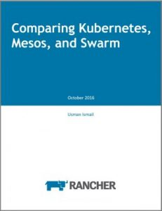

## **2017 Predictions: Rapid Adoption and Innovation to Come**

#### Rapid adoption of container orchestration frameworks

As more companies use containers in production, adoption of
orchestration frameworks like Kubernetes, Mesos, Cattle and Docker Swarm
will increase as well. These projects have evolved quickly in terms of
stability, community and partner ecosystem, and will act as necessary
and enabling technologies for enterprises using containers more widely
in production.

#### Greater innovation in container infrastructure services

Free eBook: Comparing Kubernetes, Mesos, and Docker Swarm
Though there’s a strong set of container storage and networking
solutions on the market today, more products will emerge to support the
growth and scale of production container workloads, particularly as
specifications like Container Network Interface (used by Kubernetes)
continue to mature. Companies like StorageOS, Portworx and Quobyte will
see more adoption.

#### Infrastructure clusters as code emerges

To reinforce the ability to write once and run anywhere, orchestration
clusters will be increasingly templated and instantiated from
blueprints, in the same way containerized apps are deployed as Docker
Compose files. Users will define exactly the Kubernetes, Swarm or Mesos
deployment configuration they need, along with any infrastructure
services, and then deploy it on whatever cloud or virtualization
infrastructure they choose. Users have been asking for this function for
over a year, and [the latest version of
Rancher](https://rancher.com/rancher-1-2-is-ga/) takes steps towards this
vision by enabling users to deliver complete, container-ready
environmets as modular, customizable templates.

#### Docker accelerates ARM server adoption

We are likely still a ways from the real “year of the ARM server,” but
containers will definitely help accelerate adoption of ARM in the
datacenter. Containers run the same on ARM servers as they do on Intel
servers, but with the potential to dramatically reduce costs. Hosting
companies like Packet are now offering ARM servers on demand in hourly
increments; containers and thin Linux distributions like RancherOS make
it possible to take advantage of these hosting solutions, in turn making
ARM servers an interesting option for certain workloads. *Note: This
blog first appeared on
[VMblog](http://vmblog.com/archive/2016/12/13/rancher-labs-2017-predictions-rapid-adoption-and-innovation-to-come.aspx#.WFmP0XeZPR0) on December
13, 2016*
