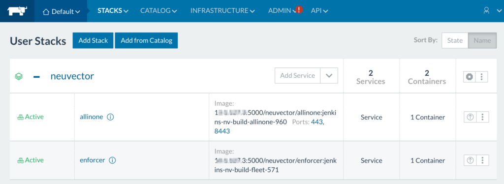

## **DevOps can now efficiently and securely deploy containers for enterprise applications**

As more enterprises move to a container-based application deployment
model, DevOps teams are discovering the need for management and
orchestration tools to automate container deployments. At the same time,
production deployments of containers for business critical applications
require specialized container-intelligent security tools.

To address
this, Rancher Labs and NeuVector [today
announced](http://neuvector.com/blog/rancher-and-neuvector-announce-partnership)
that they have partnered to make container security as easy to deploy as
application containers. You can now [easily
deploy](https://vimeo.com/175905140) the NeuVector container network
security solution with the Rancher container management platform. The
first and only container network security solution in the
Rancher application catalog, the addition
of [NeuVector](http://neuvector.com/) provides simple deployment of the
NeuVector containers into an enterprise container environment. NeuVector
secures containers where they have been most vulnerable: in production
environments where they are constantly being deployed, updated, moved,
and scaled across hosts and data centers. With constant behavioral
learning automatically applied to security policies for containers, the
NeuVector container [network security
solution](http://neuvector.com/products) delivers multi-layered
protection for containers and their hosts. Protection includes violation
and threat detection, vulnerability scanning, and privilege escalation
detection for hosts and containers. With one click in the Rancher
console, users can choose to deploy the NeuVector containers. Sample
configuration files are provided, and minimal setup is required before
deployment. Once the NeuVector containers are deployed, they instantly
discover running containers and automatically build a whitelist based
policy to protect them. Like Rancher, NeuVector supports cross host,
data center, and cloud deployments, relieving DevOps teams of
error-prone manual configurations for mixed environments. 
Deploy the NeuVector security containers with a click of a button. [View
the demo](https://vimeo.com/175905140). In addition to
production use, NeuVector is also valuable for debugging of application
connections during testing, and can be used after violations are
detected for forensic investigation. A convenient network packet capture
tool assists with investigations during test, production, and incident
management. *Henrik Rosendahl is Head of Business Development for
[NeuVector](http://neuvector.com). He is a serial enterprise software
entrepreneur and was the co-founder of CloudVolumes – named one of Five
Strategic Acquisitions That Reshaped VMware by Forbes. He is a frequent
speaker at VMworld, SNW, CloudExpo, and InterOp.*
