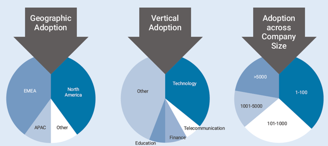

To get an accurate picture of the current state of Kubernetes deployments, Rancher Labs recently conducted an industry survey that included 1,106 respondents from large and small enterprises across a broad range of more than 25 industries, including technology, financial services, telecom, education, government and healthcare. The respondents were almost evenly split among EMEA and North America and included both Rancher and non-Rancher users.

The survey reflects widespread adoption of Kubernetes but also calls out complexity as a primary inhibitor to broader adoption. Whether you are already using containers and Kubernetes in production, or just researching, the key findings of the survey are enlightening and can help you develop your own Kubernetes strategy.

## Key Findings

The results of the survey illustrate broad general adoption of containers and Kubernetes, specifically:

- Container adoption appears consistent across company size, verticals, and geographies, as shown below:

- 85% of respondents are running containers in production demonstrating a high degree of confidence in container technology.
- Kubernetes has emerged as the dominant technology standard for container management with 90% of respondents using it for orchestration, with others following including Rancher Cattle, Docker, Mesosphere, and Hashicorp.
- Architects, developers, and DevOps are the primary drivers of adoption at 69% indicating an application-led proliferation of containers and Kubernetes.
- Containers are used for a variety of use cases, the most common being;
  - Designing microservices (71%)
  - Building customer facing applications (70%)
  - Modernizing legacy applications (53%)
- Multi-cluster environments are becoming an increasingly common deployment scenario with 91% of respondents running multiple clusters, while 45% of those not running multiple clusters, stated they plan to within six months.
- Hybrid cloud deployments also appear to be the norm with respondents showing a healthy mix of on-premises (71%) and cloud (67%) deployments.
- Edge is emerging as an important use-case with 15% of respondents deploying containers for edge workloads.

## Challenges Remain

Despite all of the promise and proliferation, the survey also indicates that challenges to wider spread container and Kubernetes adoption remain, particularly related to complexity. Key findings include:

- 62% of respondents not currently running containers cited complexity as the primary factor slowing adoption.
- Users are still wary of persistent storage due to complexity and perceived risk.
- Windows container adoption is limited, although this is not surprising given Windows container support was only introduced in Kubernetes earlier this year

We hope you find this information useful!

You can also view the key findings as a [complete infographic](https://info.rancher.com/kubernetes-industry-survey-key-findings).

Feel free to share with others you think would find benefit from this information.
