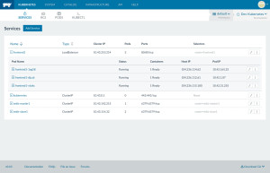

This week we shipped Rancher
v0.63. With this latest release, we are dramatically expanding the
capabilities of Rancher, by including a complete distribution
of [Kubernetes](https://rancher.com/kubernetes/) as a
container orchestration framework, within Rancher. Beginning with this
release, when you create an environment, you’ll be able to
launch a Kubernetes environment with a single click and you within 5-10
minutes have access to fully deployed Kubernetes cluster. The work
we’ve done, however, goes beyond simply launching a Kubernetes cluster
on top of the existing Rancher platform. Instead, we’ve incorporated
Kubernetes as a key element within Rancher, integrating all of our core
Rancher capabilities with Kubernetes. Specifically, Rancher’s support
of Kubernetes includes all of the following features:

1. Rancher will automatically plumb in the network for container
   communication and all hosts that are added using Docker Machine
   drivers will automatically be added to the Kubernetes cluster.
   Kubernetes clusters can even span multiple resource pools and
   clouds.
2. Each user can create multiple Kubernetes clusters; each represented
   using a Rancher environment. Users can manage access rights through
   Rancher environments. A user can decide, for example, to share
   access of a Kubernetes environment with other users.
3. Rancher implements a rich and easy-to-use graphical user interface
   specifically for Kubernetes, which allows CRUD operations on
   Kubernetes Services, Replication Controllers, and Pods.
4. Kubernetes users can leverage Rancher’s existing capabilities to
   manage underlying containers, execute commands, and fetch logs.
5. Rancher provides credential management and easy web-based access to
   the standard kubectl command line interface.
6. Rancher simplifies DNS configuration by leveraging Rancher DNS as a
   drop-in replacement for SkyDNS.
7. Users can leverage Rancher Load Balancer Services to route host
   network traffic to Kubernetes services and pods.
8. Users can publish Kubernetes templates in Rancher catalog and deploy
   complex micro-services applications with one-click of a button.

### Watch a Demo of Rancher’s Kubernetes Environments

### The Need to Support Multiple Container Orchestration Frameworks

Today’s announcement is the first step in expanding Rancher’s
capabilities to support multiple container orchestration frameworks.
Today’s developers have the choice of a variety of container
orchestration and scheduling frameworks as they develop containerized
applications.

1. Many developers love the native Docker experience and they simply
   orchestrate their applications using their own scripts or
   configuration management tools such as Chef, Puppet, and Ansible.
2. Other developers love Docker’s own orchestration tools Swarm and
   Compose. Swarm and Compose are powerful and extremely easy-to-use.
   In the past year, Rancher has developed our own orchestration
   framework called Cattle. Cattle adds a tremendous amount of
   capabilities on top of Docker’s standard Swarm and Compose
   frameworks with features such as integrated Service Discovery,
   upgrade, and scaling. Rancher users will continue to have the option
   of using the Cattle framework going forward.
3. Kubernetes is one of the fastest-growing container orchestration
   frameworks today. It embodies years of experiencing running
   containers in production at Google and has a tremendous amount of
   industry momentum as the first project being contributed to CNCF
   under the Linux Foundation. Rancher will provide first-class
   Kubernetes support going forward.
4. Based on user and community interest, we will continuously
   investigate adding support for other container scheduling and
   orchestration technologies. For example, there is interest in both
   mature frameworks like Mesos/Marathon and newer application
   orchestration frameworks like Aurora.

Large organizations today give developers a lot of freedom in choosing
the best container orchestration framework for their projects. That’s
why we designed Rancher from the ground up to support multiple
frameworks.

### Rancher Catalog, Infrastructure Services, and Application Services

Beyond an easy-to-use and consistent UI, Rancher provides an application
catalog and a rich set of infrastructure and application
services. We’ve added all of these capabilities to our Kubernetes
environemnts. The Rancher Catalog enables users and
application developers to create a repository of Docker Compose and
Kubernetes templates. Rancher users can deploy a complex multi-node
enterprise application with one click of a button. Application upgrades
can be fully automated as new versions of the application templates are
relased. Rancher Infrastructure Services provide consistent storage and
networking implementation across any public cloud, private cloud,
virtualization cluster, or bare-metal servers. By adding this support to
Kubernetes, we’re making it possible to run multi-node, multi-cloud,
clusters, and even deploy stateful applications. We’ve also added
support for Rancher’s Application Services to Kubernetes. These
services provides cloud-independent load balancer, DNS, and meta-data
services. The scope of Rancher Application Services will continue to
grow as the container ecosystem grows.

### Get Started with Rancher and Kubernetes

Like Kubernetes, Rancher is an open source platform, and setting up
a Rancher environment is as easy as launching a Docker container. You
can find more details on how to deploy your own Rancher deployment on
our [Github site](https://github.com/rancher/rancher). If you’d like
to learn more about Rancher, please schedule a
[demo](https://more.suse.com/fy21-global-sales-call-request-schedule-a-rancher-demo), or get started
deploying the software. You can
also register now for our next online meetup, which is happening later
this month, to get a deep dive on our new support for
Kubernetes.
