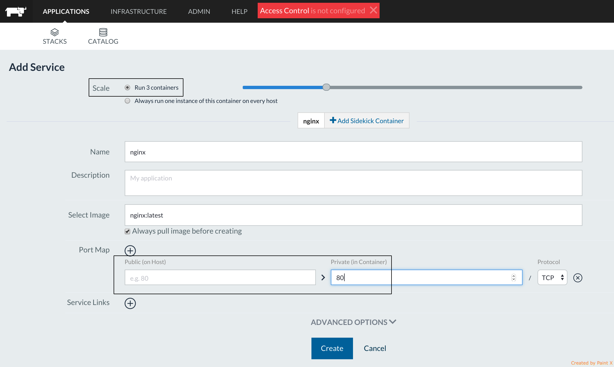
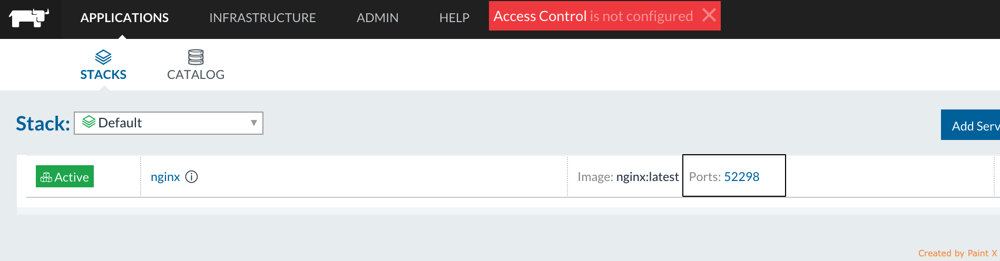
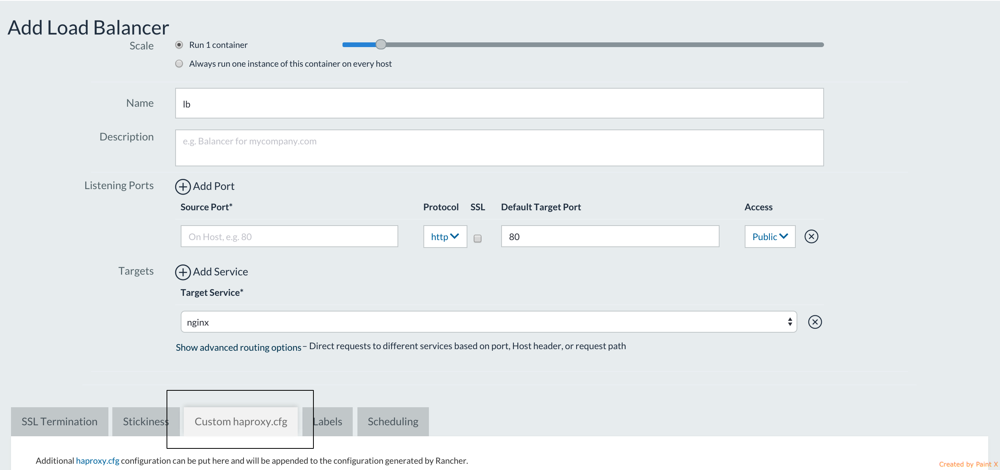
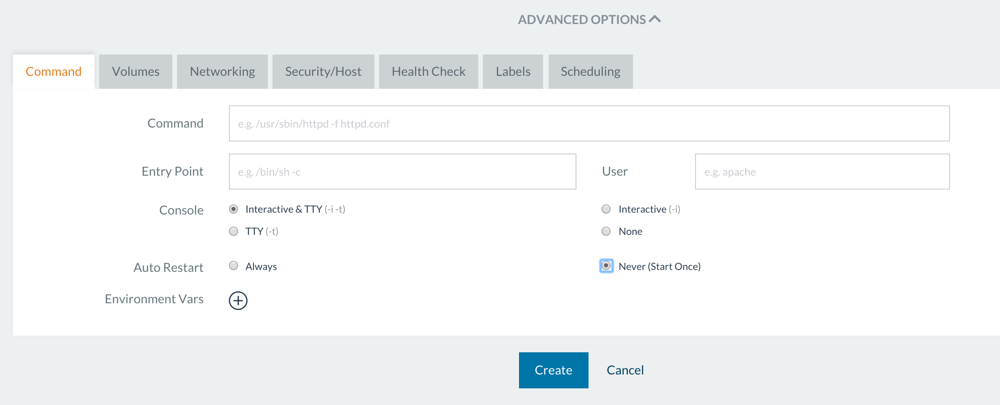

Since the Service Discovery feature was first introduced in May 2015,
Rancher engineering has never stopped adding new functionality and
improvements to it.
Rancher [Beta](https://info.rancher.com/beta)users and
[forums](https://forums.rancher.com/)participants have been
sharing their applications and architecture details to help us shape the
product to cover more use cases. This article reviews some of those very
useful features.

### Rolling Restart

Through the lifecycle of your Service Discovery, there can be a need to
restart it after reapplying certain configuration changes. Usually, the
number one requirement is to have no service outage while the restart is
happening. The rolling restart feature makes this magic happen and is
now available in Rancher Compose (UI support is coming soon). There are
a couple of optional parameters must be set for the restart action to
initiate: 
Once these options are set, the service’s containers with these
settings will be restarted in a batch size of “1” followed by a batch
restart at a “zero ms interval” since the last batch restart
completion.

### Random public port assignment to service

When the service is deployed to a particular port, it’s important that
public ports defined in the service don’t conflict with the ports that
are already in use in this host. Maintaining and tracking this
information can be an unnecessary inconvenience. Random public port
assignment becomes useful in this situation. Let’s say you want to
deploy a nginx service with scale=2 that internally listens to port 80.
You know that you do have at least three hosts in the system, but are
not aware of which ports are already allocated. All you need to do is
offload the public port picking decision to Rancher by omitting to
specify a public port when to adding a service. Rancher will choose the
available public port from 49153-65535 range (configurable) and this
port will be published on all three hosts where the service is deployed.

Rancher choses the available public port from 49153-65535 range
(configurable) and this port will be published on ALL 3 hosts where the
service is deployed:

###

### Load Balancer service custom config

The Rancher Load Balancer service allows redistribution of traffic
between target services. The services can join and leave the load
balancer at any time user demands it. Traffic can then be forwarded to
them based on the user’s defined host name routing rules. However,
we’ve always wanted to give the user even more flexibility in
configuring the Load Balancer, as specific apps might require specific
Load Balancer configuration tweaks. The Load Balancer service custom
configuration feature will enable it. Let’s say we want to:

- Switch LB algorithm from default “Round Robin” to “Least
  connection.” So, the server with the lowest number of connections
  receives the connection
- Set “httpclose” mode so LB works in HTTP tunnel mode and checks to
  see if a “Connection: close” header is already set in each
  direction, and will add one if it is missing
- Tune up the performance by increasing the number of max per-process
  concurrent connections

To do that, on the “Add Load Balancer” dialog, go to the “Custom
haproxy.cfg” tab and set the following three parameters

And set the following 3 parameters: 
Upon Load Balancer service startup, the custom values will be set in
Load Balancer config file. You can find more about what custom
properties can be configured at this url:
<http://cbonte.github.io/haproxy-dconv/configuration-1.5.html>

### “Start once” service option

By default, the service reconcile code requires all service
containers to be in “running” state. If any of the containers dies right
after the start, or some time later, it will be recreated on the spot.
For most applications, that is the default-required behavior for most,
but not all of them. For example, short-lived containers that are meant
to start, finish the task and exit without coming back later.
Alternatively, data containers that just have to be created, but staying
in a running state are not a requirement for them. Rancher enables this
sort of behavior with “Start once” option. To enable it, on the “Add
service” dialog expand “Advanced Options” and on the very first tab
pick “Start once.”

All containers that were created and stopped, will never go to the
running state again unless the user explicitly choses to start them via
Container->Start.

### Health check strategies

No doubt, the health check configuration is defined by application
parameters and requirements (port, health check endpoint, number of
retries till application is considered alive). But what about recovering
from a failed health check? Should it just be as simple as recreating a
failed container? Not necessarily, it also can be driven by your
application needs. Rancher Health Check strategies enable this
functionality. To try this feature, go to Applications view, click on
“Add Service” and expand “Advanced options” on the dialog opened.
Navigate to “Health Check ” tab, and pick either “TCP...” or
“HTTP...” setting. 
The “When unhealthy” status provides you with three choices:

1. Re-create, which is the default option - when a container goes
   unhealthy, it will be re-created by Rancher service reconcile code.
2. Take no action - sometimes you just want the health check to act
   like a monitoring tool by simply displaying a
   “healthy“/“unhealthy” state for a container without taking any
   further action. Perhaps you want to take a look at the failure
   cause, and recover the container manually. Or suppose it’s a
   testing environment. The failed health check is really proof that
   your application reacted correctly to some failure-causing-trigger
   in your application.
3. Re-create only when least (n) container is healthy - this is useful
   for applications like Zookeeper where maintaining a certain quorum
   (replicated group of container) is essential. Dropping a number of
   running containers below quorum can cause application failures. Lets
   say your service has six containers running, with the quorum of
   three. Configuring the health check strategy with “Recreate only
   when at least three containers are healthy” would ensure that
   number of running containers would never drop below this number.

Today, three strategies are enabled, but we are planning to expand in
the future. Please share your opinions on what strategy your application
could use, on Rancher [forums](https://forums.rancher.com/).

### Contact us

If you’re interested in finding out more about Rancher, please download
the software from [github](https://github.com/rancher/rancher), join
the [Beta](https://info.rancher.com/beta)to get additional support, and
visit our [forums](https://forums.rancher.com/) to view topics and
ask questions. To learn more about using Rancher, please join our next
online meetup.

Alena Prokharchyk If you have any questions or feedback, please contact
me on twitter: @lemonjet https://github.com/alena1108
