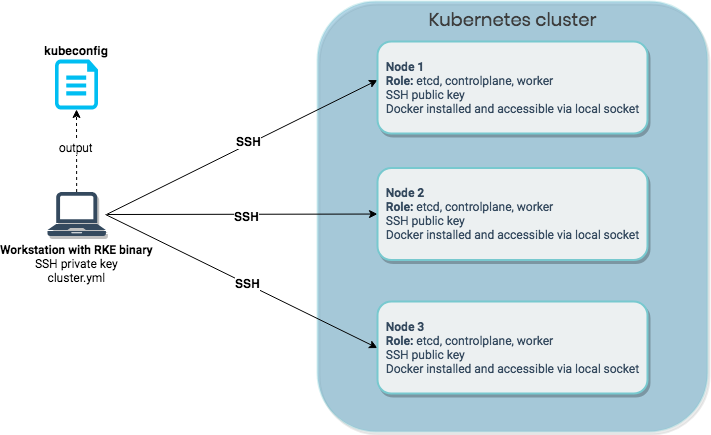

Expert Training in Kubernetes and RancherJoin our free online training sessions to learn more about Kubernetes, containers, and Rancher.[Sign up here](https://rancher.com/training/)

## Introduction

When you are using Rancher to manage your Kubernetes clusters, at some point you will encounter the terms **Rancher**, **RKE**, and **custom cluster**. If you are new to Rancher, it can be difficult to understand the difference between and purpose of each of these concepts. In this post, I will go over what each component is used for and how they are used together in parts of the system.

## Rancher

**Rancher** is a piece of software that can be used to create your own Kubernetes-as-a-Service. It will let you do everything needed to manage your Kubernetes clusters. Because this post is focused on Rancher vs. RKE, I won’t explain each function in-depth, but here is a summary of the primary features:

- Create, upgrade, and manage Kubernetes clusters. Rancher can create clusters by itself or work with a hosted Kubernetes provider.
  - Rancher Launched Kubernetes: clusters created and managed by Rancher itself by either:
    - Using nodes from an infrastructure provider
    - Bringing your own nodes with Docker installed (custom nodes)
  - Hosted Kubernetes Providers: Using a hosted Kubernetes service like GKE, AKS, or EKS
- Import any existing Kubernetes clusters
- Use an authentication provider configured in Rancher to set up access to any Kubernetes cluster
- User Interface to your Kubernetes clusters for easy management and adoption
- API to automate any steps you want to perform
- Integrated alerting and logging that can be deployed in any cluster
- Integrated pipelines to easily deploy from code repository to cluster

Rancher is written in Golang and its binary is packaged and distributed as a Docker container. This means that you can pull down the image and run Rancher by executing:

```
docker run -d -p 80:80 -p 443:443 rancher/rancher
```

This method, referred to as a “single node install” in the [Rancher documentation](https://rancher.com/docs/rancher/v2.x/en/installation/single-node/), is an easy way to get started, but is not suitable for production environments. For instance, one thing to take into consideration is the accessibility of your Kubernetes clusters.

When you create or import clusters in Rancher, a `kubeconfig` file can be created to access your clusters. However, these files will not work if the Rancher server itself is inaccessible since the connections are configured to proxy through Rancher. In the [Rancher HA](#rancher-ha) section below, we will discuss how you can use high availability installations of Rancher work around these issues.

To find out more, check out the [Rancher overview page](https://rancher.com/what-is-rancher/overview/), look through the [documentation](https://docs.rancher.com), or check out the [source code on GitHub](https://github.com/rancher/rancher).

## RKE

**RKE** stands for **Rancher Kubernetes Engine** and is Rancher’s command-line utility for creating, managing, and upgrading Kubernetes clusters. By creating a simple YAML cluster configuration file (called `cluster.yml` by default), you can run `rke up` and RKE will create a Kubernetes cluster according to the details you specified in your configuration.

One common misconception among new users is that RKE will install Rancher for you. While Rancher uses RKE under the hood, RKE can also be used to create Kubernetes clusters as a standalone piece of software.

In order for RKE to provision Kubernetes, each host must have the following:

- An accessible SSH port
- An SSH key pair
- Docker installed and accessible to the SSH user on a local socket (`/var/run/docker.sock` by default)

To run the RKE utility itself, you must be on a supported operating system (currently Linux, MacOS, or Windows) and have network access to each of the hosts you want to provision for your cluster.

Like Rancher, RKE is written in Golang and will use the default libraries to communicate with the nodes. That means that the RKE binary is the only thing you need to install locally to create your cluster. RKE will connect to the cluster hosts using a local SSH library, authenticate with the configured user and SSH private key, and connect to the host’s Docker instance through the socket file (made accessible through SSH with socket forwarding). It will then use the Docker socket to launch the containers required to set up the cluster.



Fig. 1: Provisioning a Kubernetes cluster using RKE

Each Kubernetes component will run in a Docker container. The specific components required will depend on the node’s role within the cluster: as a member of `etcd`, a member of the `controlplane`, a `worker`, or a combination of these. RKE will also deploy the specified network add-on (Canal, Flannel, and Calico are all currently supported, with Weave support coming soon), the metrics server, and the Nginx ingress controller as a `Daemonset` on each node.

After creating the cluster, RKE generates a cluster credential file (`kubeconfig`) which can be used with `kubectl` to interact with your cluster. If you want to add or remove nodes, upgrade Kubernetes version, or change Kubernetes cluster configuration, you can use the RKE command again. Just modify the RKE cluster configuration file (`cluster.yml` by default) and run the `rke up` command once more.

To read more about how to configure RKE, take a look at the [RKE documentation](https://rancher.com/docs/rke/v0.1.x/en/). Visit our page on [production ready clusters](https://rancher.com/docs/rancher/v2.x/en/cluster-provisioning/production/) to find out more about how to provision fault tolerant, scalable clusters.

## Rancher HA

While running Rancher with `docker run` is easy, a different approach is necessary for production environments. The single node install method leaves you a with a single host, responsible for both running Rancher and storing persistent data, representing a single point of failure. This is not a setup you want to use for production.

To run Rancher in high availability mode, create a dedicated Kubernetes cluster with RKE for running Rancher. We recommend a three node cluster, with each node running the components for all roles: `etcd`,`controlplane`, and `worker`. All three nodes can provide access to Rancher, but to make the interface highly available, you should configure an external load balancer in front of your nodes to avoid downtime if there is an issue.

After Rancher is set up (see the [high availability instructions](https://rancher.com/docs/rancher/v2.x/en/installation/ha/) for more detail), you can access the web UI or API to create the clusters you need to run your workloads. We do not recommend running any workloads on the Rancher cluster you created with RKE. Keep in mind that each cluster has its own requirements for production readiness (refer back to the [production ready cluster guidelines](https://rancher.com/docs/rancher/v2.x/en/cluster-provisioning/production)), meaning that each cluster will need its own nodes providing `etcd`,`controlplane`, and `worker` functionality. These components are not shared between clusters.

I mentioned earlier that running the single node install leaves you with only one host to run containers and store persistent data. By deploying Rancher on a Kubernetes cluster created by RKE, we are able to scale our Rancher installation to three instances and, because of the default anti-affinity rules, each of these will be deployed to separate hosts.

However, this configuration doesn’t solve our problem with persistent data. Rancher addresses this by behaving differently depending on whether it is run as a single Docker container (`docker run`) or in a Kubernetes cluster. When Kubernetes initializes containers as part of a pod, it passes in a few environment variables (like `KUBERNETES_SERVICE_HOST` and `KUBERNETES_SERVICE_PORT`) to provide context about the cluster environment. When RKE configures a Kubernetes cluster to run Rancher, it sets up a `ServiceAccount` and injects the credentials into the Rancher containers using these environment variables. When the Rancher container starts, if it finds the `ServiceAccount` credentials in its environment, it will use those to try to connect to the Kubernetes cluster it is running on.

By default, Rancher automatically checks the environment and tries to determine the correct course of action, but you can set the behavior explicitly with the `--k8s-mode` parameter:

```
--k8s-mode auto      # The default: try to determine the correct course based on runtime context
--k8s-mode embedded  # Run a Kubernetes API server instance within Rancher
--k8s-mode external  # Connect to and use the API server from an existing Kubernetes cluster
```

What this means is that when Rancher is part of a pod in a Kubernetes cluster and run with the `ServiceAccount`, it will inherit this cluster and use it to run Rancher itself. It will show up as imported cluster called `local` in the Rancher UI. Rancher will talk to the Kubernetes cluster’s API server and use the existing etcd cluster to store persistent data. Because all data is replicated between etcd nodes, your data will be replicated and highly available. Keep in mind that a three node etcd cluster can survive loss of one node. Take a look at the [production cluster provisioning guide](https://rancher.com/docs/rancher/v2.x/en/cluster-provisioning/production/) for more information on this.

Because the Rancher cluster is built using RKE, you must manage it using the RKE command line utility. This applies to all configuration done using RKE like upgrading the Kubernetes version, adding and removing nodes, and changing any cluster configuration.

## Rancher Launched Kubernetes and Custom Clusters

The last part of the puzzle is how RKE is used within Rancher itself. Rancher makes it possible to create, manage, and upgrade Kubernetes clusters in a few different ways. Let’s clarify what is possible and how it works.

### Rancher Launched Kubernetes: Using Nodes from an Infrastructure Provider

Using this option, you can create a Kubernetes cluster using nodes supplied by an infrastructure provider. Docker Machine drivers are used to request the required nodes from the provider. Many drivers are available by default, and you can enable or add any additional drivers that you would like. This choice also give you the option to create **node pools**, a way to configure which Kubernetes roles should be assigned to each node and what node templates should be used to provision them. A node template defines a machine’s configuration, such as the amount of CPU, memory, disk, and other configurable options.

After the machines have been created using the Docker Machine driver, Rancher accesses the machines using the generated SSH keys. As described earlier, RKE can use SSH keys to provision machines. When the machines are created, Rancher instructs RKE to provision the cluster according to the configuration given in web UI or API. It will retrieve the SSH keys and create the cluster configuration required by RKE. Since RKE is also written in Golang, Rancher can use RKE as a library instead of literally running `rke up` from the command line.

If you scale an existing node pool or create a new one, Rancher uses Docker Machine to create the machine, retrieve the SSH key, update the cluster configuration, and run RKE to update the cluster to the desired state.

### Rancher Launched Kubernetes: Bring Your Own Nodes with Docker Installed (Custom)

The second option for Rancher Launched Kubernetes is the **custom cluster** option. This option lets you use your own nodes with Docker installed to create a Kubernetes cluster. The benefit of this option is that you can use your existing provisioning system to set up your hosts: you just need to include an additional command at the end to add the node to a cluster. After creating the cluster in the web UI or API, you are given a `docker run` command to run on the node you want to add to the cluster. The most important parameters are the ones that define the role for the node, since those will ensure that the correct components are provisioned. Let’s break down how this happens.

The generated `docker run` command is used to run the Rancher agent component (the `rancher/rancher-agent` Docker image), which will register itself to the correct cluster (based on the cluster token) with the correct role(s) (based on the role parameters). However, when using this method, Rancher does not have access to an SSH key since it is not directly involved in provisioning the node.

To work around this, the Rancher agent is configured to make a connection back to Rancher, which the Rancher server then leverages to access the node’s Docker socket. After the connection has been validated, the node is provisioned according to the configured role(s). A beneficial side effect of this approach is that only one-way traffic (from the node running the Rancher agent to the Rancher server) is required. Another possible benefit is that you can use your existing scaling mechanisms to scale your Kubernetes clusters.

## Closing Thoughts

I hope this post helps to clarify some of the different options and technologies related to Rancher. To stay focused on the differences between the components, we didn’t attempt to cover every technical detail or describe every possible option. We will be posting additional in-depth technical blog posts focused on individual components in the future. Please check out the following links for more information on Rancher and RKE:

- [Rancher repository](https://github.com/rancher/rancher/)
- [RKE repository](https://github.com/rancher/rke/)
- [Rancher HA installation](https://rancher.com/docs/rancher/v2.x/en/installation/ha/)
- [Rancher Launched Kubernetes documentation](https://rancher.com/docs/rancher/v2.x/en/cluster-provisioning/rke-clusters/)
- [Production Ready Cluster](https://rancher.com/docs/rancher/v2.x/en/cluster-provisioning/production/)
- [Rancher 2 components](https://rancher.com/docs/rancher/v2.x/en/contributing/)
Expert Training in Kubernetes and RancherJoin our free online training sessions to learn more about Kubernetes, containers, and Rancher.[Sign up here](https://rancher.com/training/)
