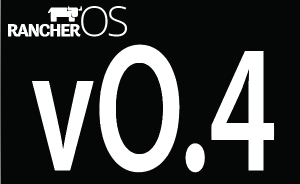
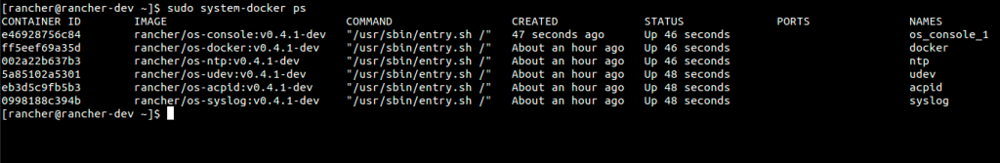

Today
we are excited to announce a major release of RancherOS. The first
release of RancherOS was announced just six months ago. At that time,
powering an entire operating system with Docker was a really
experimental concept. We had good reason to believe it was a good idea,
but honestly we didn’t know how well it would play out and what issues
we might encounter. I’m excited to say that it’s worked out great.
Having said that, we felt that sometimes RancherOS could be a little
difficult to grasp for new users. With RancherOS v0.4 we made a number
of major enhancements to improve usability and customization. To do
this we made improved support for various storage systems, made it
easier to run go binaries, simplified configuration, improved
the console experience, introduced a better build system, and reduced
the size of the runtime footprint.

## Size

RancherOS v0.4 is our biggest release yet, quite literally. It clocks
in at 27MB. We realize that would take almost 19 floppy disks and would
barely fit on your Intel 286 at home, but we just had to increase the
size. The release grew for a couple of key reasons. First, we decided
to switch to glibc. More on that topic later. Second, we included a
lot more kernel modules and firmware. More and more users are running
RancherOS on bare metal and we’ve gotten many requests to support a
wider variety of hardware. Despite increasing the overall size,
RancherOS now consumes less memory. Before RancherOS would always run
completely from memory (initrd) and thus the system images would consume
memory. Now RancherOS will transfer all contents to disk to free up the
memory. At runtime RancherOS only consumes about 80mb of RAM so it will
now comfortably run on a 512mb server. (Note: The `rancheros-install`
command still requires 1 GB, but we will be looking to address that in
the next release.)

## Better Storage

One of the biggest asks for RancherOS was to support more storage
options such asNFS, LVM, ZFS, Gluster,
etc. In the previous release of RancherOS, this was quite difficult to
do, because these different storage solution all need different user
space components. We didn’t have a way for users to run the user space
component from a container while still making that container also
available to Docker. In v0.4, we have solved this by introducing a
concept called the “storage context” of user Docker. With this release
bby default, user Docker will use the storage from the console
container. This means you can easily switch to the Ubuntu console and
then install whatever user space components you want in the console.
Additionally, if you want to keep a more tidy system, you can install
the user space components in your own dedicated storage container, and
then configure user Docker to use that container as your storage
context.

## Simplified Configuration

RancherOS used to have two ways of configuring the system. One way was
rancher.yml and the other was cloud-config. We have eliminated any need
for rancher.yml and moved everything to cloud-config. This means there
is now just a single way to configure RancherOS.

## Switch to glibc

A large part of our increase in size is due to the fact that we have
switched to glibc. In the previous release, we were using uclibc which
is a very small C library, that is designed for embedded systems. The
biggest problem with this is that go binaries mostly assume glibc is
available. This means that tools like docker-machine and
rancher-compose would not run on the default console. By switching to
glibc, this allows users to easily run go binaries (which are very
common in the Docker ecosystem).

## Customizable User Docker

In RancherOS v0.4 we made it very easy to customize the version of
Docker used.
The most common use case is that users would want to replace the user
docker. All that is require is to just place a custom Docker binary in
/usr/local/bin. For a custom system Docker, one needs to build a new ISO
using our new build system.

## Console

Because everything is a container in RancherOS, User Docker would run in
a container and the console would also run in a container. This was
sometimes confusing to users. The main confusion came from the
fact that since User Docker was in it’s own container, it would see a
different host filesystem than the console. A command like “docker run
-v /foo:/foo ...” would not work as expected because /foo on the
console is different from /foo in the Docker container. We decided to
address this by collapsing the Docker and console container into what
looks like one context to the user. This was done through our “storage
context” concept, but the end result is that Docker behaves a lot more
like it would on a traditional Linux distribution. Additionally, the
console in RancherOS is ephemeral. This means on reboot a new console
container would be created every time. This would often confuse users
when they would switch to the Ubuntu or Debian consoles. Doing an
“apt-get install” would install any package they wanted but then after
reboot those packages would be gone. For this reason we have made the
[Ubuntu and Debian console
persistent](https://docs.rancher.com/os/configuration/custom-console/#console-persistence)
by default. For those wishing to keep an ephemeral console should stay
with the default busybox console.

## Build System

We completely revamped the build system and have made it a lot more
modular. This will pave the way for our upcoming ports to ARM and i386.
Right now, the biggest benefit is that it is now very easy to build
RancherOS 0.4 with a custom kernel of
your choice.

## libcompose

A couple months back we [started the Docker libcompose
project](https://rancher.com/our-journey-with-docker-compose-and-the-introduction-of-libcompose/).
The initial code for libcompose was actually a pull from RancherOS.
Over half the code we wrote for RancherOS was for Docker Compose
support in Go. All of that code has now moved to the libcompose
project, and with v0.4, RancherOS is now based on libcompose.

## Support for RancherOS on Amazon ECS

With Rancher 0.4 we also worked closely with Amazon to ensure RancherOS
runs well onAmazon Web Services’ Elastic Container Service (ECS). With
this work, we’ve tested and verified that RancherOS runs well with ECS
and is available to download with the ECS container agent pre-built in
an AMI and cloud formation template. You can learn more from
an[excellent blog
post](https://aws.amazon.com/blogs/apn/rancher-labs-amazon-ecs/) by the
team at Amazon.

## Easier Docker Machine integration

Previously we built an ISO specifically for Docker Machine. We have now
removed the need for that ISO and now there is only one rancheros.iso
that is needed for either Docker Machine or a regular RancherOS install.

## Kernel Headers and DKMS

We now make the kernel headers
easily available such that people can compile there own custom module.
This includes support for DKMS.

## Conclusion

We’re very excited about this new release and are excited to see even
more people start using RancherOS to run their containers with the
absolute minimum OS. You can find instructions on how to download
RancherOS 0.4 on our [GitHub](http://github.com/rancher/os)page, or join
us for our next online meetup in November, during which we’ll be
covering this new release as part of the agenda. You can register for
the meetup by following the link below.
