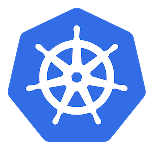

Update: The topic of Role-Based Access Control (RBAC) was addressed again and updated by Craig Jellick [here](https://rancher.com/blog/2018/2018-05-04-authentication-authorization-rancher2/).

With Kubernetes 1.6 came [the
beta release of the role-based access control (RBAC)
feature](https://kubernetes.io/docs/admin/authorization/rbac/). This
feature allows admins to create policies defining which users can access
which resources within a Kubernetes cluster or namespace. Kubernetes
itself does not have a native concept of users and instead delegates to
an external authentication system. As of version 1.6.3, Rancher
integrates with this process to allow any authentication system
supported by Rancher, such as Github, LDAP, or Azure AD, to be used for
Kubernetes RBAC policies. In short, Rancher v1.6.3 picks up where
Kubernetes RBAC leaves off, giving teams a dead-easy mechanism for
authenticating users across their Kubernetes clusters. To see how one
might use this feature, let’s consider a company that has a development
team and a QA team. Let’s also suppose they’re using GitHub as the
authentication method for their Rancher setup. In their Kubernetes
environment they’ve created two
[namespaces](https://kubernetes.io/docs/concepts/overview/working-with-objects/namespaces/),
one for developers and one for QA. It’s now possible for admins to
define rules such as the following:

- Only members of the “developers” Github team should have read and
  write access to the “dev” namespace
- Likewise, only members of the “QA” Github team should have read
  and write access to the “QA” namespace
- Developers should also be able to view, but not edit, resources in
  the “QA” namespace
- Users “user1” and “user2” should be able to read and write to
  both the “dev” and “QA” namespaces

Other Kubernetes features can be leveraged to more richly define
multitenancy within a Rancher Kubernetes environment. With [resource
quotas](https://kubernetes.io/docs/concepts/policy/resource-quotas/), an
admin can define limits on resources such as CPU and memory usage for a
namespace. This is particularly important since namespaces within an
environment run on the same set of hosts. Role bindings follow the
pattern of tying a particular role to one or more users or one or more
groups. The preceding example made use of three built-in roles defined
by Kubernetes:

- **view**: Read-only access to most objects in a namespace
- **edit** - Read and write access to most objects in a namespace
- **admin** - Includes all permissions from the edit role and allows
  the creation of new roles and role bindings

These predefined roles enhance the usability of RBAC by allowing most
users to reuse these roles in place of defining their own. We recommend
using these RBAC roles for those who are less familiar with individual
Kubernetes resources or for those who don’t have a need to define their
own custom roles. From our work with teams running Kubernetes in
production, particularly those offering CaaS solutions across their
organizations, we understand the need for straightforward RBAC,
authentication, and authorization. More detailed information on this
feature can be found[in our
docs](https://rancher.com/docs/rancher/v1.6/en/kubernetes/rbac/). We
always want feedback on what we’re building for Rancher and Kubernetes
- for any questions, you can find me on [Rancher Users
Slack](https://rancher-users.slack.com)
([@josh](https://rancher-users.slack.com/team/josh)) or on Twitter
([@joshwget](https://twitter.com/joshwget)). \*Josh Curl is a software
engineer at Rancher Labs. \*
